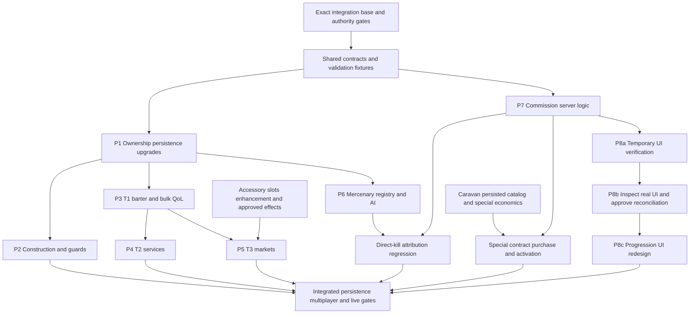

# Implementation phase plan — Stage D1

2026-10-19. **PROPOSED implementation sequencing, not permission to implement.** Target Draft PR #131 on `design/territory-economy-bounty-approved-20261019`, initial HEAD `01a1a9b9514c036b9f6ccdf7722eb57d55f6d5f3`. Source-backed requirements: [matrix](DESIGN_AUTHORITY_MATRIX.md). Decisions and technical gaps: [conflicts](DESIGN_CONFLICT_REGISTER.md). Source heads and omitted artifacts: [coverage](DESIGN_BRANCH_COVERAGE.md).

## Entry gate and dependency graph

Do not start features on this documentation branch or assume its old main base contains the later XP/research fixes. A separate authorized integration task must choose an exact tested implementation base, map ancestors and unique changes, and reconcile #112–#130 without merging/rewriting any active branch implicitly. #130 records a reproducible P1 skull forced-halt failure; normal green CI does not resolve it. No Q1-D readiness is asserted here. Existing source test claims are evidence to inspect, not D1 reruns.

Before production implementation, record owner decisions for each affected Fxx gate, inspect actual Minecraft 26.3 Fabric mappings and source/resource architecture, and agree shared contracts below. Design-approved directions with unspecified recipes/prices must not ship guessed content. Technical prototypes and test fixtures must stay isolated from survival registration.

Arrows are technical dependencies, not added player prerequisites. P3–P6 activation uses territory tier entitlement but does not require that every earlier content PR be shipped if its shared interface is already validated. P7 normal commissions have no approved territory ownership requirement; do not invent one. Special contracts alone depend on the caravan. All proposed PR names below are future boundaries, not new branches created by D1.

## Shared contracts to settle first

| Surface | Proposed ownership / boundary | Required agreement and validation |
|---|---|---|
| Territory ID / owner / tier | P1 owns versioned world state and read-only entitlement API | Stable village/territory identity incl. dimension, ownership policy, origin-size snapshot, upgrade transaction, migration and idempotent loading. No forced global per-tick village scans. |
| Managed footprint / placement | P2 owns block provenance and construction plans; P1 owns tier commit | Reserve area, validate all edits before committing; preserve player blocks/roads/beds/workstations. Define owner edits and other mutation sources before enforcing. No generic world protection affecting vanilla villages. |
| Clock service | One integration owner, consumers P2/P3/P6/P7 | Different schedules: guard morning once/day, barter daily, commission every3days, mercenary5day term. Owner decides sleep/time-command/offline behavior and backward jumps for each; do not infer one shared clock policy. Persist last applied epoch, test no repeat grants. |
| Price/payment transaction | P3 integration owner; P4/P5/P6 and contract sale use reviewed primitive | Exact emerald/block units and material inputs, actual output capacity, no partial charge. Preserve vanilla research discount policy; new eligibility/stacking requires approval. No new currency. |
| NPC roles / allies | P2/P6 agree roles; entity lifecycle owned separately | Territory guard, caravan escort and hire are distinct IDs/lifecycle. Share only target-filter predicates where semantics match; owner/allied entities never attack each other. |
| Server event envelope | P7 owns acceptance-window consumer; coordinate with current XP event owner | Include actor, cause/attribution, world/dimension and event identity. XP lifetime/retroactive completion and commission post-accept progress remain separate. No existing `quest.*` namespace or counters repurposed for commissions. |
| Structure identity / map registry | P4/P7 agree stable dimension+structure instance representation | Same instance dedup across restarts and dimensions; valid generated target before map payment. XP piece-entry semantics require separate review; never equate locating/map purchase with visiting. |
| Durable rewards / receipts | P7 and integration owner | Player inventory, world offer/contract state and reward receipt may save separately. Define supported crash/recovery guarantee and tests before claiming exactly-once. A shared API signature or single-thread execution alone is insufficient. |
| Accessory schema / UI adapter | Independent accessory workstream plus P5/P8 | Five category slots, +10, raw XP/stone/catalyst transaction; no new artifact subsystem. Slots/effects/catalyst acquisition gates remain separate from market catalog. |
| UI read models / action API | P7 backend, P8 client | Versioned offers/progress/results; server recomputes entitlement/price; temporary controls do not lock final navigation/art. Retain XP/Research/Knowledge/Advancement meanings. |

## Eight phases and suggested PR boundaries

### P1 — Territory ownership, persistence and upgrade foundation

Sources T §§1,2,5; matrix A01/A03–A05; conflicts F02–F04. **Production blocked by ownership policy and exact upgrade contract.**

Propose two PRs: `territory-state` for identity, owner/tier storage, entitlement reads, migration and diagnostics; `territory-upgrade-transactions` for costs/validation/one global tier commit after approved prerequisites. Freeze claim/loss/limits, overlap and multiplayer permissions, origin-size classification, costs, tier conditions and offline owner behavior first. Do not implement assumed liberation or per-facility upgrades.

Gates: owner vs non-owner requests, replayed/invalid upgrade, insufficient resources, concurrent actions, save/restart/migration, failure after each mutation, no tier/resources divergence. Explicit old-world village identity tests. No gameplay activation until required policies are written. P2 placements and P3 entitlement reads consume this API; P7 can proceed independently.

### P2 — Territory construction and guard behavior

Sources T §§1–2, matrix A04–A06/A12; F03–F05. Depends on P1 and approved per-tier placement/staffing/protection rules.

Propose `territory-placement` and `territory-guards` separately. Placement plans upgrade existing buildings and add housing/commercial sites only after terrain/road/collision/player-build checks. Settle protected footprint and authorized edit policy; never overwrite player changes or blanket-protect player blocks. Beds/workstations precede new population. T3 cumulative targets remain +7/+8/+10 settlers,4/6/8 guard total,~5/~6/~7 buildings, conditional on valid space. Tier distribution and base guard stats remain unresolved, not implementation defaults.

Guard logic: home territory defense, no adventure following or retaliation against owner for accidental hits; morning35/50/70% maximum-HP recovery; missing guards replenish starting next morning, at most2/day and free. No mid-combat instant replacement or failed-raid regression. Keep caravan escort out of this registry.

Gates: slopes/water/roads/occupied/player-edited sites; interrupted placement, unloaded chunks, restart without partial construction/duplicate villagers; beds/jobs capacity; exact morning healing count; multiple missing guards/cap, daylight jumps and unload/reload; hostile vs allied targeting and real raid/combat client checks. Placement algorithm feasibility is not previously validated. Structure-generator collaboration is a possible separately scoped future task, not a dependency assumed delivered here.

### P3 — T1 villager barter and bulk-trade QoL

Sources T §3, R/V; A07/A08/A35; F06/F11. Depends on P1 entitlement and settled payment/clock interfaces. Can run alongside P2 after interface freeze.

Propose `trade-batch-transactions` first, then `t1-barter-catalog`. Preserve ordinary profession trades and their stock/restock/reputation. Bulk is transaction convenience, not procurement. New barter has no emerald payment and about4–12 uses/offer/daily refresh; exact profession recipes, output counts, stock and eligibility must be approved before catalog activation. Control labels1/8/max are suggestions.

Keep research discount5/10/15%, ceil-discount amount, floor1, capped-demand correction and fixed-price book exemption on their established path. T1 material-leg reductions and new service discount applicability are open decisions.

Gates: enumerate conversion graph including vanilla buy/sell and P4 dismantle/P5 exchanges; reject profitable self-repurchase cycles under all allowed modifiers. Server tests for N trades vs stock/space/payment, partial inventory, repeated clicks, two players with different research, daily reload and restart, no global vanilla refill change. Price10→9/9/8,1→1 and book exemption regressions; real villager UI batching/stock visibility live pending.

### P4 — T2 professional services

Sources T §3 T2; A09/A10; F07/F08. Depends on P3 transaction core/P1 tier checks, independently approved service content and actual destination registry.

Propose three PRs: `t2-dismantling`, `t2-food-orders`, `t2-ordinary-structure-maps`. Dismantling needs exact recovery/fee/rounding, durability/enchantment/component treatment and excluded tiers before shipping. Food needs distinct effects/recipes and permanent-food overlap review. Map service locates a valid ordinary MM destination before charging; rare dungeon maps stay caravan. All instant player purchases, no queues/missions. No fishing, brewing, cosmetic or block-manufacture service additions.

Gates: recoverable-material calculation and repair/smithing/recycling cycle audit, failed result capacity/no loss, modifier interactions, bad map target/payment rollback and cross-dimension identity; verify each approved food effect does not recursively extend or duplicate existing research. Live villager service interaction required. Service catalogs can be reviewed in parallel; shared merchant/menu edits need one integration owner.

### P5 — T3 biome premium markets and artifacts

Sources T §3 T3, M artifact section, A/E and C/D; A11/A16–A21/A30–A33; F08–F11/F21/F25. Depends on P3 core, P1 entitlement, approved premium catalog and accessory foundation for wearable delivery.

Propose `t3-shared-biome-market` for compact common set plus input-themed specializations, then separate `desert-artifact-catalog` only when per-item contracts are approved. Plains lunchbox effect is open. Savanna=exploration, taiga=raid; snowy direction does not specify recipes. Market quantities/prices/refill/discounts remain open.

Artifact work must reuse category slots/+10/anvil transaction. Seven new effects/categories require overlap review and approval; Sands of Time stays SOURCE MISSING and disabled for implementation until original recovered/reconciled. No parallel museum/slot system, guessed catalyst acquisition or rejected battle consumables. Do not auto-expand the12-accessory XP collection quest to19/20 items or silently promote FUTURE quests.

Gates: SKU identity/category uniqueness, acquisition survival validity, inventory fullness, artifact component preservation and transactional enhancement; exact550XP/12stones through+10, catalyst quantity still provisional; research/ember/hunger/discount/Totem/daylight overlap tests after approved contracts. Compare caravan-exclusive catalog to normal T3; no rune/rare-map leakage. Market balance and equipped effects require native live review.

### P6 — Mercenary hiring and AI

Sources M, A12–A15; F05/F23. Depends on P1 T3 entitlement, payment/clock contracts and ally predicates. Independent of T1/T2 content catalogs once shared core exists.

Propose `mercenary-contract-registry` before `mercenary-combat-follow`. Resolve five-game-day clock (sleep/time commands/offline/restart), base health/attributes and any commands before player-facing activation. Registry controls current active count and fee table: budget3/4/5/6,elite5/7/8/10 emerald blocks. Three jobs × two grades, any combination, cap4. Atomic payment+slot reservation must survive unload/portal/reconnect. Gear determines combat; no new class/stat/talent system.

Inspect real26.3 mannequin and AI host before architecture choice. Equipped sword/bow/crossbow must act, not merely render. Budget plain iron+one Regen I potion; elite Protection II each iron piece+three ordinary golden apples, both auto-use at≤50%, consumed/no refill. Follow/protect owner across dimensions, no hunger; death/expiry despawn/no drops and slot release.

Gates: fee totals18/30 for four consecutive hires, cap concurrency, count after death/expiry; unique entity recovery across chunk unload/dimensions/restart; no gear drops or healing duplication, concurrent damage trigger, allied target exclusions and independent kill credit0 for direct commission rule. Functional ranged/melee/shields/portals and client mannequin appearance require live validation.

### P7 — Bounty commission server logic

Sources B §§1–4,6–7, C/D special category; A26–A29; F16–F19. Normal commissions depend on shared persistence/event/clock contracts, not on P1 territorial ownership. Can proceed parallel to P1–P6 against stable interfaces after a new authorized implementation base is selected.

Propose `commission-state-and-refresh`, `commission-progress-and-payout`, then `caravan-special-contracts`. Normal board: world shared2/2/2 offers/three-game-day refresh; private accepted progress/completion, cap3 normals+1special separately. Accepted snapshots must survive world refresh/restart. Generator legal objectives first, evaluate difficulty, quote fixed reward;45/35/20% difficulty and1/1–2/2–3 conditions; reward2–4/5–9/10–18 blocks. Objective lists/counts/score bands must be approved before production generation.

Direct player kills only after acceptance; preowned delivery permitted and consumed once; per-player exploration instance dedup persists. Reuse reliable XP/Knowledge events only with verified semantics and separate namespace. Special quote exact before purchase, immutable after, right-click activates once. High/Rare/Legendary numbers are open; caravan listing and accepted price table must be settled. End/Shulker objectives stay gated on End expansion/travel mitigation.

Gates: deterministic6-offer2/2/2 refresh; statistical difficulty distribution on legal data (no impossible combinations);3+1 caps; two players share offers but never credit; accept/refresh/disconnect/restart boundaries; delivery exact consumption/overflow rollback; repeated same structure and dimension collision; pre-accept and indirect kills0, valid post-accept1; special replay/copy/activation and slot-full no partial consume; exactly-once reward under save-order/fault/JVM restart tests. Do not substitute same-thread unit tests for world/player durability. Existing XP quest IDs/rewards/claim flags unchanged.

### P8 — Temporary UI verification and eventual progression UI redesign

Sources B §5, Q, S and existing image-backed selector work #126; A22/A25/A36; F12/F15/F24. Three distinct PR boundaries: `commission-temporary-ui-verification` after normal P7 server gates; `progression-ui-source-audit-and-approved-spec` after reading actual client/menu/resources; `progression-ui-redesign` only after explicit reconciliation/approval of final design.

Temporary stage adds one functional button in old progression UI to exercise verified backend only; do not call it polished design or final UI acceptance. Source inspection inventories actual image assets/navigation/XP claim states, exact-head localization and status gating. #12915chapter/52branch mapping and two prerequisite candidates remain proposals; do not enable unregistered or planned quests.197 missing quest copies/native200node behavior need separate content/visual gates. #126 selector texture has no implied owner acceptance.

Final redesign includes commissions while preserving vanilla Advancements, free Knowledge, paid Research and one-time XP Quest entitlements. Explicit owner design must say which old vanilla-screen/art/navigation requirements change; B's redesign sequence alone does not supply the final contract. No synthetic approximation passed off as original resources.

Gates: server-authoritative actions/quote refresh/pending errors; snapshot/delta state and no repeat toast; mouse vs drag/keyboard/back/focus, Korean/English long text/tooltip containment and200node pan/zoom; native Minecraft captures and physical multiplayer interactions, existing-save/restart acceptance. Temporary button tests and offline previews are not live acceptance. Remove/migrate temporary control only with verified equivalent access.

## Safe parallelization and integration order

After shared contracts and owner gates, P1 state and P7 normal backend can be developed separately. After P1 read API is stable, P2 placement/guards, P3 core and P6 registry/AI can proceed with separate files. P4's three services and P5 market content reviews can run independently, but one owner integrates shared villager menu/payment/discount patches. Separate fixture/test namespaces avoid reused-world contamination.

Do not concurrently change a shared attachment codec, entitlement API, merchant pricing mixin, receipt journal, clock policy or progression selector without a designated integration owner. Prefer additive modules behind agreed interfaces; isolated branches never write active PR branches. P6+P7 meet at direct-kill/allied regression; P5+accessory work meet at category/component contracts; P4+caravan meet at ordinary-vs-rare map distinction. Suggested dependency PRs remain Draft until exact-head validation, and integration/merge is a later explicit task.

## Validation gates and completion evidence

| Gate | Evidence required in each future implementation PR |
|---|---|
| Design | Explicit approved source for every gameplay number/recipe/lifecycle decision, all applicable Fxx resolved or excluded from activation; no proposal promotion |
| Static / unit | Catalog identity and balance invariants, eligible content references, deterministic state/math, appropriate migration tests |
| Server | Java25 build + relevant unit/GameTests, replay/rollback/failure injection, multiplayer attribution, vanilla-regression preservation |
| Persistence | Actual two-process restart; forced-halt/save-order tests where multiple records participate; retained entity/transaction/world identities and no duplicated/lost payments/rewards |
| Integration | Full suite on exact integrated HEAD, CI observed to finish, server/client smoke; imported source CI is insufficient |
| Live | Native interactions, visuals/AI/pathing/terrain/economy feel and existing-save multiplayer acceptance, explicitly reported LIVE PENDING until run |

D1 validation is limited to document/source identity, ledger/table checks, links and remote diff/branch/Draft inspection. Builds, unit tests, GameTests, CI acceptance and live gameplay are **NOT RUN** for D1 because no gameplay change is made; the gates above describe future work. Audit completion does not mean implementation readiness for every phase.

## Stage D2-A refinement of P1/P2 — 2026-10-19

This is documentation planning on a fresh branch from PR #131 HEAD `befa4c8a44c8e3556be2dca9af502d36b0cf11ad`, not the start of implementation. Read [historical recovery](TERRITORY_PAPER_RECOVERY_2026-10-19.md), [Fabric spec](TERRITORY_REGISTRATION_FABRIC_SPEC.md) and [OC decisions](TERRITORY_OWNERSHIP_CONFLICTS.md). Prior eight-phase dependencies remain; only territory entry gates are refined.

| Suggested future boundary | Entry / dependency | Gate before proceeding |
|---|---|---|
| P1a identity + registration-policy approval | Review historical first-contributor/physical-throw flow and optional vanilla villages; choose canonical village/anchor identity | OC01–OC07: exact recipe and historical-cap applicability, first-valid/tie/helpers, ownership loss/cancel/refund and registration→tier conversion explicitly resolved; no invented costs |
| P1b receipt and state foundation | P1a policies plus exact26.3/Fabric API check | OC08/OC12: authenticated manual-drop routes, contribution lineage before merge, atomic owner/allocation index, recoverable player→drop→deposit receipt protocol. Compile and actual multi-JVM forced-halt/reversed-save tests; no duplicate or lost material |
| P1c physical registration interface | P1b durable backend | TextDisplay + Interaction are state projections; click alone cannot claim. Loaded-only bounded collector, stale/replayed drops, partial/excess items, helper rejection, unload/restart and two-player first-owner tests. No forced global village scan |
| P1d separately approved development upgrade | Registration backend accepted and OC04 conversion policy approved | LIBERATED must not auto-grant T1 by inference. Existing whole-territory tier/cost tests remain; vanilla village play works without registering |
| P2a managed footprints + safe construction | P1 identity/entitlements; OC09–OC11 decisions | Preflight/provenance, exact managed-block boundary, owner/non-owner/environment permissions, reserved plans, effect-bounded write journal and compare-and-set rollback that never overwrites later edits. Confirm entity/container/POI/drop/neighbor and cross-save recovery |
| P2b guards / staffing | Accepted P2a facilities and existing tier allocations | Preserve original morning healing/replenishment and non-adventure role; registration/material completion does not independently spawn guards or villagers |

Safe parallel work after shared-interface agreement: policy/source/API review and construction-template safety analysis can proceed independently. Live payment collector depends on the receipt protocol; UI geometry cannot substitute for ownership validation. Construction and tier commits share an integration owner for state/escrow/journals. This refinement does not authorize a Paper runtime port, auto-enable tiers, change other active PRs or start any of these implementation branches.

## Owner-decision reconciliation — 2026-10-20

Governing record: [TERRITORY_OWNER_DECISIONS_2026-10-20.md](TERRITORY_OWNER_DECISIONS_2026-10-20.md). This is documentation only and does not authorize implementation.

- P2a: "Preflight/provenance", "effect-bounded write journal" and "compare-and-set rollback" are WITHDRAWN (D67–D78). The gate is D04 whole-layout prevalidation with atomic apply, D05 building protection and D59–D66 conservative placement. Block-level provenance tracking is not a prerequisite.
- P2 / P2b guard text (morning 35/50/70% healing, next-morning replenishment max 2/day) is SUPERSEDED by D29–D32 and D41–D43. P2b guard behavior now follows D25–D54.
- P1a: the historical per-biome cap is SUPERSEDED by D02; liberation challenge (D03a) stays an open input.
- P1b OC08 receipts remain PROPOSED and unapproved; do not extend them to world-edit history.
