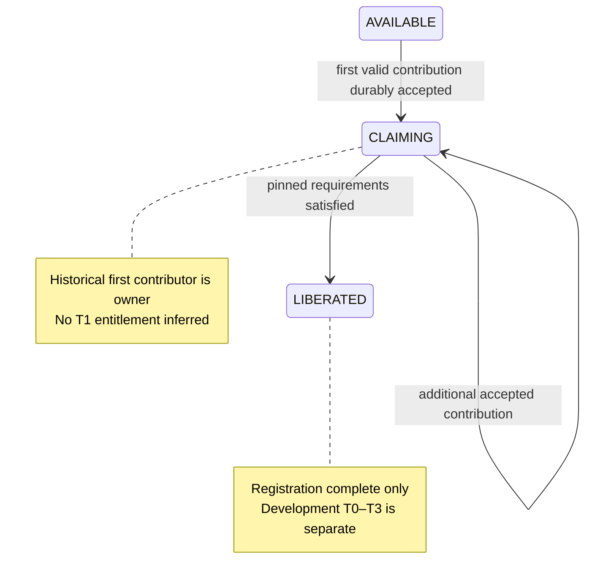

# Territory registration — Fabric 26.3 specification

Stage D2-A, 2026-10-19 (Asia/Seoul). **PROPOSED technical specification; not implemented, compiled, runtime-tested or approved for production activation.** Base: Draft PR #131 at `befa4c8a44c8e3556be2dca9af502d36b0cf11ad`. [Recovery/evidence](TERRITORY_PAPER_RECOVERY_2026-10-19.md) distinguishes historical user inputs from repository corroboration. [Ownership conflicts](TERRITORY_OWNERSHIP_CONFLICTS.md) lists decisions that this spec deliberately does not make.

## 1. Contract and scope

Preserve optional village participation and normal use of unregistered villages. The recovered historical interface is Text Display + Interaction with actual player-thrown vanilla items. The historical first valid contributor owns the registration; AVAILABLE → CLAIMING → LIBERATED describes registration, not development tier. Historical one-per-biome limits and material families are recovered inputs with unresolved Fabric applicability/definitions. No arbitrary material quantities, tier equivalences, radius, claim expiry, taxes or automatic ownership loss are introduced.

This document proposes serialization, validation, display reconstruction, attributed collection, non-destructive construction and failure recovery. Production admission is blocked until the associated policy and durability gates are met. “Must” inside a proposed algorithm states its technical invariant, not that the algorithm has been approved or proven.

## 2. Actual mapped API assessment

The exact base [gradle.properties](https://github.com/ItzGamesGD/MoreMinecrafts-Beta/blob/befa4c8a44c8e3556be2dca9af502d36b0cf11ad/gradle.properties) pins Minecraft **26.3**, Fabric API **0.161.0+26.3**, Loader **0.19.5**, Loom **1.17.21**. Fabric API tag resolves to **`84831249df47bd923b48186d169bc0d8501b547b`**. Sources below were inspected in this task; Paper API examples and older mappings are not substituted for Fabric APIs.

Primary access evidence: Fabric's pinned [classtweaker](https://github.com/FabricMC/fabric-api/blob/84831249df47bd923b48186d169bc0d8501b547b/fabric-transitive-access-wideners-v1/src/main/resources/fabric-transitive-access-wideners-v1.classtweaker) explicitly makes Display/TextDisplay and Interaction tracked-data methods accessible. This matters: unmodified/NeoForge listings can show private setters; do not claim vanilla accessibility or add an unnecessary accessor without checking the resolved Fabric classpath.

| Surface | Observed 26.3 source/API | Design consequence / verification limit |
|---|---|---|
| Text | `Display.TextDisplay#setText(Component)`, line width/opacity/background/flags; Display billboard/transformation/view-range controls are present in mapped [Display source](https://mc-packet-reference.netlify.app/26.x/source/net/minecraft/world/entity/display/) and pinned Fabric access rules | A real world text entity can present server state. Text styling/scale/range/placement remain proposed; display dimensions do not define ownership boundaries |
| Interaction | Mapped [Interaction source](https://mc-packet-reference.netlify.app/26.x/source/net/minecraft/world/entity/interaction/) has width/height/response setters, dimension-derived AABB, `interact(Player, InteractionHand, Vec3)`. It stores last click identity/time; its tick body is empty. Fabric widens the sizing/response methods | Click target is feasible; **not an item hopper or deposit callback**. Last click is not contribution identity. A separate collector must inspect the approved area |
| Item entity | Mapped [ItemEntity source](https://mc-packet-reference.netlify.app/26.x/source/net/minecraft/world/entity/item/itementity/) has stack read/write, thrower reference, pickup target and save/load. Merge checks pickup target/stack compatibility, not separate contributor lineage | Capture authenticated throw provenance before merge. Pickup target is not contributor ownership; entity UUID alone is not a durable payment receipt |
| Manual player drop | Mapped [ServerPlayer source](https://mc-packet-reference.netlify.app/26.x/source/net/minecraft/server/level/serverplayer/) exposes drop with `(ItemStack, boolean thrownFromHand, Prediction)` and selected-stack drop path | Candidate capture point for a server drop intent and returned ItemEntity. Non-hand/death/container throw paths require separate inspection; a Boolean alone must not authenticate all routes |
| Click hook | Pinned primary [UseEntityCallback](https://github.com/FabricMC/fabric-api/blob/84831249df47bd923b48186d169bc0d8501b547b/fabric-events-interaction-v0/src/main/java/net/fabricmc/fabric/api/event/player/UseEntityCallback.java): callback carries player, level, hand, entity and hit result; runs before spectator check | Use only to inspect/show intent, with logical-server, game-mode, reach and entity-role validation. Clicking does not claim or consume items |

Mapped Minecraft behavior was inspected from the linked **26.3 decompiled source archive**, which is an unofficial source mirror, not a Mojang release certificate. Fabric access and callback signatures were independently checked against the immutable upstream tag. The archive includes Fabric-widening annotations; exact archive-to-target binary identity was **not verified**. No local mapped Minecraft JAR was available, and shell network retrieval was unavailable. **Local javap/compile, Mixin descriptor validation, entity spawning, persistence and native visual checks are NOT RUN.** These remain explicit implementation gates; source feasibility is not runtime acceptance. In particular do not import NeoForge attachment/getter APIs into Fabric.

## 3. State model: separate domain state from operational state

All changes run through one server-owned service. Client packets, rendered text and entity presence are projections, never authority.

Proposed durable record:

- Stable `territoryId`, schema/revision, dimension and verified village identity; anchor identity/position/version kept separately. A moved/destroyed bell must not create a new claim. Generated structure identity versus player-made POI village eligibility remains OC01.
- `registrationStatus = AVAILABLE | CLAIMING | LIBERATED`, nullable owner UUID, first accepted receipt, pinned registration-recipe version and per-material delivered totals.
- Independent development `tier`/upgrade record governed by approved T0–T3 rules. No new default tier for a LIBERATED village is selected here; the transition/admission predicate remains disabled pending OC04.
- Player/biome allocation index and pending reservations derived from the same authoritative registration ledger if the historical cap is adopted. The biome classifier/dimension scope remain OC02.
- Separate operational condition `READY | RECONCILING | QUARANTINED` and construction job state. These are technical health states, not additional gameplay tiers or historical states. Errors must not silently set AVAILABLE, remove ownership or erase deposits.

No timer, logout, death, raid failure, absent interface or missing chunk automatically returns these states to AVAILABLE. This is a conservative proposed omission, not approval of permanent ownership. Cancellation/transfer/loss rules remain OC06; no production destructive transition may be enabled without them. A first payment that covers all requirements still records both ordered transitions and the same first owner, without double-charging.

| Current state | Event / validation | Proposed result | Must remain unchanged on rejection |
|---|---|---|---|
| AVAILABLE | Click or walk into area | Show current requirements/status only | Owner, quota, items, delivered totals |
| AVAILABLE | Authenticated eligible player's accepted positive quantity for an outstanding approved material; village + player allocation atomically available | Set owner and first receipt, reserve allocation, credit exactly accepted quantity; enter CLAIMING | On invalid item/unknown thrower/missing recipe/cap failure, no consumption or ownership |
| CLAIMING | Same owner contributes outstanding material | Credit up to remaining requirement; preserve excess and receipt identity | Other player drops cannot steal ownership; helper contribution admission remains OC05 |
| CLAIMING | All pinned requirements complete | Commit LIBERATED once; preserve owner and totals | No automatic tier increase, construction, guards or rewards |
| LIBERATED | Replayed/late/excess deposit | No registration charge; preserve or reconcile already accepted item projection | No second completion or upgrade |
| Any | Reload/missing UI | Reconcile durable state and reconstruct projections | No owner assignment from entity proximity or client text |
| Any | Corrupt/contradictory ledger or unresolved receipt | Quarantine this registration path, retain evidence; ordinary village interaction remains usable | No guessed refund, duplicate credit or blanket village freeze |

Production validation requires a complete approved recipe. “Wood”, “iron” etc. are not registry predicates until OC03 is resolved. Fixture recipes can test logic but must not be survival-registered. Recipe edits cannot retroactively reprice accepted deposits: pin a version; changing an in-flight recipe requires a reviewed migration/refund policy.

## 4. Multiplayer ownership conflict handling

Recommended **PROPOSED** arbitration is first **server-serialized, successfully committed positive contribution**, not client timestamp, first click, item entity creation time, nearest player, largest donation or final payer. Revalidate eligibility at commit. An atomic compare-and-set on AVAILABLE plus allocation index prevents two owners. A transaction sequence provides a replay-stable order; do not sort concurrent items by player UUID as an undocumented gameplay advantage. Define and test deterministic processing when multiple items enter between collector runs; the policy must be accepted under OC05.

If one player concurrently attempts two villages of the same biome, reserve/recheck the player-biome slot in the **same transaction** as ownership; only one can win if the historical cap is adopted. The losing item remains unconsumed. CLAIMING should count as a reservation to avoid evasion, but this is PROPOSED until OC02. Do not silently reset quotas on death, logout, tier changes or a bell replacement.

Recommended helpers policy: owner-only deposits initially; reject other players' drops without consuming them. Alternative: explicit owner-authorized helper donations, irrevocable or refundable according to a reviewed rule. Public donations are another distinct gameplay outcome. None is approved by “first contributor owns”; OC05 remains open. No click-based preclaim is added.

## 5. Physical deposit attribution and collection

1. Resolve a unique canonical territory and approved bounded deposit volume. Do not force-load chunks or scan every village globally. Ambiguous overlapping collectors do not consume; select neither until identity/bounds resolved.
2. At an actual server-confirmed voluntary drop route, capture player UUID, drop intent ID, source item fingerprint/count and creation context. Stamp a server-only entity attachment/registry entry before it can merge or be collected. Do not create a special player-facing item or currency. Click history and the vanilla pickup target cannot supply this proof.
3. A loaded-area collector checks ItemEntity bounds against its deposit volume, validates server-owned provenance, positive outstanding demand, claimant/helper policy, item/component predicate, game mode and state revision. Water, hoppers, mob drops, death drops, dispensers, commands and unknown legacy items are not assumed voluntary contributions. Admission/rejection routes need the OC07 policy and actual hook coverage.
4. Revalidate alive entity, exact stack/components/count and exclusive collector lease at commit; do not rely on a stale scan result. A delayed scan must not debit an item already picked up, burned, despawned, transferred or moved out of the valid volume.
5. Accepted quantity is `min(current valid count, outstanding approved requirement)`. Only that quantity is credited/removed. Extra/wrong/completed-recipe items remain ordinary items, subject to any temporary in-flight reservation; rejected items are not silently discarded or credited. No automatic inventory debit substitutes for throwing.
6. Merge handling must preserve attribution before collection: proposed simplest rule is no merging a tracked candidate with a different lineage/untracked item, even if vanilla considers stacks compatible. Same-lineage merge/split must conserve exact issued/residual quantities or be refused. Scope merge intervention to tracked registration candidates and release temporary restrictions safely when no longer participating; outside gameplay remains vanilla.
7. On each relevant loaded-player/anchor event, ensure one display pair per territory-role/anchor version. Use one bounded collector scheduler for active loaded interaction areas, or event-driven drop scheduling with a bounded loaded watch window; the cadence/window is not finalized. On unload, stop work and persist state. No per-territory permanent timer or force-loading ticket is assumed.

Offscreen/offline contribution, stale items on restart, collection grace/distance and creative/spectator policies remain OC07. Current prototype recommendation rejects ambiguous provenance **without consuming**. This recommendation must not be misrepresented as already-approved gameplay rules. No drop is allowed to claim while recipe/identity/ownership policies are undefined.

## 6. Consumption, persistence and duplicate prevention

There are at least three persistence domains: player inventory before throwing, ground ItemEntity/chunk state, and territory/ownership state. Single-thread execution or same-tick shrink+credit gives **in-process serialization only**, not crash atomicity. Saving ownership while restoring an older full item entity can double-pay; saving removed item before territory credit can lose payment. A restored pre-drop inventory can also reissue the same ordinary materials unless the player-to-drop boundary is covered.

Two approaches considered:

| Approach | Benefit | Limitation |
|---|---|---|
| Save-backed counters plus entity UUID/Boolean, shrink then credit or credit then shrink | Small implementation | Rejected as a correctness argument: save ordering/replay and merge lineage are unresolved. UUID identifies an entity, not durable ownership of individual paid units |
| Durable intent/receipt ledger with recoverable item projections | Recommended PROPOSED architecture: ownership, quota, receipts and delivered totals share a canonical ordered ledger | Requires verified drop/inventory receipt and all transfer/save boundaries; additional I/O, recovery and storage cost. Not implemented or proven by this document |

Candidate protocol, subject to OC08 technical proof:

- Issue a world-scoped unguessable token bound to authenticated drop intent, contributor, fingerprint and original count. Durable drop issuance must relate to an actual inventory removal in a recoverable way. Record PREPARED intent before irrevocable removal; prove player receipt/outbox persistence or a replayable transfer protocol. No acceptance solely because a token exists.
- Reserve/inspect an intact ground candidate and persist PREPARED deposit intent with territory revision, before-count, accepted quantity, residual count and expected owner/allocation transition. Reservation must fence merge, pickup, hopper and damage/despawn paths during the critical section; supported routes need tests, not assumed global hooks.
- Once physical transfer evidence is recoverably established, append/force one authoritative ACCEPT record containing ownership/allocation and exact material delta. Territory views and entity remainder are projections of that record. Replaying the same intent/token range returns the prior result, never another delta. On retry, reconcile first; do not double-shrink a residual stack.
- Startup loads ledger before enabling collectors. Reconcile loaded tokenized entities to canonical outstanding quantity; already spent units cannot be picked up/merged/re-collected from a stale chunk snapshot. A stale pre-drop player snapshot must also be reconciled before normal use of affected inventory. **The latter receipt mechanism is still a blocking proof obligation**, not a solved algorithm.
- A partial crash/unknown receipt, disk-full, malformed journal, conflicting player snapshot or broken fsync boundary quarantines affected registration operations. Do not delete arbitrary inventory, treat uncertain intent as successful, release spent tokens for another payer, or blindly refund. Recover using retained evidence and an explicit repair policy. Vanilla village trades/doors continue unaffected.
- Retain spent-token identity and world ID for the supported world lifetime; do not remove tombstones merely by time. Backup and restore management is not part of this design (D67–D78 withdrawn). Unsupported external edits/cross-world copied saves are detected/reported, not advertised as exactly-once supported.

Invariant for each issuance: `accepted units + currently owned/recoverable residual units <= issued units`, and each accepted range contributes once to one territory/recipe. For legitimate completed transfers the equality/recovery/no-loss obligation must also be demonstrated. A design that merely prevents duplicate credit by losing materials is not accepted. Credit and entity/owner projections may remain pending until durable reconciliation establishes both sides.

**No production collector may claim exactly-once or consume live registration materials until the player→drop→deposit protocol passes actual multi-process save-order/failure tests.** The spec intentionally isolates this unresolved engineering gate; it does not borrow a claim of success from XP Quest or Paper YAML persistence.

## 7. Protection boundaries and non-destructive construction

> **2026-10-20 reconciliation:** the owner record ([D01–D66](TERRITORY_OWNER_DECISIONS_2026-10-20.md)) governs this section. The snapshot, journal, compare-and-set rollback and quarantine mechanics in the table below, and the matching Durability/Construction/backup text elsewhere in this spec, are **WITHDRAWN (D67–D78 scope) and not requirements**. The approved contract is D04 (prevalidate the whole layout, apply atomically, consume nothing on failure), D05 (building protection), and D59–D66 (conservative placement: preserve what cannot be classified as removable natural terrain, reroute or reject). Rows are kept as history.

Current Fabric approval protects territory-managed buildings/blocks and explicitly forbids blanket protection of every player-placed block or overwriting resident edits. A whole generated structure bounding box or a radius around an anchor is **not** an approved protected region.

Propose four distinct geometries: village identity/search envelope, deposit volume, managed building footprints with exact blocks/Y ranges, and a temporary construction validation halo for adjacent effects. A search envelope is not a protection claim. Original buildings enter managed ownership only through an approved adoption policy (OPEN owner decision); unknown edits are preserved, not reclassified. Player builds remain excluded, even within a larger search envelope. Owner editing/permission exceptions and environmental mutation matrix remain OC09/OC10.

| Job step | Proposed non-destructive contract |
|---|---|
| Plan **[SUPERSEDED in part: no provenance snapshot]** | Pick an approved template/upgrade and declared footprint; snapshot block states and complete supported block-entity data, entity identities, roads, beds/workstations, fluids, terrain and ownership/provenance. Reject unknown player edits, ambiguous containers and unsafe adjacent effects rather than replacing them |
| Reserve | Validate loaded chunks, slopes, structures, clearance, villagers/entities and neighbor effects; acquire footprint reservation and revision; reserve approved materials without committing a successful upgrade. A reservation is not permanent world protection |
| Revalidate | Immediately before mutation compare all relevant preconditions to captured snapshots. Concurrent edit or other job overlap invalidates plan. Exact route/placement/clearance thresholds require a later approved design, not guessed numbers |
| Apply **[journal WITHDRAWN]** | Journal intended and completed writes; update only approved owned positions. Handle block entity components, scheduled fluid/redstone updates, drops and external callbacks explicitly. Avoid producing items/entities that rollback cannot retract. Do not run arbitrary template effects outside the validated footprint/halo |
| Verify | Check complete building and safety invariants. Establish beds/workstations before adding population. Unique job/member identities prevent duplicate villagers/guards on retry. Registration completion does not start this job by itself |
| Commit | Only after verified durable success update development tier and resource receipt as one recoverable domain operation. One territory-wide tier; no facility levels. Publish new protected footprint/revision, then release temporary reservation |
| Roll back **[WITHDRAWN; D04 prevalidation replaces it]** | In reverse journal order, restore a position only if it is still this job's write and its current after-state/fingerprint matches. Restore supported block-entity state; remove only exact job-created entity IDs. Never overwrite later player/other-system edits or duplicate drops/resources |
| Conflict / restart **[WITHDRAWN]** | Resume or undo through journal evidence and reservations. If inverse operation is unsafe, quarantine the job, retain progress/escrow and require explicit repair. Do not report rollback complete, auto-charge twice, or reset territory tier/ownership merely because recovery is blocked |

Block snapshot restoration alone does not undo loot pickups, villager inventories/POIs, scheduled ticks, fluid/redstone cascades or independent chunk/player saves. Implement only supported effect-bounded templates after proving failure recovery. Existing player builds must never be “repaired” to an older snapshot. No raids, upkeep/regression or new construction quantities are introduced here.

## 8. Validation gates for later implementation

All tests here are **specified, NOT RUN**. D2-A inspects sources and publishes documentation only.

| Gate | Required test evidence |
|---|---|
| API | Java25 compile against exact pinned26.3/Fabric stack; confirm classtweaker application and real descriptors, TextDisplay spawning/text sync, Interaction width/height/reach, click before spectator check; no custom registration renderer needed solely for text |
| Identity | Same village from multiple chunks/anchors resolves once; moved/replaced bell does not clone ownership; ambiguous/overlapping/player-made village cases follow approved policy; no forced global scans |
| Ownership | Invalid/wrong/zero contribution cannot claim; two simultaneous eligible players yield one first owner; one player/same-biome concurrent claims obey adopted cap; final payer does not replace owner; click alone does not claim |
| Items | Accepted partial stack/excess remainder; owner/helper rules; unknown/dispensed/death/water/hopper/creative routes; mixed contributor merge, splits, pickup/burn/despawn races, item out of bounds; exact vanilla components remain intact |
| Durability | Separate JVMs: kill at every drop issuance/inventory-save/entity-save/PREPARED/ACCEPT/credit/owner-save boundary; reverse save order, restore older chunks/playerdata, replay same token and partial remainder; require no duplicate units and no lost legitimate contribution. Disk-full/corruption and world mismatch fail without guessed repair |
| Interface | One display+interaction role pair after reload/unload/restart; no click grants owner, UI reflects canonical committed state, stale revision shows a retry; unregistered villagers/beds/doors remain normal |
| Protection | Exact managed bounds, player block outside/inside envelope, owner/non-owner, container/door/lever/button, pistons/fire/explosion/fluids; no blanket village freeze while CLAIMING |
| Construction **[journal/rollback test items WITHDRAWN; keep atomic prevalidation and no-overwrite checks]** | Player-edited plans rejected; concurrent edit between plan/apply invalidates; injected failure at every write; compare-and-set rollback refuses to overwrite later edits; container/entity/POI/drop/neighbor effects; unloaded chunk/restart journal reconciliation, no duplicate villagers or charges |
| Tier | AVAILABLE/CLAIMING/LIBERATED never grant T1–T3 through an inferred mapping; only a separately approved development transition can grant entitlements |
| Live | Native26.3 client display readability, real hand throws/geometry, two-player arbitration, vanilla village usability, terrain/pathing, existing-world saves and server restart. No synthetic screenshot or source inspection is live acceptance |

The next step is policy review of the companion conflict ledger and a receipt/projection proof on an authorized implementation base. This task starts neither prototype nor production code.
