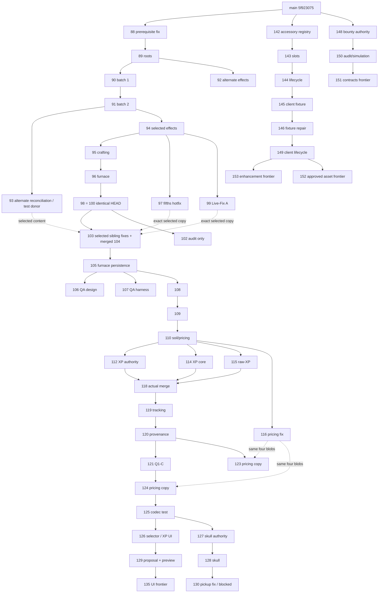

# Verified PR dependency graph — 2026-10-22

Baseline main `5f92307555ce5c486a2e0e8091f956bcbb6c6646`. All 65 open heads are pinned in [the inventory](PR_INVENTORY.md). Full history was available (`git rev-parse --is-shallow-repository` = false). Git fetch retrieved all branch heads and `refs/pull/*/head` into local inspection refs. No remote ref was modified by that operation.

## Method and meaning

For every exact head H and current declared base B: `git merge-base --all H B`; `git diff --name-status <merge-base> H`; `git rev-list H`; and all-pairs exact ancestry checks. The table records H, B, merge base and nearest open-PR ancestors. Transitive expansion of nearest ancestors gives the full dependency chain. Identical heads are grouped, never treated as parent/child. An ancestry edge means commits are reachable, not that no later change altered behavior; semantic preservation was checked by source and blob comparisons below.

The snapshot has one merge base per PR. The comparison against main is separately recorded because a stacked declared base is not main. #72/#83 predate later main changes; other older off-main prototypes are not a reason to replace the main baseline.

## Principal verified chains



Solid edges are verified reachability between selected nodes, not necessarily immediate commit parents. Dashed arrows are copied/reimplemented content, not ancestry. Territory #131→#132→#133→#134→#136→#137→#138 is a separate docs-only chain off main; #138 shelves it. #113→#122 is an authority-only chain off #110. #83 and #72 start from Stage20; #139/#140/#141/#147 independently branch from main. Consult the complete table for every head.

## Verified nearest open-head relationships

| PR | HEAD H | Declared base B | H/B merge base | H/main merge base | Nearest open ancestors / equal heads |
|---|---|---|---|---|---|
| #72 | `0cc0a9eaf58290bbde2a4b45f68df101f8f7c6d2` | `stage-20/checkpoint` / `20121ca7cceae03602038de31076bd9ace115208` | `20121ca7cceae03602038de31076bd9ace115208` | `20121ca7cceae03602038de31076bd9ace115208` | none |
| #83 | `e7dc53f9f48dfece8a5723debd5526dc061107d1` | `stage-20/checkpoint` / `20121ca7cceae03602038de31076bd9ace115208` | `20121ca7cceae03602038de31076bd9ace115208` | `20121ca7cceae03602038de31076bd9ace115208` | none |
| #88 | `d65f59059314b6e7b4e7ae4f534a12a7342d4171` | `main` / `5f92307555ce5c486a2e0e8091f956bcbb6c6646` | `5f92307555ce5c486a2e0e8091f956bcbb6c6646` | `5f92307555ce5c486a2e0e8091f956bcbb6c6646` | none |
| #89 | `53c2374e84356ff3b5ccaa84df26897dd7ce4b5b` | `stage-22/research-restructure` / `d65f59059314b6e7b4e7ae4f534a12a7342d4171` | `d65f59059314b6e7b4e7ae4f534a12a7342d4171` | `5f92307555ce5c486a2e0e8091f956bcbb6c6646` | #88 |
| #90 | `1edbdb6bc6bbd82c22f5e0865c6dd0d8c70a2469` | `codex/stage22-research-implementation-20261015` / `53c2374e84356ff3b5ccaa84df26897dd7ce4b5b` | `53c2374e84356ff3b5ccaa84df26897dd7ce4b5b` | `5f92307555ce5c486a2e0e8091f956bcbb6c6646` | #89 |
| #91 | `68a7fafb4ed5f2f0fd52211a22a6785f9b5e4fb3` | `codex/stage23a-research-content-20261015` / `1edbdb6bc6bbd82c22f5e0865c6dd0d8c70a2469` | `1edbdb6bc6bbd82c22f5e0865c6dd0d8c70a2469` | `5f92307555ce5c486a2e0e8091f956bcbb6c6646` | #90 |
| #92 | `f632f4f521c782c9614a3bbb71f1ab5579a3358d` | `codex/stage22-research-implementation-20261015` / `53c2374e84356ff3b5ccaa84df26897dd7ce4b5b` | `53c2374e84356ff3b5ccaa84df26897dd7ce4b5b` | `5f92307555ce5c486a2e0e8091f956bcbb6c6646` | #89 |
| #93 | `803d2e5df5fe2f990ff2f2e5ef3e01c6dcf37955` | `codex/stage23a-batch2-20261015` / `68a7fafb4ed5f2f0fd52211a22a6785f9b5e4fb3` | `68a7fafb4ed5f2f0fd52211a22a6785f9b5e4fb3` | `5f92307555ce5c486a2e0e8091f956bcbb6c6646` | #91 |
| #94 | `5e48deacbeed95783902f2b71e04e2ae25005606` | `codex/stage23a-batch2-20261015` / `68a7fafb4ed5f2f0fd52211a22a6785f9b5e4fb3` | `68a7fafb4ed5f2f0fd52211a22a6785f9b5e4fb3` | `5f92307555ce5c486a2e0e8091f956bcbb6c6646` | #91 |
| #95 | `c3683de7338a40143ee45dbcc76918c9cb363390` | `codex/stage23a-integrated-research-20261015` / `5e48deacbeed95783902f2b71e04e2ae25005606` | `5e48deacbeed95783902f2b71e04e2ae25005606` | `5f92307555ce5c486a2e0e8091f956bcbb6c6646` | #94 |
| #96 | `f28658e5e03ae2e78a44af8e921d06b6f2cdbb47` | `codex/stage23a-batch3-20261015` / `c3683de7338a40143ee45dbcc76918c9cb363390` | `c3683de7338a40143ee45dbcc76918c9cb363390` | `5f92307555ce5c486a2e0e8091f956bcbb6c6646` | #95 |
| #97 | `df960d6511fbf9bbe0a649d8f68de6c12362d458` | `codex/stage23a-integrated-research-20261015` / `5e48deacbeed95783902f2b71e04e2ae25005606` | `5e48deacbeed95783902f2b71e04e2ae25005606` | `5f92307555ce5c486a2e0e8091f956bcbb6c6646` | #94 |
| #98 | `7231c7aad598e9cada152537dfece7cfad2756dc` | `codex/stage23a-furnace-infrastructure-20261015` / `f28658e5e03ae2e78a44af8e921d06b6f2cdbb47` | `f28658e5e03ae2e78a44af8e921d06b6f2cdbb47` | `5f92307555ce5c486a2e0e8091f956bcbb6c6646` | #96; equal #100 |
| #99 | `eb80a148065c29394f7a46650c05ab72dda9140d` | `codex/stage23a-integrated-research-20261015` / `5e48deacbeed95783902f2b71e04e2ae25005606` | `5e48deacbeed95783902f2b71e04e2ae25005606` | `5f92307555ce5c486a2e0e8091f956bcbb6c6646` | #94 |
| #100 | `7231c7aad598e9cada152537dfece7cfad2756dc` | `codex/stage23a-batch2-20261015` / `68a7fafb4ed5f2f0fd52211a22a6785f9b5e4fb3` | `68a7fafb4ed5f2f0fd52211a22a6785f9b5e4fb3` | `5f92307555ce5c486a2e0e8091f956bcbb6c6646` | #96; equal #98 |
| #102 | `601cc28b9d078b01f1d01451fd07f278839eb4b0` | `integration/stage23-linear-chain-20261016` / `7231c7aad598e9cada152537dfece7cfad2756dc` | `7231c7aad598e9cada152537dfece7cfad2756dc` | `5f92307555ce5c486a2e0e8091f956bcbb6c6646` | #100, #98 |
| #103 | `bdffa599e1197e66d60a99064dd17a0c8209b9ef` | `integration/stage23-linear-chain-20261016` / `7231c7aad598e9cada152537dfece7cfad2756dc` | `7231c7aad598e9cada152537dfece7cfad2756dc` | `5f92307555ce5c486a2e0e8091f956bcbb6c6646` | #100, #98 |
| #105 | `5682be107145b9e4f3f7c4acc6e6dd8835ebe01b` | `integration/stage23-final-reconciliation-20261016` / `bdffa599e1197e66d60a99064dd17a0c8209b9ef` | `bdffa599e1197e66d60a99064dd17a0c8209b9ef` | `5f92307555ce5c486a2e0e8091f956bcbb6c6646` | #103 |
| #106 | `9b66f49657c084c29873990c0ff8b92d6a0ab620` | `codex/stage23-livefix-b-20261016` / `5682be107145b9e4f3f7c4acc6e6dd8835ebe01b` | `5682be107145b9e4f3f7c4acc6e6dd8835ebe01b` | `5f92307555ce5c486a2e0e8091f956bcbb6c6646` | #105 |
| #107 | `dad054c7cb5e5d672a0ef96bfdeffc482e1c48f6` | `codex/stage23-livefix-b-20261016` / `5682be107145b9e4f3f7c4acc6e6dd8835ebe01b` | `5682be107145b9e4f3f7c4acc6e6dd8835ebe01b` | `5f92307555ce5c486a2e0e8091f956bcbb6c6646` | #105 |
| #108 | `2c8e984314bb079378cffc95c4f48982a962173b` | `codex/stage23-livefix-b-20261016` / `5682be107145b9e4f3f7c4acc6e6dd8835ebe01b` | `5682be107145b9e4f3f7c4acc6e6dd8835ebe01b` | `5f92307555ce5c486a2e0e8091f956bcbb6c6646` | #105 |
| #109 | `9376777264136b37e10071adf8ed59c08da9b6ee` | `codex/stage23a-expanded-batch2-20261017` / `2c8e984314bb079378cffc95c4f48982a962173b` | `2c8e984314bb079378cffc95c4f48982a962173b` | `5f92307555ce5c486a2e0e8091f956bcbb6c6646` | #108 |
| #110 | `9ec91dc53512796748a6cfc0980cda0b65e764e6` | `codex/stage23a-remaining-research-20261017` / `9376777264136b37e10071adf8ed59c08da9b6ee` | `9376777264136b37e10071adf8ed59c08da9b6ee` | `5f92307555ce5c486a2e0e8091f956bcbb6c6646` | #109 |
| #112 | `63107098fcde6742704a07394439e5cdf9c6ad49` | `claude/stage23a-economy-soil-20261017` / `9ec91dc53512796748a6cfc0980cda0b65e764e6` | `9ec91dc53512796748a6cfc0980cda0b65e764e6` | `5f92307555ce5c486a2e0e8091f956bcbb6c6646` | #110 |
| #113 | `32cbca0a3fe57db86262bca7a865573071763640` | `claude/stage23a-economy-soil-20261017` / `9ec91dc53512796748a6cfc0980cda0b65e764e6` | `9ec91dc53512796748a6cfc0980cda0b65e764e6` | `5f92307555ce5c486a2e0e8091f956bcbb6c6646` | #110 |
| #114 | `78d1495402de6f3d7328fcd3117a4996137a05e2` | `claude/xp-quest-authority-20261017` / `7e21fc0c66c51c731aba58fd9b08b79bf5175cec` | `7e21fc0c66c51c731aba58fd9b08b79bf5175cec` | `5f92307555ce5c486a2e0e8091f956bcbb6c6646` | #110 |
| #115 | `f30d263c93b89b1bab844893bdb82084bfe209bd` | `claude/xp-quest-authority-20261017` / `7e21fc0c66c51c731aba58fd9b08b79bf5175cec` | `7e21fc0c66c51c731aba58fd9b08b79bf5175cec` | `5f92307555ce5c486a2e0e8091f956bcbb6c6646` | #110 |
| #116 | `8f33e72c8a71d29e132050457535ac8a0092a7b0` | `claude/stage23a-economy-soil-20261017` / `9ec91dc53512796748a6cfc0980cda0b65e764e6` | `9ec91dc53512796748a6cfc0980cda0b65e764e6` | `5f92307555ce5c486a2e0e8091f956bcbb6c6646` | #110 |
| #117 | `991b20c8a052ecf5d73c5130d2d9e0eb4338c041` | `integration/stage23-final-reconciliation-20261016` / `bdffa599e1197e66d60a99064dd17a0c8209b9ef` | `bdffa599e1197e66d60a99064dd17a0c8209b9ef` | `5f92307555ce5c486a2e0e8091f956bcbb6c6646` | #103 |
| #118 | `c40ee6b1656800f016644893f5bac7a9c90827b2` | `claude/xp-quest-authority-20261017` / `63107098fcde6742704a07394439e5cdf9c6ad49` | `63107098fcde6742704a07394439e5cdf9c6ad49` | `5f92307555ce5c486a2e0e8091f956bcbb6c6646` | #115, #114, #112 |
| #119 | `c7fe7fabc5a3bc486e2be0aed8f793628f42ec72` | `claude/xp-quest-q1-integration` / `c40ee6b1656800f016644893f5bac7a9c90827b2` | `c40ee6b1656800f016644893f5bac7a9c90827b2` | `5f92307555ce5c486a2e0e8091f956bcbb6c6646` | #118 |
| #120 | `fd4aa831139054f6c736edf58fa6fe5f8cc77814` | `claude/xp-quest-q1b-tracking` / `c7fe7fabc5a3bc486e2be0aed8f793628f42ec72` | `c7fe7fabc5a3bc486e2be0aed8f793628f42ec72` | `5f92307555ce5c486a2e0e8091f956bcbb6c6646` | #119 |
| #121 | `17e980912d636b0572a3f25b24995ffde31c754c` | `codex/xp-quest-q1b-correction` / `fd4aa831139054f6c736edf58fa6fe5f8cc77814` | `fd4aa831139054f6c736edf58fa6fe5f8cc77814` | `5f92307555ce5c486a2e0e8091f956bcbb6c6646` | #120 |
| #122 | `ad778059718b0a1b911264b72818bbaca8026fcd` | `docs/accessory-enhancement-approved-20261017` / `32cbca0a3fe57db86262bca7a865573071763640` | `32cbca0a3fe57db86262bca7a865573071763640` | `5f92307555ce5c486a2e0e8091f956bcbb6c6646` | #113 |
| #123 | `4fbb036e0158098f4b9d6733c68ddd73b87db826` | `codex/xp-quest-q1b-correction` / `fd4aa831139054f6c736edf58fa6fe5f8cc77814` | `fd4aa831139054f6c736edf58fa6fe5f8cc77814` | `5f92307555ce5c486a2e0e8091f956bcbb6c6646` | #120 |
| #124 | `5ea5f54614943c8fd00f047b7f8379f385d6e5e8` | `codex/xp-quest-q1c` / `17e980912d636b0572a3f25b24995ffde31c754c` | `17e980912d636b0572a3f25b24995ffde31c754c` | `5f92307555ce5c486a2e0e8091f956bcbb6c6646` | #121 |
| #125 | `079d36ac3bd2d8950118e30647d5f2efad19f947` | `integration/q1c-pr116-discount-20261019` / `5ea5f54614943c8fd00f047b7f8379f385d6e5e8` | `5ea5f54614943c8fd00f047b7f8379f385d6e5e8` | `5f92307555ce5c486a2e0e8091f956bcbb6c6646` | #124 |
| #126 | `a9b89755f7c4e924243fa4229a90177433712be4` | `audit/stage23-pr92-pr93-reconciliation-20261019` / `079d36ac3bd2d8950118e30647d5f2efad19f947` | `079d36ac3bd2d8950118e30647d5f2efad19f947` | `5f92307555ce5c486a2e0e8091f956bcbb6c6646` | #125 |
| #127 | `334997d2f81d6b324b0cccd3f40b538c921edadc` | `audit/stage23-pr92-pr93-reconciliation-20261019` / `079d36ac3bd2d8950118e30647d5f2efad19f947` | `079d36ac3bd2d8950118e30647d5f2efad19f947` | `5f92307555ce5c486a2e0e8091f956bcbb6c6646` | #125 |
| #128 | `6ba15ac2cb40cc919dfee41b24f7813231d11efb` | `codex/q1c-recovery-20261019-079d36a` / `334997d2f81d6b324b0cccd3f40b538c921edadc` | `334997d2f81d6b324b0cccd3f40b538c921edadc` | `5f92307555ce5c486a2e0e8091f956bcbb6c6646` | #127 |
| #129 | `2176935929c990a210fae64582d524d30993bc8a` | `design/xp-quest-selector-redesign-20261019` / `a9b89755f7c4e924243fa4229a90177433712be4` | `a9b89755f7c4e924243fa4229a90177433712be4` | `5f92307555ce5c486a2e0e8091f956bcbb6c6646` | #126 |
| #130 | `9c9f22577370cd0160dd2b43b0e92caa7832f420` | `claude/q1c-skull-provenance-20261019` / `6ba15ac2cb40cc919dfee41b24f7813231d11efb` | `6ba15ac2cb40cc919dfee41b24f7813231d11efb` | `5f92307555ce5c486a2e0e8091f956bcbb6c6646` | #128 |
| #131 | `befa4c8a44c8e3556be2dca9af502d36b0cf11ad` | `main` / `5f92307555ce5c486a2e0e8091f956bcbb6c6646` | `5f92307555ce5c486a2e0e8091f956bcbb6c6646` | `5f92307555ce5c486a2e0e8091f956bcbb6c6646` | none |
| #132 | `a1e0aeb0ab8ba90419b714a42502cbe8db9d770c` | `design/territory-economy-bounty-approved-20261019` / `befa4c8a44c8e3556be2dca9af502d36b0cf11ad` | `befa4c8a44c8e3556be2dca9af502d36b0cf11ad` | `5f92307555ce5c486a2e0e8091f956bcbb6c6646` | #131 |
| #133 | `09b33f39f6c0d75f6d1ef837edcdc6d8d8753776` | `design/territory-registration-recovery-d2a-20261019` / `a1e0aeb0ab8ba90419b714a42502cbe8db9d770c` | `a1e0aeb0ab8ba90419b714a42502cbe8db9d770c` | `5f92307555ce5c486a2e0e8091f956bcbb6c6646` | #132 |
| #134 | `e0428763cfd1f720a4da20e1bcc4d561fd153261` | `design/territory-owner-decisions-d01-d78-20261020` / `09b33f39f6c0d75f6d1ef837edcdc6d8d8753776` | `09b33f39f6c0d75f6d1ef837edcdc6d8d8753776` | `5f92307555ce5c486a2e0e8091f956bcbb6c6646` | #133 |
| #135 | `9a246f1e0cef5e3f39c4bf47b34df6e63877df30` | `design/xp-quest-structure-200-20261019` / `2176935929c990a210fae64582d524d30993bc8a` | `2176935929c990a210fae64582d524d30993bc8a` | `5f92307555ce5c486a2e0e8091f956bcbb6c6646` | #129 |
| #136 | `d641075f2078697e432f123d61178a73d26fbdf8` | `design/territory-owner-decisions-reconcile-20261020` / `e0428763cfd1f720a4da20e1bcc4d561fd153261` | `e0428763cfd1f720a4da20e1bcc4d561fd153261` | `5f92307555ce5c486a2e0e8091f956bcbb6c6646` | #134 |
| #137 | `f2cc4f06db44f4125b3987c4b92d2ba8711df06b` | `design/territory-d79-d80-reconcile-20261020` / `d641075f2078697e432f123d61178a73d26fbdf8` | `d641075f2078697e432f123d61178a73d26fbdf8` | `5f92307555ce5c486a2e0e8091f956bcbb6c6646` | #136 |
| #138 | `284ce62ff54247cc0a4e96693c34c190b49c4bbf` | `design/territory-d81-d84-facility-prep-20261021` / `f2cc4f06db44f4125b3987c4b92d2ba8711df06b` | `f2cc4f06db44f4125b3987c4b92d2ba8711df06b` | `5f92307555ce5c486a2e0e8091f956bcbb6c6646` | #137 |
| #139 | `526416b16a590abf558534a8426625508c23ad99` | `main` / `5f92307555ce5c486a2e0e8091f956bcbb6c6646` | `5f92307555ce5c486a2e0e8091f956bcbb6c6646` | `5f92307555ce5c486a2e0e8091f956bcbb6c6646` | none |
| #140 | `3e66cfbdfa6a12576ecf0162108250691318c8db` | `main` / `5f92307555ce5c486a2e0e8091f956bcbb6c6646` | `5f92307555ce5c486a2e0e8091f956bcbb6c6646` | `5f92307555ce5c486a2e0e8091f956bcbb6c6646` | none |
| #141 | `aa376713aedcd7fecd769af39e18f8532b9e147d` | `main` / `5f92307555ce5c486a2e0e8091f956bcbb6c6646` | `5f92307555ce5c486a2e0e8091f956bcbb6c6646` | `5f92307555ce5c486a2e0e8091f956bcbb6c6646` | none |
| #142 | `9b79f9be03d3227f1e295dda36ddc2dbc09ccabb` | `main` / `5f92307555ce5c486a2e0e8091f956bcbb6c6646` | `5f92307555ce5c486a2e0e8091f956bcbb6c6646` | `5f92307555ce5c486a2e0e8091f956bcbb6c6646` | none |
| #143 | `f2e6e87fe95ee4454f4b365c569ecfefae619e9e` | `codex/accessory-infrastructure-20261021` / `9b79f9be03d3227f1e295dda36ddc2dbc09ccabb` | `9b79f9be03d3227f1e295dda36ddc2dbc09ccabb` | `5f92307555ce5c486a2e0e8091f956bcbb6c6646` | #142 |
| #144 | `2083cf37d163398c953995223be35f1d3ba50f02` | `codex/accessory-persistence-inventory-20261021` / `f2e6e87fe95ee4454f4b365c569ecfefae619e9e` | `f2e6e87fe95ee4454f4b365c569ecfefae619e9e` | `5f92307555ce5c486a2e0e8091f956bcbb6c6646` | #143 |
| #145 | `d7e8effd4052313e9965ff417001e5c2ad489c06` | `codex/accessory-lifecycle-qa-20261021` / `2083cf37d163398c953995223be35f1d3ba50f02` | `2083cf37d163398c953995223be35f1d3ba50f02` | `5f92307555ce5c486a2e0e8091f956bcbb6c6646` | #144 |
| #146 | `b7f72fdae46428110079641c681eabdde175e79c` | `codex/accessory-client-acceptance-20261021` / `d7e8effd4052313e9965ff417001e5c2ad489c06` | `d7e8effd4052313e9965ff417001e5c2ad489c06` | `5f92307555ce5c486a2e0e8091f956bcbb6c6646` | #145 |
| #147 | `849c7393e92eb18822b19426aab51ae875c00f32` | `main` / `5f92307555ce5c486a2e0e8091f956bcbb6c6646` | `5f92307555ce5c486a2e0e8091f956bcbb6c6646` | `5f92307555ce5c486a2e0e8091f956bcbb6c6646` | none |
| #148 | `b7cedf199a5f1eda341ce3bd27eabb22eeb309e1` | `main` / `5f92307555ce5c486a2e0e8091f956bcbb6c6646` | `5f92307555ce5c486a2e0e8091f956bcbb6c6646` | `5f92307555ce5c486a2e0e8091f956bcbb6c6646` | none |
| #149 | `6d37a73f11befea3288e028590c540dc31deda61` | `codex/accessory-client-repair-20261022` / `b7f72fdae46428110079641c681eabdde175e79c` | `b7f72fdae46428110079641c681eabdde175e79c` | `5f92307555ce5c486a2e0e8091f956bcbb6c6646` | #146 |
| #150 | `1269cdbacc7c6b75d8aa3cce1352de9432a61914` | `main` / `5f92307555ce5c486a2e0e8091f956bcbb6c6646` | `5f92307555ce5c486a2e0e8091f956bcbb6c6646` | `5f92307555ce5c486a2e0e8091f956bcbb6c6646` | #148 |
| #151 | `30b5c076554111bf660fe3dca67cde4be735776a` | `main` / `5f92307555ce5c486a2e0e8091f956bcbb6c6646` | `5f92307555ce5c486a2e0e8091f956bcbb6c6646` | `5f92307555ce5c486a2e0e8091f956bcbb6c6646` | #150 |
| #152 | `f0dfef9e88b3a284aee9ba751dd71e9847c92271` | `codex/accessory-client-lifecycle-final-20261022` / `6d37a73f11befea3288e028590c540dc31deda61` | `6d37a73f11befea3288e028590c540dc31deda61` | `5f92307555ce5c486a2e0e8091f956bcbb6c6646` | #149 |
| #153 | `f9a31c7117198550c0d5b984b4019af6f164cd94` | `codex/accessory-client-lifecycle-final-20261022` / `6d37a73f11befea3288e028590c540dc31deda61` | `6d37a73f11befea3288e028590c540dc31deda61` | `5f92307555ce5c486a2e0e8091f956bcbb6c6646` | #149 |

## Tree comparisons that change the integration decision

| Comparison | Verified result | Consequence |
|---|---|---|
| #98 vs #100 | Same commit `7231c7aad598e9cada152537dfece7cfad2756dc`, same complete tree | Count once; different base labels do not add implementation. |
| #72 vs #103/#135 | All 78 PNGs share texture subtree `f5c7c4f8`; 91/94 original delta final blobs match. Three divergent shared files add later initialization/mixins/tests while retaining mob behavior | No independent mob-texture merge needed. #104 `b0de6b754859e090427ff310887ca04188310a8a` was merged into #103 and is already retained. |
| #92/#93 vs #103/#125 | No ancestry, but chosen effects are reimplemented/copied in selected architecture | Do not merge whole siblings. Preserve #93 missing event tests separately. |
| #97 vs #103 | `fa903d665566bfec67be368a3a71c2e9700b7531` selects exact arithmetic/test blobs | Hotfix exists despite absent donor ancestry. |
| #99 vs #103/#105/#110 | All ten final changed blobs identical | Live-Fix A was not lost on that line; it is missing from main. |
| #99 vs #125/#135 | Nine final blobs retained; selector intentionally evolved for XP | Preserve later selector, not old disabled/card implementation. |
| #116 vs #123/#124/#125 | Four code/test blobs identical; two corrected documents not copied | Pricing repair present, stale description remains. #123 is not an ancestor of #124. |
| #107 vs #108/#125/#135 | QA harness/workflow absent; sibling off #105 | Unique validation donor, not an implicitly merged feature. |
| #130 vs #135 | Fork at #125; neither head ancestor of the other | #135 does not contain skull repair; #130 does not contain later selector/tree work. |
| #113 vs #153 | Enhancement authority blob `4bb6c2b63117a0286a7e316e7795df2ed773cffb` identical; relic authority `dbce54a43f3930a67d9f272c9bee219a192009e5` identical; no ancestry | Copy already satisfies document source need; do not merge research branch merely for accessory authority. |
| #148/#150/#151 | Actual ancestry 148→150→151 although all target main | One contracts donor, not three independent additive merges. |
| main vs UI integration ref | `a124ccfc2e7e3bc826c04705fa98f69a102a2636`: only `docs/design/xp-quest/INTEGRATION_CHECKPOINT_2026-10-20.md` added | No production UI integration exists there. |

## Historical and un-PR'd branches

Closed PRs were fetched for context, not altered. #87 is actually merged into main (`c0ce63cb73cea42446bedbaece3bb49a9ce71bf8` → main merge `5f923075…`); therefore Knowledge foundation is present on main. #75/#76/#79/#80/#81/#82/#84/#86 are historical source/recovery lines, not new open work to replay. #101 accessory design is closed but copied in merged #104. #104 is merged **into #103's branch**, not main. Closed #111 shares #112's current SHA; its prerequisite-fix title is not a separate runtime donor. #85 is explicitly wrong-repository/DO NOT MERGE; omit it. #73's old visual prototype is superseded by later validation tooling, not a production feature.

Un-PR'd `codex/xp-quest-ui-integration-20261020` is the docs-only checkpoint above. `experiment/ponytail-skill-2-20261021` at `f864df45ef0dad33a898a7f6aaf066b6b345bb5a` adds four experimental skill/audit/review documents under `.github/experimental-skills/`, no gameplay; do not install them as current instructions. `security/gitleaks-historical-findings-20261022` at `b2f2f8f9bfb1c9d72b7e87a06a6c91ef66150113` changes only `.gitleaksignore`; its existence does not clear failing full-history checks or authorize suppressing findings. No secret contents were copied into these reports. `prototype/vanilla-sweep-texture` / `prototype/stage20-vanilla-sweep-texture` and `recovery/vanilla-model-custom-mob-roster-base` remain historical presentation/recovery sources; no current open production promotion was inferred. Trusted `stage-*/checkpoint` refs remain untouched.

## Reproduction commands

```sh
git fetch origin '+refs/heads/*:refs/remotes/origin/*' '+refs/pull/*/head:refs/remotes/audit/pr/*'
git merge-base --all <HEAD> <BASE_SHA>
git merge-base --is-ancestor <DONOR_HEAD> <CANDIDATE_HEAD>
git diff --name-status <MERGE_BASE> <HEAD>
git rev-parse <HEAD>:<PATH>
git diff main a124ccfc2e7e3bc826c04705fa98f69a102a2636 --stat
```

The first command only fetches remote objects into local inspection refs. None of these commands modifies existing remote branches or PRs. Re-fetch and re-pin before executing any future approved batch; a changed head invalidates its prior diff/CI evidence.
