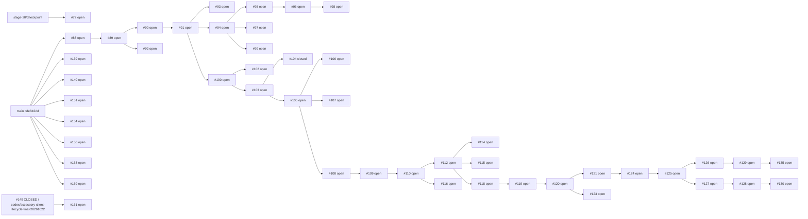
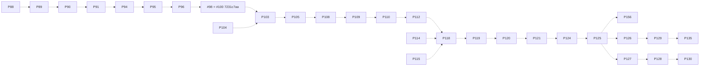

# Phase 3 — PR dependency graph

Snapshot: 2026-10-23T21:45:28+09:00. Documentation-only audit; no integration, closure, deletion, rebase, force push, authority or gameplay change.

Main `cde842dd2cd3d472515aaecb80ad7e78f5da5ce3`; protected accessory+bounty `63efc3ca0a71d369d9e7aa25b9e5231e6a7b29ac`; Batch A #156 `05a378211a6e4576609416096d3515a6b1dee36f`. None of #156 or the protected integration is in main (Git ancestry checked).

## Scope and baseline

44 requested PRs plus **4 justified dependencies = 48 inspected PRs**. #72/#104 are required to account for the actual mob-resource merge into #103; #151/#161 identify shared-file conflicts with the protected target. No arena, territory or unrelated experiments were added. The nine previous cleanup targets are confirmed CLOSED/unmerged; 63 PRs were open before publishing this audit.

## Current declared base links

Solid arrows mean only “child currently targets parent head branch”. They do not assert commit ancestry, approval or complete preservation. Closed base PRs outside the 48 are rendered as external nodes.

## Verified ancestry spine and sibling imports

Dotted arrows below are actual ancestor relationships verified with Git objects. #98 and #100 have the identical SHA. #97/#99/#116/#123/#135/#140 are not ancestors of #156 merely because their selected content survives there. See each JSON row for the full ancestor set. #104 is an actual parent-side ancestor merged back into #103; that reverse ancestry must not be confused with today’s declared base direction.

## Exact current inventory

`API base` is the current PR response; `live base` is independently resolved from fetched remote refs. These can differ (notably #114/#115). Original-envelope and live merge bases are stored separately, including #104’s historical first-parent exception.

| PR / title | State | HEAD | Base branch / API SHA / live SHA | Direct parent PRs | Open children | Ancestor of #156 / protected target |
|---|---|---|---|---|---|---|
| [#72](https://github.com/ItzGamesGD/MoreMinecrafts-Beta/pull/72) Add production textures for all 40 custom mobs | open | `0cc0a9eaf58290bbde2a4b45f68df101f8f7c6d2` | `stage-20/checkpoint` / `20121ca7cceae03602038de31076bd9ace115208` / `20121ca7cceae03602038de31076bd9ace115208` | external/main | none | False / False |
| [#88](https://github.com/ItzGamesGD/MoreMinecrafts-Beta/pull/88) Stage 22: repair Research prerequisite purchase validation | open | `d65f59059314b6e7b4e7ae4f534a12a7342d4171` | `main` / `5f92307555ce5c486a2e0e8091f956bcbb6c6646` / `cde842dd2cd3d472515aaecb80ad7e78f5da5ce3` | external/main | [89] | True / False |
| [#89](https://github.com/ItzGamesGD/MoreMinecrafts-Beta/pull/89) Draft: Stage 22 research roots, passives, and C-Lite | open | `53c2374e84356ff3b5ccaa84df26897dd7ce4b5b` | `stage-22/research-restructure` / `d65f59059314b6e7b4e7ae4f534a12a7342d4171` / `d65f59059314b6e7b4e7ae4f534a12a7342d4171` | [88] | [92, 90] | True / False |
| [#90](https://github.com/ItzGamesGD/MoreMinecrafts-Beta/pull/90) Stage 23-A: implement research content batch 1 | open | `1edbdb6bc6bbd82c22f5e0865c6dd0d8c70a2469` | `codex/stage22-research-implementation-20261015` / `53c2374e84356ff3b5ccaa84df26897dd7ce4b5b` / `53c2374e84356ff3b5ccaa84df26897dd7ce4b5b` | [89] | [91] | True / False |
| [#91](https://github.com/ItzGamesGD/MoreMinecrafts-Beta/pull/91) Stage 23-A: implement research content batch 2 | open | `68a7fafb4ed5f2f0fd52211a22a6785f9b5e4fb3` | `codex/stage23a-research-content-20261015` / `1edbdb6bc6bbd82c22f5e0865c6dd0d8c70a2469` / `1edbdb6bc6bbd82c22f5e0865c6dd0d8c70a2469` | [90] | [100, 94, 93] | True / False |
| [#92](https://github.com/ItzGamesGD/MoreMinecrafts-Beta/pull/92) Stage 23-A Batch 1 research effects | open | `f632f4f521c782c9614a3bbb71f1ab5579a3358d` | `codex/stage22-research-implementation-20261015` / `53c2374e84356ff3b5ccaa84df26897dd7ce4b5b` / `53c2374e84356ff3b5ccaa84df26897dd7ce4b5b` | [89] | none | False / False |
| [#93](https://github.com/ItzGamesGD/MoreMinecrafts-Beta/pull/93) Draft: Stage 23-A parallel branch reconciliation | open | `803d2e5df5fe2f990ff2f2e5ef3e01c6dcf37955` | `codex/stage23a-batch2-20261015` / `68a7fafb4ed5f2f0fd52211a22a6785f9b5e4fb3` / `68a7fafb4ed5f2f0fd52211a22a6785f9b5e4fb3` | [91] | none | False / False |
| [#94](https://github.com/ItzGamesGD/MoreMinecrafts-Beta/pull/94) Stage 23-A: selectively integrate unique research effects | open | `5e48deacbeed95783902f2b71e04e2ae25005606` | `codex/stage23a-batch2-20261015` / `68a7fafb4ed5f2f0fd52211a22a6785f9b5e4fb3` / `68a7fafb4ed5f2f0fd52211a22a6785f9b5e4fb3` | [91] | [99, 97, 95] | True / False |
| [#95](https://github.com/ItzGamesGD/MoreMinecrafts-Beta/pull/95) Draft: Stage 23-A Batch 3 precision crafting; furnace nodes deferred | open | `c3683de7338a40143ee45dbcc76918c9cb363390` | `codex/stage23a-integrated-research-20261015` / `5e48deacbeed95783902f2b71e04e2ae25005606` / `5e48deacbeed95783902f2b71e04e2ae25005606` | [94] | [96] | True / False |
| [#96](https://github.com/ItzGamesGD/MoreMinecrafts-Beta/pull/96) Draft: Stage 23-A furnace research infrastructure | open | `f28658e5e03ae2e78a44af8e921d06b6f2cdbb47` | `codex/stage23a-batch3-20261015` / `c3683de7338a40143ee45dbcc76918c9cb363390` / `c3683de7338a40143ee45dbcc76918c9cb363390` | [95] | [98] | True / False |
| [#97](https://github.com/ItzGamesGD/MoreMinecrafts-Beta/pull/97) Draft: Stage 23-A Fisheries Study exact-allocation hotfix | open | `df960d6511fbf9bbe0a649d8f68de6c12362d458` | `codex/stage23a-integrated-research-20261015` / `5e48deacbeed95783902f2b71e04e2ae25005606` / `5e48deacbeed95783902f2b71e04e2ae25005606` | [94] | none | False / False |
| [#98](https://github.com/ItzGamesGD/MoreMinecrafts-Beta/pull/98) Draft: Stage 23-A expanded research effects on furnace infrastructure | open | `7231c7aad598e9cada152537dfece7cfad2756dc` | `codex/stage23a-furnace-infrastructure-20261015` / `f28658e5e03ae2e78a44af8e921d06b6f2cdbb47` / `f28658e5e03ae2e78a44af8e921d06b6f2cdbb47` | [96] | none | True / False |
| [#99](https://github.com/ItzGamesGD/MoreMinecrafts-Beta/pull/99) Draft: Stage Live-Fix A repairs | open | `eb80a148065c29394f7a46650c05ab72dda9140d` | `codex/stage23a-integrated-research-20261015` / `5e48deacbeed95783902f2b71e04e2ae25005606` / `5e48deacbeed95783902f2b71e04e2ae25005606` | [94] | none | False / False |
| [#100](https://github.com/ItzGamesGD/MoreMinecrafts-Beta/pull/100) Draft: Stage 23 linear-chain integration (#94 → #95 → #96 → #98) | open | `7231c7aad598e9cada152537dfece7cfad2756dc` | `codex/stage23a-batch2-20261015` / `68a7fafb4ed5f2f0fd52211a22a6785f9b5e4fb3` / `68a7fafb4ed5f2f0fd52211a22a6785f9b5e4fb3` | [91] | [103, 102] | True / False |
| [#102](https://github.com/ItzGamesGD/MoreMinecrafts-Beta/pull/102) Draft: Stage 23 remaining branch reconciliation audit (#92/#93/#97/#99) | open | `601cc28b9d078b01f1d01451fd07f278839eb4b0` | `integration/stage23-linear-chain-20261016` / `7231c7aad598e9cada152537dfece7cfad2756dc` / `7231c7aad598e9cada152537dfece7cfad2756dc` | [100] | none | False / False |
| [#103](https://github.com/ItzGamesGD/MoreMinecrafts-Beta/pull/103) Draft: integrate Stage 23 sibling fixes (#93/#97/#99) and regression tests | open | `bdffa599e1197e66d60a99064dd17a0c8209b9ef` | `integration/stage23-linear-chain-20261016` / `7231c7aad598e9cada152537dfece7cfad2756dc` / `7231c7aad598e9cada152537dfece7cfad2756dc` | [100] | [117, 105] | True / False |
| [#104](https://github.com/ItzGamesGD/MoreMinecrafts-Beta/pull/104) Draft: consolidate 40 custom mob resources (#72) and accessory design (#101) onto Stage 23 | closed | `b0de6b754859e090427ff310887ca04188310a8a` | `integration/stage23-final-reconciliation-20261016` / `c9057b340a57415f8384745e0f187f7a78893312` / `bdffa599e1197e66d60a99064dd17a0c8209b9ef` | [103] | none | True / False |
| [#105](https://github.com/ItzGamesGD/MoreMinecrafts-Beta/pull/105) Draft: Stage 23 Live-Fix B portable furnace persistence | open | `5682be107145b9e4f3f7c4acc6e6dd8835ebe01b` | `integration/stage23-final-reconciliation-20261016` / `bdffa599e1197e66d60a99064dd17a0c8209b9ef` / `bdffa599e1197e66d60a99064dd17a0c8209b9ef` | [103] | [108, 107, 106] | True / False |
| [#106](https://github.com/ItzGamesGD/MoreMinecrafts-Beta/pull/106) Draft: Stage 23-B Cloud Live Client QA design | open | `9b66f49657c084c29873990c0ff8b92d6a0ab620` | `codex/stage23-livefix-b-20261016` / `5682be107145b9e4f3f7c4acc6e6dd8835ebe01b` / `5682be107145b9e4f3f7c4acc6e6dd8835ebe01b` | [105] | none | False / False |
| [#107](https://github.com/ItzGamesGD/MoreMinecrafts-Beta/pull/107) Draft: Stage 23-B Cloud Live Client QA harness | open | `dad054c7cb5e5d672a0ef96bfdeffc482e1c48f6` | `codex/stage23-livefix-b-20261016` / `5682be107145b9e4f3f7c4acc6e6dd8835ebe01b` / `5682be107145b9e4f3f7c4acc6e6dd8835ebe01b` | [105] | none | False / False |
| [#108](https://github.com/ItzGamesGD/MoreMinecrafts-Beta/pull/108) Draft: Stage 23-A expanded batch 2 and portable furnace research | open | `2c8e984314bb079378cffc95c4f48982a962173b` | `codex/stage23-livefix-b-20261016` / `5682be107145b9e4f3f7c4acc6e6dd8835ebe01b` / `5682be107145b9e4f3f7c4acc6e6dd8835ebe01b` | [105] | [109] | True / False |
| [#109](https://github.com/ItzGamesGD/MoreMinecrafts-Beta/pull/109) Draft: Stage 23-A remaining research campaign | open | `9376777264136b37e10071adf8ed59c08da9b6ee` | `codex/stage23a-expanded-batch2-20261017` / `2c8e984314bb079378cffc95c4f48982a962173b` / `2c8e984314bb079378cffc95c4f48982a962173b` | [108] | [110] | True / False |
| [#110](https://github.com/ItzGamesGD/MoreMinecrafts-Beta/pull/110) Draft: Villager Trading discount and Soil Study (V3 .53 / .16) | open | `9ec91dc53512796748a6cfc0980cda0b65e764e6` | `codex/stage23a-remaining-research-20261017` / `9376777264136b37e10071adf8ed59c08da9b6ee` / `9376777264136b37e10071adf8ed59c08da9b6ee` | [109] | [116, 112] | True / False |
| [#112](https://github.com/ItzGamesGD/MoreMinecrafts-Beta/pull/112) Draft: XP Quest authority decisions and design documents A–D | open | `63107098fcde6742704a07394439e5cdf9c6ad49` | `claude/stage23a-economy-soil-20261017` / `9ec91dc53512796748a6cfc0980cda0b65e764e6` / `9ec91dc53512796748a6cfc0980cda0b65e764e6` | [110] | [118, 115, 114] | True / False |
| [#114](https://github.com/ItzGamesGD/MoreMinecrafts-Beta/pull/114) Draft: Q1-A XP Quest catalog ledger, persistent tracking and retroactive reconciliation | open | `78d1495402de6f3d7328fcd3117a4996137a05e2` | `claude/xp-quest-authority-20261017` / `7e21fc0c66c51c731aba58fd9b08b79bf5175cec` / `63107098fcde6742704a07394439e5cdf9c6ad49` | [112] | none | True / False |
| [#115](https://github.com/ItzGamesGD/MoreMinecrafts-Beta/pull/115) Draft: Q1-A2 exact raw-XP transactions, claim rollback, Enhancement raw-XP costs | open | `f30d263c93b89b1bab844893bdb82084bfe209bd` | `claude/xp-quest-authority-20261017` / `7e21fc0c66c51c731aba58fd9b08b79bf5175cec` / `63107098fcde6742704a07394439e5cdf9c6ad49` | [112] | none | True / False |
| [#116](https://github.com/ItzGamesGD/MoreMinecrafts-Beta/pull/116) Independent review and repair for Claude PR #110 | open | `8f33e72c8a71d29e132050457535ac8a0092a7b0` | `claude/stage23a-economy-soil-20261017` / `9ec91dc53512796748a6cfc0980cda0b65e764e6` / `9ec91dc53512796748a6cfc0980cda0b65e764e6` | [110] | none | False / False |
| [#118](https://github.com/ItzGamesGD/MoreMinecrafts-Beta/pull/118) Draft: Q1 integration validation — XP Quest core + exact XP | open | `c40ee6b1656800f016644893f5bac7a9c90827b2` | `claude/xp-quest-authority-20261017` / `63107098fcde6742704a07394439e5cdf9c6ad49` / `63107098fcde6742704a07394439e5cdf9c6ad49` | [112] | [119] | True / False |
| [#119](https://github.com/ItzGamesGD/MoreMinecrafts-Beta/pull/119) XP Quest Q1-B: live event tracking, ore provenance, 39 registered quests | open | `c7fe7fabc5a3bc486e2be0aed8f793628f42ec72` | `claude/xp-quest-q1-integration` / `c40ee6b1656800f016644893f5bac7a9c90827b2` / `c40ee6b1656800f016644893f5bac7a9c90827b2` | [118] | [120] | True / False |
| [#120](https://github.com/ItzGamesGD/MoreMinecrafts-Beta/pull/120) Q1-B: require positive natural ore provenance | open | `fd4aa831139054f6c736edf58fa6fe5f8cc77814` | `claude/xp-quest-q1b-tracking` / `c7fe7fabc5a3bc486e2be0aed8f793628f42ec72` / `c7fe7fabc5a3bc486e2be0aed8f793628f42ec72` | [119] | [123, 121] | True / False |
| [#121](https://github.com/ItzGamesGD/MoreMinecrafts-Beta/pull/121) Q1-C WIP: player-attributed structure loot evidence | open | `17e980912d636b0572a3f25b24995ffde31c754c` | `codex/xp-quest-q1b-correction` / `fd4aa831139054f6c736edf58fa6fe5f8cc77814` / `fd4aa831139054f6c736edf58fa6fe5f8cc77814` | [120] | [124] | True / False |
| [#123](https://github.com/ItzGamesGD/MoreMinecrafts-Beta/pull/123) reconcile: apply approved PR #116 villager pricing and regression tests onto Q1-B | open | `4fbb036e0158098f4b9d6733c68ddd73b87db826` | `codex/xp-quest-q1b-correction` / `fd4aa831139054f6c736edf58fa6fe5f8cc77814` / `fd4aa831139054f6c736edf58fa6fe5f8cc77814` | [120] | none | False / False |
| [#124](https://github.com/ItzGamesGD/MoreMinecrafts-Beta/pull/124) reconcile(Q1-C): integrate approved #116 villager discount fixes into #121 lineage | open | `5ea5f54614943c8fd00f047b7f8379f385d6e5e8` | `codex/xp-quest-q1c` / `17e980912d636b0572a3f25b24995ffde31c754c` / `17e980912d636b0572a3f25b24995ffde31c754c` | [121] | [125] | True / False |
| [#125](https://github.com/ItzGamesGD/MoreMinecrafts-Beta/pull/125) audit(Stage23): reconcile PR #92/#93 successors and restore missing fisheries codec test | open | `079d36ac3bd2d8950118e30647d5f2efad19f947` | `integration/q1c-pr116-discount-20261019` / `5ea5f54614943c8fd00f047b7f8379f385d6e5e8` / `5ea5f54614943c8fd00f047b7f8379f385d6e5e8` | [124] | [127, 126] | True / False |
| [#126](https://github.com/ItzGamesGD/MoreMinecrafts-Beta/pull/126) ui(selector): XP Quest card redesign + four-card keyboard navigation | open | `a9b89755f7c4e924243fa4229a90177433712be4` | `audit/stage23-pr92-pr93-reconciliation-20261019` / `079d36ac3bd2d8950118e30647d5f2efad19f947` / `079d36ac3bd2d8950118e30647d5f2efad19f947` | [125] | [129] | False / False |
| [#127](https://github.com/ItzGamesGD/MoreMinecrafts-Beta/pull/127) draft(q1c): recover skull provenance decision and record build blocker | open | `334997d2f81d6b324b0cccd3f40b538c921edadc` | `audit/stage23-pr92-pr93-reconciliation-20261019` / `079d36ac3bd2d8950118e30647d5f2efad19f947` / `079d36ac3bd2d8950118e30647d5f2efad19f947` | [125] | [128] | False / False |
| [#128](https://github.com/ItzGamesGD/MoreMinecrafts-Beta/pull/128) feat(q1c): Wither Skeleton skull provenance + register xpq.cmb.wither_skulls_3 | open | `6ba15ac2cb40cc919dfee41b24f7813231d11efb` | `codex/q1c-recovery-20261019-079d36a` / `334997d2f81d6b324b0cccd3f40b538c921edadc` / `334997d2f81d6b324b0cccd3f40b538c921edadc` | [127] | [130] | False / False |
| [#129](https://github.com/ItzGamesGD/MoreMinecrafts-Beta/pull/129) design(xp-quest): 200-quest structure proposal (presentation-only, draft) | open | `2176935929c990a210fae64582d524d30993bc8a` | `design/xp-quest-selector-redesign-20261019` / `a9b89755f7c4e924243fa4229a90177433712be4` / `a9b89755f7c4e924243fa4229a90177433712be4` | [126] | [135] | False / False |
| [#130](https://github.com/ItzGamesGD/MoreMinecrafts-Beta/pull/130) WIP Q1-C #128: fix P2 pickup accounting; preserve P1 forced-halt blocker | open | `9c9f22577370cd0160dd2b43b0e92caa7832f420` | `claude/q1c-skull-provenance-20261019` / `6ba15ac2cb40cc919dfee41b24f7813231d11efb` / `6ba15ac2cb40cc919dfee41b24f7813231d11efb` | [128] | none | False / False |
| [#135](https://github.com/ItzGamesGD/MoreMinecrafts-Beta/pull/135) feat(xp-quest): semantic zoom, sticky chapter labels, sub-branch rows, per-quest icons, tooltip/keyboard fixes (D1-D5) | open | `9a246f1e0cef5e3f39c4bf47b34df6e63877df30` | `design/xp-quest-structure-200-20261019` / `2176935929c990a210fae64582d524d30993bc8a` / `2176935929c990a210fae64582d524d30993bc8a` | [129] | none | False / False |
| [#139](https://github.com/ItzGamesGD/MoreMinecrafts-Beta/pull/139) Audit Q1-C XP Quest production integration readiness | open | `526416b16a590abf558534a8426625508c23ad99` | `main` / `5f92307555ce5c486a2e0e8091f956bcbb6c6646` / `cde842dd2cd3d472515aaecb80ad7e78f5da5ce3` | external/main | none | False / False |
| [#140](https://github.com/ItzGamesGD/MoreMinecrafts-Beta/pull/140) Draft: XP Quest 200-entry content-design audit | open | `3e66cfbdfa6a12576ecf0162108250691318c8db` | `main` / `5f92307555ce5c486a2e0e8091f956bcbb6c6646` / `cde842dd2cd3d472515aaecb80ad7e78f5da5ce3` | external/main | none | False / False |
| [#151](https://github.com/ItzGamesGD/MoreMinecrafts-Beta/pull/151) BC-03 bounty contracts implementation (in progress) | open | `5ad001b091ea24705834a1caab94335a6abcc445` | `main` / `5f92307555ce5c486a2e0e8091f956bcbb6c6646` / `cde842dd2cd3d472515aaecb80ad7e78f5da5ce3` | external/main | none | False / True |
| [#154](https://github.com/ItzGamesGD/MoreMinecrafts-Beta/pull/154) Draft: repository-wide PR reconciliation and staged integration plan | open | `84550ad4ef0a09248934641e26dab61c4f2cd13b` | `main` / `5f92307555ce5c486a2e0e8091f956bcbb6c6646` / `cde842dd2cd3d472515aaecb80ad7e78f5da5ce3` | external/main | none | False / False |
| [#156](https://github.com/ItzGamesGD/MoreMinecrafts-Beta/pull/156) Batch A: recover existing progression systems and claim-once quest UI | open | `05a378211a6e4576609416096d3515a6b1dee36f` | `main` / `5f92307555ce5c486a2e0e8091f956bcbb6c6646` / `cde842dd2cd3d472515aaecb80ad7e78f5da5ce3` | external/main | none | True / False |
| [#158](https://github.com/ItzGamesGD/MoreMinecrafts-Beta/pull/158) Draft: phase 2 repository cleanup safety audit | open | `c9e29c56804198a07d7fdb0f7c9007f801cc6936` | `main` / `cde842dd2cd3d472515aaecb80ad7e78f5da5ce3` / `cde842dd2cd3d472515aaecb80ad7e78f5da5ce3` | external/main | none | False / False |
| [#159](https://github.com/ItzGamesGD/MoreMinecrafts-Beta/pull/159) Draft: Phase 2B activity evidence and redundancy verification | open | `5a0ede40519bd15715900482d8816c025e74c99c` | `main` / `cde842dd2cd3d472515aaecb80ad7e78f5da5ce3` / `cde842dd2cd3d472515aaecb80ad7e78f5da5ce3` | external/main | none | False / False |
| [#161](https://github.com/ItzGamesGD/MoreMinecrafts-Beta/pull/161) Draft: accessory system integration (#149 + #152 + #153 + #160) and real-client acceptance | open | `0e9ccc5af9313d3648d4bce98a8ee33b1f2dba82` | `codex/accessory-client-lifecycle-final-20261022` / `6d37a73f11befea3288e028590c540dc31deda61` / `6d37a73f11befea3288e028590c540dc31deda61` | [149] | none | False / True |

## Preservation versus topology

Use [the preservation audit](PHASE3_PRESERVATION_AUDIT.md) and [machine inventory](phase3_pr_inventory.json). Each JSON row records full HEAD/base/merge-base SHAs, file paths and blob IDs, comparison to main/#156/protected integration, exact witnesses, equal-head PRs, transitive ancestry and unresolved semantic status. No ancestor relation is a CLOSE_READY decision.

## Ownership and safety

Public comments were refreshed on all 44 requested PRs. #88 has a completed historical Codex review and #103 a historical CI checkpoint; neither proves a running agent. No queued/in-progress Actions were observed at snapshot. Private sessions/worktrees are not observable, so ownership is UNKNOWN, not idle. All existing branches and PRs remain protected.
