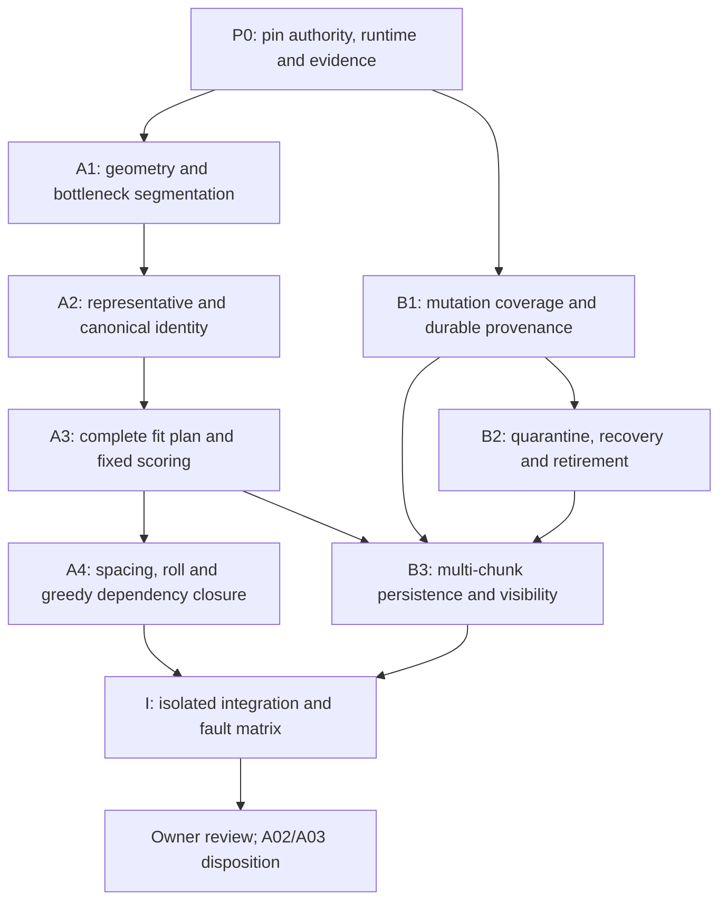

# ST-05 Stage 0 — Integrated Feasibility Validation Plan

> **VALIDATION PROPOSAL ONLY — NOT EXECUTION AUTHORIZATION.**
>
> This document archives the integrated validation plan previously returned in conversation. Saving and committing this document does not approve its proposed algorithms or parameters, authorize implementation, tests, probes, world generation, integration or Stage 1 progression, or permit a merge or checkpoint change. Existing owner-approved design remains unchanged and takes precedence. **A02 and A03 remain BLOCKED.**
>
> Audit baseline: design commit `27c5cd50c782f7dbfaaa77a4f50985f00b8e1134`; evidence PR #218 at `838e1366d44a7a09c43bb1453d92511eea46327e`. Live-reference observations below belong to the original 2026-10-31 planning review, not a new execution or validation run. Review this document through the immutable commit URL reported when it is saved; the document commit does not replace the pinned design baseline.

**PLAN_READY for a later, separately authorized feasibility stage. A02 and A03 remain BLOCKED.** This plan approves no technical parameters, implementation, experiments, or Stage 1 progression.

The original planning review changed no files, GitHub records, checkpoints, or branches. No probes, tests, or world generation were executed. The subsequent document-save authorization permits only adding this plan to the specified design branch.

## 1. Verified baseline and evidence

Live references checked on 2026-10-31 during the original planning review:

| Reference | Live observation |
|---|---|
| Design branch | `design/st05-worldgen-q01-q18-20261030` → **`27c5cd50c782f7dbfaaa77a4f50985f00b8e1134`**, matching the pin |
| [Owner FIX decisions](https://github.com/ItzGamesGD/MoreMinecrafts-Beta/blob/27c5cd50c782f7dbfaaa77a4f50985f00b8e1134/docs/design/ST05_STAGE0_FIX_OWNER_DECISIONS_2026-10-31.md) | Blob `735bca2a5af7bc4cb6e08cd72733dc72a0c7a2c7`; includes A02-Q01–Q10 and A03-Q01–Q06 |
| [WG-Q01–Q45 + FIX-01 A](https://github.com/ItzGamesGD/MoreMinecrafts-Beta/blob/27c5cd50c782f7dbfaaa77a4f50985f00b8e1134/docs/design/ST05_WORLDGEN_OWNER_DECISIONS_Q01_Q18_2026-10-30.md) | Blob `9b9331def0c041750018f43f919203ed8aa67006` |
| [Preimplementation audit](https://github.com/ItzGamesGD/MoreMinecrafts-Beta/blob/27c5cd50c782f7dbfaaa77a4f50985f00b8e1134/docs/design/ST05_WORLDGEN_PREIMPLEMENTATION_AUDIT_2026-10-30.md) | Blob `bcdc49584e35941f2a81398384b282c0ee8a4a01` |
| [Stage handoff](https://github.com/ItzGamesGD/MoreMinecrafts-Beta/blob/27c5cd50c782f7dbfaaa77a4f50985f00b8e1134/docs/design/ST05_WORLDGEN_STAGED_IMPLEMENTATION_HANDOFF_2026-10-30.md) | Blob `e47857ecc326d977bb987ecdf5d23fd7ff9dfa44` |
| [PR #218](https://github.com/ItzGamesGD/MoreMinecrafts-Beta/pull/218) | Open, draft, unmerged; HEAD **`838e1366d44a7a09c43bb1453d92511eea46327e`** |
| PR #213 / #216 | Both open, draft, unmerged; heads `172613621438ad5f2c2252134e0aaccf1a757380` / `1ee08d440032095f9f247f2cb98c87fd15478656` |

**Differences that must remain explicit:**

- PR #218 records design base `cfdecb47897758fa1ea02c447dd7490fcf04268d`; it does not contain the full newer FIX policy at the pinned design commit. Its pinned WG, audit, and handoff blobs match the current pinned versions.
- Its whole-connected-air identity examples and unapproved hash-priority spacing examples do not validate the newer major-chamber segmentation or Q08 suitability-greedy policy.
- PR #218's body described some CI as pending. The live check-run response in the planning review listed all 13 returned checks as completed/success. This does not resolve either feasibility blocker.
- The local checkout used during planning was unrelated HEAD `cde842dd2cd3d472515aaecb80ad7e78f5da5ce3`, with a clean working tree. Remote pinned files were used; no checkout or baseline change occurred.

Reuse these PR #218 artifacts as **historical evidence with stated limits**:

| Evidence | What it supports | What it does not support |
|---|---|---|
| [summary.json](https://github.com/ItzGamesGD/MoreMinecrafts-Beta/blob/838e1366d44a7a09c43bb1453d92511eea46327e/tools/st05-stage0/results/fix/summary.json), [recover.json](https://github.com/ItzGamesGD/MoreMinecrafts-Beta/blob/838e1366d44a7a09c43bb1453d92511eea46327e/tools/st05-stage0/results/fix/recover.json) | Five-JVM, two-marker recovery; idempotent replay; corrupt-journal rejection; visible-conflict preservation | Whole-arena atomicity, production persistence, actual player-event coverage |
| Change-and-restore negative control | State reconciliation overwrote an indistinguishable restored edit | Safe nonintervention detection |
| [identity.json](https://github.com/ItzGamesGD/MoreMinecrafts-Beta/blob/838e1366d44a7a09c43bb1453d92511eea46327e/tools/st05-stage0/results/fix/identity.json) | Stable complete synthetic identities; 96 SQLite claims → 3 unique records; restart adds zero | Stable Minecraft chamber identities, production concurrency, finite search completeness |
| [README.md](https://github.com/ItzGamesGD/MoreMinecrafts-Beta/blob/838e1366d44a7a09c43bb1453d92511eea46327e/tools/st05-stage0/README.md), API signatures | Reproduction specification and known limitations; region-boundary fixture | Cave qualification, complete collision plans, power-loss safety |

## 2. Authority boundary and dependency DAG

**Approved invariants:** major independently qualifying chambers distinguished through relative bottlenecks; deterministic representative-based identities; ≤8 fit candidates before one 75% roll; descending-suitability greedy acceptance with canonical-ID ties; separate statistical stages; conservative player protection, chunk quarantine and dependency closure; conditional recovery and non-destructive retirement; unchanged WG-Q28.

**Unapproved proposals below:** segmentation thresholds and measurement details, representative algorithms and encoding, numeric spacing and metric, exact scoring transforms, completeness certificates, journal/provenance protocol, storage and publication mechanism.

Each package produces a separately reviewable specification, evidence bundle and PASS/FAIL/UNKNOWN report. A failure blocks dependent packages; it does not authorize redesign.

**Runtime investigation baseline:** Minecraft 26.3, Java 25, Loader 0.19.5, Loom 1.17.21, Fabric API `0.161.0+26.3`. Later work must record source/mapping hashes and exact call sites. Class names below are investigation targets, not claims of available guarantees.

## 3. A02 work packages

| Package | Invariant and proposed algorithm | Source/API targets | Proof, experiments and acceptance |
|---|---|---|---|
| **A1 — segmentation** | Every finalized unit has a discovery-order-independent voxel membership and independently satisfies width ≥32, height ≥18 and a traversable path ≥64. Narrow connectors alone do not merge major chambers. Propose a six-neighbor natural traversability graph, distance-to-solid chamber cores and relative neck analysis. Compare neck/core cross-sectional area ratios **0.20, 0.35, 0.50**, using fixed **8/16-block** comparison windows. These are experimental values only. Merge overlapping cores unless a reproducible qualifying neck separates them. | Noise/carver and aquifer stages; `NoiseBasedChunkGenerator`, `NoiseChunk`, chunk-status pipeline, `WorldGenRegion`; availability of immutable pre-ST05 natural geometry independent of later structures and player edits. | Define cross-section orientation, window selection, branch junctions, plateaus, core merging and width/height/path witnesses before coding. Compare dumbbells, broad halls, loops, braided tunnels and distant connections. Require identical final membership under every tested schedule and no unresolved frontier treated as closed. Owner approves metric, threshold, resolution and qualification measurements. |
| **A2 — representatives/IDs** | Compare **L:** signed numeric lexicographic minimum `(x,y,z)` of the complete unit; **I:** maximum interior clearance, then minimum sum of traversable graph distances to unit voxels, then signed `(x,y,z)`. I selects an actual traversable voxel. Propose identity tuple `(schema, seed, dimension-key, representative)` with length-delimited encoding; digest is an index, with full tuple equality checking. | Coordinate and dimension serialization; seed/generator identity; block-position packing limits; natural-snapshot access across unloaded chunks. | Prove one unit → one tuple, distinct disjoint units → distinct representatives, canonical serialization and collision handling. Measure remote extremal branches, centrality ties, representative-to-plan-center distance, work and memory. Any partial discovery that changes an already-finalized identity fails. Owner must approve representative, ordering, encoding and version policy. |
| **A3 — fit/score** | Stable unit → at most eight deterministic candidate descriptors → complete hard-gated plans → exact scores → one selected best plan. Candidate-score ties use deterministic seed-based ordering, preserving WG-Q33. No roll before fit proof; no alternative search after retirement or spacing loss. | Structure planning/placement, template processors, `StructureStart.placeInChunk`, occupancy/clearance queries, fluid/stair/block-update behavior; PR #216 mask contract. | Every plan must include arena, modules, 1–2 connections, terrain repair, fluid seals, protected occupancy and clearance, and all read/write dependencies. Unknown protected occupancy rejects conservatively. Permuting the other seven candidates must leave a candidate's score unchanged. Owner reviews score transforms and candidate-generation policy where they affect eligibility/density. |
| **A4 — spacing/conflicts** | On the complete qualified roll-winner population, sort by `(-exact suitability, canonical ID)`; accept only against already accepted candidates and all protected/persisted/retired sites. Rejected candidates do not exclude later ones. | Deterministic off-thread/unloaded-neighbor inspection, chunk-generation scheduling and recursion; persistence/index completeness; world-coordinate limits. | Prove complete direct-neighbor discovery **and transitive higher-priority dependency closure**. Exercise multiway conflicts, cycles, arbitrary chain lengths, late higher-priority candidates, region crossings and protected sites. No commitment without a completeness certificate. Metric/value and work bounds remain owner gates. |
| **A5 — accounting** | One durable decision per canonical ID; eligibility, roll, win, conflict, lifecycle and actual placement are separate fields/events. Retries never increment distinct-unit counters or consume new randomness. | Production persistent-state serialization, asynchronous saves, unique claims and synchronization; controller registration boundaries. | Concurrent repeated discovery and restart must reproduce the same decision and counters. Ledger loss or ID ambiguity is UNKNOWN/quarantine, not a new roll. Owner approves persistent lifecycle details, without changing the approved denominators. |

**Segmentation assumptions requiring explicit validation:** a consistent natural-geometry snapshot exists; player-created voids cannot become natural qualification evidence; width and height concern a representative chamber rather than disconnected extrema; the 64-block witness is a simple traversable route, not repeated walking around a cycle. A short-corridor qualification witness must not silently imply a complete chamber-membership bound.

### Proposed exact fixed-reference scoring

All formulas below are **unapproved comparison proposals**. Hard gates run first. Use exact rational arithmetic; compare totals without floating-point rounding.

Let `clip(x)=min(1,max(0,x))`. Select a deterministic primary connection before scoring; secondary connections contribute to total damage/fluid measurements but do not boost primary-connection quality.

| Component | Exact proposed definition |
|---|---|
| **C, WG-Q36** | `C = .4L + .3H + .3J`. `L=100(1−ℓ/32)`, where `ℓ` is primary traversable route length. `H=100[1−clip((a+b)/32)]`, where `a` is the number of one-block elevation transitions and `b` counts consecutive transitions reversing ascent direction. Valid stair continuity/clearance remains mandatory. `J=100j/125`, where `j` counts pre-existing, naturally traversable cells in a route-aligned **5×5×5** junction stencil beyond the cave endpoint. |
| **T, WG-Q37** | `T=.6M+.4G`. `M=100[1−clip(n/100000)]`, with `n` the number of distinct natural cells whose block state changes, including excavation, replacement and seals. Log mandatory construction and optional correction separately, summing each changed cell once. `G=100g/\|V\|`, where `V` is the fully defined unit's original traversable-cell set and `g` counts cells remaining traversable and connected to a fixed canonical qualification witness after applying the plan. Destroying mandatory routes rejects the plan. |
| **F, WG-Q38** | `F=.5W+.5R`. `W=100[1−clip(f/2048)]`, where `f` counts distinct fluid-removal and fluid-sealing-work cells. `R=100[1−clip(e/256)]`, where `e` counts exterior wet block faces contacting the final protective seal boundary within the complete fluid dependency envelope. Seal safety and absence of persistent floor/Vault flooding are independent hard gates. Unknown fluid dependencies reject or remain pending. |
| **E, WG-Q39** | `E=.6D+.4A`. `D=100d/64`: 64 deterministic pre-existing cave observation positions, ordered by graph distance from the primary junction and then coordinates; `d` counts unobstructed views to the entrance aperture. Missing positions score zero. `A=100a/w`: `w` is the fixed planned outer-wall-face stencil for the chosen variant; `a` counts naturally exposed faces retaining their intended architectural state. Visibility uses original natural geometry, so added excavation cannot increase this score. |
| **S, WG-Q35** | **`S=.4C+.4T+.1F+.1E`**. Approved outer and inner weights remain unchanged. |

Before implementation, each cell predicate, route orientation, view-ray endpoint and voxel stencil must be serialized in the score specification. Report saturation and sensitivity for the proposed constants; changing them requires a new reviewed proposal.

**Score acceptance:** endpoints and intermediate golden vectors match exactly; each raw measure has its stated monotonic effect; all outputs lie in 0–100; candidate-population changes cannot renormalize scores; mandatory violations never become acceptable through a high total.

### Spacing comparison and finite-search obligation

Compare these **specific proposed experimental settings**, independently of the 68-block diameter:

| Proposal | Exact geometry | Initial value and sensitivity |
|---|---|---|
| Center spacing | Horizontal squared Euclidean distance between doubled-coordinate arena symmetry centers; equality passes. Separately compare 3D distance using the same center convention. | **160 blocks**; compare **128 / 160 / 192** |
| Footprint spacing | Minimum Euclidean distance between closed unit voxel cubes in the protected occupied/mandatory-clearance sets, including corridors and seals; equality passes. Compare full 3D against horizontal projection. | **32 blocks**; compare **16 / 32 / 48** |

Actual protected overlap remains a hard rejection under either metric. Retired sites retain protection; an incomplete site's missing planned blocks must not make its exclusion mask disappear. Propose conservatively reserving its complete immutable plan footprint, pending owner review.

Report density, corridor interference, vertically stacked arenas, large/irregular footprints, and candidate counts. Center spacing alone does not establish noninterference.

For neighbor enumeration:

1. Derive maximum plan extents from actual voxel plans, including modules, repair, corridor clearance and junctions.
2. Use plan extents to derive a conservative direct-conflict envelope.
3. Prove how every unit capable of placing a center/footprint in that envelope is discoverable. A representative may be arbitrarily far from its placement center unless a bound is established.
4. Recursively enumerate higher-priority conflicting winners required to decide acceptance. Include protected-site state and its dependencies.
5. Finalize only with closed geometry frontiers, complete candidate coverage and complete decision dependencies.

**Critical counterexample:** a path of conflicts `A₀—A₁—…—Aₙ`, increasing in priority toward `Aₙ`, can change `A₀`'s acceptance when a remote endpoint is added. Direct spacing radius therefore does not bound greedy dependency radius. Exact-score ties ordered by ID can also create long chains.

Neither finite sampled chains nor 30 successful seeds prove a universal bound. Finite world-coordinate limits alone do not establish an acceptable deterministic operational budget.

If a complete finite algorithm within an approved budget cannot be established, **retain A02 BLOCKED and leave placement pending**. Present, without adopting:

- Exhaustive resolution over an explicitly finite world domain, with quantified cost.
- A revised bounded-unit/conflict policy requiring owner approval because it changes semantics.
- Continued deferral or abandonment of placement for unresolved cases, with denominator effects exposed.

## 4. A03 work packages

| Package | Formal invariant and proposed mechanism | Investigation, counterexamples and acceptance |
|---|---|---|
| **B1 — nonintervention/provenance** | Recovery permission requires a continuous, independently verifiable provenance interval from trusted baseline through recovery. Equal current block states are insufficient. Propose monotonic chunk/dependency contamination epochs and durable records of potentially relevant mutation attempts, including change-and-restore. Unknown origin, lost logs or uncovered intervals mean contamination/uncertainty. | Trace player break/place/use, buckets, explosions, pistons, fluids, scheduled/random ticks, fire, entities, commands, block entities, structure generation, low-level section writes, mods, imports and offline edits. Inspect `ServerPlayerGameMode`, interaction/command routes, `Level`/`LevelChunk`/`LevelChunkSection` mutations and causal propagation. Every uncovered path must be detectable as UNKNOWN or prevent a safety claim. Owner approves evidence standard and supported mutation environment. |
| **B2 — write-ahead contamination** | A relevant mutation cannot become effective before its contamination evidence is durable. Proposed order: acquire mutation fence → persist intent/epoch and dependency contamination → durability acknowledgement → permit mutation. Clean status never follows merely from restoration. | Inspect mutation synchronization, journal force semantics, atomic rename assumptions, chunk-save ordering, `RegionFile`/IO workers, persistent-state save behavior and error handling. Crash before/after each ordering edge. Fail if any effective edit can survive without corresponding evidence while recovery is allowed. Ordinary “dirty” flags and save-method return values are not durability proofs. |
| **B3 — whole-arena plan** | No placement write precedes a durable, immutable, fully validated plan and its complete dependency declarations. Reads used for decisions must remain valid through commitment, or commitment fails before writes. | Include every architecture variant, corridor, clearance, terrain modification, seal, module, block entity and protected site. Investigate structure processors and deferred updates for hidden reads/writes. Missing dependency, plan-hash mismatch, unavailable chunk or concurrent relevant edit means no commitment. Owner reviews plan scope; geometry constraints remain unchanged. |
| **B4 — persistent consistency/publication** | All participating chunks, block entities, completion records and registration refer to the same plan and generation epoch. Every allowed external observer must see a coherent pre-placement or complete placement state. A complete flag cannot conceal incomplete physical state. | Compare ordinary WAL, staging and versioned/shadow publication as hypotheses. Trace chunk save/load, entity and block-entity stores, lighting, heightmaps, scheduled ticks, fluids, neighbor updates, client packets, collision/pathfinding, commands and autosaves. Inject crashes with mixed old/new chunk versions. Require independent visibility and restart proofs; staging or replay alone is insufficient. Owner reviews observer/crash model without implicitly relaxing WG-Q28. |
| **B5 — quarantine closure** | For uncertain chunks `Q₀`, quarantine `Q=closure(Q₀)` over all structural, corridor, clearance, support, fluid, publication and completion dependencies. Unknown dependencies expand Q. No automatic write in Q. | Test an edit in one corridor chunk whose seal/support affects another region; inaccessible chunks; cyclic dependencies; shared publication groups. Independent recovery is allowed only with a nonintervention certificate and no dependency on Q. Whole-arena publication may make Q encompass the entire site. Exact closure/persistence needs owner review. |
| **B6 — recovery/retirement/fencing** | Recover only demonstrably independent safe portions. Otherwise logically retire; perform no rollback, deletion, replacement or substitute search/roll. Durable retired protection precedes releasing workers. A stale generation epoch cannot write, publish, register or change accounting. | Inspect transaction/locking options and every mutation entry point. Epoch checks must be synchronized with the write; a check followed by an unfenced write is insufficient. Crash during retirement, reload stale workers and compact/rebuild indexes. Require zero stale-worker writes and durable no-reroll/no-substitute behavior. Owner approves lifecycle and evidence details. |

**Nonintervention certificate proposal:** identify trusted baseline, world/save lineage, covered chunks and causal dependencies, instrumentation/schema versions, uninterrupted observation interval, durable journal sequence, mutation epochs and recovery fence. A checksum authenticates record consistency; it does not prove complete mutation coverage.

**Change-and-restore acceptance:** both a different final block and a restored-original final block produce persistent contaminated/uncertain status. Recovery writes **zero** blocks in their quarantine closures, including after restart.

**Four independent result columns are mandatory:**

| Property | Required evidence |
|---|---|
| Runtime visibility | No observer sees or interacts with a partially published arena or its indirect effects |
| Post-restart consistency | Reload reconstructs a coherent physical placement across every participating store |
| Player-edit preservation | No recovery/retirement path overwrites an intervening edit, including restored-state edits |
| Trial/reward activation | No trial, Vault, key, reward or successful-generation registration before whole-site acceptance |

Passing one column proves none of the others.

**A03-FIX-Q06 C remains controlling:** quarantine and retirement are safety responses, not proof of physical completeness. Any incomplete physical remains must still be reported as a WG-Q28 failure. If preserving edits prevents completion, record the concrete incompatibility and retain **A03 BLOCKED**.

Alternatives for owner consideration, without adoption: a comprehensively mediated versioned-publication mechanism; an enforceable generation-before-exposure architecture with proven crash behavior; or an explicit requirement revision. No automatic exception is included.

## 5. Proposed A02 → A03 integration contract

| Payload | Required meaning |
|---|---|
| `CavernIdentity` | Full canonical tuple, segmentation/representative versions, qualification witnesses and completeness certificate; unresolved identity cannot authorize a roll |
| `PlacementPlan` | Immutable variant, selected candidate, all target states/block entities, geometry, corridors, seals and deterministic score breakdown |
| `PlanHash` | Canonical serialization hash covering identity, algorithm/config versions, baseline dependencies and complete plan; never timestamp/thread/order dependent |
| `Dependencies` | Separate decision-read sets, write sets, protected occupied/clearance footprint, indirect-effect dependencies and participating storage/publication groups |
| `RollDecision` | One persistent deterministic roll after fit, configured probability 75%, result, and original selected plan; no subsequent fit lottery |
| `ConflictDecision` | Canonical ranking, complete dependency certificate, accepted/rejected/pending result and blocking IDs/sites; rejected candidates reserve nothing merely by losing |
| `GenerationLifecycle` | Separate planned, applying/staged, physically verified and published states; state names do not imply atomicity |
| `SafetyState` | Quarantine closure, provenance evidence, fencing epoch, failure reason and durable retirement protection |
| `AccountingEvents` | Idempotent keys by canonical ID and transition; accepted/published placement is never inferred from a roll win |

A proposed roll implementation may use a domain-separated deterministic bit value with success for three of four outcomes. Its hash/PRF choice and serialization require review; it must not be presented as a proof of empirical independence.

Keep orthogonal statuses:

- Eligibility: `UNRESOLVED / INELIGIBLE / FIT_ELIGIBLE`.
- Roll: `NOT_ROLLED / LOSS / WIN`.
- Conflict: `PENDING / ACCEPTED / SPACING_REJECTED / PROTECTED_REJECTED`.
- Physical lifecycle: `UNSTARTED / APPLYING / COMPLETE_VERIFIED / PUBLISHED`.
- Safety: `CLEAR / QUARANTINED / RETIRED`.

Counters derive from durable distinct-ID records:

`roll fraction = winners / actually rolled fit-eligible units`

`placement fraction = actually accepted complete placements / actually rolled fit-eligible units`

Also report qualification, fit eligibility, spacing rejection, protected rejection, pending, quarantine and retirement counts separately. Retirement never resets eligibility or roll history. New live obstructions are integrity events, not a normal post-roll fit filter.

## 6. Later-stage test matrix and observable assertions

All rows are **PLANNED / NOT RUN**.

| Test family | Inputs/schedules | Exact observable assertion |
|---|---|---|
| Segmentation boundaries | Dumbbell, broad hall, braided passages, loops, distant narrow connection; threshold-adjacent cases | Same completed voxel partition and qualification witnesses in every schedule; unknown frontiers never finalized |
| Representative comparison | Negative coordinates, symmetric chambers, remote tendrils, centrality ties, separate dimensions/seeds | Same tuple per complete unit across schedules; no cross-unit alias; signed ordering correct; representative is a member voxel |
| Qualification/fit | Width 31/32/33; height 17/18/19; path 63/64/65; corridor 31/32/33; hard-gate violations | Exact threshold behavior under reviewed measurements; ≤8 candidates; no roll for unresolved or no-fit unit; zero writes |
| Scoring | Golden endpoint/intermediate values; candidate additions/removals; unsafe high-score plans | Exact rational totals; fixed-reference invariance; unsafe plans rejected regardless of score |
| Greedy conflicts | Approved C>B>A chain; triangles; cycles; path lengths 2, 3, 8, 32, 128; remote endpoint extension | C and A accepted, B rejected in the specified chain; isolated solver equals complete-population oracle; no claim that tested lengths bound all chains |
| Spacing | Each proposed metric/value; equality and ±1 coordinate cases; vertical stacks; long corridors; retired sites | Equality follows specification; protected overlap always rejects; results match exact geometry oracle |
| Schedule/restart | Forward/reverse/spiral chunk order; chunk/region corners including negative coordinates; overlapping workers; restarts at decision boundaries | Identical finalized IDs, plans, rolls, accepted population and accounting; retries add zero decisions |
| Provenance | Actual player edits and restoration; commands, fluids, pistons, explosions, entities, block entities, mods and offline-save changes | Every path yields durable observed contamination or explicit UNKNOWN; no UNKNOWN interval authorizes recovery |
| Persistence faults | Every journal append/force/rename, chunk-save, block-entity-save, manifest, completion and reload boundary | No false COMPLETE; no edit loss; no mixed physical state accepted; malformed/missing data fail closed |
| Visibility/publication | Readers/ticks/client packets during every write/publication boundary | Each observer sees coherent old or complete new state; zero partial collision, fluid, lighting, block-entity or interaction effects |
| Quarantine/recovery | Cross-chunk corridor/support/seal dependencies; missing chunk; concurrent edit between check and write | Zero writes in closure; independent recovery only with valid certificate and fence |
| Retirement/stale workers | Crash before/after retirement persistence; stale task resumes; index reconstruction | Existing blocks preserved; durable footprint remains protected; stale writes/publication/activation = 0; additional rolls/searches = 0 |
| Activation/accounting | Pending, spacing-lost, quarantined, retired, stale-complete and successful sites | Incomplete sites produce zero trial/reward/success registration; each successful site counted once; existing personal claim history preserved |

For later empirical Minecraft sampling, start with the approved **30 seeds**, retaining `20261030` for historical comparison. Publish the seed list and bounded observation domains before execution. Expand based on eligible-unit counts and uncertainty, reporting per-seed results, confidence intervals, pending cases, deterministic operation counts, latency tails and peak memory. Never censor unresolved cases or equate final placement rate with 75%.

Instrumentation must record seed/dimension, coordinates, chunk/region, canonical tuple, algorithm versions, frontier/completeness status, candidate ordinal, hard-gate reasons, raw score measurements, exact totals, roll record, conflict dependencies, plan hash, mutation provenance, fence epoch, journal/save acknowledgements, observer events and physical validation results.

## 7. Proof obligations, falsification and approval gates

**Requires a general argument, not a seed sample:**

- Segmentation and representative stability on fully defined units.
- Complete neighbor discovery despite representative displacement.
- Termination and completeness of greedy dependency resolution within the proposed deterministic budget.
- Mutation-path coverage and write-ahead ordering.
- Race-free fencing and durable lifecycle/accounting transitions.
- Cross-store persistence and publication guarantees under the stated crash/observer model.

Empirical tests can falsify these arguments and establish behavior on tested cases. They cannot prove universal geometric bounds, absence of unobserved mutation paths, or power-loss guarantees by themselves.

**STOP conditions:**

- Any finalized ID changes under late discovery.
- A missing neighbor changes an already committed greedy result.
- Budget exhaustion silently excludes units or changes eligibility.
- State equality is used as evidence of no intervention.
- A write precedes durable contamination or plan evidence.
- Any player edit is overwritten, stale worker writes, protected site is damaged, or a substitute roll/search occurs.
- Any partial physical arena is exposed or persists contrary to WG-Q28—even if retired and inactive.
- Geometry, scoring weights, probability, candidate cap or other approved hard constraints must change to proceed.

**Owner gates, bundled into a focused feasibility review:**

1. Separate authorization to execute isolated validation; the original task authorizes planning only, and the document-save task authorizes documentation only.
2. Segmentation metric/threshold, qualification measurements and representative/ID specification.
3. Exact score transforms, spacing metric/value, complete-enumeration proof and operational budgets.
4. Nonintervention evidence standard, supported mutation environment, quarantine dependencies, lifecycle/fencing and publication/crash model.
5. Review of raw results and unresolved incompatibilities. Stage 1 requires separate approval; neither a passing fixture nor this plan grants it.

Recommended isolated order: **source/API and proof review → synthetic counterexamples/oracles → segmentation and representative comparison → complete fit/scoring and spacing closure → provenance and write-ahead durability → quarantine/retirement/fencing → physical publication and restart faults → isolated A02/A03 contract exercise → 30-seed empirical sampling → owner review.**

**Final assessment: PLAN_READY as a gated validation protocol. A02 BLOCKED; A03 BLOCKED. No complete finite placement algorithm or compliant atomic publication mechanism has yet been established.**
