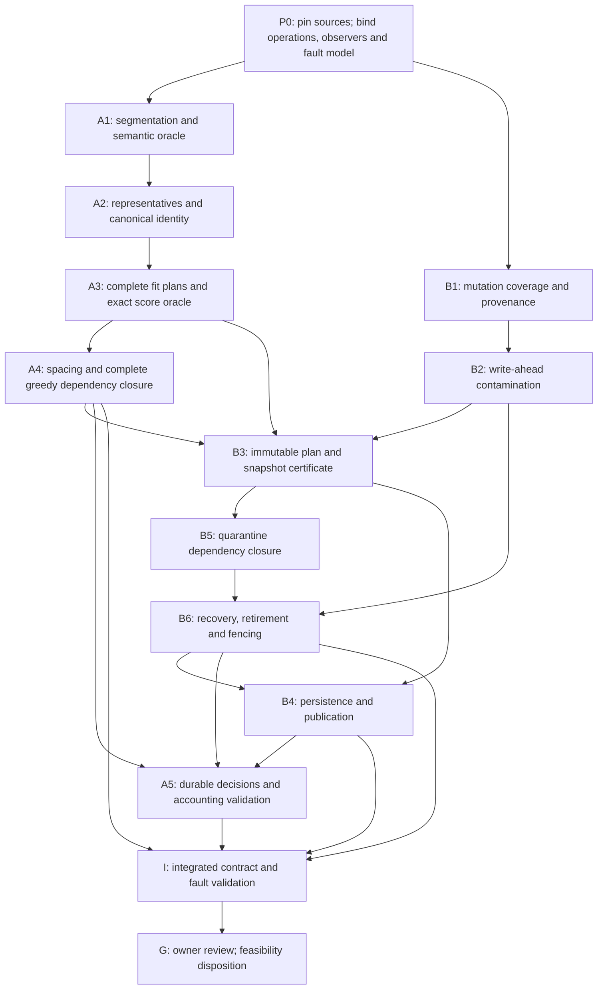

# ST-05 Stage 0 — Integrated Feasibility Validation Plan

> **VALIDATION PROPOSAL ONLY — NOT EXECUTION AUTHORIZATION.**
>
> This document revises the archived integrated validation proposal to address independent audit findings F1–F6. Revision baseline: `e77faf45cf51567c3e8ade18776c2ea53bc99bcd`. Saving and committing this document does not approve its proposed algorithms or parameters, authorize implementation, tests, probes, world generation, integration or Stage 1 progression, or permit a merge or checkpoint change. Existing owner-approved design remains unchanged and takes precedence. **A02 and A03 remain BLOCKED.**
>
> Audit baseline: design commit `27c5cd50c782f7dbfaaa77a4f50985f00b8e1134`; evidence PR #218 at `838e1366d44a7a09c43bb1453d92511eea46327e`. Live-reference observations below belong to the original 2026-10-31 planning review, not a new execution or validation run. Review this document through the immutable commit URL reported when it is saved; the document commit does not replace the pinned design baseline.

**PLAN_READY describes this gated validation protocol only, subject to the execution-entry conditions in sections 7–8. It is not execution authorization or a feasibility verdict. A02 and A03 remain BLOCKED.** This plan approves no technical parameters, implementation, experiments, or Stage 1 progression.

The original planning review changed no files, GitHub records, checkpoints, or branches. No probes, tests, or world generation were executed. The historical document-save authorization permitted only adding this plan. The present F1–F6 revision authorization permits editing and committing only this planning document on the specified design branch.

## 1. Verified baseline and evidence

Live references checked on 2026-10-31 during the original planning review:

| Reference | Live observation |
|---|---|
| Design branch | `design/st05-worldgen-q01-q18-20261030` → **`27c5cd50c782f7dbfaaa77a4f50985f00b8e1134`**, matching the pin |
| [Owner FIX decisions](https://github.com/ItzGamesGD/MoreMinecrafts-Beta/blob/27c5cd50c782f7dbfaaa77a4f50985f00b8e1134/docs/design/ST05_STAGE0_FIX_OWNER_DECISIONS_2026-10-31.md) | Blob `735bca2a5af7bc4cb6e08cd72733dc72a0c7a2c7`; includes A02-Q01–Q10 and A03-Q01–Q06 |
| [WG-Q01–Q45 + FIX-01 A](https://github.com/ItzGamesGD/MoreMinecrafts-Beta/blob/27c5cd50c782f7dbfaaa77a4f50985f00b8e1134/docs/design/ST05_WORLDGEN_OWNER_DECISIONS_Q01_Q18_2026-10-30.md) | Blob `9b9331def0c041750018f43f919203ed8aa67006` |
| [Preimplementation audit](https://github.com/ItzGamesGD/MoreMinecrafts-Beta/blob/27c5cd50c782f7dbfaaa77a4f50985f00b8e1134/docs/design/ST05_WORLDGEN_PREIMPLEMENTATION_AUDIT_2026-10-30.md) | Blob `bcdc49584e35941f2a81398384b282c0ee8a4a01` |
| [Stage handoff](https://github.com/ItzGamesGD/MoreMinecrafts-Beta/blob/27c5cd50c782f7dbfaaa77a4f50985f00b8e1134/docs/design/ST05_WORLDGEN_STAGED_IMPLEMENTATION_HANDOFF_2026-10-30.md) | Blob `e47857ecc326d977bb987ecdf5d23fd7ff9dfa44` |
| [PR #218](https://github.com/ItzGamesGD/MoreMinecrafts-Beta/pull/218) | Open, draft, unmerged; HEAD **`838e1366d44a7a09c43bb1453d92511eea46327e`** |
| PR #213 / #216 | Both open, draft, unmerged; heads `172613621438ad5f2c2252134e0aaccf1a757380` / `1ee08d440032095f9f247f2cb98c87fd15478656` |

**Differences that must remain explicit:**

- PR #218 records design base `cfdecb47897758fa1ea02c447dd7490fcf04268d`; it does not contain the full newer FIX policy at the pinned design commit. Its pinned WG, audit, and handoff blobs match the current pinned versions.
- Its whole-connected-air identity examples and unapproved hash-priority spacing examples do not validate the newer major-chamber segmentation or Q08 suitability-greedy policy.
- PR #218's body described some CI as pending. The live check-run response in the planning review listed all 13 returned checks as completed/success. This does not resolve either feasibility blocker.
- The local checkout used during planning was unrelated HEAD `cde842dd2cd3d472515aaecb80ad7e78f5da5ce3`, with a clean working tree. Remote pinned files were used; no checkout or baseline change occurred.

Reuse these PR #218 artifacts as **historical evidence with stated limits**:

| Evidence | What it supports | What it does not support |
|---|---|---|
| [summary.json](https://github.com/ItzGamesGD/MoreMinecrafts-Beta/blob/838e1366d44a7a09c43bb1453d92511eea46327e/tools/st05-stage0/results/fix/summary.json), [recover.json](https://github.com/ItzGamesGD/MoreMinecrafts-Beta/blob/838e1366d44a7a09c43bb1453d92511eea46327e/tools/st05-stage0/results/fix/recover.json) | Five-JVM, two-marker recovery; idempotent replay; corrupt-journal rejection; visible-conflict preservation | Whole-arena atomicity, production persistence, actual player-event coverage |
| Change-and-restore negative control | State reconciliation overwrote an indistinguishable restored edit | Safe nonintervention detection |
| [identity.json](https://github.com/ItzGamesGD/MoreMinecrafts-Beta/blob/838e1366d44a7a09c43bb1453d92511eea46327e/tools/st05-stage0/results/fix/identity.json) | Stable complete synthetic identities; 96 SQLite claims → 3 unique records; restart adds zero | Stable Minecraft chamber identities, production concurrency, finite search completeness |
| [README.md](https://github.com/ItzGamesGD/MoreMinecrafts-Beta/blob/838e1366d44a7a09c43bb1453d92511eea46327e/tools/st05-stage0/README.md), API signatures | Reproduction specification and known limitations; region-boundary fixture | Cave qualification, complete collision plans, power-loss safety |

## 2. Authority boundary and dependency DAG

**Approved invariants:** major independently qualifying chambers distinguished through relative bottlenecks; deterministic representative-based identities; ≤8 fit candidates before one 75% roll; descending-suitability greedy acceptance with canonical-ID ties; separate statistical stages; conservative player protection, chunk quarantine and dependency closure; conditional recovery and non-destructive retirement; unchanged WG-Q28.

**Unapproved proposals below:** segmentation thresholds and measurement details, representative algorithms and encoding, numeric spacing and metric, exact scoring transforms, completeness certificates, journal/provenance protocol, storage and publication mechanism.

Each package produces a separately reviewable specification, evidence bundle and separate PASS, FAIL, UNKNOWN or BLOCKED report. Package IDs P0, A1–A5, B1–B6, I and G have exactly the same meanings throughout this document. A5 is standalone ledger/reconciliation validation using certified fixtures; I is the later integrated exercise, so A5 → I is not circular. A failure blocks dependent packages; it does not authorize redesign.

**Runtime investigation baseline:** Minecraft 26.3, Java 25, Loader 0.19.5, Loom 1.17.21, Fabric API `0.161.0+26.3`. Later work must record source/mapping hashes and exact call sites. Class names below are investigation targets, not claims of available guarantees.

## 3. A02 work packages

| Package | Invariant and proposed algorithm | Source/API targets | Proof, experiments and acceptance |
|---|---|---|---|
| **A1 — segmentation** | Every finalized unit has a discovery-order-independent voxel membership and independently satisfies width ≥32, height ≥18 and a traversable path ≥64. Narrow connectors alone do not merge major chambers. Propose a six-neighbor natural traversability graph, distance-to-solid chamber cores and relative neck analysis. Compare neck/core cross-sectional area ratios **0.20, 0.35, 0.50**, using fixed **8/16-block** comparison windows. These are experimental values only. Merge overlapping cores unless a reproducible qualifying neck separates them. | Noise/carver and aquifer stages; `NoiseBasedChunkGenerator`, `NoiseChunk`, chunk-status pipeline, `WorldGenRegion`; availability of immutable pre-ST05 natural geometry independent of later structures and player edits. | Define cross-section orientation, window selection, branch junctions, plateaus, core merging and width/height/path witnesses before coding. Compare dumbbells, broad halls, loops, braided tunnels and distant connections. Require identical final membership under every tested schedule and no unresolved frontier treated as closed. Owner approves metric, threshold, resolution and qualification measurements. |
| **A2 — representatives/IDs** | Compare **L:** signed numeric lexicographic minimum `(x,y,z)` of the complete unit; **I:** maximum interior clearance, then minimum sum of traversable graph distances to unit voxels, then signed `(x,y,z)`. I selects an actual traversable voxel. Propose identity tuple `(schema, seed, dimension-key, representative)` with length-delimited encoding; digest is an index, with full tuple equality checking. | Coordinate and dimension serialization; seed/generator identity; block-position packing limits; natural-snapshot access across unloaded chunks. | Prove one unit → one tuple, distinct disjoint units → distinct representatives, canonical serialization and collision handling. Measure remote extremal branches, centrality ties, representative-to-plan-center distance, work and memory. Any partial discovery that changes an already-finalized identity fails. Owner must approve representative, ordering, encoding and version policy. |
| **A3 — fit/score** | Stable unit → at most eight deterministic candidate descriptors → complete hard-gated plans → exact scores → one selected best plan. Candidate-score ties use deterministic seed-based ordering, preserving WG-Q33. No roll before fit proof; no alternative search after retirement or spacing loss. | Structure planning/placement, template processors, `StructureStart.placeInChunk`, occupancy/clearance queries, fluid/stair/block-update behavior; PR #216 mask contract. | Every plan must include arena, modules, 1–2 connections, terrain repair, fluid seals, protected occupancy and clearance, and all read/write dependencies. Unknown protected occupancy rejects conservatively. Permuting the other seven candidates must leave a candidate's score unchanged. Section 8.2 supplies independent cross-cavern, saturation and tie vectors. Owner reviews score transforms and candidate-generation policy where they affect eligibility/density. |
| **A4 — spacing/conflicts** | On the complete qualified roll-winner population, sort by `(-exact suitability, canonical ID)`; accept only against already accepted candidates and all protected/persisted/retired sites. Rejected candidates do not exclude later ones. | Deterministic off-thread/unloaded-neighbor inspection, chunk-generation scheduling and recursion; persistence/index completeness; world-coordinate limits. | Prove complete direct-neighbor discovery **and transitive higher-priority dependency closure**. Exercise multiway conflicts, cycles, arbitrary chain lengths, late higher-priority candidates, region crossings and protected sites. No commitment without a completeness certificate; section 8.3 additionally requires cross-plan snapshot validity. Metric/value and work bounds remain owner gates. |
| **A5 — accounting** | One durable decision per canonical ID; eligibility, roll, win, conflict, lifecycle and actual placement are separate fields/events. Retries never increment distinct-unit counters or consume new randomness. | Production persistent-state serialization, asynchronous saves, unique claims and synchronization; controller registration boundaries. | Concurrent repeated discovery and restart must reproduce the same decision and counters. Ledger loss or ID ambiguity is UNKNOWN/quarantine, not a new roll. The transition and reconciliation oracle is section 8.4. Owner approves persistent lifecycle details, without changing the approved denominators. |

**Segmentation assumptions requiring explicit validation:** a consistent natural-geometry snapshot exists; player-created voids cannot become natural qualification evidence; width and height concern a representative chamber rather than disconnected extrema; the 64-block witness is a simple traversable route, not repeated walking around a cycle. A short-corridor qualification witness must not silently imply a complete chamber-membership bound.

### Proposed exact fixed-reference scoring

All formulas below are **unapproved comparison proposals**. Hard gates run first. Use exact rational arithmetic; compare totals without floating-point rounding.

Let `clip(x)=min(1,max(0,x))`. Select a deterministic primary connection before scoring; secondary connections contribute to total damage/fluid measurements but do not boost primary-connection quality.

| Component | Exact proposed definition |
|---|---|
| **C, WG-Q36** | `C = .4L + .3H + .3J`. `L=100(1−ℓ/32)`, where `ℓ` is primary traversable route length. `H=100[1−clip((a+b)/32)]`, where `a` is the number of one-block elevation transitions and `b` counts consecutive transitions reversing ascent direction. Valid stair continuity/clearance remains mandatory. `J=100j/125`, where `j` counts pre-existing, naturally traversable cells in a route-aligned **5×5×5** junction stencil beyond the cave endpoint. |
| **T, WG-Q37** | `T=.6M+.4G`. `M=100[1−clip(n/100000)]`, with `n` the number of distinct natural cells whose block state changes, including excavation, replacement and seals. Log mandatory construction and optional correction separately, summing each changed cell once. `G=100g/\|V\|`, where `V` is the fully defined unit's original traversable-cell set and `g` counts cells remaining traversable and connected to a fixed canonical qualification witness after applying the plan. Destroying mandatory routes rejects the plan. |
| **F, WG-Q38** | `F=.5W+.5R`. `W=100[1−clip(f/2048)]`, where `f` counts distinct fluid-removal and fluid-sealing-work cells. `R=100[1−clip(e/256)]`, where `e` counts exterior wet block faces contacting the final protective seal boundary within the complete fluid dependency envelope. Seal safety and absence of persistent floor/Vault flooding are independent hard gates. Unknown fluid dependencies reject or remain pending. |
| **E, WG-Q39** | `E=.6D+.4A`. `D=100d/64`: 64 deterministic pre-existing cave observation positions, ordered by graph distance from the primary junction and then coordinates; `d` counts unobstructed views to the entrance aperture. Missing positions score zero. `A=100a/w`: `w` is the fixed planned outer-wall-face stencil for the chosen variant; `a` counts naturally exposed faces retaining their intended architectural state. Visibility uses original natural geometry, so added excavation cannot increase this score. |
| **S, WG-Q35** | **`S=.4C+.4T+.1F+.1E`**. Approved outer and inner weights remain unchanged. |

Before implementation, each cell predicate, route orientation, view-ray endpoint and voxel stencil must be serialized in the score specification. Report saturation and sensitivity for the proposed constants; changing them requires a new reviewed proposal.

**Score acceptance:** endpoints and intermediate golden vectors match exactly; each raw measure has its stated monotonic effect; all outputs lie in 0–100; candidate-population changes cannot renormalize scores; mandatory violations never become acceptable through a high total.

### Spacing comparison and finite-search obligation

Compare these **specific proposed experimental settings**, independently of the 68-block diameter:

| Proposal | Exact geometry | Initial value and sensitivity |
|---|---|---|
| Center spacing | Horizontal squared Euclidean distance between doubled-coordinate arena symmetry centers; equality passes. Separately compare 3D distance using the same center convention. | **160 blocks**; compare **128 / 160 / 192** |
| Footprint spacing | Minimum Euclidean distance between closed unit voxel cubes in the protected occupied/mandatory-clearance sets, including corridors and seals; equality passes. Compare full 3D against horizontal projection. | **32 blocks**; compare **16 / 32 / 48** |

Actual protected overlap remains a hard rejection under either metric. Retired sites retain protection; an incomplete site's missing planned blocks must not make its exclusion mask disappear. Propose conservatively reserving its complete immutable plan footprint, pending owner review.

Report density, corridor interference, vertically stacked arenas, large/irregular footprints, and candidate counts. Center spacing alone does not establish noninterference.

For neighbor enumeration:

1. Derive maximum plan extents from actual voxel plans, including modules, repair, corridor clearance and junctions.
2. Use plan extents to derive a conservative direct-conflict envelope.
3. Prove how every unit capable of placing a center/footprint in that envelope is discoverable. A representative may be arbitrarily far from its placement center unless a bound is established.
4. Recursively enumerate higher-priority conflicting winners required to decide acceptance. Include protected-site state and its dependencies.
5. Finalize only with closed geometry frontiers, complete candidate coverage and complete decision dependencies.

**Critical counterexample:** a path of conflicts `A₀—A₁—…—Aₙ`, increasing in priority toward `Aₙ`, can change `A₀`'s acceptance when a remote endpoint is added. Direct spacing radius therefore does not bound greedy dependency radius. Exact-score ties ordered by ID can also create long chains.

Neither finite sampled chains nor 30 successful seeds prove a universal bound. Finite world-coordinate limits alone do not establish an acceptable deterministic operational budget.

If a complete finite algorithm within an approved budget cannot be established, **retain A02 BLOCKED and leave placement pending**. Present, without adopting:

- Exhaustive resolution over an explicitly finite world domain, with quantified cost.
- A revised bounded-unit/conflict policy requiring owner approval because it changes semantics.
- Continued deferral or abandonment of placement for unresolved cases, with denominator effects exposed.

## 4. A03 work packages

| Package | Formal invariant and proposed mechanism | Investigation, counterexamples and acceptance |
|---|---|---|
| **B1 — nonintervention/provenance** | Recovery permission requires a continuous, independently verifiable provenance interval from trusted baseline through recovery. Equal current block states are insufficient. Propose monotonic chunk/dependency contamination epochs and durable records of potentially relevant mutation attempts, including change-and-restore. Unknown origin, lost logs or uncovered intervals mean contamination/uncertainty. | Trace player break/place/use, buckets, explosions, pistons, fluids, scheduled/random ticks, fire, entities, commands, block entities, structure generation, low-level section writes, mods, imports and offline edits. Inspect `ServerPlayerGameMode`, interaction/command routes, `Level`/`LevelChunk`/`LevelChunkSection` mutations and causal propagation. Every uncovered path must be detectable as UNKNOWN or prevent a safety claim. Owner approves evidence standard and supported mutation environment. |
| **B2 — write-ahead contamination** | A relevant mutation cannot become effective before its contamination evidence is durable. Proposed order: acquire mutation fence → persist intent/epoch and dependency contamination → durability acknowledgement → permit mutation. Clean status never follows merely from restoration. | Inspect mutation synchronization, journal force semantics, atomic rename assumptions, chunk-save ordering, `RegionFile`/IO workers, persistent-state save behavior and error handling. Crash before/after each ordering edge. Fail if any effective edit can survive without corresponding evidence while recovery is allowed. Ordinary “dirty” flags and save-method return values are not durability proofs. |
| **B3 — whole-arena plan** | No placement write precedes a durable, immutable, fully validated plan and its complete dependency declarations. Reads used for decisions must remain valid through commitment, or commitment fails before writes. | Include every architecture variant, corridor, clearance, terrain modification, seal, module, block entity and protected site. Investigate structure processors and deferred updates for hidden reads/writes. Missing dependency, plan-hash mismatch, unavailable chunk or concurrent relevant edit means no commitment. Owner reviews plan scope; geometry constraints remain unchanged. Section 8.3 defines a proposed, unapproved snapshot/epoch comparison contract and invalidation cases. |
| **B4 — persistent consistency/publication** | All participating chunks, block entities, completion records and registration refer to the same plan and generation epoch. Every allowed external observer must see a coherent pre-placement or complete placement state. A complete flag cannot conceal incomplete physical state. | Compare ordinary WAL, staging and versioned/shadow publication as hypotheses. Trace chunk save/load, entity and block-entity stores, lighting, heightmaps, scheduled ticks, fluids, neighbor updates, client packets, collision/pathfinding, commands and autosaves. Inject crashes with mixed old/new chunk versions. Require independent visibility and restart proofs; staging or replay alone is insufficient. Owner reviews observer/crash model without implicitly relaxing WG-Q28. |
| **B5 — quarantine closure** | For uncertain chunks `Q₀`, quarantine `Q=closure(Q₀)` over all structural, corridor, clearance, support, fluid, publication and completion dependencies. Unknown dependencies expand Q. No automatic write in Q. | Test an edit in one corridor chunk whose seal/support affects another region; inaccessible chunks; cyclic dependencies; shared publication groups. Independent recovery is allowed only with a nonintervention certificate and no dependency on Q. Whole-arena publication may make Q encompass the entire site. Exact closure/persistence needs owner review. |
| **B6 — recovery/retirement/fencing** | Recover only demonstrably independent safe portions. Otherwise logically retire; perform no rollback, deletion, replacement or substitute search/roll. Durable retired protection precedes releasing workers. A stale generation epoch cannot write, publish, register or change accounting. | Inspect transaction/locking options and every mutation entry point. Epoch checks must be synchronized with the write; a check followed by an unfenced write is insufficient. Crash during retirement, reload stale workers and compact/rebuild indexes. Require zero stale-worker writes and durable no-reroll/no-substitute behavior. Owner approves lifecycle and evidence details. Section 8.4 forbids confusing unfinished generation with post-publication player edits. |

**Nonintervention certificate proposal:** identify trusted baseline, world/save lineage, covered chunks and causal dependencies, instrumentation/schema versions, uninterrupted observation interval, durable journal sequence, mutation epochs and recovery fence. A checksum authenticates record consistency; it does not prove complete mutation coverage.

**Change-and-restore acceptance:** both a different final block and a restored-original final block produce persistent contaminated/uncertain status. Recovery writes **zero** blocks in their quarantine closures, including after restart.

**Four independent result columns are mandatory:**

| Property | Required evidence |
|---|---|
| Runtime visibility | No observer sees or interacts with a partially published arena or its indirect effects |
| Post-restart consistency | Reload reconstructs a coherent physical placement across every participating store |
| Player-edit preservation | No recovery/retirement path overwrites an intervening edit, including restored-state edits |
| Trial/reward activation | No trial, Vault, key, reward or successful-generation registration before whole-site acceptance |

Passing one column proves none of the others.

**A03-FIX-Q06 C remains controlling:** quarantine and retirement are safety responses, not proof of physical completeness. Any incomplete physical remains must still be reported as a WG-Q28 failure. If preserving edits prevents completion, record the concrete incompatibility and retain **A03 BLOCKED**.

Alternatives for owner consideration, without adoption: a comprehensively mediated versioned-publication mechanism; an enforceable generation-before-exposure architecture with proven crash behavior; or an explicit requirement revision. No automatic exception is included.

## 5. Proposed A02 → A03 integration contract

| Payload | Required meaning |
|---|---|
| `CavernIdentity` | Full canonical tuple, segmentation/representative versions, qualification witnesses and completeness certificate; unresolved identity cannot authorize a roll |
| `PlacementPlan` | Immutable variant, selected candidate, all target states/block entities, geometry, corridors, seals and deterministic score breakdown |
| `PlanHash` | Canonical serialization hash covering identity, algorithm/config versions, baseline dependencies and complete plan; never timestamp/thread/order dependent |
| `Dependencies` | Separate decision-read sets, write sets, protected occupied/clearance footprint, indirect-effect dependencies and participating storage/publication groups |
| `RollDecision` | One persistent deterministic roll after fit, configured probability 75%, result, and original selected plan; no subsequent fit lottery |
| `ConflictDecision` | Canonical ranking, complete dependency certificate, accepted/rejected/pending result and blocking IDs/sites; rejected candidates reserve nothing merely by losing |
| `GenerationLifecycle` | Separate planned, applying/staged, physically verified and published states; state names do not imply atomicity |
| `SafetyState` | Quarantine closure, provenance evidence, fencing epoch, failure reason and durable retirement protection |
| `AccountingEvents` | Idempotent keys by canonical ID and transition; accepted/published placement is never inferred from a roll win |

A proposed roll implementation may use a domain-separated deterministic bit value with success for three of four outcomes. Its hash/PRF choice and serialization require review; it must not be presented as a proof of empirical independence.

Keep orthogonal statuses:

- Eligibility: `UNRESOLVED / INELIGIBLE / FIT_ELIGIBLE`.
- Roll: `NOT_ROLLED / LOSS / WIN`.
- Conflict: `PENDING / ACCEPTED / SPACING_REJECTED / PROTECTED_REJECTED`.
- Physical lifecycle: `UNSTARTED / APPLYING / COMPLETE_VERIFIED / PUBLISHED`.
- Safety: `CLEAR / QUARANTINED / RETIRED`.

Counters derive from durable distinct-ID records:

`roll fraction = winners / actually rolled fit-eligible units`

`historical placement fraction = distinct durably evidenced, physically complete published placements / actually rolled fit-eligible units`

Also report qualification, fit eligibility, spacing rejection, protected rejection, pending, quarantine and retirement counts separately. Retirement never resets eligibility or roll history. A successful publication is historical and is not erased by subsequent lawful player edits; current activation state is separate (section 8.4). New live obstructions are integrity events, not a normal post-roll fit filter.

## 6. Later-stage test matrix and observable assertions

All rows are **PLANNED / NOT RUN**. Sections 8.1–8.5 provide the expected-output oracles and injection catalogue. I may begin only after A5 and its other DAG prerequisites have PASS evidence for the declared scope; a blocked prerequisite cannot be bypassed.

| Package(s) / test family | Inputs/schedules | Exact observable assertion |
|---|---|---|
| A1 / Segmentation boundaries | Dumbbell, broad hall, braided passages, loops, distant narrow connection; threshold-adjacent cases | Same completed voxel partition and qualification witnesses in every schedule; unknown frontiers never finalized |
| A2 / Representative comparison | Negative coordinates, symmetric chambers, remote tendrils, centrality ties, separate dimensions/seeds | Same tuple per complete unit across schedules; no cross-unit alias; signed ordering correct; representative is a member voxel |
| A1, A3 / Qualification/fit | Width 31/32/33; height 17/18/19; path 63/64/65; corridor 31/32/33; hard-gate violations | Exact threshold behavior under reviewed measurements; ≤8 candidates; no roll for unresolved or no-fit unit; zero writes |
| A3 / Scoring | Golden endpoint/intermediate values; candidate additions/removals; unsafe high-score plans | Exact rational totals; fixed-reference invariance; unsafe plans rejected regardless of score |
| A4 / Greedy conflicts | Approved C>B>A chain; triangles; cycles; path lengths 2, 3, 8, 32, 128; remote endpoint extension | C and A accepted, B rejected in the specified chain; isolated solver equals complete-population oracle; no claim that tested lengths bound all chains |
| A4 / Spacing | Each proposed metric/value; equality and ±1 coordinate cases; vertical stacks; long corridors; retired sites | Equality follows specification; protected overlap always rejects; results match exact geometry oracle |
| A1–A5, B3–B6 / Schedule/restart | Forward/reverse/spiral chunk order; chunk/region corners including negative coordinates; overlapping workers; restarts at decision boundaries | Identical finalized IDs, plans, rolls, accepted population and accounting; retries add zero decisions |
| B1–B2 / Provenance | Actual player edits and restoration; commands, fluids, pistons, explosions, entities, block entities, mods and offline-save changes | Every path yields durable observed contamination or explicit UNKNOWN; no UNKNOWN interval authorizes recovery |
| B2–B4, B6 / Persistence faults | Every journal append/force/rename, chunk-save, block-entity-save, manifest, completion and reload boundary | No false COMPLETE; no edit loss; no mixed physical state accepted; malformed/missing data fail closed |
| B4 / Visibility/publication | Readers/ticks/client packets during every write/publication boundary | Each observer sees coherent old or complete new state; zero partial collision, fluid, lighting, block-entity or interaction effects |
| B5–B6 / Quarantine/recovery | Cross-chunk corridor/support/seal dependencies; missing chunk; concurrent edit between check and write | Zero writes in closure; independent recovery only with valid certificate and fence |
| B6 / Retirement/stale workers | Crash before/after retirement persistence; stale task resumes; index reconstruction | Existing blocks preserved; durable footprint remains protected; stale writes/publication/activation = 0; additional rolls/searches = 0 |
| A5 / Activation/accounting | Pending, spacing-lost, quarantined, retired, stale-complete and successful sites | Generation-incomplete sites produce zero trial/reward/success registration; each successful publication counted once; later player modifications do not erase it or authorize generation repair/retirement; existing personal claim history preserved |

For later empirical Minecraft sampling, start with the approved **30 seeds**, retaining `20261030` for historical comparison. Publish the seed list and bounded observation domains before execution. Expand based on eligible-unit counts and uncertainty, reporting per-seed results, confidence intervals, pending cases, deterministic operation counts, latency tails and peak memory. Never censor unresolved cases or equate final placement rate with 75%.

Instrumentation must record seed/dimension, coordinates, chunk/region, canonical tuple, algorithm versions, frontier/completeness status, candidate ordinal, hard-gate reasons, raw score measurements, exact totals, roll record, conflict dependencies, plan hash, mutation provenance, fence epoch, journal/save acknowledgements, observer events and physical validation results.

## 7. Proof obligations, falsification and approval gates

**Requires a general argument, not a seed sample:**

- Segmentation and representative stability on fully defined units.
- Complete neighbor discovery despite representative displacement.
- Termination and completeness of greedy dependency resolution within the proposed deterministic budget.
- Mutation-path coverage and write-ahead ordering.
- Race-free fencing and durable lifecycle/accounting transitions.
- Cross-store persistence and publication guarantees under the stated crash/observer model.

Empirical tests can falsify these arguments and establish behavior on tested cases. They cannot prove universal geometric bounds, absence of unobserved mutation paths, or power-loss guarantees by themselves.

**STOP conditions:**

- Any finalized ID changes under late discovery.
- A missing neighbor changes an already committed greedy result.
- Budget exhaustion silently excludes units or changes eligibility.
- State equality is used as evidence of no intervention.
- A write precedes durable contamination or plan evidence.
- Any player edit is overwritten, stale worker writes, protected site is damaged, or a substitute roll/search occurs.
- Any partial physical arena is exposed or persists contrary to WG-Q28—even if retired and inactive.
- Geometry, scoring weights, probability, candidate cap or other approved hard constraints must change to proceed.

**Owner gates, bundled into a focused feasibility review:**

1. Separate authorization to execute isolated validation; the original task authorizes planning only, and the document-save task authorizes documentation only.
2. Segmentation metric/threshold, qualification measurements and representative/ID specification.
3. Exact score transforms, spacing metric/value, complete-enumeration proof and operational budgets.
4. Nonintervention evidence standard, supported mutation environment, quarantine dependencies, lifecycle/fencing and publication/crash model.
5. Review of raw results and unresolved incompatibilities. Stage 1 requires separate approval; neither a passing fixture nor this plan grants it.

Recommended isolated order: **source/API and proof review → synthetic counterexamples/oracles → segmentation and representative comparison → complete fit/scoring and spacing closure → provenance and write-ahead durability → quarantine/retirement/fencing → physical publication and restart faults → isolated A02/A03 contract exercise → 30-seed empirical sampling → owner review.**

**Protocol assessment is in section 8.6. A02 BLOCKED; A03 BLOCKED. No complete finite placement algorithm or compliant atomic publication mechanism has yet been established.**

## 8. Audit F1–F6 revision: independent oracles and execution-entry contract

Everything in this section is a **validation specification or explicitly unapproved mechanism proposal**, not a promotion into owner-approved gameplay authority. Preserve WG-Q01–Q45, FIX-01 A, A02-FIX-Q01–Q10 and A03-FIX-Q01–Q06. In particular, Q09 C and Q10 C authorize research proposals, not final spacing, representative or parameter choices. The snapshot/epoch model below is one hypothesis to compare; an alternative mechanism may satisfy the same approved properties. No implementation or execution is authorized here.

Result vocabulary applies per property, per row and per package:

- **PASS:** independently observed outputs satisfy the declared oracle and all prerequisites for that bounded claim. A finite-fixture PASS has only that scope.
- **FAIL:** a witnessed contradiction of an approved property or a declared experimental oracle. Record experimental-oracle failure separately from an approved-requirement violation.
- **UNKNOWN:** observations, semantic decisions, mapping coverage or proof are insufficient. It is never counted as PASS or as ineligibility.
- **BLOCKED:** a dependent package cannot proceed because authorization, a required owner decision or prerequisite evidence is absent/failed/unknown. A02/A03 remain BLOCKED independently of document readiness.

PLANNED / NOT RUN describes execution history, not a fifth acceptance result. No row in this revision has been executed. Negative-control detection can PASS the *harness*, while the deliberately broken subject must be reported FAIL. Safety-preserving refusal may PASS its safety column while integrity or progress is FAIL/UNKNOWN.

### 8.1 A1–A2 / F1: semantic segmentation oracle

The fixture author must be independent of the proposed segmenter: publish literal voxel sets, natural-origin labels, floor/support/head-clearance data, chamber labels and witnesses **before** reading the segmenter's output. The segmenter cannot generate its own expected labels or use its own IDs as the oracle. Closed fixtures are embedded in an explicitly solid exterior; open-frontier fixtures explicitly withhold that exterior. Coordinates below are inclusive integer voxel coordinates; all cells not listed as void are solid. Translation/rotation copies preserve the labels and witnesses, including across negative chunk/region boundaries.

Define test-only boxes R(t) = [t,t+39] × [0,19] × [0,79], H = [0,119] × [0,19] × [0,79]. Their floors at y=-1 are solid. A witness is a supported, head-clear route with feet at (t+1,0,z), z=0..79: 79 edges, with representative chamber width 40 and height 20. These obvious boxes satisfy WG-Q09; this does **not** assert full arena fit. N = [40,79] × [0,2] × [38,40] joins R(0) and R(80) by a 3×3 neck. P = [40,79] × [0,2] × [8,10] and Q = [40,79] × [0,2] × [68,70] are two additional narrow connectors.

| Fixture | Independently expected chamber count / membership | Qualification oracle and required verdict |
|---|---|---|
| S01 single closed room: R(0) | Exactly 1; membership exactly R(0) | 1 qualifying unit, witness above; an extra split or missing/extra member is FAIL |
| S02 disconnected rooms: R(0) ∪ R(80), solid gap | Exactly 2; exact memberships R(0), R(80) | Both qualify independently; merging across solid is FAIL |
| S03 broad hall: H | Exactly 1; membership exactly H; x=40/80 are not necks or cuts | 1 qualifies; fixed-cell/center-distance splitting is FAIL |
| S04 dumbbell: R(0) ∪ N ∪ R(80) | 2 independently qualifying chamber cores R(0), R(80); no core split/merge. Ownership/exclusion of N is explicitly UNKNOWN pending the reviewed boundary convention | Both cores qualify. Merging them solely because N connects them is FAIL. Exact full-unit membership and canonical IDs remain UNKNOWN until neck ownership is decided |
| S05 braided/loop connection: R(0) ∪ N ∪ P ∪ Q ∪ R(80) | Same 2 core labels; connector-only cells N/P/Q have UNKNOWN boundary ownership | Both cores qualify. A loop must not turn the two major chambers into one merely by connectivity; full-membership verdict remains UNKNOWN |
| S06 distant connection | R(0) ∪ R(4000) plus [40,3999]×[0,2]×[38,40]; the support floor extends under the tunnel | 2 qualifying cores; tunnel membership UNKNOWN. Discovery of the remote tunnel may not silently merge finalized units; no finalized full-ID PASS while ownership/frontier is unresolved |
| S07 small/disconnected extrema | B=[0,15]×[0,7]×[0,79] and B+(80,0,0), solid gap | Exactly 2 memberships B and translated B, **0 qualifying**: width 16 and height 8 each. Combining extrema across the gap to meet width/height is FAIL |
| S08 width/height boundary boxes | Separate closed boxes [0,w-1]×[0,h-1]×[0,79], with (w,h)=(31,20),(32,18),(33,19),(40,17) | Exactly 1 membership per box; qualifying counts respectively 0,1,1,0 using the direct 79-edge floor witness. No additional rarity/fit claim |
| S09 threshold/branch ambiguity | R(0) ∪ R(80), joined by four slabs: [40,49]×[0,2]×[38,40], [50,59]×[0,8]×[35,43], [60,69]×[0,18]×[30,48], [70,79]×[0,19]×[30,49]; compare branch/overlapping-core label alternatives | Count, contested membership and qualification **UNKNOWN** where interpretation is genuinely undecided; report each alternative and denominator impact. Never tune the oracle to the winning segmenter |
| S10 open frontier / late extension | S01 cropped to x=0..19 with the x=20 plane explicitly unknown; repeat S03/S04 using the same crop rule; later reveal the original source fixture | Before reveal: full count/membership/qualification UNKNOWN, no finalized ID/roll. After reveal: use the original source fixture oracle; schedule equality alone cannot pass |
| S11 remote tendril / symmetry | S01 ∪ ([-200,-1]×[0,2]×[38,40]); also its copy translated by (512,0,512), with a solid support floor and explicit branch-end labels | Main core qualifies; full membership/representative UNKNOWN until branch ownership is fixed. After that independent decision, A2 must compute both proposed representatives over that exact membership, including remote extrema and ties |

For every fixture, the independently serialized voxel/label manifest derived from these literal sets is an **entry artifact**, not permission to generate a world now. S04–S06/S09/S11 deliberately retain unknown connector/contested membership rather than inventing an owner-approved boundary rule. Reject an incomplete manifest as BLOCKED; the rows already specify which semantic outputs are known and which are deliberately UNKNOWN. If an exact boundary convention is needed to give S04/S05/S06/S11 full memberships, seek review before freezing those expectations. Neither a convenient synthetic convention nor successful synthetic counts approve a production segmentation threshold.

Required deliberate controls:

| Control | Deliberately incorrect output | Expected detection |
|---|---|---|
| N-merge | One connected-air unit for S02 or S04/S05, or one unit for every fixture | Semantic oracle rejects: subject FAIL; detector PASS. S02 also checks solid separation |
| N-split | Split S01 at x=20 and S03 at x=40/80 | Subject FAIL despite perfect repeatability and unique IDs; detector PASS |
| N-extrema | Qualify S07 by combining dimensions from different rooms | Subject FAIL; detector PASS |
| N-frontier | Close S10's cropped frontier, issue an ID and roll | Subject FAIL; detector PASS |
| P-room | Correct exact S01/S02/S03/S08 memberships and witnesses | Must PASS those determinate oracle columns; returning UNKNOWN for every closed box cannot pass A1 |
| Ambiguity control | Refuse to finalize S09 and unresolved connector membership | UNKNOWN is the correct semantic disposition, not proof of stable full units |

A1 must pass the determinate positive cases and detect all incorrect controls. UNKNOWN boundary cases stay in reports and block their dependent A2/A3/A4 claims; they do not disappear from sampling. Agreement of all chunk schedules proves repeatability only. There is no circular inference from hash equality → correct partition → hash stability. Full A2 membership/representative PASS additionally requires a general completeness argument and independently checked frontier certificate, not just these fixtures.

### 8.2 A3–A4 / F2: exact arithmetic, selection and tie oracles

Golden vectors below are scalar oracle inputs, **not claims that a real cave/plan realizes them or passes hard gates**. All proposed transforms/constants in section 3 remain unapproved. Approved weights are unchanged: C=(4L+3H+3J)/10, T=(3M+2G)/5, F=(W+R)/2, E=(3D+2A)/5 and S=(4C+4T+F+E)/10. The fixture author supplies exact rational expected outputs independently of the score implementation. No decimal rounding, epsilon tie, or population normalization is permitted.

| Vector | (L,H,J); (M,G); (W,R); (D,A) | Expected (C,T,F,E); S |
|---|---|---|
| V0 | (0,0,0); (0,0); (0,0); (0,0) | (0,0,0,0); 0 |
| V1 | (100,100,100); (100,100); (100,100); (100,100) | (100,100,100,100); 100 |
| V2 | (50,75,80); (75,75); (75,75); (50,50) | (133/2,75,75,50); **691/10** |
| V3 | (100,0,0); (0,0); (0,0); (0,0) | (40,0,0,0); 16 |
| V4 | (0,100,0); (0,0); (0,0); (0,0) | (30,0,0,0); 12 |
| V5 | (0,0,100); (0,0); (0,0); (0,0) | (30,0,0,0); 12 |
| V6 | (0,0,0); (100,0); (0,0); (0,0) | (0,60,0,0); 24 |
| V7 | (0,0,0); (0,100); (0,0); (0,0) | (0,40,0,0); 16 |
| V8 | (0,0,0); (0,0); (100,0); (0,0) | (0,0,50,0); 5 |
| V9 | (0,0,0); (0,0); (0,100); (0,0) | (0,0,50,0); 5 |
| V10 | (0,0,0); (0,0); (0,0); (100,0) | (0,0,0,60); 6 |
| V11 | (0,0,0); (0,0); (0,0); (0,100) | (0,0,0,40); 4 |

Raw-transform vectors, with all unspecified inputs held fixed:

| Measure | Exact inputs → expected output |
|---|---|
| Route length L | ℓ=0,16,31,32 → L=100,50,25/8,0; ℓ=33 is a hard-gate rejection, not a usable negative score |
| Elevation H | a+b=0,16,31,32,33 → H=100,50,25/8,0,0 |
| Junction J | j=0,1,125 → J=0,4/5,100; counts outside 0..125 invalidate the input |
| Modification M | n=0,99999,100000,100001 → M=100,1/1000,0,0 |
| Geometry G | (g,\|V\|)=(0,1000),(1,1000),(750,1000),(1000,1000) → G=0,1/10,75,100; empty V or g>\|V\| invalidates the input |
| Fluid W | f=0,2047,2048,2049 → W=100,25/512,0,0 |
| Re-entry R | e=0,255,256,257 → R=100,25/64,0,0 |
| Discoverability D | d=0,1,64 → D=0,25/16,100; missing observation positions contribute zero, never a reduced denominator |
| Wall A | (a,w)=(0,100),(1,100),(50,100),(100,100) → A=0,1,50,100; w=0 or a>w invalidates the input |

V2 can be reconstructed from ℓ=16, a=8,b=0,j=100,n=25000,g=750,\|V\|=1000,f=512,e=64,d=32,a_wall=50,w=100. Store mandatory and optional modification counts without double counting. A high S never rescues an unsafe plan.

Selection/tie fixtures use a **test-only proposed order**, not a finalized Q10 C identity rule. Fixed schema/seed/dimension are equal unless explicitly varied; signed coordinate comparison is numeric. The owner must review any corresponding real selection/encoding specification before finalization.

| Oracle case | Inputs and exact expected result |
|---|---|
| Equal weighted totals | K1:(C,T,F,E)=(100,0,0,0), K2=(0,100,0,0), K3=(50,50,0,0) all give **S=40**. No component-wise preference may replace the proper tie-break. Put these in different cavern fixtures and in the same cavern fixture separately |
| Near tie | K4=(50+1/1000,50,0,0) gives S=40+1/2500; K4 strictly precedes S=40. Rounding it into a tie is FAIL |
| Primary connection tie | Two otherwise equal connections p0 and p1, with descriptor coordinate keys (-1,0,0) and (1,0,0), have (ℓ,a,b,j)=(16,8,0,100). Under the proposed descriptor tie order select p0, C=133/2, regardless of enumeration. Replay after adding an inferior third connection; primary and score stay unchanged. If geometry differs, the proposed complete connection-priority specification must precede this last tie key |
| Qualification-witness tie | In S01 two valid 64-edge routes at x=1 and x=2, feet y=0,z=0..64. Test-only order: canonicalize each route against its reversal, then compare coordinate sequences numerically. Select the x=1 route. The oracle supplies that witness directly; it is not chosen by candidate score or a provisional representative. Permuting witnesses must leave T/G and qualification unchanged |
| Within-cavern candidate tie / WG-Q33 | Candidates c0,c1 realize K1,K2, both S=40, frozen seed-based order c1<c0. Select c1; canonical cavern ID is identical and cannot select a candidate. Reverse discovery order: still c1 |
| Cross-cavern score tie / Q08 A | Two hard-valid, roll-winning, conflicting candidates with S=40 and canonical tuple coordinate keys (-1,0,0), (0,0,0). Under the proposed ID order accept the former and reject the latter, regardless of candidate-seed order or arrival |
| Exact same canonical ID | Repeated records for one actual unit are one decision, not two rivals. Two demonstrably distinct units with the same full canonical identity are **identity FAIL**; freeze dependent decisions as UNKNOWN/BLOCKED, never first-writer-wins |
| Digest collision | Distinct full tuples intentionally share an index digest. Preserve tuple distinction, follow reviewed full-ID comparison, do not merge claims. A digest alone must not settle an ID tie |
| Greedy chain | A–B and B–C conflict, A–C do not; S(A)=40, S(B)=60, S(C)=80. All hard-valid/winners: accept C, then reject B, then accept A. A rejected B never reserves exclusion space |
| Protected site | Repeat any tie/chain with a legitimate persisted/retired footprint blocking the score winner. Protection is a hard gate; no score or tie-break overwrites it |

Run future vectors both across different fully labeled units and within one unit's candidate set, including negative coordinates, translations and reordered input. Primary/witness tie rules above are explicit oracle proposals; changing them requires revising expected vectors before execution, not adopting whichever implementation wins. An actual unit whose witness/primary rule is not specified is UNKNOWN, not an inferred equal score.

Independent negative controls: rounded totals must fail the near-tie vector; swapped inner weights fail V3–V11; ID-only priority fails the unequal-score chain; a rejected-neighbor veto fails its A outcome; first-arrival tie resolution fails reversed schedules; relative candidate normalization fails unchanged-input comparisons. The correct exact evaluator/complete-population fixture oracle must pass, while each deliberately broken subject is FAIL.

### 8.3 A4, B3–B6 / F3: proposed snapshot/epoch certificate and invalidation

This is an **unapproved comparison mechanism**, not an owner-required implementation architecture. Its purpose is to make the approved deterministic planning, nonintervention and protection properties falsifiable. P0 must map a candidate mechanism's operations to this abstract contract or document a demonstrably equivalent alternative; inability to do so is UNKNOWN/BLOCKED, not automatic rejection of all alternatives.

Proposed certificate C contains:

- World/save lineage and trusted natural-baseline identity; generator/data/config/mapping/segmentation/representative/score versions; canonical cavern tuple, selected immutable plan and plan hash.
- Immutable natural snapshot for segmentation/qualification/score; separate live read dependencies for safe application. Neither snapshot proves current nonintervention.
- The complete dependency sets: natural geometry and witnesses, planned writes, fluid/support/neighbor effects, occupied/clearance masks, other accepted plans, protected/persisted/retired footprints and their index-coverage certificate.
- Monotonic version/epoch for every live dependency and protection-index scope, provenance sequence/coverage interval, worker fencing epoch and publication-group identifier.
- A4's population/rank/roll/completeness evidence. Roll eligibility/value, selected plan and original score/rank are frozen; a new epoch is not a new probability unit.
- The independently checkable closure witness and deterministic budget. The verifier must reject an omitted frontier, dependency or relevant index range; the solver cannot certify completeness by listing only what it happened to find.

Proposed validity interval: decision reads → live preflight → fenced application → physical verification → publication. Validation and each effective write/publication must be synchronized against dependency-changing mutations; a single check before an unfenced write is invalid. Serializing operations alone does not prove durability or multi-chunk visibility.

Invalidation procedure to compare, in this order:

1. Detect a dependency/version/lineage change or uncovered interval; atomically revoke the affected certificate/fence and stop further automatic writes/publication. Retain reason, read/write intersection and original decisions.
2. Expand affected decision and quarantine closures conservatively, including dependent accepted plans and pending accounting/registration. An inaccessible/missing protection index cannot be interpreted as an empty protected population.
3. **Before any effective world write**, retain the original roll/plan/rank and set placement pending. Revalidation may certify the **same** immutable plan against unchanged approved semantics; it may not score a replacement, enumerate a ninth/new candidate or reroll. If revalidation would change fit, score, population or greedy outcome, the original proof is invalid: report the incompatibility and keep dependent placement blocked for review, not an invented post-roll filter.
4. **After any effective world write**, preserve current blocks, quarantine uncertain closure, fence stale workers, and apply the approved conditional-recovery/retirement policy. No rollback or new candidate search. Physical partial remains still FAIL WG-Q28 even when safely retired.
5. A certificate may be renewed only with independently verifiable evidence and the required approval. An epoch mismatch is not evidence that intervention did not occur. No automatic unretirement is proposed.

| Case | Independent input/observation | Required distinction / result |
|---|---|---|
| Genuine pre-roll no-fit | Complete stable unit; all ≤8 frozen candidates fail hard fit before any roll | INELIGIBLE/no-fit; roll NOT_ROLLED; no writes, no new-candidate retry. Correct fit oracle may PASS |
| Invalidated proof, no writes | Original selected fit-valid plan already rolled WIN; live dependency epoch changes | Original eligibility/roll retained, certificate INVALID, placement pending/UNKNOWN; not a new no-fit denominator exclusion |
| Cross-plan terrain counterexample | P and Q are independently safe on snapshot S0 and both pass the proposed spacing metric. P removes natural support r read by Q's passage plan, outside Q's direct write set | Dependency oracle must identify r and reject the stale joint certificate **before either conflicting effect is committed**. Spacing-only acceptance is insufficient. If original scoring/fit omitted it, record integrity FAIL; do not silently drop/replan Q |
| Cross-plan fluid counterexample | P's excavation/seal update opens a connected fluid route into Q's planned floor. Their occupied footprints do not overlap; the route is an indirect dependency | A4/B3 must compare joint effects/closure, including both application orders. Detect before publication/writes as required; otherwise safety/integrity FAIL. If finite fluid closure cannot be proved, UNKNOWN/BLOCKED |
| Mid-application invalidation | Same change after one participating chunk is effectively written | Stop/fence; quarantine dependency closure; retire only under approved unsafe-recovery policy. Safety may PASS, physical integrity is FAIL if a partial arena persists or was exposed |
| Protected retirement | A previously failed incomplete attempt has durable protected footprint | Hard protection rejection is distinct from spacing rejection or no-fit; retain original roll history and retirement record; no replacement candidate |
| Missing index / stale worker | Drop a protected-site index range or resume a worker at the old epoch | No assumption of empty space; pending/UNKNOWN and zero stale writes/publication/registration. Any stale effect is FAIL |

P/Q are **counterexample specifications**, not permission to create interfering arenas or weaken spacing. If a reviewed spacing bound makes one geometry impossible, document that proof and use a reachable indirect-dependency example; do not assert the whole class impossible from bounding boxes alone. If approved rules do not determine how to resolve a genuine joint-plan conflict, report it for owner decision. Do not silently add a new greedy exclusion rule.

Required certificate controls: known-clean same-plan renewal must complete; omitted support/fluid dependency, stale epoch, lost provenance and omitted retired footprint must all be detected independently. A validator that always says INVALID/UNKNOWN can pass refusal safety but cannot pass B3 or integrated progress.

### 8.4 A5, B4–B6 / F4: lifecycle transition and reconciliation oracle

This table specifies validation expectations and a **proposed state/event representation**, not an approved storage engine or new gameplay policy. Keep eligibility, roll, conflict, physical lifecycle and safety orthogonal as in section 5. INVALID_CERTIFICATE and POST_PUBLICATION_MODIFIED are evidence annotations, not permission to erase earlier states. HISTORICAL_PUBLICATION is a monotonic fact established at valid initial publication, not a comparison against today's blocks.

| From / event | Legal result and durable preconditions | Duplicate, crash and reconciliation rule |
|---|---|---|
| UNRESOLVED eligibility / complete unit and fit proof | FIT_ELIGIBLE only after qualification and ≥1 hard-valid frozen candidate among ≤8; otherwise genuine pre-roll INELIGIBLE | Repeated proof for same identity/config is the same fact; disagreement or unknown membership blocks the roll |
| FIT_ELIGIBLE + NOT_ROLLED / decide | Persist exactly one LOSS or WIN, original plan/hash and decision provenance | Same event is a no-op. Lost/ambiguous record is UNKNOWN, never a new draw; renewals/fences do not change the event key |
| WIN + PENDING conflict / complete A4 decision | ACCEPTED, SPACING_REJECTED or PROTECTED_REJECTED, with independent complete-population witness | Duplicate identical decision is a no-op; contradictory decision is FAIL. A stale certificate cannot be treated as a fresh rejection |
| ACCEPTED + UNSTARTED + CLEAR / application starts | APPLYING only with valid B3 evidence, durable full plan/provenance and current fence | Crash before first effective write leaves UNSTARTED/pending evidence; after writes B4/B5 must determine actual physical state; label alone grants no recovery |
| APPLYING / full physical verification | COMPLETE_VERIFIED only for the entire planned group, all stores/effects and valid provenance | Repeated verification does not count success. Missing chunks/NBT/records or stale evidence cannot authorize COMPLETE |
| COMPLETE_VERIFIED + valid fence / publish | PUBLISHED and durable, verifiable publication evidence; initial trial/registration only after whole-site gates | Crash between physical publication, receipt, registration and counter projection must reconcile to one historical success using independent durable evidence; current block equality is insufficient. If no such protocol/evidence exists, UNKNOWN/BLOCKED |
| Any pre-publication state / certificate invalidated, no effective writes | Pending placement with original plan/roll and INVALID_CERTIFICATE | No no-fit relabel, reroll, new search or automatic permanent exclusion; same-plan recertification only per section 8.3 |
| UNSTARTED/APPLYING/COMPLETE_VERIFIED / uncertainty or intervention | QUARANTINED with conservative B5 dependency closure; halt affected automatic writes/activation | Quarantine and fence persist across restart. Duplicate event expands/preserves protection and never clears uncertainty |
| QUARANTINED incomplete generation / safe independent recovery certificate | Resume only demonstrably safe independent portions under new fence, preserving immutable plan and existing edits | Repeated replay must add zero already-applied effective writes; unsafe/uncertain portions stay quarantined. Resume cannot conceal a prior WG-Q28 FAIL |
| QUARANTINED incomplete generation / safety cannot be established | RETIRED, with durable protection/audit trail; zero completion-dependent activation and zero historical success for that failed attempt | Crash before retirement acknowledgement keeps conservative quarantine/fence. After acknowledgement, replay retirement idempotently and restore protection before admitting conflicting work. Never delete/revert world blocks |
| PUBLISHED / lawful later player break/place, NBT edit or edit-and-restore | Remain historically PUBLISHED; record POST_PUBLICATION_MODIFIED if needed. Preserve actual edits and existing trial/reward histories | No generation repair, automatic retirement, historical success decrement, new roll or candidate search. Current activation follows existing controller authority, not a new pristine-architecture requirement |
| Any state / duplicate worker/event | No extra roll, publication fact, registration, key, personal claim or success count | Same full canonical ID + event kind + original decision identity is idempotent. Worker/fence renewal is not a new generation identity |
| Any state / inconsistent or missing ledger/protection evidence | Mark affected knowledge UNKNOWN; retain known historical facts and conservative protection; block dependent operations | Reconstruct only from independently verifiable durable records. Never infer that missing index/receipt means unoccupied/unrolled/never published; no automatic retry |

Explicitly illegal transitions: NOT_ROLLED→WIN/LOSS without fit proof; LOSS→WIN; rejection→new candidate search; RETIRED→CLEAR/APPLYING/new roll; APPLYING→PUBLISHED without complete verification/publication proof; QUARANTINED/RETIRED incomplete generation→trial activation; PUBLISHED→UNSTARTED/RETIRED solely because a player changed architecture; any transition from stale worker epochs. An unsupported transition must be rejected, recorded and fenced, not normalized into an apparently valid record.

A post-publication audit that discovers the **original** success claim was false is an integrity FAIL, not lawful player modification and not permission to silently erase history. Preserve the disputed record, record correction/evidence separately and seek disposition; do not fabricate a successful physical placement. Missing publication history is UNKNOWN, not authority to repair the site. This distinction also applies after save imports/restores.

Proposed durable reconciliation:

1. Use full canonical tuple plus original decision identity for durable records; generation epoch is a fencing/version field. A new epoch never creates a new eligibility or roll event. Preserve segmentation/config versions and lineage, preventing changed versions/imports from quietly minting a replacement identity.
2. Rebuild distinct qualification/fit/roll/win/conflict/pending/failed-retired/historical-publication sets from a verified event chain/publication evidence, **not** from mutable counter increments alone. A duplicate event contributes once; inconsistent payloads are FAIL/UNKNOWN, not last-writer-wins.
3. A completed, valid initial publication contributes one historical success. Later player changes do not remove it. Current pending/quarantine/retirement and current trial readiness are separate projections with their own as-of epoch. Report intersections explicitly; these orthogonal counts are not summed as mutually exclusive bins.
4. Reconcile publication evidence ↔ registration ↔ success projection before exposing completion-dependent behavior. Durable registration/projection recovery must not redeliver keys/rewards or reinterpret a shared Trial Key as a personal claim. Preserve Q112/Q115/Q118 records and controller ownership; generation recovery does not reset trial state.
5. Reconcile occupied/clearance/retired protection independently of success counters. Losing candidates reserve nothing merely by losing; already materialized or retired protection cannot vanish because a counter/event was lost. Unknown coverage blocks affected placement.
6. Fault every boundary between decision persistence, publication evidence, controller registration, event append and materialized counters (section 8.5). Fresh-reader projection must equal the independent expected sets. Replay/restart adds zero distinct decisions, zero duplicate success and zero duplicate delivery.

Required A5 oracle scenarios:

| Input history | Exact expected outcome |
|---|---|
| 3 distinct fit-eligible IDs rolled once: one LOSS, two WIN; one winner spacing-rejected, the other cleanly published | rolled=3, wins=2, spacing-rejected=1, historical success=1; fractions 2/3 and 1/3. Repeated discovery/restart changes none |
| Above, with successful site subsequently player-modified | Same 3,2,1,1; actual player blocks/NBT preserved; no automatic generation repair/retirement |
| Same initial history, but accepted winner becomes invalidated before writes | rolled=3, wins=2, spacing-rejected=1, success=0; original accepted winner placement pending=1, not a fourth candidate or new no-fit case |
| Same initial history, but accepted winner partially writes, quarantines and retires | rolled=3, wins=2, spacing-rejected=1, success=0, failed/retired=1; footprint persists. Safety response may PASS; strict physical-integrity column FAIL if incomplete remains |
| Valid publication receipt survives; counter/registration projection lags | Rebuild success=1 and one registration from independently verified receipt; no second publication or reward delivery |
| Only current block equality suggests completion; history/receipt unavailable | Publication knowledge UNKNOWN, dependent operations BLOCKED; do not increment success or regenerate. Do not erase known success records elsewhere |
| Always-UNKNOWN/never-publishing subject on the certified clean positive control | Safety refusal may PASS, but progress FAIL and A5/I cannot PASS |

The DAG's A5 package uses these independent histories and certified fixture receipts. The integrated I package later verifies the same invariants through the actual candidate publication mechanism. This makes accounting validation an explicit prerequisite without relying on I to validate its own prerequisite.

### 8.5 P0, B1–B6, A5, I / F5: operation-boundary fault matrix

**Specification only; every row NOT RUN.** P0 must publish a binding manifest before a later authorized run: candidate mechanism/version, exact Minecraft/mapped source call sites, every participating store, syscall/acknowledgement meanings, observer set, scheduler barriers, injection trigger and independent capture method. An unmapped operation/path is UNKNOWN and blocks its dependent claim; “all save boundaries tested” is forbidden without an enumerated trace. These are abstract operation boundaries to bind, not algorithm implementation instructions or a claim that Minecraft provides atomic publication.

Named boundary trace for each affected group/epoch:

- O0: capture/freeze trusted natural and live dependency evidence.
- O1: append immutable plan/decision/intent record; O2: force that record; O3: publish it by rename/replacement; O4: force its containing directory and acknowledge durability.
- O5: acquire/validate fence and append contamination intent; O6: force/acknowledge that evidence; O7: permit one effective mutation, including in-place NBT changes.
- O8: serialize/enqueue a specific store save; O9: write its body/sector/index or equivalent; O10: force/acknowledge that store. Enumerate O8–O10 **per chunk, block-entity/entity/tick store and metadata file**, not just the first/last chunk.
- O11: physical whole-group verification and proposed publication manifest preparation; O12: externally effective publication and durable publication evidence (the actual ordering/atomicity must be proved, never assumed).
- O13: controller registration, historical-success event and counter/index projections; separately identify each append, force and acknowledgement.
- O14: fence revocation/quarantine/retirement intent, persistence, protection-index update and worker release, each separately identified.

If a candidate uses a transactional store instead of rename, P0 must name its equivalent steps and fault them; it cannot claim the rename rows irrelevant without demonstrating equivalence. For every occurrence inject immediately **before invocation, after effect but before acknowledgement, and after acknowledgement**. Repeat across two chunks on opposite sides of an Anvil boundary, negative-coordinate boundary copies, and each participating store; include concurrent readers and stale workers.

Independent durable-state vocabulary:

- **O:** coherent old effective world; pending records may exist but grant no activation.
- **H:** arbitrary staged bytes wholly isolated from effective world/observers; old world remains coherent. H is allowed only if that isolation is independently established.
- **C:** complete coherent new physical group across every required store. Publication/accounting additionally need their own valid evidence; C alone grants neither.
- **X:** partial/mixed/corrupt *effective* physical state, including hidden-from-clients but persisted ordinary partial world blocks. X violates strict integrity under the stated in-scope crash model.
- **U:** durable state cannot be established. Safety must fail closed; integrity UNKNOWN, never inferred O/C.

“Allowed durable states” means states consistent with the claimed property, **not states the candidate is assumed able to achieve**. Observed X is FAIL even if quarantine protects edits; observed U is UNKNOWN. Strict WG-Q28 failures remain failures after successful repair.

Independent observations (none rely solely on the subject's COMPLETE flag, counter or own event log):

- **D:** fresh-process decoding of every named saved store plus separately recorded injection effects, immutable expected plans and marker/sentinel positions/NBT. Raw file images/sequence records establish which bytes survived; a fresh process alone does not prove stable-media durability.
- **V:** independent server-reader/client packet and collision/lighting/fluid/tick observations synchronized at each exposed boundary.
- **E:** separate mutation-driver record of actual player/action results and full before/after block-entity NBT; verify causal effects in source/destination/dependency chunks.
- **L:** independent expected event sets, retained publication evidence and reconstructed protection/registration projections, including imported-save lineage.

| ID / packages | Exact operation boundary and fault | Allowed durable states | Independent observation | Expected result |
|---|---|---|---|---|
| FT00 / B3–B4,A5,I | Positive: O0→O14 relevant clean path; **no injected fault**; two-store/two-chunk complete plan, each architecture variant later | C, valid publication evidence, registration and one historical success; no X during the path | D+V+L against complete expected plan | **Must PASS and publish** within the declared deterministic budget; always-UNKNOWN or no publication is progress FAIL |
| FT01 / B3 | Process termination before O1; restart | O (or independently isolated H), no effective writes or success | D+L and untouched sentinels | PASS only for O/H with no unauthorized effects; X FAIL, U UNKNOWN |
| FT02 / B2–B3 | Terminate/interrupted append between O1 and O2; truncate/torn record bytes | O/H; invalid record grants no world write/roll retry | D+L, decode record independently | Rejection safety PASS; X/new writes FAIL; missing observability UNKNOWN |
| FT03 / B2–B3 | O2 record force returns error or acknowledgement is withheld | O/H; no durable-plan assumption | D plus error/ack trace independent of subject status | Fail-closed safety PASS; proceeding on purported durability FAIL; publication claim BLOCKED |
| FT04 / B3 | O3 rename/replacement fails before effect, or effect succeeds but error/termination precedes return | O/H with old/new/invalid record handled without unsafe effects | D, source/destination record identities and directory image | PASS if no invalid/missing record authorizes writes; X FAIL; U UNKNOWN |
| FT05 / B3 | O3→O4 directory force fails; simulated loss/stale directory entry after reported rename | O/H; no assumption rename is power-loss durable | D, record namespace before/after restart and injected persistence trace | Unproven durability UNKNOWN/BLOCKED; falsely certifying durability FAIL |
| FT06 / B1–B2 | O5 append→O6 force: terminate or fail contamination journal force before an edit acknowledgement | O/H, or C for an already published site with edits preserved; no clean recovery authorization across the gap | E+D, retained intent/epoch and action result | Safety PASS only if uncertainty blocks affected automated recovery; effective edit followed by false-clean recovery FAIL |
| FT07 / B1–B2 | Negative: force O7 mutation to survive while O5/O6 evidence is lost/reordered | Modified world preserved; no nonintervention certificate; incomplete attempts quarantined | E+D, including change-and-restore | Broken subject that recovers as clean **FAIL**; detector must flag the evidence gap. Indistinguishable unobserved history cannot be called PASS |
| FT08 / B1–B2,B5 | O7 actual break/place, bucket, piston source/destination, explosion, entity, tick/fluid and command effects; terminate at each causal cross-chunk mutation | O/H/C with intervening edits preserved and conservative dependency contamination; no X compliance claim | E+D+V for every published mutation-path entry | Report each path as observed or UNKNOWN; complete coverage cannot PASS while any relevant path is UNKNOWN, and an uncovered interval blocks recovery. An incomplete partial arena still integrity FAIL |
| FT09 / B1–B2,B5 | O7 **NBT-only** edit: change a block-entity inventory/custom NBT with identical block state; save/restart | Same block state with modified NBT retained; contaminated/UNKNOWN pre-publication recovery scope | E full NBT, D separate block/entity store read | PASS if recovery preserves NBT and never infers clean from block equality; overwrite/false-clean FAIL |
| FT10 / B1–B2,B5 | O7 change A→B→A (including NBT→original NBT), crash before/after each O6/O10 acknowledgement | Persistent contamination or explicit uncertainty despite equal final values | Independent E action history plus D epoch/log coverage | PASS for persistent contamination/UNKNOWN disposition with zero quarantined recovery writes; false-clean FAIL |
| FT11 / B4 | O8 queued but not executed; terminate before each store's O9 | O/H/C coherent group | D+V over all stores | O/H/C coherent behavior PASS; any X integrity FAIL; U UNKNOWN |
| FT12 / B4 | Interrupt O9 body/sector/index writes; truncate or tear one chunk/block-entity/tick store while others survive | O/H/C via independently proven protocol; never an accepted X | D per store and fresh-process load, V before crash | X FAIL; unreadable state U→integrity UNKNOWN with safe refusal; correct error handling alone is not atomicity PASS |
| FT13 / B4 | O9→O10: lose/reorder unforced writes; O10 force fails or returns error | O/H/C only; no save-return durability assumption | D plus injected storage/ack trace; V | Coherent allowed state PASS for tested fault; X FAIL; unsupported persistence model UNKNOWN |
| FT14 / B4 | After O10 acknowledgement, restore one older valid chunk/NBT/tick version; separately test stale-writes within declared crash model and out-of-model media/restore faults | O/H/C coherent group, or U with no unsafe automated action | D cross-store version comparison and lineage | In-model X FAIL. Out-of-model guarantees UNKNOWN; safety refusal may PASS, never promotion to power-loss proof |
| FT15 / B4,A5 | O11 complete marker/manifest made durable **before** one chunk/NBT dependency by deliberate reordering | No false completion accepted; O/H/C required for integrity | D expected physical plan, L receipt, V | Broken completion subject FAIL; detector PASS only if mismatch is found and activation/counter remains zero; observed X still integrity FAIL |
| FT16 / B4,A5 | After all O10 saves but before O11/O12; terminate | C or H/O with coherent visibility; no invented registration from block equality | D+V+L | PASS if valid same-plan continuation publishes once under proof; unknown provenance→UNKNOWN/BLOCKED. Complete bytes alone cannot PASS publication |
| FT17 / B4 | O12 visibility switch: hold readers/ticks/packets at each substep; terminate before/after the effective switch and its durability acknowledgement | Each allowed observer sees coherent O or C, H remains inaccessible; restart coherent O/C | V+D, including indirect fluid/light/collision/NBT effects | Any partial observer effect or X FAIL; missing observer coverage UNKNOWN |
| FT18 / B4 | Negative: expose a partial staged chunk, stale block entity or neighbor tick despite delayed feature activation | No such partial effect is allowed | V+D independent of trial activation flag | Subject FAIL and detector must detect it; deactivated trial does not rescue integrity |
| FT19 / A5,B4 | O12→O13: terminate before/after each receipt/event/registration/counter force and acknowledgement | O with no success, or C with verifiable publication evidence and exactly one historical success after reconciliation | L+D, independently reconstructed sets | Idempotent reconciliation PASS; duplicate delivery/count, activation before gates or erased known history FAIL; insufficient evidence UNKNOWN |
| FT20 / B5–B6,A5 | Each O14 retirement/protection/fence persistence edge: terminate; resume old worker concurrently | Conservative quarantine until durable retirement/protection; existing blocks preserved; stale effective writes/publication=0 | D+L+V, worker epoch at each attempted effect | Safety PASS if protected across restart; lost protection/stale effect FAIL. Partial effective remains X still integrity FAIL |
| FT21 / B6,A5 | O14 protection-index save/compaction: omit a range, replay an older index, lose an event | Known footprints retained/rebuilt from independent evidence; affected unknown range blocks candidates | D+L, sentinel retired site in omitted range | Safety PASS for conservative block/rebuild; treating gap as empty, reroll or substitute search FAIL |
| FT22 / B1,B3,B6 | Offline interval: external edit or import/save rollback while process stopped, including restored-original bytes and an older consistent log | Actual edits preserved; lineage/coverage becomes UNKNOWN unless independently established | E out-of-process modification/import record + D+L | Correct uncertainty/refusal safety PASS; presumed-clean history from checksum/state equality FAIL; proof of no offline edit remains UNKNOWN without approved trust evidence |
| FT23 / A5,B6 | After valid O12/O13 success: actual player breaks/rebuilds arena or edits NBT; restart | Historically PUBLISHED/C-at-publication plus preserved current modifications, success count unchanged | E+D+L, compare publication history to current world separately | PASS only with no automatic generation repair/retirement, no success decrement, no new roll/search |
| FT24 / A1–A5,I | Positive: determinate geometry/score/conflict fixtures, unchanged certificates, duplicate discovery and retries | Oracle memberships/ranks, original single rolls and exactly expected publications/counters | Independent section 8.1/8.2/8.4 oracles | Must PASS expected clean completions; blanket UNKNOWN/refusal FAILS progress, though safety may PASS |
| FT25 / A1–A5,B3–B4,I | Negative: N-merge/N-split, rounded scores, omitted remote greedy endpoint, omitted cross-plan dependency, false COMPLETE | Deliberately invalid subjects rejected with evidence; no false PASS | Independent semantic/score/population/physical oracles | Each broken subject FAIL; detector PASS only if the intended violation is identified, not merely generic refusal |

For FT08 every uncovered mutation path is its own UNKNOWN row, not “covered by other edits.” The supported-environment proposal must address mods, low-level section writes, structure processors, offline tools and indirect NBT mutations; it cannot silently ban normal player construction, traps or farms. If observation cannot be comprehensive, preserve uncertainty and report the technical limit.

Process-kill results, storage fault simulation and actual OS/power-loss behavior are separate evidence scopes. No simulation or force call proves real stable-media behavior. P0 must identify what can actually be injected and observed; unavailable cases remain UNKNOWN/BLOCKED. Safety refusal is not a strict-integrity PASS, and a repaired X does not retroactively remove FAIL.

Non-vacuity gate: FT00/FT24 must complete expected publications with exact independent states/counts within the predeclared deterministic budget. Every applicable negative control must identify its planted error. “All unknown,” “never publish,” skipping failed rows, or using only the subject's own logs cannot pass B4/A5/I. These gates do not require every real cave to be placeable; they require successful behavior on independently certified clean controls.

### 8.6 F1–F6 resolution, remaining proofs and protocol readiness

| Finding | Revision disposition (document review only) | Package / exact validation entry |
|---|---|---|
| F1 semantic oracle | Addressed: independent literal geometry/core labels, exact determinate membership/qualification, explicit UNKNOWN boundaries and planted over-merge/over-split controls | A1–A2; section 8.1; FT24–FT25 |
| F2 scores/ties | Addressed: exact component/raw/saturation vectors, equal/near totals, primary/witness/candidate/cavern-ID and digest-collision controls | A3–A4; section 8.2; FT24–FT25 |
| F3 validity | Addressed: explicitly proposed certificate, validity interval, synchronized invalidation and cross-plan terrain/fluid counterexamples; original roll/plan preserved | A4, B3–B6; section 8.3; FT20–FT21/FT25 |
| F4 lifecycle/accounting | Addressed: legal/illegal transitions, duplicate/crash reconciliation, durable historical success versus lawful post-publication modification | A5, B4–B6; section 8.4; FT19–FT24 |
| F5 fault protocol | Addressed: named per-operation boundaries, fault/state/observer/result columns, positive progress and negative detection gates | P0, B1–B6, A5, I; section 8.5 |
| F6 package IDs | Addressed: P0/A1–A5/B1–B6/I/G normalized in graph, package tables and test families; A5 → I is mandatory | Section 2 DAG, sections 3–4 tables, section 6 matrix |

“Addressed” means the planning gap has a reviewable proposed protocol, **not** that any oracle, mechanism, runtime property or implementation has passed.

Remaining unresolved proof obligations and owner gates:

1. An immutable trustworthy natural baseline, complete chamber membership and noncircular segmentation/representative frontier certificates. Synthetic labels do not prove correctness on actual Minecraft caves.
2. Complete finite unit/neighbor enumeration, representative-to-placement displacement and transitive greedy dependency termination within a justified deterministic budget. Tested chains and finite world coordinates do not establish a usable universal bound.
3. Actual bounded score measurements and immutable candidate/read-set validity, including joint effects across accepted plans. The supplied arithmetic vectors prove neither measured geometry nor cross-plan safety.
4. Complete mutation coverage, causal quarantine closure, reliable offline lineage, durable write-ahead evidence and synchronized worker fencing. Equal state/checksum alone cannot prove nonintervention.
5. Cross-store persistence and externally coherent publication under the declared crash/observer model; safe recovery/retirement cannot waive WG-Q28 or player protection.
6. Durable historical-publication/accounting/controller reconciliation without duplicate decisions/deliveries, lost protected footprints or false repair of completed player-modified sites.
7. Owner review of segmentation/qualification details, representative/order/encoding, spacing metric/value, exact transforms, operational budgets, evidence/trust standard and any proposed storage/publication/lifecycle mechanism. Q09 C/Q10 C remain research decisions. None of those technical choices is finalized by this document.

**Protocol status: PLAN_READY for a separately owner-authorized, gated feasibility investigation.** The revision supplies independent expected outputs, deliberately failing controls, explicit failure/unknown dispositions, transition/reconciliation rules and a bounded-scope injection catalogue. It does not claim the required general proofs exist or a compliant implementation is feasible.

Before probe/test execution: obtain separate authorization specifying allowed packages and environment; P0/source review must bind the operation/store/observer catalogue to exact source/mapping versions and publish fixture/expected-output manifests, schedules and budgets. A missing binding or undecided semantic/parameter choice makes its affected package BLOCKED/UNKNOWN. P0/source/proof review may therefore conclude that a dependent experiment cannot responsibly run. It is not permission to fill a missing owner decision with a convenient algorithm.

If a future proposal cannot supply independently observable outputs, complete positive/negative controls or an honest declared fault scope, return **PLAN_REVISION_REQUIRED** for that protocol revision rather than execute a test incapable of falsifying its claim. A reproduced strict-integrity failure is FAIL and retains A03 BLOCKED even if the fault detector itself passes. The same distinction applies to A02 semantic/completeness failures.

**A02 BLOCKED. A03 BLOCKED. All newly specified probes/tests/world generation remain NOT RUN. No Stage 1, production integration, merge or checkpoint change is authorized.**
