# B 개선안(B·B1–B5) + A안 잔디 (2026-11-19, 2차-b)

> **상태: PROPOSAL / 소유자 승인 대기.** 권위 문서가 아니다. 코드·NBT·월드젠·권위 문서는 수정하지 않았다.
> 2차 결과(`../heaven_sky_island_blocks_B_refine_2026-11-19/`)와 1차 결과는 그대로 두었다.

**변경 내용은 하나뿐이다.** 2차의 6개 팔레트(B, B1–B5)에서 잔디 슬롯만 B 잔디(`garden_grass_B`)에서 1차 A안 잔디(`heaven_grass_A`)로 바꿨다.
흙(`garden_loam_B`, dirt·coarse_dirt 병합)과 암석, NBT 형상, 식생, 카메라, 조명은 2차와 동일하다. 모든 이미지는 NBT-BASED 렌더이고 텍스처는 컨셉이다.

`heaven_grass_A`의 정의는 1차 `palettes.py`에 있다.
* 윗면: 바닐라 grass_top 그레인을 녹색 램프 `#2f7a22…#86da5a`로 gradient-map
* 측면: 바닐라 dirt 바탕에 바닐라 오버레이 모양의 술
* 바닥: 바닐라 dirt

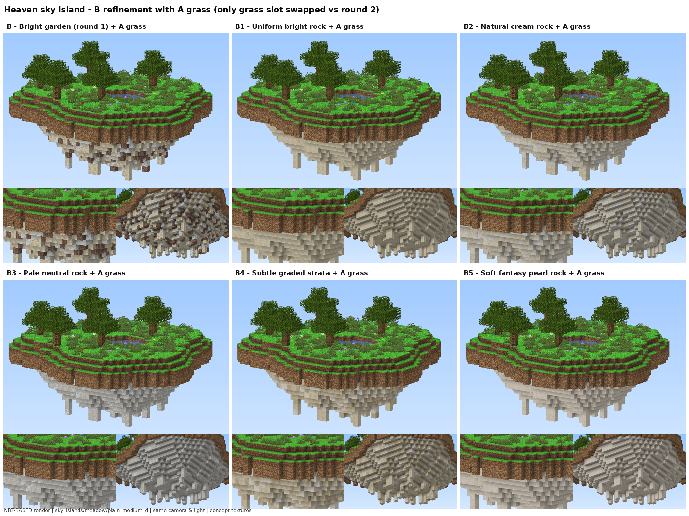

| 시안 | 전체 | 경계 | 하부 |
|---|---|---|---|
| B + A 잔디 |  | 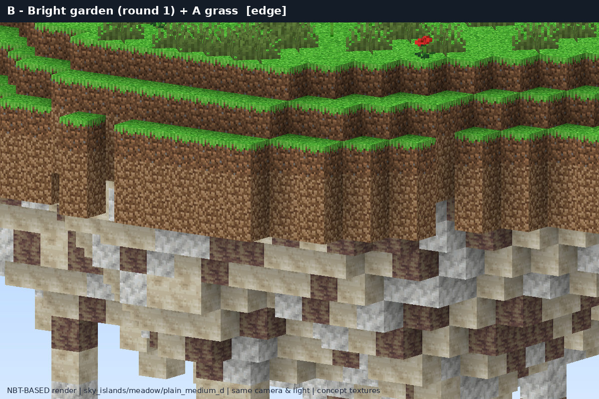 | 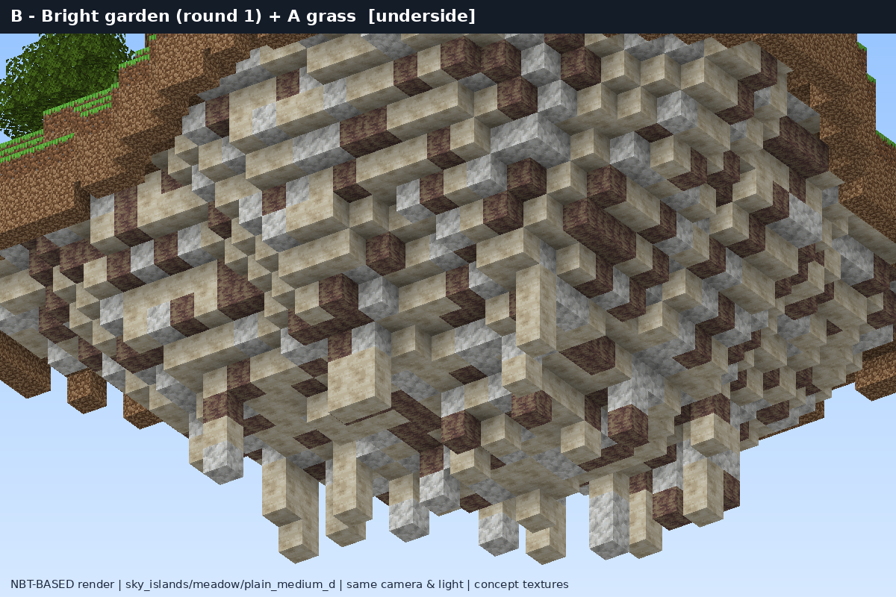 |
| B1 + A 잔디 |  | 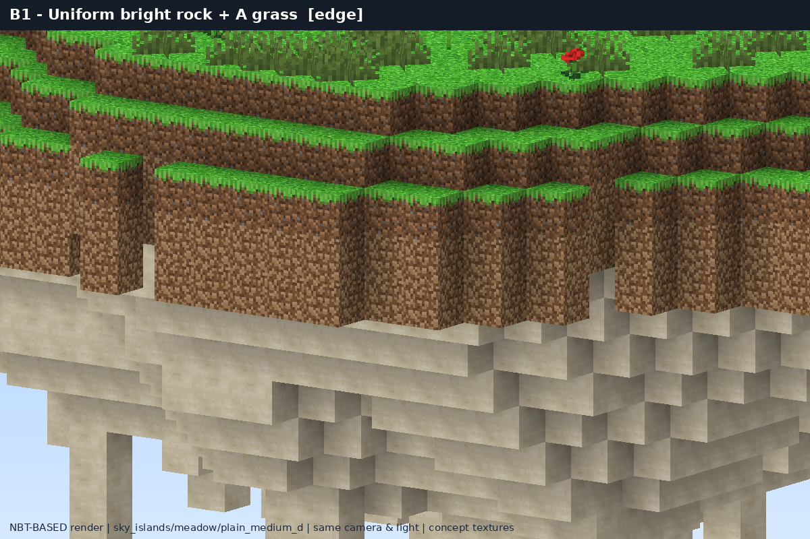 | 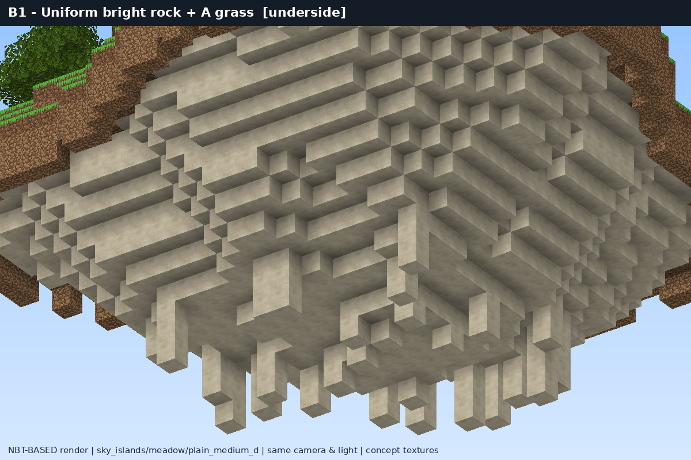 |
| B2 + A 잔디 | 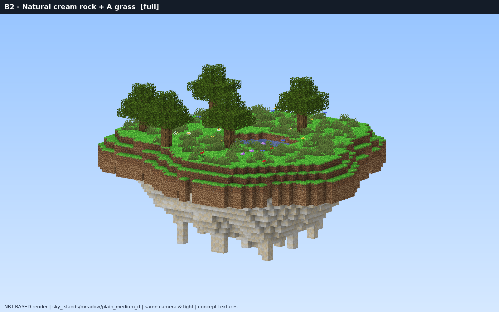 | 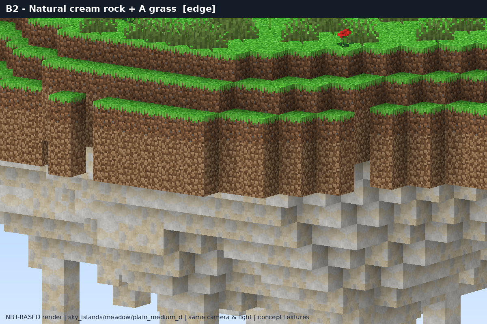 | 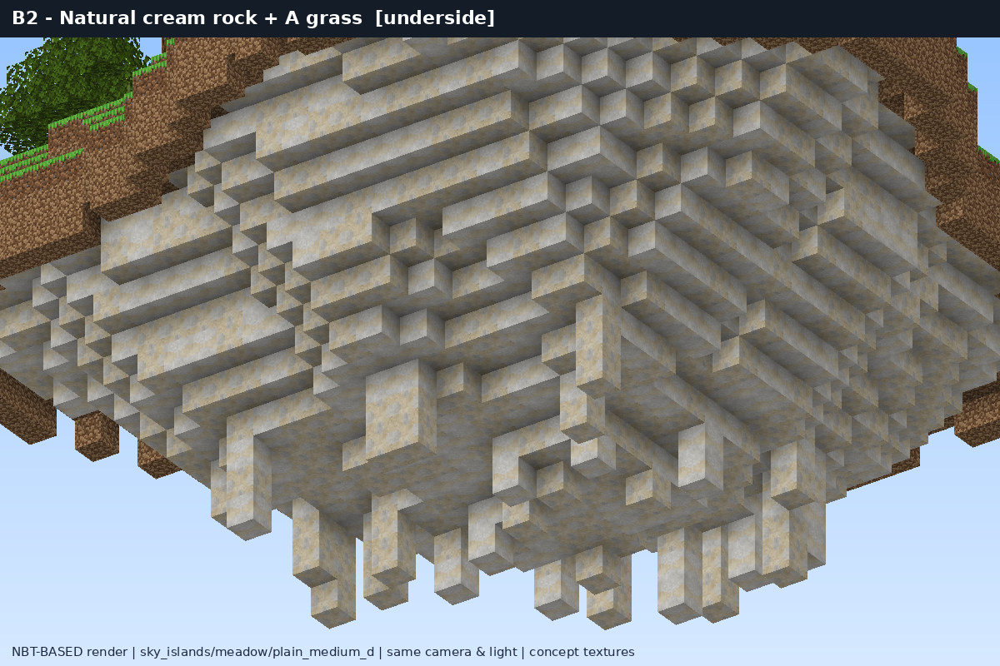 |
| B3 + A 잔디 | 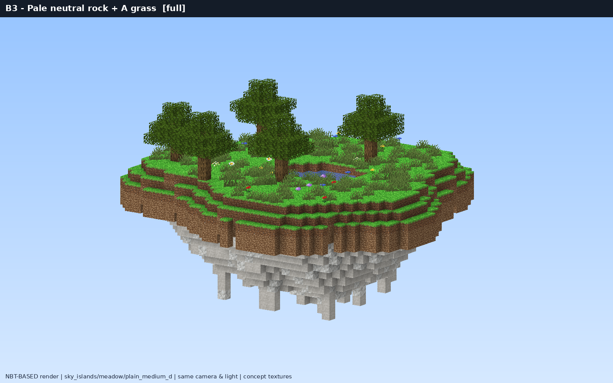 |  |  |
| B4 + A 잔디 | 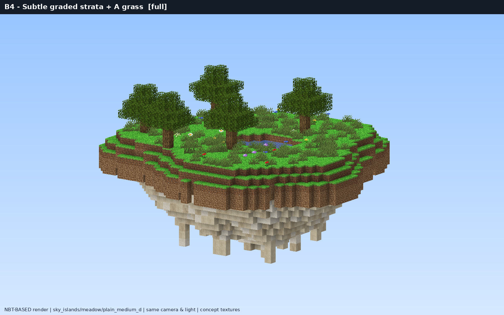 | 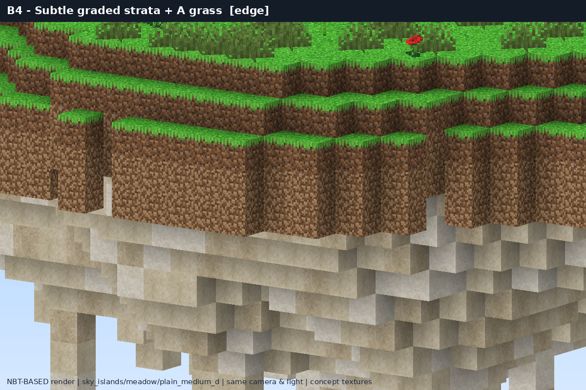 |  |
| B5 + A 잔디 | 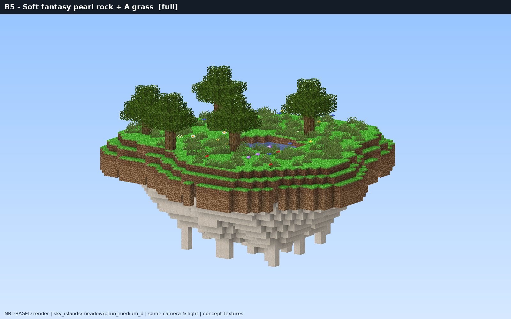 | 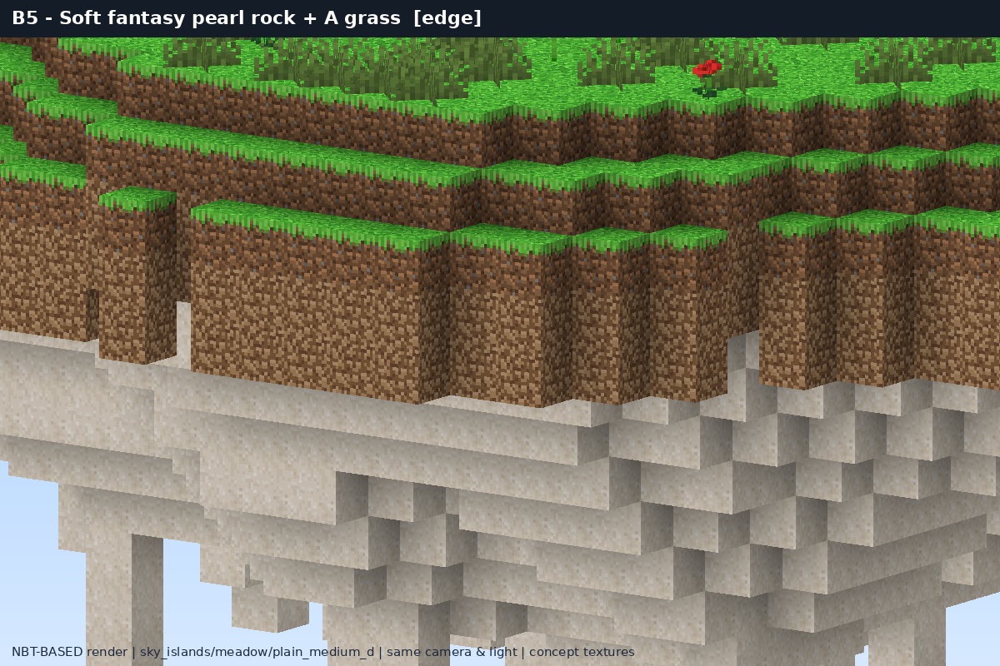 | 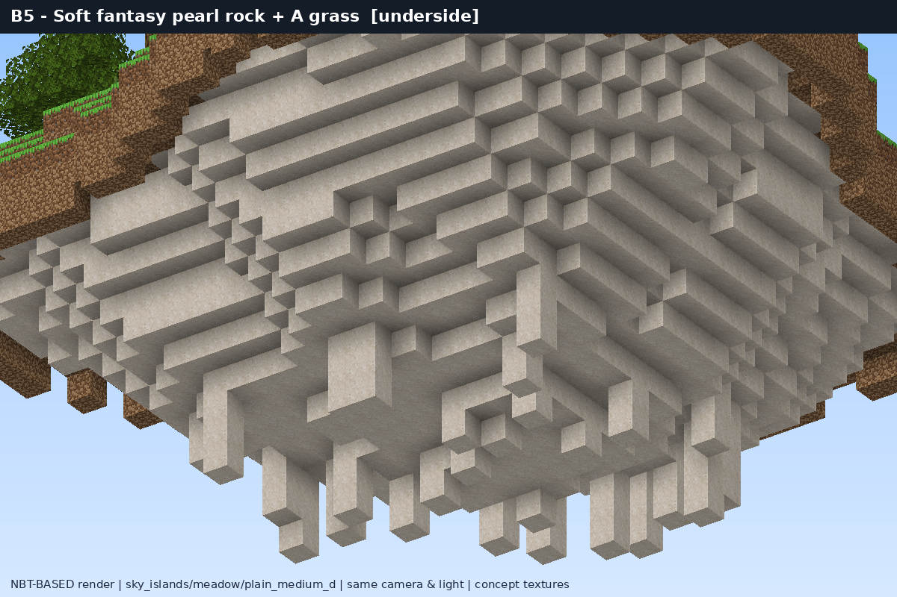 |

팔레트 시트는 `images/{Bg,B1g..B5g}_palette.png`에 있다.

## 잔디 교체로 달라진 점 (`render/grass_metrics.txt`)

| 항목 | B 잔디 | A 잔디 |
|---|---|---|
| 윗면 평균 L\*a\*b\* | 79.6 / −35.8 / 42.2 (밝은 파스텔) | 62.6 / −49.6 / 50.5 (더 진하고 채도 높은 녹색) |
| 바닐라 short_grass(plains 틴트)와의 색차 ΔE | 42.8 | 42.3 |
| 잔디 측면 흙 부분 ↔ 흙 블록 ΔE | **0.4** (측면 바탕이 같은 loam) | **7.6** (측면 바탕이 바닐라 dirt, L\* 44.0 vs loam 51.4) |

* **장점:** 잔디가 진해져서 밝은 크림 암석과의 명도 대비가 커진다. 원거리에서 지표와 암석층이 더 분명하게 갈린다.
* **새로 생긴 이음매:** A 잔디의 측면은 바닐라 dirt 위에 그려진다. 그래서 잔디 블록 줄의 흙 부분이 바로 아래 loam 블록보다 어둡다(ΔE 7.6). 경계 근접샷에서 맨 윗줄 흙이 한 단계 어두운 띠로 보일 수 있다.
  * 해결 방법: A의 술 모양과 색은 유지하고, 측면 바탕만 loam으로 바꾼다. 텍스처 수는 그대로다.
  * 원문 그대로 "A안 잔디"를 적용하라는 요청이었으므로 이번에는 바꾸지 않았다. 소유자 결정 사항이다.
* **바뀌지 않은 점:**
  * 바닐라 식생 틴트와의 색 불일치는 A·B 잔디 모두 ΔE 약 42로 비슷하다. 잔디 교체로 해결되지 않는다.
  * 암석 측정값(반점, 흙→암석 경계, 하늘 대비)은 2차와 완전히 같다(`render/metrics_all.json`). 잔디는 암석 픽셀에 영향을 주지 않는다.

## 비용

`garden_grass_B`를 `heaven_grass_A`로 1:1로 바꾸므로, 신규 블록·텍스처 수는 2차 표와 같다(B1/B3/B5 = 3블록·4텍스처, B2 = 4·5, B4 = 5·6).
측면 바탕을 loam으로 바꾸는 보정을 해도 텍스처 수는 늘지 않는다.

## 검증

| 검증 | 결과 |
|---|---|
| 잔디 슬롯만 변경 | ✔ 2차 팔레트와 비교해 grass_block 외 5개 슬롯 동일 (`render/verify.json`) |
| NBT 형상·카메라 동일 | ✔ 히트버퍼 3개의 sha256이 2차와 일치 |
| 재현성 | ✔ 다시 렌더한 PNG 25개 전부 픽셀 동일 |
| 게임 클라이언트 렌더 | **NOT RUN** (블록 미등록 단계) |

재현 방법: `cd render && python3 raycast.py meadow/plain_medium_d.nbt hb && python3 panels.py ../images && python3 metrics_all.py`
팔레트 정의는 `render/palettes_b3.py`에 있다(2차 `palettes_b2.py`를 import하고 grass 슬롯만 교체).
