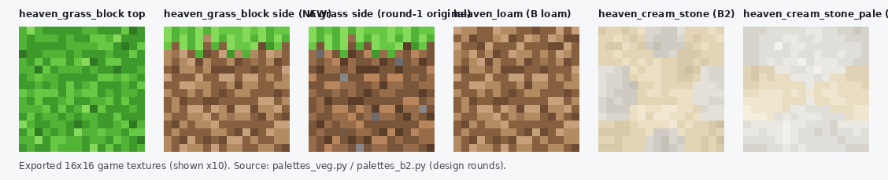
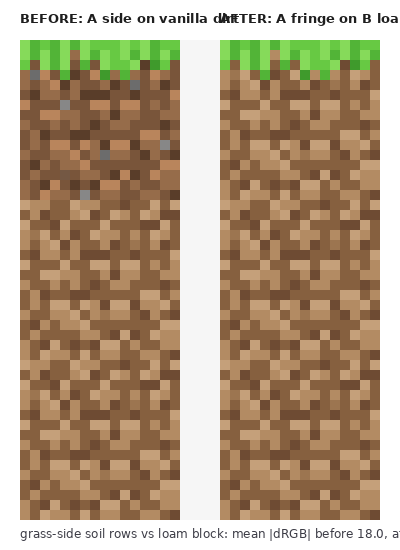
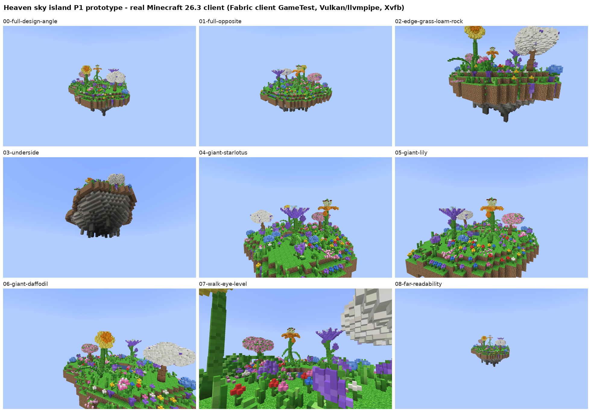

# 천국 하늘섬 P1 — 리소스 명세 및 단일 섬 실게임 프로토타입 (2026-11-20)

> **상태: PROTOTYPE / 소유자 승인 대기.** 이 문서는 권위 문서가 아니며 `CONTENT_AUTHORITY_INDEX.md`를 수정하지 않았다.
> 원본 NBT, 기존 19개 템플릿, 구조물 ID·세트, 생성 확률, Sky Tower·신전·폐허는 수정하지 않았다.
> 프로토타입 템플릿은 어떤 템플릿 풀·구조물·구조물 세트에서도 참조되지 않는다. 따라서 월드젠으로는 생성되지 않는다.
> 브랜치: `claude/heaven-sky-island-p1-prototype-20261120` (기준: `claude/heaven-sky-island-vegetation-20261119` `1191e23`)

## 0. 사전 확인

| 항목 | 결과 |
|---|---|
| 기준 브랜치·HEAD | `claude/heaven-sky-island-vegetation-20261119` @ `1191e23`. 디자인 3라운드(`c157863` → `d16717a` → `ef21c0a` → `1191e23`)가 한 줄 이력으로 모두 포함되어 있다. 이 위에서 분기했고, 덮어쓴 파일은 없다 |
| 디자인 자료 | `docs/design/heaven_sky_island_blocks_2026-11-19/`, `…_B_refine_2026-11-19/`, `…_B_refine_A_grass_2026-11-19/`, `…_vegetation_2026-11-19/` 모두 존재 |
| V5 원본 | `heaven_sky_island_vegetation_2026-11-19/render/`. 모델은 `veg_models.py`, 배치는 `veg_layout.py`의 `build('V5')`, 보고서는 `README.md`. 생성기가 이 코드를 **직접 import**한다(재구성하지 않음). V5 복셀 그리드 crc32 `3288601534`가 설계 라운드의 `results.json`과 일치한다 |
| B2 팔레트 | `…_B_refine_2026-11-19/render/palettes_b2.py`의 `cream_stone_B2`(텍스처 내 그레이지/베이지 혼합)와 `cream_stone_pale_B2` 텍스처를 그대로 내보냈다(§2 표의 해시) |
| 버전·등록 방식 | Minecraft **26.3**, Fabric Loader 0.19.5, Fabric API 0.161.0+26.3, Loom 1.17.21, Java 25. 블록은 `Registry.register(BuiltInRegistries.BLOCK, …)`와 `BlockItem`으로, 리소스는 blockstate / `models/block` / `items/`(26.x 아이템 정의) / loot_table / 태그로 등록한다 |
| 실제 템플릿 경로 | `src/main/resources/data/moreminecrafts/structure/sky_islands/meadow/plain_medium_d.nbt` (sha256 `c2a919e9…5a9a22`, 생성 전후 동일) |
| 빌드 환경 | 컨테이너에는 JDK 21만 있었다. Temurin 25.0.5.1을 받아 체크섬 일치를 확인한 뒤 세션 임시 폴더에서만 사용했다. 저장소에는 넣지 않았다 |

## 1. 확정 디자인 적용 결과

| 구성 요소 | 확정 디자인 | 게임 리소스 |
|---|---|---|
| 잔디 윗면 | A안 `heaven_grass_A` | `heaven_grass_block_top.png` |
| 잔디 측면 | A안 풀 표현 + B안 흙 바탕 | `heaven_grass_block_side.png`: A 술 픽셀은 그대로, 나머지는 B 흙 |
| 흙 | B안 | `heaven_loam.png` (dirt·coarse_dirt 모두 대체) |
| 암석 | B2 | `heaven_cream_stone.png` (stone), `heaven_cream_stone_pale.png` (andesite·tuff) |
| 식생 | V5 | V5 복셀 그리드를 블록 셀 단위로 그대로 굽는다(§4.2) |
| 지형 | plain_medium_d | 지형 블록 6,272개의 좌표 보존 (§6 테스트) |



**잔디 측면 수정 전후** (`images/grass_side_before_after.png`): 측면 흙 행과 흙 블록의 평균 |ΔRGB|가 **17.98 → 0.0**이 되었다. 술 픽셀은 A안과 동일하다. A안 원본 텍스처는 1차 디자인 폴더에 그대로 남아 있다.



---

# P1-A. 리소스 명세

## 2. 자연 블록 명세

ID는 모두 **PROVISIONAL**이다. 월드에 저장되면 바꾸기 어려우므로 확정 전에 승인이 필요하다.

| 항목 | `heaven_grass_block` | `heaven_loam` | `heaven_cream_stone` | `heaven_cream_stone_pale` |
|---|---|---|---|---|
| 대체 대상 (템플릿) | grass_block | dirt, coarse_dirt | stone | andesite, tuff |
| 텍스처 | top / side / bottom = `heaven_loam` | 1장 | 1장 | 1장 |
| 모델 | `cube_bottom_top` | `cube_all` | `cube_all` | `cube_all` |
| 블록 상태 | 없음 (단일 상태) | 없음 | 없음 | 없음 |
| 경도 / 저항 | 0.6 / 0.6 (바닐라 잔디값) | 0.5 (바닐라 흙값) | 1.5 / 6.0 (바닐라 돌값) | 1.5 / 6.0 |
| 도구 | 삽 (`mineable/shovel`) | 삽 | 곡괭이 (`mineable/pickaxe`), 맞는 도구 필요 | 곡괭이, 맞는 도구 필요 |
| 사운드 / 지도색 | GRASS / GRASS | GRAVEL / DIRT | STONE / SAND | STONE / QUARTZ |
| 드롭 (PROVISIONAL) | 섬세한 손길이면 잔디, 아니면 **천국 흙** | 자신 | 자신 (조약돌 계열 없음) | 자신 |
| 아이템 | BlockItem + `items/*.json` | 〃 | 〃 | 〃 |
| 바이옴 색 | **없음 (고정색)**. 바닐라 잔디는 바이옴 틴트를 받아 사바나에서 색이 변한다. 고정색이 1차 설계의 근거다 | 해당 없음 | 해당 없음 | 해당 없음 |
| 태그 | `minecraft:mineable/shovel` (신규 파일) | 〃 | `minecraft:mineable/pickaxe` (기존 파일에 추가) | 〃 |
| 렌더 레이어 | 불투명 (26.3은 텍스처에서 레이어를 자동 결정하며 `ItemBlockRenderTypes`가 없다) | 〃 | 〃 | 〃 |

### 2.1 바닐라 자연 블록 기능 — 구현 여부

| 기능 | 필요성 | 이번 구현 | 비고 |
|---|---|---|---|
| 잔디 확산 (흙 → 잔디) | 지표 복구·플레이어 정원 조성 시 필요 | **미구현** | 확산 대상(천국 흙만? 바닐라 흙도?)이 정책 결정 사항이다 |
| 잔디 → 흙 전환 (덮였을 때) | 바닐라 문법상 기대되는 동작 | **미구현** | 전환 결과가 천국 흙인지 바닐라 흙인지 결정 필요 |
| 삽으로 길 만들기 | 선택 | **미구현** | 천국 전용 길 블록이 필요한지 결정 필요 |
| 괭이로 경작 | 선택 | **미구현** | 바닐라 경작지로 바뀌면 천국 팔레트가 깨진다 |
| 식물 생존 조건 (`#minecraft:dirt` 등) | 바닐라 꽃·묘목을 심으려면 필요 | **미구현 (태그 미추가)** | 태그를 추가하면 바닐라 식물·나무 생성 규칙 전체에 영향을 준다 |
| 눈 덮임 (`snowy` 상태) | 천국 섬에 눈이 오지 않는다면 불필요 | **미구현** | 바이옴 강수 정책과 연동 |
| 뼛가루 | 꽃 생성 규칙이 필요하다 | **미구현** | 천국 식생 정책이 정해진 뒤 결정 |

현재 프로토타입 잔디는 **일반 블록처럼 동작**한다. 위 기능은 모두 게임플레이에 영향을 주므로 소유자 승인 대상으로 남긴다(§11).

## 3. V5 식생 리소스 분해

수치는 V5 원본 모델을 측정한 값이다(`data/spec_metrics.json`, `tools/heaven-prototype/spec_metrics.py`).
* "셀": 모델이 차지하는 1×1×1 블록 칸 수
* "요소": 디자인 해상도(1/4블록 = 4 모델 단위)로 셀마다 굽고, 같은 재질끼리 박스로 병합한 수

| 계열 (V5 개수) | 원본 디자인에서의 역할 | 크기 (블록) | 셀 / 요소 / 재질 | 프로덕션 권장 리소스 (추정) | 블록 상태 | 충돌 | 빛·렌더 | NBT 배치 | 난이도 | 바닐라 재활용 |
|---|---|---|---|---|---|---|---|---|---|---|
| **거대 꽃** 별연꽃·백합·수선화 (각 1) | 섬의 랜드마크, 원거리 실루엣 | 높이 9.25 / 11.5 / 10.5 | 123/706/13, 120/562/10, 106/699/9 | 형태별 NBT 1개 + 공유 줄기 블록(직선·굽음·마디) + 공유 잎 파트 + 형태별 꽃잎·꽃술 파트 모델 (§4) | 파트 블록에 `part`(또는 방향+종류) 상태 | 줄기만 충돌, 꽃잎·잎은 통과 | 비고체·불투명 텍스처 → 솔리드 레이어, 하늘빛 통과 | 가능 (멀티블록 NBT) | 상 | 없음 |
| **꽃나무** 벚꽃 H8·흰꽃 H9 (각 1) | 보조 실루엣, 색 대비 | 7.25 / 8.25 | 172/**3,512**/6, 223/**4,569**/5 | 원목은 바닐라 참나무, 잎은 **전체 블록 컷아웃 잎**(벚꽃 = 바닐라 `cherry_leaves`, 흰꽃 = 신규 1). 나무 NBT 2개 | 바닐라 잎 상태 (distance/persistent) | 원목 고체, 잎 고체(바닐라) | 잎 컷아웃 | 가능 | 하 | 높음 |
| **중형 꽃** 수국 5·라벤더 8·플록스 6 | 거대 꽃 사이 공간 채움 | 2.25–2.75 | 15/212/7, 16/94/6, 20/203/4 | 종당 상하 2블록 식물(바닐라 큰 꽃 방식) + 크로스·요소 모델 2개, 텍스처 2 | `half=lower/upper` | 없음 | 컷아웃 | 가능 | 중 | 큰 꽃 블록 패턴 |
| **소형 꽃** 6색 127 | 꽃밭 바탕 | ≈1.25 | 2/9/4 (1개당) | 색당 블록 1, 크로스 모델 1, 텍스처 1 | 없음 | 없음 | 컷아웃 | 가능 | 하 | 바닐라 꽃 패턴 |
| **풀** 짧은 79·긴 29 | 지표 질감, A 잔디 색 연속 | 1.0 / 2.0 | 1/6/4, 4/14/4 | 천국 짧은 풀 1 + 긴 풀(2블록) 1, **고정색** 텍스처 | 긴 풀 `half` | 없음 | 컷아웃 | 가능 | 하 | 바닐라 풀 모델 (틴트 제외) |
| **덩굴** 절벽 8 | 절벽의 수직 연결 | 길이 2.5 | 4/9/2 | 천국 덩굴 1 (바닐라 vine식 다면 부착) | 6방향 부착 상태 | 없음 | 컷아웃 | 가능 (부착면 필요) | 중 | vine 로직 |
| **등나무** 절벽 10 + 수관 18 | V5 고유의 늘어진 보라 식생 | 길이 2.5 | 6/17/3 | 머리·몸통 2블록 (weeping vines 방식), 텍스처 2 | `age`/머리-몸통 | 없음 | 컷아웃 | 가능 | 중 | weeping vines 로직 |
| **지표 장식** 꽃잎 12 | 바닥 색 변화 | 0.25 | 7/12/1 | 바닐라 `pink_petals` 재활용 | 바닐라 (amount, facing) | 없음 | 컷아웃 | 가능 | 하 | **완전 재활용** |

**측정에서 확인한 점**
* 나무의 듬성듬성한 잎 복셀은 박스로 병합되지 않는다. 나무 1그루가 **3.5k–4.6k 요소**로, 거대 꽃(560–710)보다 훨씬 무겁다. 따라서 프로덕션 나무는 복셀을 굽지 말고, 바닐라처럼 전체 블록 컷아웃 잎을 쓰는 것이 맞다.
* 거대 꽃·중형 꽃은 모델 방식이 적합하다. 소형 꽃·풀·꽃잎은 바닐라 크로스·꽃잎 패턴으로 충분하다.

## 4. 거대 꽃 구현 방식 분석 (10블록 기준)

### 4.1 비교

| 방식 | 꽃잎 입체감 | 충돌 | 렌더 비용 | NBT 배치 | 제작 난이도 | 판단 |
|---|---|---|---|---|---|---|
| 전체 블록 멀티블록 NBT | **불충분.** 식생 라운드의 해상도 비교에서 백합 수술·수선화 부관·별연꽃 그라데이션이 사라졌다 | 전부 고체 | 최저 (형태당 90–192면) | 쉬움 | 하 | 10블록에서 디자인 핵심 요소를 잃으므로 **부적합** |
| 커스텀 모델 파트 + NBT 조립 | **충분.** 요소 단위가 1/16블록이라 디자인 해상도(1/4)보다 정밀하다 | 파트별 VoxelShape | 형태당 560–710 요소 (1/4 디자인 기준) | 가능 (파트 블록을 NBT에 배치) | 중–상 | **권장.** P1 프로토타입이 이 방식의 특수한 경우다 |
| 블록 엔티티 렌더러 (BER) 단일 모델 | 충분 | 별도 구현 필요 | 매 프레임 렌더, 청크 메시 아님 | 기점 블록 1개 | 상 | 많이 배치되는 장식에는 비권장 |

### 4.2 P1 프로토타입의 구현 (실제 적용)

* V5 복셀 그리드(1/4블록)의 **빈 칸이 아닌 블록 셀 1,561개**를 각각 블록 모델 하나로 구웠다.
  * 셀의 4×4×4 복셀은 같은 재질끼리 박스로 병합된다.
  * 같은 셀 안에서 완전히 가려진 면은 생략했다.
  * 내용이 같은 셀은 모델을 공유한다 → **고유 모델 1,241개**, 요소 13,078개, 면 44,126개.
* 모든 파트는 블록 하나(`heaven_flora_prototype`)의 `part=0..1240` 상태다. 아이템과 드롭은 없다.
* 재질 57종은 16×16 텍스처 57장이다. 디자인 색에 디자인 렌더러와 같은 0.93–1.07 명도 지터를 4×4 텍셀 단위로 넣었다.
* 충돌: 디자인의 "관대" 규칙대로 거대 꽃 줄기·나무 원목 복셀(파트 148개 셀)만 충돌한다. 꽃잎·잎·꽃·풀·덩굴은 통과한다.
* 외곽선(선택 상자)은 셀의 실제 복셀 박스를 쓴다.
* **이 방식은 V5를 정확히 재현하기 위한 프로토타입 장치다. 프로덕션 리소스 구조가 아니다.**
  * 셀 단위 익명 파트라서 형태 재사용·파괴 규칙·성장 등 게임플레이 구조가 없다.
  * 프로덕션은 §3의 종별 리소스로 다시 구성해야 한다.

## 5. 신규 블록·모델·텍스처 목록

| 구분 | 블록 ID | 블록 상태 수 | 모델 | 텍스처 | 아이템 | 루트 테이블 |
|---|---|---:|---:|---:|---|---|
| 자연 | heaven_grass_block, heaven_loam, heaven_cream_stone, heaven_cream_stone_pale | 4 | 4 | 5 | 4 | 4 |
| 식생 (프로토타입) | heaven_flora_prototype | 1,241 | 1,241 | 57 | 없음 | 없음 (noLootTable) |
| **합계** | **5** | 1,245 | 1,245 | 62 | 4 | 4 |

데이터:
* 템플릿: `structure/heaven_prototype/plain_medium_d_v5.nbt` (31.6 KB, 팔레트 1,246)
* 파트 형상표: `heaven_prototype/flora_parts.json`
* 출처·거대 꽃 기록: `heaven_prototype/manifest.json`
* 태그·언어: `mineable/shovel.json`(신규), `mineable/pickaxe.json`(2줄 추가), `en_us`/`ko_kr` 각 5줄 추가

---

# P1-B. 단일 하늘섬 프로토타입

## 6. 프로토타입 NBT

`moreminecrafts:heaven_prototype/plain_medium_d_v5`
* 원본 템플릿의 **복사본**이다. 생성기 `tools/heaven-prototype/build_prototype.py`가 원본을 읽기만 하고, 원본 해시가 전후 동일함을 스스로 확인한다.

| 항목 | 값 |
|---|---|
| 크기 | 45 × 43 × 37 (원본과 동일), DataVersion 5023 (원본과 동일), 원본과 같은 `id`/`properties` 팔레트 형식 |
| 지형 | 6,272블록, **좌표 동일**. 슬롯 치환: grass → heaven_grass_block, dirt·coarse_dirt → heaven_loam, stone → heaven_cream_stone, andesite·tuff → heaven_cream_stone_pale |
| 물 | 104블록 그대로 |
| 제거 | 템플릿의 바닐라 식생 504블록(참나무 원목 24·잎 288·풀 165·꽃 27)과 **jigsaw 2개**. jigsaw는 월드젠에서 위성섬을 연결하는 장치이고, `/place template`로 놓으면 jigsaw 블록이 그대로 남으므로 제거했다 |
| 추가 | V5 식생 셀 1,561블록. 지형과 겹침 0, 템플릿 경계 밖 0, jigsaw 연결점 반경 4블록 안 0 |
| 지형 절삭·확장 | 없음 |

## 7. 개발용 배치 방법

월드젠 변경 없이, 테스트 월드에서 바닐라 명령어로 배치한다.

```
/place template moreminecrafts:heaven_prototype/plain_medium_d_v5 ~ ~ ~
```

* 섬은 명령 위치를 원점으로 +X 45, +Y 43, +Z 37 범위에 놓인다. 지표는 원점 +11~13 높이다. 공중에 띄우려면 y를 높게 지정한다(예: `~ 200 ~`).
* GameTest(`HeavenPrototypeGameTests`)와 클라이언트 캡처(`HeavenPrototypeClientCapture`)도 같은 템플릿을 `StructureTemplate.placeInWorld`로 배치한다.
* 블록 단독 확인: `/give @s moreminecrafts:heaven_grass_block` 등. 식생 파트는 아이템이 없어 `/setblock … moreminecrafts:heaven_flora_prototype[part=N]`으로만 놓을 수 있다.

## 8. 자동 검증

| 검증 | 방법 | 결과 |
|---|---|---|
| 신규 블록 ID 등록 | GameTest `heavenPrototypeBlocksAreRegistered` (아이템 4, 식생 아이템 없음, 상태 수 1,241 = 파트 표) | ✔ PASS |
| 모델·텍스처 경로 | JUnit `naturalBlockResourcesAreComplete`, `floraPartResourcesAreComplete` (blockstate → 모델 → 텍스처 전부 존재, 요소가 셀 안에 있음) | ✔ PASS |
| NBT 팔레트 | JUnit `terrainCoordinatesArePreservedAndRemapped` (팔레트는 heaven_*·water만) + GameTest에서 게임의 `StructureTemplateManager`로 로드 | ✔ PASS |
| 기준 지형 좌표 보존 | 원본·프로토타입 NBT를 좌표별로 비교. 지형 6,272 / 물 104 모두 일치, 추가·삭제 없음 | ✔ PASS |
| 거대 꽃 높이 | JUnit `giantFlowersKeepTheirDesignHeight`: 배치된 파트 형상으로 잰 높이가 V5 디자인 값과 같다. 별연꽃 **9.25**, 백합 **11.5**, 수선화 **10.5**블록 (기준 10 ± 1.5) | ✔ PASS (주의: §11-1) |
| 지형 밖 돌출 | 모든 블록이 템플릿 경계 안, 식생과 지형 겹침 0 | ✔ PASS |
| 이동 동선 | NBT 기준 잔디 칸 위 2블록에 충돌 파트 없음: **790/807 = 97.9%** (설계 라운드의 독립 계산값 0.979와 일치). 이 템플릿에는 구조물 입구가 없고, jigsaw 연결점 반경 4 안의 식생은 0 | ✔ PASS |
| 실제 서버 배치 | GameTest `heavenPrototypeTemplatePlacesAsDesigned`: 월드에 배치한 뒤 블록 수가 정확히 일치(잔디 807, 흙 1,614, 크림석 1,954, 연한 크림석 1,897, 식생 1,561). 충돌 파트 148개 모두 실제 충돌, 통과 파트는 충돌 없음 | ✔ PASS |
| 드롭 규칙 | GameTest: 잔디(도구 없음) → 천국 흙 | ✔ PASS (PROVISIONAL 규칙) |
| 월드젠 격리 | JUnit: `data/` 전체 JSON 중 프로토타입 템플릿을 참조하는 곳이 없음. 원본 NBT 해시 불변 | ✔ PASS |
| **회귀 (전체)** | `./gradlew test build` (빌드 검증기 포함) + `runGameTest` | ✔ **JUnit 782/782, GameTest 718/718 required PASS** |

**회귀 실행 중 발견한 환경 문제**
* 첫 `runGameTest` 이후 `build`가 GameTest를 다시 실행하자 Sky Tower 테스트 32개가 실패했다(`overlapping tower registration` 등).
* 원인: 첫 실행이 남긴 `build/run/gameTest/world/…/sky_tower_instances.dat`. 이 저장 데이터를 재사용하면서 같은 타워 부지를 중복 등록하려 한 것이다.
* 그 월드만 지우고 다시 실행하자 718/718 통과했다. CI는 `clean`부터 시작하므로 영향이 없다. 프로토타입 변경과는 무관하다.

## 9. 실게임 검증

**실행:** 실제 Minecraft 26.3 클라이언트에서 확인했다.
* 방식: Fabric client GameTest `HeavenPrototypeClientCapture`, `-Dmoreminecrafts.heaven.capture=true`일 때만 동작
* 환경: Xvfb 가상 디스플레이 + Mesa **llvmpipe 소프트웨어 렌더러**
  * OpenGL은 GLX visual을 찾지 못해 실패했고, 게임이 자동으로 **Vulkan(lavapipe)** 백엔드로 전환했다.
* 절차: 저장소 CI 워크플로(`sky-island-sizes.yml`)와 같은 방식으로 캡처 엔트리포인트 하나만 격리했다(작업 사본에서만, 커밋하지 않음).
* 배치: 일반 월드 y=230에 프로토타입을 놓고 정오·맑음에서 촬영했다.



| 확인 항목 | 관찰 (실제 클라이언트 화면) | 판정 |
|---|---|---|
| 전체 섬 시각 품질 | V5 렌더와 같은 구성이다: 거대 꽃 3개, 벚꽃·흰꽃 나무, 꽃밭, 연못, 등나무. 디자인 렌더와의 차이는 원근 투영과 실제 조명 정도다 | 재현됨 |
| 잔디·흙 이음매 | `02-edge`: A 술과 B 흙 측면이 끊김 없이 이어진다. 측면 흙 행 = 흙 블록(텍스처 차이 0) | 이음매 없음 |
| 암석 질감 | 밝은 면 상위 10%는 L\* 51 / b\* +13.1로 크림 색조가 유지된다(텍스처 b\* +12.5). **섬 하부 평균은 L\* 26.5 / b\* +2.8**로 회색에 가깝게 보인다. 바닥면 음영과 섬 아래의 하늘빛 감소 때문이다. B2 라운드 렌더러는 하늘빛 차단을 계산하지 않아 하부를 실제보다 밝게 표현했다 | **주의 (§11-8)** |
| 거대 꽃 디테일 | 별연꽃 2단 꽃잎·그라데이션·수정 심지, 백합 수술·꽃밥·젖힌 꽃잎·곁봉오리, 수선화 부관·숙인 목이 모두 보인다(`04`–`06`) | 재현됨 |
| 꽃·나무 배치 | V5 좌표 그대로. 나무 수관과 거대 꽃이 겹치지 않는다 | 재현됨 |
| 플레이어 이동 | 관전자 시점 촬영이라 실제 보행은 하지 않았다. NBT·서버 기준 지표 97.9%가 막히지 않고, 줄기·원목만 충돌하며 꽃잎·풀은 통과한다(GameTest로 충돌 형상 확인) | **사람이 직접 걸어보는 확인은 미완료** |
| 원거리 가독성 | 68블록(`08`): 섬 실루엣·거대 꽃·나무가 구분된다. 가장 먼 백합은 안개로 흐려진다. 120블록에서는 테스트 클라이언트의 렌더 거리 밖이라 아무것도 그려지지 않았다(환경 한계) | 부분 확인 |
| 렌더링 성능 | 클라이언트 FPS: 전체 9–13, 보행 13–15, 원거리 24–30 | **판단 불가.** CPU 소프트웨어 렌더러 수치라 실제 GPU 성능을 대표하지 않는다 |

**실게임 검증 상태**
* 실제 클라이언트에서 화면 재현은 **완료**했다(자동 캡처 9장).
* 다음은 **미완료**다(LIVE VALIDATION PENDING):
  * 사람이 직접 플레이하는 이동·충돌 체감
  * GPU 환경 성능
  * 시간대·날씨·셰이더에 따른 외관
  * 밉맵 원거리 품질
* GameTest 통과를 시각 품질 검증으로 대신하지 않았다.

**재현:** §13의 명령으로 `build/run/clientGameTest/screenshots/`에 생성된다. 커밋한 사본은 `images/client/`에 있다.


## 10. 기존 시스템 영향

| 영역 | 영향 |
|---|---|
| 월드젠·구조물·세트·확률 | **없음.** 신규 템플릿은 `heaven_prototype/` 경로에 있다. 테스트가 `sky_islands/` 풀이 정확히 21개임을 검사하므로 그 경로 밖에 두었고, 어떤 JSON도 참조하지 않는다 |
| 기존 템플릿 | 변경 없음 (원본 해시 테스트) |
| 레지스트리 | 블록 5·아이템 4가 **추가**만 된다. 기존 ID 변경·삭제 없음. 기존 월드는 새 블록이 없는 상태로 그대로 로드된다(추가 레지스트리 항목은 Fabric 레지스트리 동기화가 처리) |
| 태그 | `minecraft:mineable/pickaxe`에 2개 추가, `minecraft:mineable/shovel` 신규(바닐라 태그에 병합, `replace: false`) |
| 언어 파일 | 끝에 5줄씩 추가. 기존 줄은 바이트 단위로 동일 (중복 키가 있는 원본을 재직렬화하지 않음) |
| 성능 | 식생 블록이 1,241개 상태를 가진다(상태 메모리는 블록당 상태 객체 1,241개 수준). 모델 1,241개는 리소스 로드 시간과 텍스처 아틀라스(57장)를 소폭 늘린다 |
| GameTest 수 | +3 (서버), 클라이언트 캡처 +1 (`-Dmoreminecrafts.heaven.capture=true`일 때만 동작) |
| 권위 문서 | 변경 없음 |

## 11. 소유자 결정 필요 사항

1. **거대 꽃 높이:** V5 원본 모델의 "H=10"은 생성 파라미터이고, 실제 높이는 9.25(별연꽃)·11.5(백합)·10.5(수선화)이다. 프로토타입은 디자인 보존 원칙에 따라 **원본을 그대로** 두었다. 실측 10블록으로 정규화할지 결정이 필요하다(형태 변경이 수반됨).
2. 블록 ID, 이름, 경도, 드롭 규칙(잔디 → 천국 흙, 크림석은 자신을 드롭) 확정
3. §2.1 기능(확산·전환·길·경작·식물 생존 태그·눈·뼛가루) 구현 여부와 대상 블록
4. 거대 꽃 프로덕션 방식(§4.1 권장: 커스텀 모델 파트 + NBT 조립)과 파괴 규칙(파트 하나를 부수면 전체가 부서지는지)
5. 나무는 바닐라 컷아웃 잎 + 신규 흰꽃 잎으로 전환할지 (§3 측정 근거)
6. 식생 충돌 정책: 줄기·원목만 충돌하는 현재 규칙을 유지할지
7. 위성섬 jigsaw: 프로토타입에서 제거한 연결점을 19개 템플릿 확장 시 어떻게 처리할지
8. **실게임 하부 명도:** 실제 클라이언트에서 B2 암석 하부는 회색에 가깝게 보인다(평균 L\* 26.5, b\* +2.8). 확정 팔레트를 유지할지, 하부 전용 대응(더 밝은 하부 텍스처, 광원, 하부 노출 블록 변경 등)을 검토할지 결정해야 한다. 이번 작업에서는 확정 디자인을 변경하지 않았다.

## 12. 19개 템플릿 확장 시 고려 사항

* **자연 블록:** 6슬롯 → 4블록 치환 규칙은 meadow 세트 18개 템플릿에 그대로 적용된다(1차 조사: 모두 같은 6종). `build_prototype.py`의 `SLOT_TO_ID`로 일괄 처리할 수 있다. tower는 건축 블록이 섞여 있어 제외 대상이다.
* **식생:** 프로토타입의 "셀 굽기"는 템플릿마다 고유 모델이 수백~천여 개 생기므로 확장에 부적합하다. §3의 종별 리소스와 종별 NBT/피처로 다시 만든 뒤 템플릿에 배치 규칙으로 적용해야 한다.
* **배치 규칙:** 설계 라운드의 `veg_layout.py` 규칙(가장자리·연못·jigsaw 여유, 간격, 이동 동선)을 크기별(small/medium/large)로 다시 조정해야 한다. 중형섬 기준 거대 꽃 3개는 소형섬에서는 1개 이하가 적당하다.
* **월드젠 통합:** 기존 구조물 ID 8개와 생성 조건을 유지하고 템플릿만 교체하려면 프로세서(rule processor) 방식과 템플릿 재저장 방식 중 하나를 선택해야 한다.
* **다른 5개 테마:** 형상이 다르므로 같은 슬롯 규칙을 테마별 6슬롯에 대응시켜야 한다(디자인 결정 필요).
* **jigsaw·위성섬:** 템플릿을 재저장할 때 jigsaw 블록과 그 NBT를 반드시 보존해야 한다(프로토타입은 단독 배치용이라 제거했다).

## 13. 재현 방법

```
python3 tools/heaven-prototype/build_prototype.py    # 리소스·템플릿 생성 (디자인 소스 직접 사용)
python3 tools/heaven-prototype/spec_metrics.py       # 명세 수치·텍스처 시트
./gradlew test --tests 'dev.itzgamesgd.moreminecrafts.heaven.*'
./gradlew runGameTest                                 # 서버 GameTest 전체 (이전 실행 월드가 있으면 build/run/gameTest/world 삭제)
# 헤드리스 환경: CI와 동일하게 LIBGL_ALWAYS_SOFTWARE=1 MESA_LOADER_DRIVER_OVERRIDE=llvmpipe, VK_ICD_FILENAMES=<lvp_icd.json>,
# fabric.mod.json의 fabric-client-gametest 엔트리를 HeavenPrototypeClientCapture 하나로 임시 격리(커밋 금지)
JAVA_TOOL_OPTIONS="$JAVA_TOOL_OPTIONS -Dmoreminecrafts.heaven.capture=true" \
  xvfb-run -a -s "-screen 0 1920x1080x24 +extension GLX +render -noreset" \
  ./gradlew runClientGameTest --args="--width 1600 --height 1000"
```
생성기는 두 번 실행해도 같은 파일을 만든다. 레이아웃은 crc32로 고정되어 있다.
