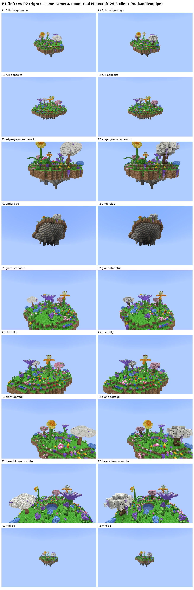
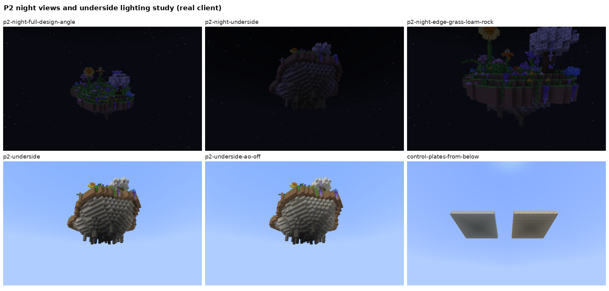

# 천국 하늘섬 P2 — 재사용 리소스 구조, P2 프로토타입, 실게임 검증, 정책·확장 명세 (2026-11-20)

> **상태: PROTOTYPE / 소유자 승인 대기.** 권위 문서가 아니며 `CONTENT_AUTHORITY_INDEX.md`를 수정하지 않았다.
> **P1 산출물은 그대로 보존했다**(P1 블록·모델 1,241개·NBT·테스트·보고서 변경 없음). 월드젠·템플릿 풀·구조물 ID·구조물 세트·생성 확률·원본 템플릿·Sky Tower·신전·폐허는 수정하지 않았다.
> 브랜치: `claude/heaven-sky-island-p2-20261120` (기준: `claude/heaven-sky-island-p1-prototype-20261120` @ `997d470`)

## 0. 사전 확인과 확정 디자인

* 작업 전 확인 결과: 브랜치·HEAD `997d470`, 작업 트리 깨끗함, P1 보고서·블록·모델 1,241개·`heaven_prototype/plain_medium_d_v5.nbt` 모두 존재.
* 확정 디자인은 바꾸지 않았다.
  * 잔디 A안, 잔디 측면(B 흙 이음매 수정), 흙 B안, 암석 B2: P1 블록과 텍스처를 그대로 쓴다. P2에서 새로 만들지 않았다.
  * 식생 V5: 설계 라운드의 `veg_layout.build('V5')`를 다시 실행해 **인스턴스 290개의 정확한 복셀**을 기록하고 변환했다(`tools/heaven-p2/capture_v5.py`).
    * 설계 코드는 수정하지 않았다. 실행하는 동안만 래핑했다.
    * V5 crc32 `3288601534`가 일치하는지 확인한다.
  * 거대 꽃 높이: V5 원본 그대로 9.25 / 10.5 / 11.5블록 (테스트로 확인).

---

## 1. P2-A — 식생 리소스 구조

### 1.1 결정 근거 (V5 실측, `tools/heaven-p2/build_p2.py`)

| 조사 | 결과 | 결정 |
|---|---|---|
| 거대 꽃 셀을 종끼리 공유할 수 있는가 | 3종의 셀 341개 중 고유 336개. **종 사이 공유 셀은 1개**뿐이다(꽃잎·잎은 설계상 종마다 고유). | 꽃잎·꽃술·잎은 **정확히 보존**한다. 재사용은 셀 단위가 아니라 **종 단위 구조물**(어느 섬에나 같은 블록으로 배치)로 얻는다. |
| 줄기를 표준 파츠 라이브러리로 묶을 수 있는가 | 순수 줄기 셀 44개 → 표준 원기둥 26종으로 줄어들지만, 원본과의 일치도가 평균 IoU 0.68, **최저 0.25**다. | **채택하지 않음.** 모델 14개를 줄이자고 줄기 곡선을 눈에 띄게 왜곡하는 것은 "외형 손상 금지" 조건에 어긋난다. |
| 나무를 원목·잎 블록으로 바꿀 수 있는가 | 셀당 잎 복셀 수 임계값 24/64일 때 수관 부피 비율이 벚꽃 1.02, 흰꽃 1.08로 원본 부피에 가장 가깝다. | **채택.** 원목은 `oak_log`, 잎은 벚꽃 `cherry_leaves` / 흰꽃 신규 `heaven_white_blossom_leaves`(바닐라 잎 동작)로 한다. |
| 소형 꽃 | 셀 254개 중 고유 12개(색당 2셀) | 색당 **단일 블록 모델 1개**로 만든다. 모델이 블록 위로 4px 솟는다(디자인과 동일). |
| 중형 꽃·풀·덩굴 | 고유 비율 79–98%(인스턴스마다 무작위 시드) | 종별 **표준 변형**(중형 2개, 짧은 풀 3개, 긴 풀 2개, 덩굴·등나무 분절)을 만들고 blockstate `facing`으로 4방향 회전한다. |
| 꽃잎 | 바닐라 `pink_petals`를 재사용하려 했으나, 구조물 배치 시 **57개 전부 제거**되었다(GameTest가 발견). `pink_petals`는 바닐라 식물 지지 태그가 없는 천국 잔디 위에서 살아남지 못한다(`canSurvive=false`). 태그를 추가하는 것은 미승인 게임플레이 정책이다(§4). | V5와 같은 분홍 복셀 꽃잎 `heaven_petals`(양 3종 × 4방향)로 대체했다. 태그가 승인되면 바닐라 재사용으로 되돌릴 수 있다. |

### 1.2 P2 리소스 구조

| 계열 | 블록 ID (PROVISIONAL) | 모델 | 상태 속성 | 충돌 | 렌더 | 재사용 단위 |
|---|---|---:|---|---|---|---|
| 거대 꽃 | `heaven_giant_stem` / `heaven_giant_leaf` / `heaven_giant_bloom` | 57 / 112 / 172 | `part` | 줄기 복셀만 | 불투명 요소 모델 | 종 구조물 `heaven_flora/giant_{starlotus,lily,daffodil}` |
| 나무 | 바닐라 `oak_log`, `cherry_leaves` + `heaven_white_blossom_leaves` | 1 (흰꽃 잎) | 바닐라 잎 (`persistent=true`) | 바닐라 (고체) | 잎 컷아웃 | `heaven_flora/tree_{blossom,white}` |
| 중형 꽃 | `heaven_lavender` / `heaven_hydrangea` / `heaven_phlox` | 31 / 15 / 42 | `part` + `facing` | 없음 | 요소 모델 | `heaven_flora/medium_<종>_{0,1}` |
| 소형 꽃 | `heaven_flower_{red,yellow,white,pink,blue,violet}` | 6 | 없음 | 없음 | 요소 모델 | 블록 자체 |
| 풀 | `heaven_short_grass` / `heaven_tall_grass` | 3 / 2 | `part` + `facing` | 없음 | 요소 모델 | 블록 자체 |
| 덩굴 | `heaven_vine` / `heaven_wisteria` | 4 / 5 | `part` + `facing` | 없음 | 요소 모델 | 분절 블록 |
| 지표 | `heaven_petals` | 3 | `part` + `facing` | 없음 | 요소 모델 | 블록 자체 |

* 공통 구현: `HeavenPartBlock` 하나로 처리한다. 생성된 표(`data/moreminecrafts/heaven/flora/<block>.json`)를 읽어 `part` 범위·외곽선·충돌 형상을 만든다. `facing` 회전 형상도 이 클래스가 계산한다.
* 아이템·드롭·생존 규칙·성장은 없다(정책 미승인). 월드젠에서도 참조하지 않는다.
* 표준 변형과 회전은 위치 해시로 결정된다. 생성 결과는 바이트 단위로 재현된다.

### 1.3 P1 대비 P2 비교

| 지표 | P1 (셀 굽기) | P2 (재사용 구조) | 변화 |
|---|---:|---:|---|
| 식생 블록 ID | 1 | 18 (신규 17 + 흰꽃 잎 1). 바닐라 재사용 2(`oak_log`, `cherry_leaves`) | ID 증가. 종별 정책·드롭·충돌을 따로 지정할 수 있는 구조 |
| 모델 파일 | **1,241** | **453** | −63.5% |
| 모델 요소 | 13,078 | 2,888 | −77.9% |
| 모델 면 | 44,126 | 12,057 | −72.7% |
| 식생 텍스처 | 57장 / 8.4 KB | 49장 / 7.4 KB (재질 48 + 흰꽃 잎 1) | 실제 쓰는 재질만 남김. P2 전용 사본(P1은 보존) |
| 섬 NBT 팔레트 | 1,246 | **551** | −55.8% |
| 섬 NBT 크기 | 31.6 KB | 27.5 KB | −13% |
| 섬 식생 블록 | 1,561 셀 | 1,232 블록 | 나무가 전체 블록 잎이 되면서 부분 셀이 정리됨 |
| **섬이 늘어날 때 모델 수** | 섬마다 새 셀 모델이 생긴다(셀이 주변 식생과 섞여 고유해짐) | **고정.** 종 구조물·표준 변형을 재사용하므로 섬 수와 무관 | P3 확장의 핵심 차이 |

> **성능 주의:** 모델 파일·요소 수 감소가 **실제 GPU 프레임 향상을 보장하지는 않는다.** 실제 비용은 화면에 그려지는 면 수, 투명 정렬, 청크 리빌드 빈도에 달려 있다. GPU 환경 측정은 이번에 하지 못했다(§3).
> 리소스 로딩 시간은 P1·P2 리소스가 같은 모드 안에 공존해 분리 측정할 수 없었다(**NOT MEASURED**).

### 1.4 외형 차이 (V5 설계 그리드와 복셀 비교, `data/moreminecrafts/heaven/manifest_p2.json`)

| 계열 | 복셀 IoU | 부피 비 | 블록 열 일치 | 열 평균 높이 차 (블록) | 판정 |
|---|---:|---:|---:|---:|---|
| 거대 꽃 | **1.000** | 1.00 | 1.000 | 0.00 | **동일** |
| 소형 꽃 | **1.000** | 1.00 | 1.000 | 0.00 | **동일** |
| 나무 | 0.71 | 1.15 | 0.748 | 0.35 | 실루엣·높이 유지. 표면은 블록 잎이라 덜 섬세하다 |
| 중형 꽃 | 0.445 | 0.98 | 0.876 | 0.43 | 종·위치·크기 유지. 개별 송이 배치는 표준 변형을 따른다 |
| 풀 | 0.129 | 0.90 | 0.671 | 0.13 | 같은 높이·밀도. 잎 배치는 표준 변형을 따른다 |
| 꽃잎 | 0.121 | 1.59 | 0.687 | 0.00 | 같은 칸, 양 기반 패턴 |
| 절벽 덩굴·등나무 | 0.113 | 1.20 | 0.536 | 0.07 | 같은 절벽 칸, 표준 분절 |
| 수관 등나무 | 0.006 | 2.03 | 0.567 | 1.99 | **차이 큼.** 아래 참고 |
| 전체 | 0.634 | 1.08 | — | — | — |

* 복셀 IoU는 무작위로 배치된 얇은 디테일(풀잎 하나의 위치 등)에 매우 엄격한 지표다. 그래서 실루엣 지표(열 일치·높이 차)를 함께 둔다.
* **수관 등나무:** V5에서는 복셀 수관 안쪽에 대부분 묻혀 있었다(보이는 복셀이 115개뿐). P2에서는 수관이 블록 잎으로 바뀌어 꽃송이를 수관 아래에 매달았다. 그래서 V5보다 **더 잘 보인다.** 원본에 가깝게 하려면 수관 등나무를 줄이거나 없애야 하는데, 디자인 판단이 필요하다(§8).
* 하나의 칸에는 블록이 하나만 들어가므로, V5에서 한 셀을 나눠 쓰던 식생 중 나중에 놓인 쪽은 빠진다.
  * 꽃잎 31칸, 중형 4칸, 나무 2칸, 덩굴 2칸이 빠졌다.
  * 거대 꽃 8칸은 지형 아래 셀이라 V5에서도 보이지 않던 칸이다.

## 2. P2-B — 단일 P2 프로토타입

`moreminecrafts:heaven_prototype/plain_medium_d_v5_p2` (신규, 31.6 KB → 27.5 KB). **P1 템플릿은 별도로 보존한다.**

| 보존 조건 | 결과 (테스트) |
|---|---|
| 지형 좌표 6,272개 동일 | ✔ 원본·P1과 좌표별 일치 (`HeavenP2ResourceTest.p2IslandKeepsTerrainAndNaturalPalette`) |
| 자연 블록 팔레트 동일 | ✔ P1과 같은 4블록, 물 104 동일 |
| V5 식생 종류와 기본 배치 | ✔ V5 인스턴스 290개를 위치 그대로 변환. 종 구성 동일 |
| 거대 꽃 높이·실루엣 | ✔ 9.25 / 11.5 / 10.5블록, 복셀 IoU 1.0 |
| 이동 가능 지표 | ✔ 790/807 = **97.9%** (P1과 동일, 나무 원목·잎을 고체로 계산) |
| 월드젠 영향 | ✔ 어떤 데이터 JSON도 `heaven_prototype/`·`heaven_flora/`를 참조하지 않음 (`p2IsIsolatedFromWorldgen`) |
| 실제 서버 배치 | ✔ 식생 1,232블록 전부 배치 후에도 유지된다. 잎은 `persistent`, 줄기는 충돌함 (`HeavenP2GameTests`) |

배치: `/place template moreminecrafts:heaven_prototype/plain_medium_d_v5_p2 ~ ~ ~`
종 구조물: `/place template moreminecrafts:heaven_flora/giant_lily ~ ~ ~` 등. 피벗(식물 밑동 블록)은 `manifest_p2.json`의 `structures.<이름>.pivot`에 있다.

## 3. P2-C — 실제 클라이언트 시각 검증

**실행:** 실제 Minecraft 26.3 클라이언트에서 확인했다.
* 방식: Fabric client GameTest `HeavenP2ClientCapture`, `-Dmoreminecrafts.heaven.p2capture=true`일 때만 동작
* 환경: Xvfb + Mesa llvmpipe. OpenGL GLX visual이 없어 게임이 **Vulkan(lavapipe)** 으로 자동 전환했다.
* 배치: P1·P2 섬을 140블록 떨어뜨려 놓고 **같은 상대 카메라**로 촬영했다(정오·맑음). 이어서 P2 야간, 하부 AO off, 개활지 대조 판을 촬영했다. 총 24장(`images/client/`).
* 1차 시도는 서버 작업 하나에서 청크 생성과 두 섬 배치를 한꺼번에 처리하다 클라이언트 연결이 시간 초과로 끊겼다(`Player0 lost connection: Timed out`). 작업을 나누어 해결했다(수리 1회).

### 3.1 P1 대비 P2 외형 (같은 카메라·조명)



| 확인 항목 | 관찰 | 판정 |
|---|---|---|
| 전체 섬 (설계 각도·반대편·68블록) | 섬 형상·거대 꽃 3개·꽃밭·연못 배치가 같다 | 유지 |
| 잔디·흙·암석 경계 | P1과 같은 자연 블록, 이음매 없음 | 유지 |
| 거대 꽃 (별연꽃·백합·수선화) | 근접 화면에서 꽃잎·꽃술·곁봉오리 형태가 같다 (복셀 IoU 1.0) | **동일** |
| 나무 | 둥근 복셀 수관이 **블록 잎 수관**으로 바뀌었다. 흰꽃 나무는 컷아웃 구멍이 보이는 각진 수관이 되었고, 벚꽃 나무는 바닐라 벚나무 잎이라 초록 반점이 없다. 높이·위치·크기는 유지된다 | **변화 (승인 필요, §8-2)** |
| 수관 등나무 | 흰꽃 나무 아래 보라 꽃송이가 P1보다 뚜렷하다 | **변화 (§8-4)** |
| 중형 꽃·풀 | 같은 위치에 같은 종. 개별 모양은 표준 변형이다 | 근거리에서만 차이 |
| 원거리 가독성 (68블록) | 실루엣·거대 꽃 구분이 P1과 같다 | 유지 |

### 3.2 낮과 밤, 하부 조명 분석



**측정 1: 서버 하늘빛 레벨** (`HEAVEN_P2_SKYLIGHT`, 아래를 향한 면 바로 밑 공기 칸)

| 위치 | 하늘빛 레벨 분포 |
|---|---|
| 섬 하부 (아래를 향한 면 859개) | 0:27, 1:20, 2:27, 3:35, 4:36, 5:45, 6:48, 7:57, 8:64, 9:70, 10:75, 11:102, 12:125, 13:31, 14:97 → **8 이하가 359면(42%)** |
| 개활지 대조 판 9×9 (크림석·흰 콘크리트 동일) | 10:1, 11:8, 12:16, 13:24, 14:32 |
| 섬 아래 블록 빛 | 0 (광원 없음) |

**측정 2: 화면 밝기** (CIELAB L\*, 실제 클라이언트, 정오)

| 대상 | L\* | b\* |
|---|---:|---:|
| `heaven_cream_stone` 텍스처 원본 | 85.4 | +12.5 |
| 흰 콘크리트 텍스처 (바닐라, RGB 207/213/214) | ≈ 84.5 | ≈ 0 |
| **개활지 판 아랫면: 흰 콘크리트** | **37.5** | −1.2 |
| **개활지 판 아랫면: 천국 크림석** | **37.6** | +5.1 |
| 섬 하부, AO 끔 | 31.2 | +3.3 |
| 섬 하부, AO 켬 (기본) | 26.5 | +2.8 |
| 섬 하부, 자정 | 5.5 | — |

**원인 분해 (L\* 기준, 크림석)**

| 단계 | 변화 | 원인 | 근거 |
|---|---:|---|---|
| 텍스처 85.4 → 개활지 아랫면 37.6 | **−47.8** | **바닐라 렌더링 자체:** 아래를 향한 면의 고정 면 음영 + 하늘빛 10–14의 밝기 곡선 | 흰 콘크리트도 똑같이 37.5가 된다 → 텍스처와 무관 |
| 개활지 37.6 → 섬 하부(AO 끔) 31.2 | −6.4 | **섬에 의한 하늘빛 차단**(레벨 0–8 영역 42%) | 측정 1 |
| AO 끔 31.2 → AO 켬 26.5 | −4.7 | **주변광 차폐(AO)**: 하부의 계단형 요철 | AO on/off 동일 카메라 비교 |
| 텍스처 영향 | ≈ 0 | 크림석과 흰 콘크리트가 같은 밝기로 표시된다. 크림 색조(b\* +5.1)는 일부 남는다 | 측정 2 |

**결론**
* 하부가 어두운 것은 **B2 텍스처 문제가 아니다.** 바닐라의 아랫면 음영이 대부분이고, 섬 자체의 하늘빛 차단과 AO가 그 뒤를 잇는다.
* 이것은 바닐라의 모든 공중 구조물에 똑같이 나타나는 현상이다.
* B2 팔레트는 바꾸지 않았다. 발광 블록이나 밝기 보정으로 덮지 않았다.
* 대응 여부와 방법은 디자인 결정이다(§8-6). 검토 가능한 선택지:
  1. 바닐라 그대로 수용
  2. 하부 노출면 전용의 더 밝은 블록(디자인 변경)
  3. 하부 형상 변경으로 하늘빛 노출 증가
  4. 하부 장식 광원(디자인 변경)

**P1 대비 P2 하부:** 같은 카메라에서 P1 30.7, P2 26.5로 측정되었다. 지형이 같으므로 식생(하부 덩굴·등나무, 나무 잎 블록) 차이로 추정하지만, **원인은 확인하지 않았다.**

**밤:** 자정에는 섬 전체가 L\* 5–12 수준으로 어둡다. 꽃 색은 가까이에서만 구분된다. 천국 섬에 광원을 둘지는 디자인 결정이다(보류 요소: 발광 식생).

### 3.3 성능

* 클라이언트 FPS (CPU 소프트웨어 렌더러 llvmpipe):
  * P1 화면 10–21 fps
  * P2 같은 화면 19–29 fps
* 같은 조건에서 P2가 꾸준히 높았지만, **CPU 렌더러 수치이므로 GPU 성능 근거가 아니다.**
* GPU 측정은 **NOT RUN**(GPU 없는 환경)이다. 실제 GPU에서 다시 측정해야 한다.

**실게임 검증 상태:** 실제 클라이언트 화면 비교와 하부 조명 분석은 **완료**했다. 다음은 **LIVE VALIDATION PENDING**이다.
* 사람이 직접 하는 플레이(이동·충돌·파괴 체감)
* GPU 성능
* 셰이더·다른 밝기 설정


## 4. P2-D — 게임플레이 정책 결정표 (명세만, 구현 안 함)

난이도 기준: 하 = 바닐라 클래스 재사용·태그 추가 / 중 = 소량의 블록 로직 / 상 = 멀티블록 연동·신규 시스템.
**모든 항목은 소유자 승인 전 구현하지 않는다.**

### 4.1 자연 블록

| 항목 | 현재 P1/P2 동작 | 바닐라에 가장 가까운 방식 (기본 권장) | 대안 | 난이도 | 충돌 가능성 | 승인 |
|---|---|---|---|---|---|---|
| 잔디 확산 | 없음 (일반 블록) | `SpreadingSnowyBlock` 방식: 밝은 곳의 인접 **천국 흙**에만 확산 | 바닐라 흙에도 확산 / 확산 없음 | 중 | 바닐라 흙으로 퍼지면 지상 지형이 천국화됨 → 천국 흙 한정 권장 | 필요 |
| 빛 부족 시 흙으로 전환 | 없음 | 덮이거나 어두우면 **천국 흙**으로 | 바닐라 흙으로 / 전환 없음 | 중 | 바닐라 흙으로 바뀌면 팔레트가 깨짐 | 필요 |
| 삽으로 길 만들기 | 없음 | 바닐라 `dirt_path`로 전환 | 천국 전용 길 블록(신규 텍스처) | 하/중 | 바닐라 길은 색이 안 맞음 | 필요 |
| 괭이로 경작 | 없음 | 바닐라 `farmland`로 전환 | 천국 경작지(신규) / 경작 불가 | 하/중 | 농사 밸런스, 천국 팔레트 | 필요 |
| 식물 생존 조건 | 태그 없음 → 바닐라 꽃·묘목·`pink_petals`가 살 수 없다 (**P2에서 실측**) | 천국 잔디·흙을 바닐라 식물 지지 태그(`#minecraft:dirt` 계열)에 추가 | 천국 식생만 허용하는 전용 태그 | 하 | 태그 추가 시 바닐라 나무·꽃 생성 규칙 전체에 영향 | 필요 |
| 뼛가루 | 반응 없음 | 바닐라 잔디처럼 주변에 천국 풀·소형 꽃 생성 | 반응 없음 | 중 | 식생 생성 테이블 결정 필요 | 필요 |
| 눈 덮임 | `snowy` 상태 없음 | 바닐라처럼 `snowy` 상태 + 눈 덮인 측면 텍스처 | 없음 (천국에 눈 없음) | 중 | 사바나 등 생성 바이옴의 강수 | 필요 |
| 채굴 속도·도구 | 잔디 0.6·흙 0.5(삽), 크림석 1.5/6(곡괭이, 맞는 도구 필요) | 현재값 유지 (바닐라 잔디·흙·돌과 동일) | 천국 블록에 추가 경도 | 하 | 없음 | 확정 필요 |
| 드롭·섬세한 손길 | 잔디: 섬세한 손길이면 잔디, 아니면 천국 흙 / 흙·크림석: 자신 | 현재 규칙 유지. 크림석은 바닐라 돌처럼 "조각" 블록을 드롭할지 결정 | 크림석이 자기 자신을 드롭 (현재) | 하 | 조약돌 대응 블록이 필요해질 수 있음 | 필요 |
| 블록 태그 | `mineable/shovel`·`mineable/pickaxe`만 | 위 항목에 따라 `dirt`, `animals_spawnable_on`, `sculk_replaceable`, `bamboo_plantable_on` 등 | 최소 태그 | 하 | 몹 스폰(하늘섬 스폰 규칙)과 상호작용 | 필요 |

### 4.2 식생

| 항목 | 현재 P1/P2 동작 | 바닐라에 가장 가까운 방식 (기본 권장) | 대안 | 난이도 | 충돌 가능성 | 승인 |
|---|---|---|---|---|---|---|
| 거대 꽃 파괴 방식 | 파츠 하나씩 즉시 부서짐. 나머지는 공중에 남음 | 큰 식물(대나무·초러스) 방식: **줄기를 부수면 위쪽 파츠가 연쇄 파괴** | 개별 파괴 유지 / 전체 한 번에 파괴 / 파괴 불가(장식) | 상 | 파츠가 셀 단위라 "같은 꽃" 연결 정보가 필요 (구조물 ID·연결 탐색) | 필요 |
| 꽃잎·줄기·꽃술 충돌 | 줄기 복셀만 충돌 (이동 97.9%) | 현재 유지: 줄기·원목만 고체 | 큰 꽃잎 위를 걸을 수 있게 / 전부 통과 | 하 | 꽃잎 위 플랫폼화는 이동 동선을 바꿈 | 필요 |
| 파괴 시 드롭 | 없음 (`noLootTable`) | 소형·중형 꽃 = 자기 아이템, 거대 꽃 = 씨앗/구근 아이템 | 드롭 없음(장식) / 염료 | 중 | 아이템 등록·제작법·진행도와 연결 | 필요 |
| 재생성·성장 | 없음 | 소형 꽃은 바닐라처럼 성장 없음. 거대 꽃은 구근 → 단계 성장 → 구조물 배치 | 자연 재생성 없음 | 상 | 성장 시 공간 검사·구조물 배치 로직 | 필요 |
| 뼛가루 | 반응 없음 | 소형 꽃: 주변 복제 (바닐라 꽃과 동일) / 거대 꽃: 성장 단계 진행 | 반응 없음 | 중/상 | 뼛가루 남용 시 거대 꽃 양산 | 필요 |
| 화염 | 불에 타지 않음 (가연성 미지정) | 바닐라 꽃·잎처럼 가연성 부여 | 불연 (천국 테마) | 하 | 섬 전체 화재 위험 | 필요 |
| 폭발 | 경도 0–0.4로 쉽게 파괴됨 | 현재 유지 (바닐라 식물 수준) | 거대 꽃 폭발 저항 | 하 | 없음 | 필요 |
| 물 | 물 관련 동작 미지정 (흐르는 물과의 상호작용은 **미검증**) | 바닐라 식물처럼 흐르는 물에 파괴 | 침수 가능(`waterlogged`) | 하/중 | 연못가 배치 | 필요 |
| 플레이어 이동 방해 | 줄기·원목·잎만 막음 | 현재 유지 | 덤불 감속(달콤한 열매 덤불식) | 하 | 없음 | 필요 |
| 피스톤 | 파츠가 튀어나옴 (`POPPED`) | 현재 유지 | 이동 불가 | 하 | 멀티블록 분리 | 필요 |
| 아이템·크리에이티브 탭 | 없음 | 소형·중형·풀·덩굴·꽃잎: 아이템. 거대 꽃: 구근 아이템만 | 크리에이티브 전용 | 중 | 제작·진행도 | 필요 |

## 5. P2-E — 위성섬 연결 복원 설계와 확장 준비 (`data/expansion_analysis.json`)

### 5.1 plain_medium_d의 jigsaw 2개

| 위치 | 방향 | 풀 | 이름 / 대상 | 결합 | final_state | P2 식생과 충돌 |
|---|---|---|---|---|---|---|
| (0, 17, 18) 서쪽 면 | `west_up` | `sky_islands/meadow/satellite` | `sky_link` / `sky_link` | aligned | `minecraft:air` | **없음.** 칸이 비어 있고, 반경 4열 안에 식생 0 (테스트) |
| (44, 8, 18) 동쪽 면 | `east_up` | `sky_islands/meadow/satellite` | `sky_link` / `sky_link` | aligned | `minecraft:air` | **없음** (같은 테스트) |

* 두 jigsaw 모두 템플릿 경계면에 있고, 위성섬은 경계 바깥에 붙는다. 섬 내부 식생과 겹치지 않는다.

**복원 방법 (설계, 이번에는 적용하지 않음)**
1. 천국 템플릿을 만들 때 원본의 jigsaw 블록을 **위치·방향·NBT(pool/name/target/joint/final_state/priority) 그대로 복사**한다. P2 생성기에 원본 jigsaw를 그대로 옮기는 단계를 추가하면 된다.
2. 식생 배치 규칙에서 jigsaw 칸과 반경 4열은 계속 제외한다(현재 규칙 유지).
3. `final_state`가 `air`이므로 연결 후 바닐라 블록이 남지 않는다.
4. 위성섬 템플릿(`satellite_a/b`)도 같은 팔레트로 바꿔야 연결된 섬의 외형이 일치한다. 위성섬 jigsaw는 양쪽 면에 있다.
5. 개발용 단독 배치(`/place template`)용 사본은 jigsaw 블록이 화면에 남으므로 계속 jigsaw를 제거한 별도 파일로 둔다.

### 5.2 19개 meadow 템플릿의 jigsaw 현황

* 12개 템플릿에 jigsaw가 있다.
  * plain_medium_a–e: 서·동 `satellite`
  * satellite_a/b: 서·동 `satellite`
  * large_d/e: 내부 `tower_top`
  * ruins: 내부 `ruins_top` + 동 `satellite`
  * temple: 내부 `temple_top`
  * tower: 내부 `minecraft:empty`
* **주의:** 다음 jigsaw는 `final_state`가 **바닐라 지형 블록**이다.
  * large_d/e의 `tower_top`: `minecraft:dirt`
  * ruins / temple / tower: `minecraft:grass_block`
  * 팔레트만 바꾸면 연결 지점에 바닐라 흙·잔디 1블록이 생긴다. P3에서는 `final_state`도 천국 블록(`heaven_loam` / `heaven_grass_block`)으로 바꿔야 한다.

### 5.3 6개 테마 형상 비교

* 같은 이름의 템플릿끼리 비교했다(tower 제외 18종 × 5테마 = 90쌍).
* 결과:
  * **크기는 90쌍 모두 같다.**
  * 지형 좌표의 IoU는 **최소 0.539 / 평균 0.718 / 최대 0.898**이다.
* 테마별 형상은 비슷한 틀 위에서 서로 다르게 생성된 것이다. 하나로 통합하면 각 테마의 섬 모양이 바뀐다. **통합 여부는 소유자 결정 사항이며, 통합하지 않았다.**

## 6. 19개 템플릿 확장(P3) 전제조건

1. **정책 결정**(§4): 특히 식물 생존 태그(바닐라 꽃잎 재사용 여부), 거대 꽃 파괴 방식, 드롭·아이템
2. **테마 형상 결정**(§5.3): 테마별 형상 유지 + 팔레트 치환 / meadow 형상 공용
3. **jigsaw 보존 규칙**(§5.1–5.2): jigsaw 복사, `final_state` 천국 블록 치환, 위성섬 팔레트 동시 치환
4. **템플릿별 식생 배치 규칙:** 소형(25×23)·대형(최대 155×137)·폐허·신전에 맞춘 거대 꽃 개수와 여유 거리. V5 규칙은 중형섬 기준이다.
5. **구조물 내부 보호:** 폐허·신전·탑 템플릿의 건축 블록과 입구에 식생 금지 마스크
6. **적용 방식:** 템플릿 재저장(P2 방식) 또는 구조물 프로세서 중 선택(재현성·diff 크기·풀 테스트 영향 비교)
7. **수관 등나무 처리**(§1.4)와 **하부 암석 명도 대응 여부**(§3) 디자인 결정
8. 템플릿 풀 개수 테스트(`SkyIslandsGameTests`, 21개) 등 기존 검증과의 정합

## 7. 검증 결과

| 검증 | 결과 |
|---|---|
| P1 결과 보존 | ✔ P1 섬 sha256 일치, P1 파츠 표 1,241, P1 블록·모델 그대로. `HeavenPrototypeResourceTest` 7/7, P1 GameTest 3/3 통과 |
| P2 리소스 경로 | ✔ 17개 계열의 blockstate → 모델 → 텍스처, 계열별 변형 수 = 파츠 × 방향 (`HeavenP2ResourceTest` 9/9) |
| 기준 지형 좌표 | ✔ 6,272 + 물 104 일치 |
| V5 식생 배치 | ✔ 인스턴스 290개 변환. 계열별 외형 지표(§1.4) |
| 거대 꽃 높이·외형 | ✔ 9.25 / 11.5 / 10.5, 복셀 IoU 1.0 |
| 실제 서버 배치 | ✔ `HeavenP2GameTests` 3/3 (등록, 배치 후 식생 1,232 유지, 종 구조물 11개 로드) |
| JUnit 전체 | ✔ **791/791** |
| GameTest 전체 | ✔ **721/721 required** (새 GameTest 월드에서 실행) |
| 기존 월드젠 설정 불변 | ✔ `git diff 997d470 -- src/main/resources/data/moreminecrafts/worldgen src/main/resources/data/moreminecrafts/tags/worldgen src/main/resources/data/moreminecrafts/structure/sky_islands` → 변경 없음 |
| 구조물 ID·생성 확률 불변 | ✔ 위와 같음 (`worldgen/structure`, `structure_set`, `template_pool` 변경 없음) |
| 실제 클라이언트 | ✔ 24장, P1/P2 동일 카메라 비교·야간·하부 조명 분석 (§3). 사람 플레이는 **LIVE VALIDATION PENDING** |
| GPU 성능 | **NOT RUN** (GPU 없는 컨테이너) |
| 리소스 로딩 시간 | **NOT MEASURED** (P1·P2 공존) |

## 8. 소유자 승인 필요 항목

1. P2 리소스 구조 채택 여부, 블록 ID 17개와 이름(PROVISIONAL)
2. **나무의 블록 잎 전환:** 실루엣·높이는 유지되지만(§1.4) 표면 질감이 바뀐다. 벚꽃 나무의 초록 반점은 바닐라 `cherry_leaves`에 없다.
3. 중형 꽃·풀·덩굴의 **표준 변형 개수**(현재 2 / 3·2 / 분절)
4. **수관 등나무:** P2에서 V5보다 더 잘 보인다. 유지 / 감소 / 제거
5. §4 정책표 전체. 특히:
   * 식물 생존 태그(승인되면 `heaven_petals` 대신 바닐라 `pink_petals`로 되돌릴 수 있음)
   * 거대 꽃 파괴·드롭·성장
6. **하부 암석 명도 대응 여부**(§3, 원인 분석 결과 기준). B2 팔레트는 바꾸지 않았다.
7. 테마 형상 통합 여부(§5.3)와 jigsaw `final_state` 치환 규칙(§5.2)
8. P1 프로토타입 리소스(블록 1, 모델 1,241, 텍스처 57) 폐기 시점. P2를 채택하면 정리 대상이다.

## 9. 재현

```
python3 tools/heaven-p2/build_p2.py            # P2 리소스·섬·종 구조물·manifest (V5 crc 확인, P1은 읽기만)
python3 tools/heaven-p2/expansion_analysis.py  # jigsaw·테마 형상 분석
./gradlew test build                           # JUnit + 빌드 검증기 + GameTest (이전 실행 월드가 있으면 build/run/gameTest/world 삭제)
# 실제 클라이언트 비교 (CI와 같은 헤드리스 설정, HeavenP2ClientCapture만 임시 격리):
JAVA_TOOL_OPTIONS="$JAVA_TOOL_OPTIONS -Dmoreminecrafts.heaven.p2capture=true" xvfb-run … ./gradlew runClientGameTest
```
