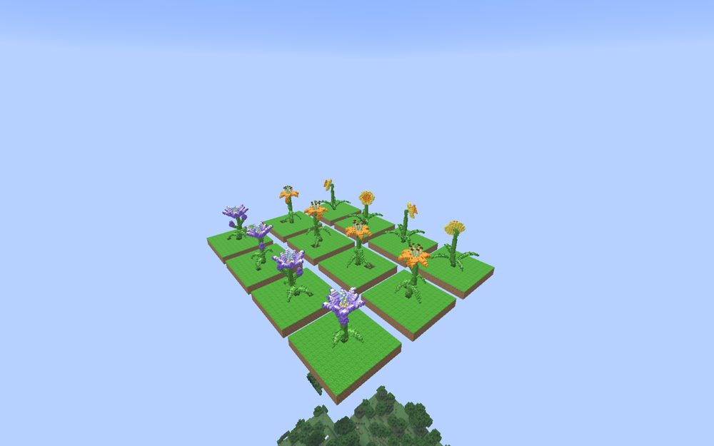
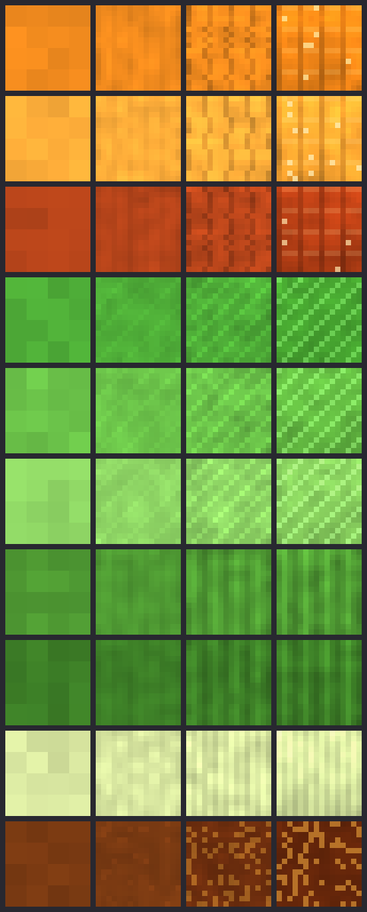
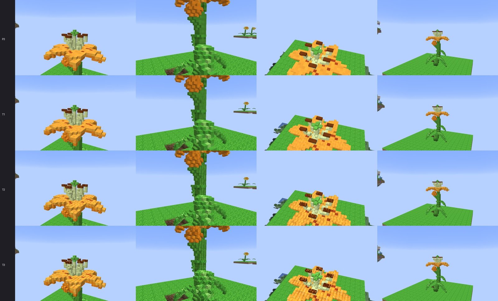
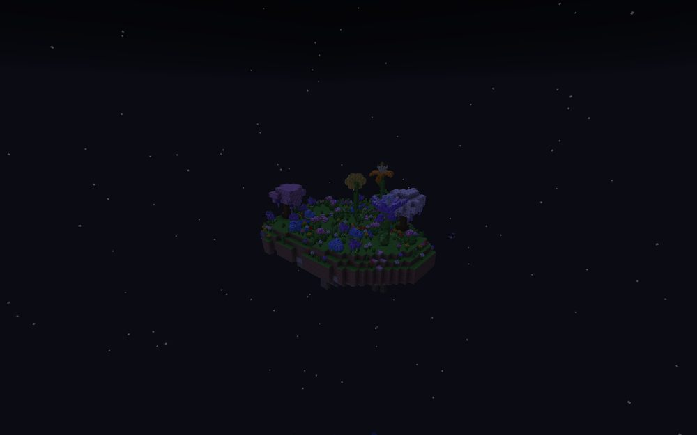
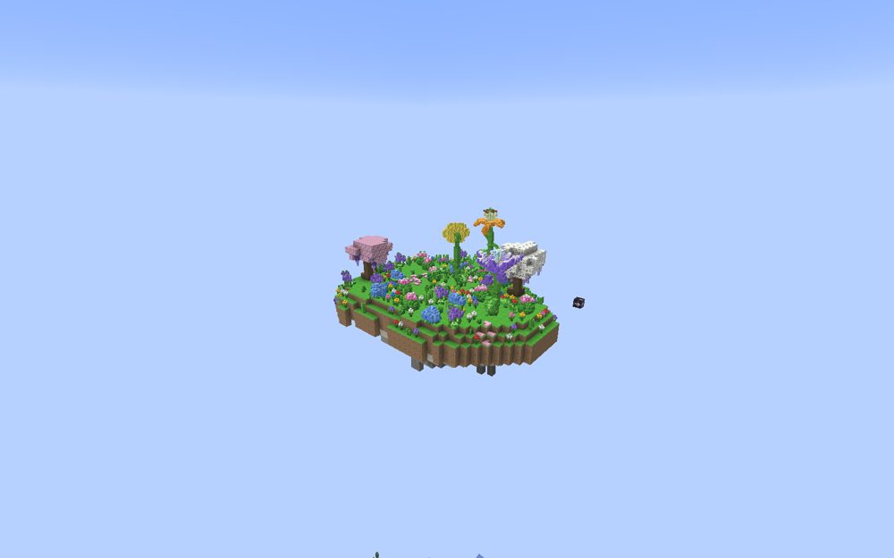
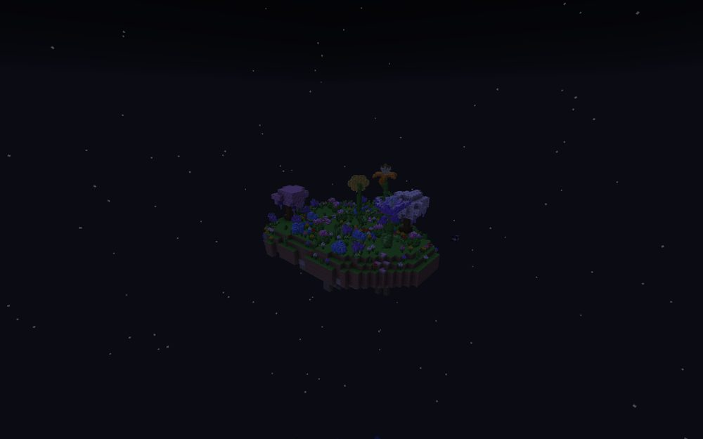

# 천국 하늘섬 P3.5 — 정책 반영 · 회전 호환 · 직소 풀 · 저장 오류 · 꽃 텍스처 시안 · forest 준비 (2026-11-21)

- 기준: `claude/heaven-sky-island-p3-20261120` @ `83ee0c4` (원격 HEAD·파일 확인 후 시작)
- 작업 브랜치: `claude/heaven-sky-island-p3-5-20261121`
- 보존: P1·P2·P2.5·P3 산출물, 원본 114개 템플릿, 초원 천국판 19개 NBT(바이트 동일), worldgen(구조물·세트·풀·확률), 구조물·블록 ID.
- 생성하지 않음: forest 19개, 텍스처 전체 적용, 월드젠 연결. PR·병합 없음.

## 0. 요약

| 영역 | 결과 |
|---|---|
| G1–G10 | 코드가 필요한 G4(물)·G5(용암)를 구현했다. 나머지는 현행 유지를 확인했다. 권위 문서 §23과 색인에 결정 상태를 기록했고, G2·G9는 보류로 표시했다 |
| 권위 충돌 | §4 "주변 바이옴 반영"과 F5(114개 전체 천국화)가 충돌할 수 있다. 폐기하지 않고 오너 결정 항목으로 기록했다 |
| 거대 꽃 회전 | 3종 × 4방향 **전부 통과**: 칸 위치, 방향, 1/16 복셀 실루엣, 높이, 줄기 연쇄, 인접 꽃 보호, 드롭 1회. 실제 클라이언트 동기화와 저장 후 재로드도 확인. 모델·ID 추가 0 |
| 천국판 직소 풀 | 초원 풀과 1:1로 대응하는 설계를 GameTest 네임스페이스에서 **격리 검증**했다. 천국판끼리만 조립되고(바닐라 지형 0), 탑·폐허·신전 기능은 보존된다. 월드젠은 변경하지 않았다 |
| 저장 오류 | **다른 MoreMinecrafts 시스템(ST05 콜로세움) 관련.** 경기장 상태 JSON이 NBT 문자열 한도 65,535바이트를 넘는다. 천국 하늘섬과는 무관하며 근거는 §4에 있다 |
| 꽃 텍스처 | 단색 원인 확정: 4×4픽셀 칸마다 한 색인 텍스처를 4픽셀 복셀 면이 정확히 한 칸씩 표시한다. T1·T2·T3 시안을 대표 꽃(거대 백합) 재질 10종으로 만들고 실제 클라이언트에서 비교했다(격리 리소스팩) |
| forest 준비 | 19개 조사 완료. **meadow와 형상이 다름**(겹침 67–95%). 생성기 재사용 가능. 팔레트(포드졸·이끼 조약돌)는 오너 결정 필요 |
| 회귀 | GameTest 739/739, JUnit 802/802, BUILD SUCCESSFUL |

---

## 1. G1–G10 정책 반영

| # | 처리 | 코드·데이터 | 검증 |
|---|---|---|---|
| G1 | 현행 유지(경작지·흙길 → 바닐라 흙) | 변경 없음 | P3 `f3ShovelPathAndHoeFarmland` |
| G2 | **보류.** 시험 밀도 유지 | 변경 없음 | — |
| G3 | 대나무 불허 유지 | `supports_bamboo`에 추가하지 않음 | P3 `f2…` (bamboo=false) |
| G4 | **구현.** 소형 식물이 물에 쓸려감 | `data/minecraft/tags/block/washed_away_by_fluids.json`에 소형 꽃 6, 짧은 풀, 긴 풀, 꽃잎 추가 | `g4SmallPlantsWashAway…`: 바닐라 민들레 대조군과 천국 4종 모두 물로 바뀜 |
| G5 | **구현.** 흰꽃 잎은 불연이고 용암에도 불붙지 않음 | `HeavenP2Blocks`: 흰꽃 잎을 바닐라 잎 속성으로 다시 만들되 `ignitedByLava`만 제외 | 화염 0/0, `ignitedByLava=false`, 경도·소리·랜덤틱·밀림·스폰(앵무새만)이 벚꽃잎과 동일. 바닐라 벚꽃잎 30/60·원목 5/5 유지 |
| G6 | forest 준비 (§6) | 생성기 보정 2건 (§6.4) | — |
| G7 | 설계와 격리 검증만 (§3) | GameTest 네임스페이스에만 추가 | `heavenPoolsAssemble…` |
| G8 | 유지 | 변경 없음 | P3 `f8MediumFlowerIsOnePlant` |
| G9 | **보류** | 드롭 없음 유지 | P3 드롭 훅 1회 테스트 |
| G10 | 권위 문서 반영 (§1.1) | 문서 2개 | JUnit `authorityRecordsTheApprovedAndDeferredHeavenDecisions` |

**P3 보고서 정정:**
- P3 §1.3에 "소형 꽃이 물에 남는다(실측)"고 썼는데, 당시 테스트는 대조군 없이 물 틱이 돌지 않는 청크에서 실행되어 판단 근거가 없었다.
- 이번에 바닐라 민들레 대조군과 강제 로드 청크로 다시 측정했다. P3 시점의 천국 소형 식물은 실제로 물에 남았다. 26.3은 `canBeReplaced`가 아니라 `#washed_away_by_fluids` 태그로 판정하기 때문이다. G4 구현으로 해결했다.

### 1.1 권위 문서 변경 내역

| 문서 | 변경 전 | 변경 후 |
|---|---|---|
| `docs/design/SKY_ISLANDS_T2_CONTEXT_2026-10-27.md` | 천국 하늘섬 항목 없음 | **§23 추가**: F1–F11 확정 상태, G1–G10 상태(G2·G9 보류, G7 월드젠 통합 보류, G6 forest 팔레트 미확정), §4와의 미해결 충돌 |
| `docs/CONTENT_AUTHORITY_INDEX.md` | 천국 하늘섬 경로 없음 | §23으로 가는 항목 추가(F8 범위, 보류 항목, 충돌을 요약) |

- **F8 범위 구체화** (지시대로):
  - 천국 전용 식생 블록(`heaven_*` 식생 17계열과 흰꽃 잎)은 불연성이다.
  - 재사용한 바닐라 원목·벚꽃잎은 바닐라 가연성을 유지한다.
  - 따라서 천국 하늘섬의 모든 식물성 블록이 불연성인 것은 아니다.
- **기존 문서와의 충돌:** §4 "주변 바이옴 반영"(설산은 눈·얼음·돌, 사막은 모래·사암 등)은 비-초원 테마 지형을 천국 블록으로 바꾸는 F5와 충돌할 수 있다.
  - 천국판은 월드젠에 연결되지 않아 지금 생성되는 결과에는 영향이 없다.
  - 어느 쪽도 폐기하지 않았고, 월드젠 통합이나 비-초원 변환 전에 오너 결정이 필요하다(승인 항목 H1).
- 그 밖의 정책 충돌은 발견되지 않았다.

---

## 2. P3.5-A — 거대 꽃 회전 호환성

### 2.1 조사: 회전에 관여하는 네 가지

| 요소 | 동작 (26.3) | P3 상태 |
|---|---|---|
| NBT 회전 | `StructureTemplate`가 칸 위치를 (x,z) → (−z,x) 방식으로 돌리고, 각 블록 상태에 `BlockState.rotate`를 호출한다 | 위치는 돌지만 거대 부품에는 회전할 속성이 없었다 |
| 블록 상태 회전 | `HeavenPartBlock.rotate`가 `facing`을 돌린다(P3에서 추가) | 중형 꽃만 `facing`이 있었다 |
| 모델 회전 | blockstate 변형의 `y: 90/180/270`으로 같은 모델을 돌린다 | 거대 부품은 변형이 `part=N` 하나뿐이었다 |
| 개체별 부품 배치표 | `HeavenPlants`가 `facing`에서 회전을 읽어 배치표 오프셋을 같은 방식으로 돌린다 | 거대 꽃은 회전 0으로만 일치했다 |

결론: 위치는 회전되지만 각 칸의 모델과 충돌 형상이 회전하지 않았다. 그래서 칸 안의 꽃잎·줄기 단면이 어긋나 실루엣이 깨졌고, 배치표 일치도 실패했다.

### 2.2 방식 비교

| 방식 | 내용 | 장점 | 단점 | 판정 |
|---|---|---|---|---|
| A. `facing` + blockstate y 회전 | 거대 3계열에 중형 꽃과 같은 `facing`을 주고, 기존 모델을 y 회전으로 재사용 | 모델·텍스처·ID 추가 0. 기존 NBT는 `facing` 없음 = 북쪽이라 지금과 동일. 충돌 형상·배치표 회전은 P3 코드가 이미 처리. 중형 꽃과 같은 규칙 | 상태 수가 ×4(341 → 1,364). 상태당 메모리만 늘고 모델은 그대로 | **선택** |
| B. 회전별 모델 생성 | 칸 내용을 미리 회전한 모델 4벌 | 블록 상태 의미가 단순 | 모델 341 → 1,364, P2 최적화와 반대 | 기각 |
| C. 회전 금지 | 천국판 배치를 회전 없이 고정 | 코드 0 | 직소 조립은 시작 조각을 무작위 회전한다. 월드젠 통합 시 해결 불가 | 기각 |

구현은 `tools/heaven-p35/giant_rotation.py`다. 부품표의 `facing` 값을 true로 바꾸고 blockstate에 4방향 변형을 쓴다. 자바 코드는 수정하지 않았다(P3 `rotate`·형상·배치표가 이미 일반화되어 있었다).

### 2.3 결과 (GameTest `giantFlowersKeepShapeAndBreakInEveryRotation`)

각 종을 **실제 구조물 회전**(`StructurePlaceSettings.setRotation`, 뿌리 기준)으로 배치했다.

| 종 | 칸 | 위치·부품·방향 오류 | 1/16 복셀 실루엣 (0°와 비교) | 높이 | 줄기 파괴 후 잔여 | 맞닿은 꽃 보존 | 드롭 훅 | 아이템 |
|---|---:|---:|---|---:|---:|---|---:|---:|
| starlotus 0/90/180/270° | 123 | 0 | 동일 (107,904복셀) | 9 | 0 | 123/123 | 1 | 0 |
| lily 0/90/180/270° | 120 | 0 | 동일 (86,464복셀) | 11 | 0 | 123/123 | 1 | 0 |
| daffodil 0/90/180/270° | 106 | 0 | 동일 | 10 | 0 | 123/123 | 1 | 0 |

실제 클라이언트(§5)에서도 확인했다.
- 90° 회전 백합의 줄기를 부수면 120칸이 제거되고 **클라이언트 잔여 0**이다.
- 저장 → 닫기 → 다시 열기 후에도 회전 격자 5,300블록의 지문이 같다(`6e30d4e9e78cbb57`).
- 다시 연 뒤 270° 수선화 줄기를 부수면 106칸이 제거되고 클라이언트 잔여 0이다.

카메라를 꽃과 함께 돌린 단독 샷 12장은 `images/rotation-*.jpg`에 있다. 같은 면이 보여야 정상이고, 실제로 같은 면이 보인다.

---

## 3. P3.5-B — 천국판 직소 연결

### 3.1 조사

| 항목 | 현황 |
|---|---|
| 구조물 | `sky_island_meadow`: jigsaw, start_pool `sky_islands/meadow/start`, size 4, 중심 거리 80, 시작 높이 40–110, 하늘섬 몹 스폰 재정의 |
| 시작 풀 | 템플릿 16개(소형 4 × 10, 중형 5 × 6, 대형 5 × 6, 폐허 6, 신전 2). 탑과 위성섬은 시작 풀에 없다 |
| 위성 | 이름·대상 `sky_link`, 방향 `west_up`/`east_up`, final_state 공기, 풀 `meadow/satellite`(satellite_a 3, satellite_b 3, empty 4) |
| Sky Tower 섬 | large_d·e의 `sky_top` 직소(`up_north`, final_state 흙) → `meadow/tower_top`(tower 1). 탑 바닥 직소는 `down_north`, 풀 `minecraft:empty`, final_state 잔디 |
| 폐허·신전 | `ruins_top`(ruins_a–d), `temple_top`(temple)은 **6테마 공용**이다. 상자·vault·trial_spawner가 있는 기능성 조각이고 테마 지형은 없다 |
| fallback | 모든 풀이 `minecraft:empty`. 조각이 맞지 않으면 아무것도 붙지 않고 직소는 final_state로 바뀐다 |

### 3.2 설계 (G7)

| 풀 | 원본 | 천국판 | 비고 |
|---|---|---|---|
| start | `sky_islands/meadow/start` | `…/heaven_link/meadow/start` | 가중치 동일, 위치만 천국판 |
| satellite | `sky_islands/meadow/satellite` | `…/heaven_link/meadow/satellite` | satellite_a 3 · b 3 · empty 4 동일 |
| tower_top | `sky_islands/meadow/tower_top` | `…/heaven_link/meadow/tower_top` | 천국판 탑 1 |
| ruins_top / temple_top | 공용 | **그대로 재사용** | 건물은 테마와 무관한 기능성 조각이다 |

- 직소 블록은 위치, 방향, 이름(`sky_link`/`sky_top`), 대상, 결합, 우선순위, final_state를 유지한다. 위성·탑 링크의 `pool`만 천국판 풀로 바꾼다.
- 대상 템플릿 10개: large_d·e, plain_medium_a–e, ruins, satellite_a·b.
- **격리**
  - 풀 8개(설계 3 + 테스트용 단일 시작 풀 5)와 연결용 템플릿 10개는 `src/gametest/resources/data/moreminecrafts-gametest/`에만 있다. 테스트 실행에서만 로드되고 어떤 구조물도 참조하지 않는다.
  - P3 NBT(`src/main`)는 바꾸지 않았다.
  - JUnit으로 다음을 고정했다: 프로덕션 JSON에 `heaven_link` 참조 0, 프로덕션 천국 풀 디렉터리 없음, 연결용 템플릿은 P3와 **pool 값만** 다름.
- **월드젠 통합 시(보류):** 같은 풀 3개를 `data/moreminecrafts/worldgen/template_pool/heaven_p3/meadow/`에 두고 P3 템플릿의 pool 값을 바꾼다. 천국판 전용 구조물(새 ID)이 필요하다. 구조물 세트와 확률은 오너 결정 사항이다.

### 3.3 검증 (GameTest `heavenPoolsAssembleOnlyHeavenPiecesAndKeepFunctionalStructures`, 바닐라 jigsaw 조립기 `JigsawPlacement.generateJigsaw`)

| 사례 | 결과 |
|---|---|
| 천국 large_d + 천국 Sky Tower 섬 | 조립 성공. 바닐라 지형 0, 탑 건축 안산암 **3,312**, vault **8**, trial_spawner **16**, 남은 직소 0. 시작 조각이 무작위 회전되었고 거대 꽃도 함께 회전됨 |
| 천국 중형 + 위성 (6회 시도) | 6회 조립 모두 천국 위성이 붙음. 바닐라 지형 0, 남은 직소 0 |
| **대조군: P3 템플릿 그대로** | 바닐라 meadow 위성이 붙어 바닐라 잔디 **1,476**개가 섞임 (G7이 해결하는 문제를 재현) |
| 천국 폐허 + 공용 폐허 조각 | 석재 벽돌류 274, 상자 2, 바닐라 지형 0, 남은 직소 0 |
| 천국 신전 + 공용 신전 조각 | 매끈한 석영 1,341, 바닐라 지형 0, 남은 직소 0 |

---

## 4. P3.5-C — 저장 데이터 오류 조사

**분류: 다른 MoreMinecrafts 시스템 관련 (ST05 콜로세움 `ColosseumData`).**

| 단계 | 결과 |
|---|---|
| 1. 로그·스택 | P3 실행 23:41:38 `Failed to write NBT String`, `UTFDataFormatException: encoded string ({"format...ns":[]}}) too long: 373690 bytes`. 경로: `SavedDataStorage.tryWrite` → 루트 compound → **list** → compound → **string** |
| 2. 저장 데이터 종류 | 루트에 compound 목록을 두고 그 안에 긴 JSON 문자열을 넣는 저장 데이터는 `ColosseumData`(`moreminecrafts:colosseum_arenas`)뿐이다. 코덱은 `SiteSave.listOf()`이고 `state` 필드에 `ArenaController.toJson()`(Gson)을 넣는다. Dto의 첫 필드는 `format`, 마지막 필드는 `structure_mask.player_positions`이다. 오류 메시지의 앞뒤 `{"format`…`ns":[]}}`와 일치한다. P3 실행 후 저장 폴더에 `colosseum_arenas.dat`가 없었다 |
| 3. 크기 제한 | NBT 문자열은 Java `writeUTF`라 최대 65,535바이트다. 콜로세움 구조 마스크의 보호 좌표(`protected_positions`, long 목록)가 JSON에 그대로 들어가 373,690바이트가 되었다 |
| 4–6. 재현·대조 | **천국 하늘섬 없이 재현됨.** P3 시드로 새 월드를 만들고 천국 블록은 하나도 놓지 않았다. 플레이어를 콜로세움 위치에 두자 1,011틱 뒤 같은 콜로세움(`68114ef59640c71e`)이 생성되었고, 상태 JSON은 **373,690자**(P3 오류와 같은 바이트 수)였다. `save-all flush` 시 같은 `UTFDataFormatException`이 발생했고 `colosseum_arenas.dat`는 **생성되지 않았다**. 다시 열었을 때 경기장 상태는 **222자**로 초기화되어 있었다(구조 마스크·진행 상태 손실). 천국 배치 전후 비교: P3 실행(천국 6종 배치)과 이번 대조 실행(천국 0)에서 같은 크기로 실패했다 |
| 7. 연관 | P3 실행 중 23:41:10에 ST05 자연 콜로세움이 생성·검증됨(`construction … final_state=VERIFIED`) → 28초 뒤 첫 저장에서 실패. 콜로세움이 생성되지 않은 P1·P2 실행에서는 오류 0. 천국 코드는 SavedData를 쓰지 않고, 천국 블록은 재로드 전후 지문이 같다 |

- **영향 (천국 밖):** 콜로세움 경기장 상태가 저장되지 않는다. 재접속 후 경기장 등록·구조 마스크·진행 상태가 사라질 수 있다.
- **수정:** 이번 범위 밖이라 ST05 코드는 수정하지 않았다. 원인과 재현 절차만 보고한다.
  - 재현 절차: `HeavenP35ClientCapture`의 대조 월드와 같다. P3 시드 `-7815959961086380509`로 싱글플레이 월드를 만들고, 플레이어를 (206, 120, −164)에 두고, 콜로세움이 등록될 때까지 기다린 뒤 `save-all flush`를 실행한다.
  - 수정 방향 예: 상태를 문자열 대신 NBT로 저장, 좌표 목록 압축, 마스크를 별도 파일로 분리. 결정은 ST05 담당 범위다.

---

## 5. P3.5-D — 꽃 블록 텍스처

### 5.1 단색 원인 (확정)

| 확인 항목 | 결과 |
|---|---|
| 텍스처 색상 수 | 재질 1장에 9–14색. 그런데 **4×4픽셀 칸 안에서는 항상 1색**이다(`data/texture_stats.json`: P3 `colours_per_4x4_tile = 1.0`, 10재질 모두) |
| 생성 스크립트 | `tools/heaven-prototype/build_prototype.py` `material_texture()`: V5 디자인 색 × 4×4 격자 밝기 ±7%. 디자인 렌더러가 복셀마다 한 색을 주던 방식을 그대로 옮겼다 |
| 모델·UV | P2 모델은 4픽셀(¼블록) 복셀 상자이고 `uv` 지정이 없다(자동 투영). **복셀 면 하나 = 텍스처의 4×4칸 하나 = 단색 한 칸** |
| 면별 색상 지정 | 면마다 재질 1개(디자인 그대로). 문제는 재질 안의 세부가 없다는 것이다 |
| 팔레트 제한 | 재질 = V5 색 1개. 채널별 편차가 2.5–7.4로 매우 작다 |
| 조명·AO | 바닐라 조명과 AO는 면 단위 명암만 준다. 원인이 아니다 |
| 반복·확대 | 텍스처는 블록 단위로 반복된다. 같은 블록의 이웃 복셀은 다른 칸을 표시하므로 16픽셀 패턴이 복셀 경계를 넘어 이어질 수 있다. 시안은 이 점을 이용한다 |

**지난 답변 정정:** "밝기 편차 10–90"은 RGB 채널 간 색 차이가 섞인 잘못된 지표였다. 실제 채널별 편차는 2.5–7.4이고, 복셀 면은 완전한 단색이다.

### 5.2 시안 (대표 꽃: 거대 백합, 재질 10종)

`tools/heaven-p35/flower_textures.py`로 만들었다. 공통 제약은 16×16 유지, 재질 평균색을 V5 색 ±3% 이내로 유지(JUnit), 모델·ID·NBT 동일이다.

| 시안 | 꽃잎 (lil_out·lil_in·lil_spot) | 줄기 (stem·stem_dk) | 잎 (leaf·leaf_lt·vein) | 꽃술 (fil·anther) | 4×4칸당 색 | 채널 편차 |
|---|---|---|---|---|---:|---:|
| P3 | 단색 | 단색 | 단색 | 단색 | 1.0 | 2.5–7.4 |
| T1 절제 | 2픽셀 노이즈 ±3.5% + 옅은 세로 결 | 옅은 세로 결 | 옅은 사선 잎맥 | 꽃가루 미세 점 | 10.6–13.8 | 2.9–8.2 |
| T2 자연 | 4픽셀 간격의 흔들리는 꽃잎 결(−13%), 가로 능선 | 밝고 어두운 섬유 줄 ±10% | 사선 잎맥 +14%, 반대 사선 −6% | 노란 꽃가루 22% | 13.4–15.3 | 6.9–18.0 |
| T3 환상 | T2 결 + 블록 위쪽 밝기 그라데이션, 금빛 능선, 반짝임 3% | 밝은 섬유 하이라이트 | 밝은 잎맥에 연두 하이라이트 | 금빛 꽃가루 28%, 수술은 진주빛 | 10.6–14.9 | 8.5–27.9 |

열 순서: P3 · T1 · T2 · T3. 행 순서: lil_out, lil_in, lil_spot, leaf, leaf_lt, vein, stem, stem_dk, fil, anther. **디자인 시트(16배 확대)이며 게임 화면이 아니다.**

### 5.3 실제 클라이언트 비교 (같은 카메라·정오·소프트웨어 렌더)

- 격리 방식: 시안은 GameTest 모드의 내장 리소스팩 3개다(기본 꺼짐, `-Dmoreminecrafts.heaven.p35capture` 실행에서만 등록). 촬영 중에만 켜고 끈다. 프로덕션 텍스처는 바뀌지 않는다(JUnit).
- 시안은 공용 재질(stem, leaf 등)을 교체하므로, 촬영 중에는 같은 재질을 쓰는 다른 꽃도 함께 바뀐다.

행: P3 · T1 · T2 · T3. 열: 꽃잎 근접 · 줄기와 잎 · 꽃술(위에서) · 꽃 전체.

| 섬 (정오) | 섬 (자정) |
|---|---|
|  P3 |  P3 |
|  T1 |  T1 |
|  T2 |  T2 |
|  T3 |  T3 |

관찰:
- **근거리:** P3는 복셀 면이 평평한 단색이다. T1은 가까이서만 보이는 미세한 결이 있다. T2는 꽃잎 줄무늬, 잎맥, 꽃가루 점이 분명하다. T3은 T2보다 밝은 하이라이트와 반짝임이 있다.
- **원거리:** 섬 전체 샷에서는 네 안의 차이가 거의 없다. 평균색을 유지했으므로 원거리 색 가독성은 그대로다.
- **밤:** 네 안 모두 바닐라 밤 조명으로 어두워진다. T3의 밝은 픽셀도 발광은 아니다.
- **판단은 소유자 몫이다** (`LIVE VALIDATION PENDING`). 적용 범위(다른 꽃 재질로 확대)도 승인 후 결정한다.

---

## 6. P3.5-E — forest 19개 확장 준비 (생성하지 않음)

데이터: `data/forest_prep.json` (`tools/heaven-p35/forest_prep.py`, 시험 실행만).

### 6.1 템플릿과 팔레트

- 19개 이름·크기는 meadow와 같다.
- **형상은 다르다.** 비식생 블록 위치의 겹침(Jaccard)이 0.67–0.95다. P2.5는 "같은 형태"라고 보고했지만, 크기만 같고 지형은 따로 만들어져 있다. 따라서 forest는 meadow 천국판을 복사할 수 없고, forest 원본에서 다시 생성해야 한다.
- 지형 팔레트(19개 합):

| 블록 | 수 | 깊이 역할 (P2.5) |
|---|---:|---|
| `stone` | 281,027 | 암반 |
| `andesite` | 143,857 | 암반 (탑에서는 3,312개가 건축재) |
| `mossy_cobblestone` | 140,361 | 암반 |
| `dirt` | 84,580 | 하층 |
| `grass_block` | 62,939 | 표면 |
| `podzol` | 42,248 | 하층 |

- 제거 대상 바닐라 식생: 참나무 잎 29,978, 자작나무 잎 14,694, 짧은 풀 7,232, 참나무 원목 2,446, 고사리 1,487, 자작나무 원목 1,205, 꽃 580.
- 건축재: 탑 1개(meadow와 같은 탑 구조, 안산암 3,312를 보존). badlands·rocky 같은 오분류는 없다.
- 직소: meadow와 같은 위치·방향 20개. 풀은 `forest/satellite`, `forest/tower_top`이고, `ruins_top`·`temple_top`은 공용이다. final_state 변환 대상은 잔디 3개와 흙 2개다.

### 6.2 시험 실행 (팔레트 후보, 승인 전)

| 후보 | 변환 | 남는 바닐라 지형 |
|---|---|---|
| A 전부 천국 | 잔디 → 천국 잔디, 흙·포드졸 → 천국 흙, 돌 → 크림 석재, 안산암·이끼 조약돌 → 옅은 크림 석재 | 없음 |
| B forest 강조 유지 | A와 같되 포드졸·이끼 조약돌은 바닐라 유지(지형으로 취급) | 이끼 조약돌·포드졸(예: large_a 19,740 / 4,377) |

| 템플릿 | 식재 가능 (forest / meadow) | 거대 꽃 공식 요청→배치 | 나무 | 식생 블록 |
|---|---|---|---:|---:|
| large_a | 6,467 / 6,338 | 24→24 | 16 | 10,199 |
| large_b | 7,587 / 7,637 | 28→28 | 19 | 11,939 |
| large_c | 9,907 / 9,908 | 37→37 | 25 | 15,638 |
| large_d | 7,661 / 7,642 | 28→28 | 19 | 12,084 |
| large_e | 9,575 / 9,418 | 35→35 | 24 | 14,945 |
| 중형 5 | 656–810 | 2–3 | 2 | 987–1,246 |
| 소형 4 | 312–345 | 1 | 1 | 444–534 |
| ruins | 260 / 258 | 1→0 (붙는 폐허 조각) | 0 | 251 |
| satellite_a·b | 172–175 | 1 | 0 | 234–247 |
| temple | 832 / 866 | 3→3 | 2 | 1,168 |
| tower | 90 / 87 | 0 | 0 | 48 |
| **합계** | **47,777 / 47,540** | **176→175** | 119 | **74,526** |

- A와 B는 식재·식생 결과가 같고, 섬 몸체 색만 다르다. 생존 규칙 위반 0, 보행 가능 97%.
- 생성 시간은 19개에 28초다. 시험 공식으로는 대형 섬 거대 꽃이 24–37개로 meadow와 같은 수준이다. 이 수치는 **최종 기준이 아니다**(G2 보류). 실제 클라이언트에서 시야·동선·구조물 간섭을 확인한 뒤 정한다.

### 6.3 meadow와의 차이와 생성기 재사용

| 항목 | meadow | forest | 생성기 대응 |
|---|---|---|---|
| 형상 | 기준 | 다름 (겹침 0.67–0.95) | forest 원본에서 생성(`Island(theme='forest')`) |
| 하층 | 흙·거친 흙 | 흙·**포드졸** | 슬롯 표에 포드졸 추가 (A/B 결정 필요) |
| 암반 | 돌·안산암·응회암 | 돌·안산암·**이끼 조약돌** | 슬롯 표에 이끼 조약돌 추가 (A/B 결정 필요) |
| 원래 식생 | 참나무 | 참나무·**자작나무**·고사리 | 제거 목록에 자작나무·고사리(자동 감지) |
| 숲 정체성 | — | 나무·풀 (권위 §4) | V5 꽃나무를 V5 비율로 심는다. 숲답게 나무를 더 늘릴지는 결정 필요 |

### 6.4 이번에 고친 생성기 문제 (초원 출력은 바이트 동일)

1. `attached_footprints()`가 meadow 풀만 읽어, 다른 테마에서 large_d·e 위의 **탑 조각 금지 구역이 빠졌다.**
   - P3에서 고쳤다고 생각했지만 수정 문자열이 일치하지 않아 적용되지 않았다.
   - **P3 보고서 §7의 비-초원 추정치를 정정한다**(`data/expansion_estimate_corrected.json`): forest 59,021 → 47,777, snowy 58,759 → 47,493, desert 58,796 → 47,377, badlands 52,140 → 41,731, rocky 23,668 → 16,838 식재 기둥.
2. 슬롯이 바닐라 블록을 그대로 두는 경우(후보 B)에도 지형으로 취급하도록 `terrain_out`을 섬별로 계산한다.

---

## 7. 통합 검증

### 7.1 자동 테스트

| 실행 | 결과 |
|---|---|
| `./gradlew test build` (GameTest 월드 삭제 후, 최종 코드) | **GameTest 739/739** (P3 736 + 신규 3), **JUnit 802/802** (P3 797 + 신규 5), BUILD SUCCESSFUL |
| 실제 클라이언트 `HeavenP35ClientCapture` | BUILD SUCCESSFUL, 스크린샷 40장 |

신규 테스트:

| 테스트 | 내용 |
|---|---|
| GameTest `giantFlowersKeepShapeAndBreakInEveryRotation` | 3종 × 4방향: 칸·방향·실루엣·높이·연쇄·인접 보호·드롭 1회 |
| GameTest `heavenPoolsAssembleOnlyHeavenPiecesAndKeepFunctionalStructures` | 천국판 조립 4사례 + 대조군 |
| GameTest `g4SmallPlantsWashAwayAndG5FlammabilityScope` | 바닐라 대조군과 함께 물(실제 물 흐름), 흰꽃 잎·벚꽃잎·원목 가연성 범위 |
| JUnit `HeavenP35ResourceTest` (5) | 거대 blockstate 회전 규약, G4 태그 정확성, 연결용 템플릿이 pool 외 동일, 테스트 리소스가 프로덕션에서 격리, 시안 평균색 유지, 권위 문서 기록 |

기존 P3 테스트 중 블록 틱에 의존하는 2개(`f6EveryGiantSpecies…`, `f8HeavenVegetationNeedsSupport`)는 사용하는 청크를 강제 로드하도록 고쳤다. P3.5 1차 실행에서 틱이 돌지 않는 청크 때문에 실패했었다.

### 7.2 시각 검증

| 항목 | 결과 |
|---|---|
| 회전된 거대 꽃 외형 | 격자 2장 + 단독 12장. 같은 면이 보임 |
| T1·T2·T3 근거리 질감 | §5.3 |
| P3 원본과의 비교 | §5.3 (같은 카메라) |
| 원거리 색 가독성 | 섬 샷에서 차이 거의 없음 |
| 낮·밤 외관 | 섬 정오·자정 × 4안 |
| GPU 성능 | **NOT RUN** — 소프트웨어 렌더러(lavapipe) |

### 7.3 저장 검증

| 항목 | 결과 |
|---|---|
| 천국 하늘섬 저장·재로드 | 회전 격자 5,300블록 지문 동일 |
| 거대 꽃 파괴 후 저장 | 90° 백합을 파괴한 상태로 저장 → 재로드 후에도 지문 동일(파괴 상태 유지) |
| 오류 재현 | §4 |
| 저장 데이터 무결성 | 천국 하늘섬은 블록 상태만 쓰므로 해당 없음. 콜로세움 데이터 손실은 §4 |

---

## 8. 미해결 문제

1. **ST05 콜로세움 상태 저장 실패** (§4): 다른 시스템의 실제 데이터 손실 버그다. 이번 범위에서는 수정하지 않았다.
2. **§4 바이옴 반영 vs F5 충돌** (§1.1).
3. **G7 월드젠 통합 보류:** 천국판 전용 구조물 ID·구조물 세트·확률이 결정되지 않았다.
4. **텍스처 시안은 대표 꽃 재질 10종만:** 다른 꽃(starlotus, daffodil, 중형·소형, 덩굴)의 재질 38종은 승인 후 같은 규칙으로 확장해야 한다.
5. GPU 성능 미측정.

## 9. 소유자 승인 요청

| # | 결정 | 선택지 | 권장 |
|---|---|---|---|
| H1 | §4 바이옴 반영 vs F5 | ① 비-초원 테마도 천국 지형으로 전환(§4 개정) ② 천국은 초원(+forest)만, 나머지는 바이옴 유지(F5 개정) ③ 천국판을 별도 희귀 구조물로 두고 기존 6테마와 병존 | 결정 필요 (③이 두 문서를 모두 살림) |
| H2 | 꽃 텍스처 | P3 유지 / T1 / T2 / T3 / 혼합(예: 꽃잎 T3 + 잎·줄기 T2) | T2 (근거리 질감이 분명하고 노이즈가 과하지 않음). 스크린샷 검토 후 결정 |
| H3 | 텍스처 적용 범위 | 대표 꽃만 / 모든 천국 꽃 재질 48종 | 승인안을 전체 재질에 같은 규칙으로 적용 |
| H4 | forest 팔레트 | A 전부 천국 / B 포드졸·이끼 조약돌 유지 | 결정 필요 (A는 일관성, B는 숲 정체성) |
| H5 | forest 나무 비율 | V5 비율 그대로 / 숲답게 상향 | 결정 필요 |
| H6 | G7 월드젠 통합 방식 | 천국판 전용 구조물 신규 + 풀 3개 + P3 NBT 풀 값 변경 / 기존 구조물의 풀 교체 | 전용 구조물 신규 (기존 생성 규칙 불변) |
| H7 | ST05 콜로세움 저장 버그 | ST05 담당 작업으로 이관 / 이번 브랜치에서 최소 수정 | 이관 |
| G2·G9 | 거대 꽃 최종 밀도 / 드롭 | 보류 유지 | — |

## 부록 · 파일

| 파일 | 내용 |
|---|---|
| `tools/heaven-p35/giant_rotation.py` | 거대 부품표·blockstate 회전 |
| `src/main/resources/assets/moreminecrafts/blockstates/heaven_giant_*.json`, `data/moreminecrafts/heaven/flora/heaven_giant_*.json` | 회전 변형 |
| `src/main/resources/data/minecraft/tags/block/washed_away_by_fluids.json` | G4 |
| `src/main/java/…/heaven/HeavenP2Blocks.java` | G5 흰꽃 잎 속성 |
| `tools/heaven-p35/link_pools.py`, `src/gametest/resources/data/moreminecrafts-gametest/{worldgen/template_pool,structure}/heaven_link/` | G7 격리 풀·연결용 템플릿 |
| `tools/heaven-p35/flower_textures.py`, `src/gametest/resources/resourcepacks/heaven_tex_t{1,2,3}/` | 텍스처 시안 (GameTest 전용 팩) |
| `tools/heaven-p35/forest_prep.py`, `data/forest_prep.json` | forest 준비 |
| `tools/heaven-p3/build_meadow.py` | 테마 풀 금지 구역 보정, `terrain_out` (초원 출력 바이트 동일) |
| `src/gametest/…/HeavenP35GameTests.java`, `HeavenP35ClientCapture.java`, `HeavenP35TexturePacks.java`, `src/test/…/HeavenP35ResourceTest.java` | 테스트·실제 클라이언트 검증 |
| `docs/design/SKY_ISLANDS_T2_CONTEXT_2026-10-27.md` §23, `docs/CONTENT_AUTHORITY_INDEX.md` | 권위 문서 |
| `data/texture_stats.json`, `data/expansion_estimate_corrected.json` | 분석 |
