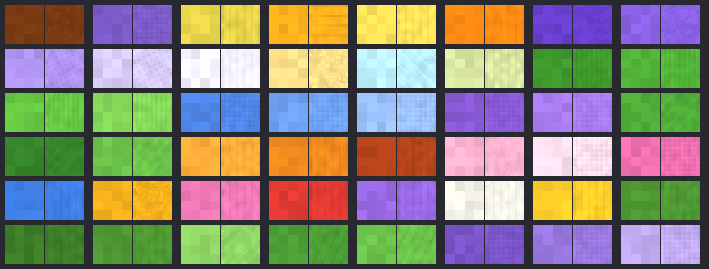
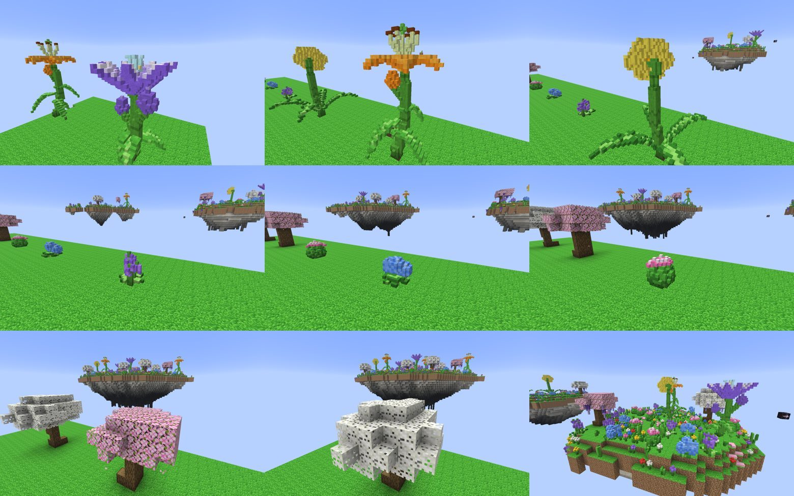

# 천국 하늘섬 P3.6 — 꽃 텍스처 T1 전체 적용 (2026-11-21)

- 승인: H2 = T1, H3 = 꽃 재질 48종 전체 적용. H1, H4–H7, G2, G9는 포함하지 않으며 미결정 상태를 유지한다.
- 기준: `claude/heaven-sky-island-p3-5-20261121` @ `acdd837`
- 브랜치: `claude/heaven-sky-island-p3-6-t1-textures-20261121`
- 변경한 것: `textures/block/heaven/flora/*.png` 48장. 모델, 블록 ID, NBT, 게임플레이, worldgen은 변경 없음.
- 권위 문서: `SKY_ISLANDS_T2_CONTEXT` §24.4에 H2·H3 확정을 기록했다.

## 적용 원칙 (`tools/heaven-p36/apply_t1.py`)

- **공통 원칙**
  - 16×16 크기를 유지한다.
  - 재질 평균색을 V5 색으로 되돌린다. 차이는 채널당 최대 4.9/255로, 흰색 계열 클리핑 때문이다.
  - 진폭은 약 ±3–6%로 절제한다.
  - 4×4칸 안에 구조를 넣는다. 칸당 색 수가 1.0에서 10.7–15.3으로 늘었다.
- **거대 백합 재질 10종:** 승인된 P3.5 T1 시안과 **바이트 단위로 같다**.
- **나머지 38종:** 재질 특성별로 무늬를 다르게 했다.

| 특성 | 재질 | T1 무늬 |
|---|---|---|
| 꽃잎 | daf_back, daf_pet, daf_rim, sm_red·blu·pnk·vio·yel | 옅은 세로 결 |
| 밝은 꽃잎 | sm_wht, fan_5 | 진폭을 절반으로 줄인 결 (회색으로 탁해지지 않게) |
| 부채꽃잎 (starlotus) | fan_1–4 | 완만한 사선 결 |
| 나팔 (수선화 부관) | daf_cor | 가로 고리 |
| 꽃 중심 | sm_ctr, fan_core | 꽃가루 알갱이 |
| 결정 | fan_crys | 희미한 결정면 반짝임 |
| 꽃송이 (중형·등나무·봉오리) | hyd_1–3, lav, lav_lt, phl_p, phl_c, bud, wis_1–3 | 작은 꽃송이 요철 |
| 땅 꽃잎 | petal_g | 흩어진 점 |
| 풀 | gr_1–4 | 위로 갈수록 옅어지는 풀잎 줄 |
| 잎·줄기 | leaf_dk, stem_s | 백합 잎맥·줄기 결과 같은 규칙 |
| 덩굴 | vine, vine_lt | 꼬인 줄기 |

## 실제 클라이언트 검증 (`HeavenP36ClientCapture`, 소프트웨어 렌더)

정오와 자정에 각각 11장, 모두 22장을 찍었다.
- 근거리 9장: 거대 꽃 3, 중형 꽃 3, 나무 2, 섬 지면
- 중거리 1장: 중형 섬
- 원거리 1장: 대형 섬

| 정오 | 자정 |
|---|---|
|  |  |
|  |  |

- **근거리:** 복셀 면이 단색으로 보이지 않고 은은한 결이 보인다. V5 형태와 주요 색은 그대로다.
- **원거리:** 평균색을 유지해 섬의 색 구성이 P3와 같다.
- **밤:** 바닐라 조명대로 어두워지고, 발광 요소는 없다.
- 미적 판단은 소유자 검토가 필요하다(`LIVE VALIDATION PENDING`). GPU 성능은 측정하지 못했다(NOT RUN).
- 원거리 샷은 카메라 각도 때문에 대형 섬이 화면 오른쪽에 치우쳐 있다(판단에는 지장 없음).

## 회귀

`./gradlew test build` (GameTest 월드 삭제 후): **GameTest 739/739, JUnit 802/802, BUILD SUCCESSFUL**. P3.5 회귀 테스트를 모두 포함한다.
