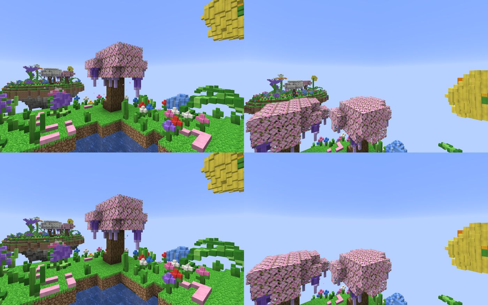
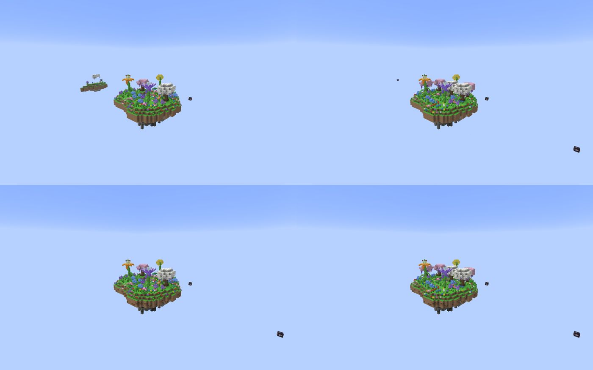
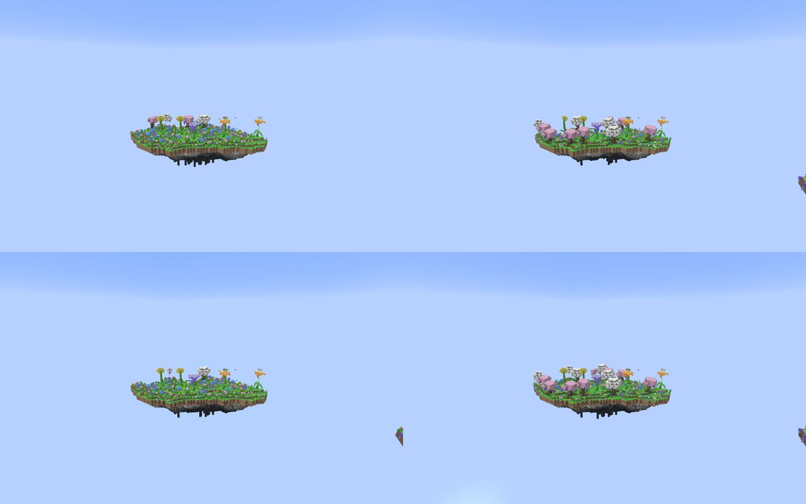

# 천국 하늘섬 P3.7 — H1·H6 월드젠 구조 검토, H4·H5 forest 비교 시안 (2026-11-21)

- 기준: `claude/heaven-sky-island-p3-6-t1-textures-20261121` @ `e347a64`
- 브랜치: `claude/heaven-sky-island-p3-7-policy-review-20261121`
- 범위: 정책 비교와 시안 검증만. **H1·H4·H5·H6 최종 선택과 forest 프로덕션 NBT는 승인 후 진행한다.**
- 보존: P3.6 산출물, 월드젠, 구조물 ID, 구조물 세트, 초원 천국판(바이트 동일). 비교용 forest NBT는 GameTest 전용 리소스에만 있다.

## 0. 요약과 권장

| 항목 | 권장 | 한 줄 근거 |
|---|---|---|
| H1 구조 | **D안: 기존 풀의 원소를 천국판 템플릿으로 교체** (구조물 ID·세트·확률·바이옴은 그대로) | 6테마 형상과 분포를 그대로 유지하면서 외형만 통일하고, 이미 생성된 섬과 이음매가 생기지 않는다 |
| H1 범위 | 초원 → forest는 §4 개정 없이 진행 가능. 나머지 4테마는 §4 개정(소유자 결정)이 선행 조건 | §4는 평원 "잔디·꽃·드문 나무", 숲 "나무·풀"이라 천국과 어긋나지 않는다. 설산·사막·악지는 어긋난다 |
| H6 풀 | 프로덕션에서는 **새 풀을 만들지 않고** 기존 풀 ID를 유지한 채 원소만 교체한다 | 천국판 직소의 풀 값을 바꿀 필요가 없고(정적 검증), 템플릿은 `sky_islands/heaven/<theme>/` 경로여야 몹이 스폰한다 |
| H4 팔레트 | **A (전부 천국)** | B와 눈에 보이는 차이가 없고, B는 섬 하부에 바닐라 포드졸·이끼 조약돌이 남는다 |
| H5 나무 밀도 | **forest 강화(807기둥당 6그루, 간격 5)** | V5 기본은 수관 7%로 초원 원본(8.5%)보다도 낮아 숲으로 보이지 않는다. 강화안은 21%(원본 forest 30%), 이동·성능 영향은 작다 |

---

## 1. H1·H6 — 월드젠 구조

### 1.1 현재 구조 (조사)

| 항목 | 현황 |
|---|---|
| 구조물 ID | 8개: 일반 5(snowy, meadow, forest, desert, badlands), 산악 3(mountain_snowy, mountain_rocky, mountain_meadow) |
| 구조물 세트 | `sky_islands_general`(5개, 가중치 1:1, 간격 24, 빈도 0.5), `sky_islands_mountain`(3개, 간격 14) |
| 선택 | 바이옴 태그가 구조물을 고른다(meadow=평원·사바나, forest=숲·타이가 등). 같은 풀을 산악 변형이 공유한다(mountain_meadow → `meadow/start`) |
| 풀 | 테마 6개 × (start, satellite, tower_top) = 18개 + 공용 `ruins_top`, `temple_top`, `tower_top` |
| 몹 스폰 재정의 | 구조물 JSON마다 13종씩 복제되어 있다 |
| `SkyIslandHabitat` | 구조물 ID 8개(하드코딩)와 템플릿 경로 접두사 `sky_islands/`를 검사한다. 이 두 조건을 만족해야 하늘섬 몹이 스폰한다 |
| 저장 | **구조물 시작점은 조각마다 템플릿 위치(ID)를 저장한다**(`SinglePoolElement` 코덱이 `Either<Identifier, Template>`을 직렬화). 템플릿 블록 내용은 저장하지 않고 청크가 생성될 때마다 읽는다 |

### 1.2 §4와의 충돌 여부

§4 "주변 바이옴 반영": 설산 눈·얼음·돌, 평원 잔디·꽃·드문 나무, 숲 나무·풀, 악지 테라코타·붉은 모래, 사막 모래·사암. 일반 섬과 유적·신전이 놓인 섬의 자연 지형·식생에 적용하고, 건축물 고유 디자인은 종속시키지 않는다.

| 대상 | 천국화와의 관계 |
|---|---|
| 평원(meadow) | 어긋나지 않음. 천국 초원은 잔디·꽃이고 나무는 807기둥당 2그루로 "드문 나무"에 맞다 |
| 숲(forest) | 어긋나지 않음. 나무 밀도가 충분해야 한다(H5) |
| 설산·사막·악지 | **충돌한다.** 눈·모래·테라코타 표면이 천국 잔디·크림 석재로 바뀐다 |
| 산악 변형 | 같은 풀을 공유하므로 테마를 따라간다. rocky는 §4에 항목이 없다 |
| 건축물(탑·폐허·신전) | 영향 없음. 변환하지 않는다 |

**병존(B안)이 §4와 충돌하는가?** 문자 그대로는 충돌하지 않는다(기존 6테마가 그대로 남기 때문). 그러나 **원래 목표(외형 통일)와 충돌한다.** 천국 섬이 가중치만큼만 나오고 나머지는 옛 외형이므로 통일이 되지 않고, 통일하려면 옛 구조물 가중치를 0으로 만들어야 해서 결국 대체와 같아진다. 병존의 이점은 §4를 건드리지 않는 것뿐이다.

### 1.3 방안 비교

| 방안 | 내용 | 저장·기존 월드 | 목표 적합 | §4 | 변경 규모 | 몹·호환 | 롤백 |
|---|---|---|---|---|---|---|---|
| R. 구조물 ID 대체 | 옛 8개 ID를 천국 ID로 교체 | **위험.** 저장된 시작점의 구조물 ID가 사라져 부분 생성된 섬이 잘릴 수 있다(바닐라가 알 수 없는 구조물 시작점을 버리는 동작으로 예상, 이번에 실측하지 않음) | 높음 | 비-초원 충돌 | NBT 114 + 구조물 8 + 세트 2 + 바이옴 태그 + Habitat ID + 몹 복제 | ID가 바뀌어 외부 참조(테스트, 다른 모드)가 깨질 수 있다 | 어려움 |
| B. 병존 | 천국 구조물 ID 8개를 새로 추가 | 안전. 옛 구조물은 그대로 | **낮음**(일부만 천국) | 충돌 없음 | NBT 114 + 풀 26 + 구조물 8(몹 13종 ×8 복제) + 세트 2 + 바이옴 태그 8 + Habitat ID 8 + 테스트 | Habitat에 새 ID를 추가하지 않으면 몹이 스폰하지 않는다. 몹 설정이 두 벌이 되어 유지 비용이 2배 | 쉬움(가중치 0) |
| A. 템플릿 제자리 덮어쓰기 | `sky_islands/<테마>/<n>.nbt` 114개를 천국판 내용으로 덮어씀 | **이음매 발생.** 이미 부분 생성된 섬은 조각 위치(ID)가 같아서 새 청크가 천국 블록으로 생성되어 경계에서 옛 블록과 섞인다 | 높음 | 비-초원 충돌 | NBT 114 | 변경 없음. 단 기존 템플릿 검증 테스트의 기대값을 다시 확인해야 한다 | 월드가 섞인 뒤에는 어려움 |
| **D. 풀 원소 교체** | 새 경로 `sky_islands/heaven/<테마>/<n>.nbt`에 천국판을 두고, 기존 풀 18개의 `location`만 새 경로로 바꾼다 | **안전, 이음매 없음.** 이미 생성된 조각은 옛 템플릿 위치를 저장하고 있어 옛 템플릿으로 계속 생성된다. 새로 뽑히는 섬만 천국판이다. 옛 NBT는 삭제하면 안 된다 | **높음** | 비-초원 충돌 | NBT 114 + 풀 18. 구조물·세트·Habitat·몹·바이옴 변경 0 | 구조물 ID·가중치·몹 규칙·바이옴 선택이 그대로다 | 풀 JSON 되돌리기(새 월드에만 영향) |

D안의 부가 이점:
- 테마별 단계 적용이 가능하다(풀 3개씩 교체).
- 직소 풀 이름이 그대로라서 **천국판 템플릿의 직소 풀 값을 바꿀 필요가 없다.** P3.5의 `heaven_link` 연결용 템플릿은 격리 검증용이었고, 프로덕션에서는 필요 없다.
- 추가 비용: 옛 템플릿 114개(약 13.6MB 중 일부)를 계속 보관해야 하고, 천국판 114개가 더해진다(초원 19개 기준 2.5MB).

### 1.4 D안 정적 검증 (`tools/heaven-p37/pool_closure.py`, `data/pool_closure.json`)

초원에서 D안을 모의했다: 시작 풀 `meadow/start`의 모든 `meadow/<n>` 위치를 `heaven_p3/meadow/<n>`로 바꾸고 풀 그래프를 따라간다.

| 검사 | 결과 |
|---|---|
| 도달하는 천국판 템플릿 | 19개 |
| 도달하는 옛 초원 섬 템플릿 | **0개** |
| 공용 기능 조각 (유지) | ruins_a–d, temple |
| 해결되지 않는 직소 풀 | 0 |

P3.5의 GameTest(`heavenPoolsAssemble…`)가 같은 조립 동작을 실제 조립기로 확인했다(천국 조각끼리만 붙고 탑·폐허·신전 기능 보존).

### 1.5 주의

- **템플릿 경로:** `SkyIslandHabitat`은 `sky_islands/` 접두사를 요구한다. 현재 천국판은 격리용으로 `heaven_p3/`에 있어서 그대로 풀에 연결하면 **몹이 스폰하지 않는다.** 프로덕션 NBT는 `sky_islands/heaven/<테마>/` 경로로 생성하거나 Habitat의 접두사 검사를 바꿔야 한다(권장: 경로).
- **기존 템플릿 테스트:** `SkyIslandsResourceTest`는 `sky_islands/<스타일>/<이름>.nbt`를 스캔한다. 새 하위 경로는 스캔 대상이 아니므로 통과 상태가 유지되지만, 천국판용 동등 검사를 추가해야 한다.
- **미검증:** 실제 월드젠으로 천국 섬을 뽑아 보는 검증은 풀을 교체해야 가능하므로 이번에 하지 않았다(월드젠 불변 조건).

### 1.6 권장

1. **D안**을 선택한다.
2. 순서는 초원(완료) → forest(§4 어긋남 없음) → 나머지 4테마다. 나머지는 §4 개정 또는 테마별 예외를 소유자가 결정한 뒤 진행한다.
3. 비-초원을 천국화하지 않기로 하면 그 테마의 풀은 그대로 둔다. 풀 단위라서 부분 적용이 자연스럽다.

---

## 2. H4·H5 — forest 비교 시안

forest **원본**에서 생성했다(초원 천국판 복사 아님). 같은 생성기·규칙·시드이고, 두 축(팔레트 A/B, 나무 밀도 V5/forest)만 다르다. 도구: `tools/heaven-p37/forest_compare.py`, 데이터: `data/forest_compare.json`.

| 변형 | 팔레트 | 나무 |
|---|---|---|
| a_v5 | A: 전부 천국 (포드졸 → 천국 흙, 이끼 조약돌 → 옅은 크림 석재) | V5: 807기둥당 2, 간격 8 |
| a_forest | A | 강화: 807기둥당 6, 간격 5 |
| b_v5 | B: 포드졸·이끼 조약돌은 바닐라 유지 | V5 |
| b_forest | B | 강화 |

참조(원본 템플릿 측정, 탑 제외 18개): 초원 원본 수관 8.5%·나무 2.9그루/807기둥, **forest 원본 수관 30.1%·나무 10.6그루/807기둥**.

### 2.1 결과 (19개 합계, 잔디 기둥 가중)

| 변형 | 나무 | 거대 꽃 | 식생 블록 | 수관 비율 | 보행 가능 | 시야 개방도 | 위반 | 구조물 앵커 도달 |
|---|---:|---:|---:|---:|---:|---:|---:|---|
| a_v5 | 119 | 175 | 74,526 | **7.3%** | 98.4% | 0.920 | 0 | 8/8 |
| a_forest | 342 | 175 | 93,527 | **21.0%** | 97.3% | 0.864 | 0 | 8/8 |
| b_v5 / b_forest | a와 동일 | 동일 | 동일 | 동일 | 동일 | 동일 | 0 | 8/8 |
| (참고) 6→9그루, 간격 4 | 348 | 175 | 94,130 | 21.4% | 97.3% | 0.864 | 0 | 8/8 |

- 팔레트는 지표를 바꾸지 않는다. 식재·식생은 같고 섬 몸체 블록만 다르다.
- 밀도를 더 올려도(9그루·간격 4) 수관이 21.4%에서 멈춘다. 현재 배치 규칙(나무 주위 점유와 구조물·직소 금지 구역)이 상한이다. 원본 forest의 30%에 닿으려면 규칙을 풀거나 나무를 작게 만들어야 하고, 그것은 디자인 결정이다.
- 거대 꽃 수는 밀도와 무관하게 175다(거대 꽃을 먼저 배치한다).
- 강화안에서 놓지 못한 나무는 12그루다(범위·겹침).

### 2.2 템플릿별 (a_v5 → a_forest)

| 템플릿 | 나무 | 수관 비율 | 시야 개방도 | 보행 가능 |
|---|---|---|---|---|
| large_a | 16 → 47 | 9.5% → **27.8%** | 0.895 → 0.821 | 97.9% → 96.5% |
| large_b / c | 19→56 / 25→74 | → 28.4% / 28.6% | | |
| large_d / e (탑 조각 금지 구역) | 19→57 / 24→71 | → 16.1% / 18.0% | | |
| plain_medium_d | 2 → 5 | 9.4% → **22.5%** | 0.914 → 0.860 | 97.9% → 96.8% |
| plain_small_a–d | 1 → 1–3 | → 10.6–31.9% | | |
| temple | 2 → 5 | 2.5% → 6.0% | 0.978 → 0.966 | 99.5% → 99.2% |
| ruins | 0 → 0 | 0% | 1.000 | 100% |
| satellite_a·b | 0 → 0 | 0% | | |
| tower | 0 → 1 | 0% → 13.8% | 1.0 → 0.962 | |

- 숲다움은 **대형·중형 섬**에서 충분히 올라간다(22–29%).
- ruins·satellite는 붙는 조각의 금지 구역이나 면적 때문에 나무가 0이다. 이 섬들의 숲다움은 작은 식물에 의존한다(두 밀도 모두 같다).
- large_d·e는 탑이 붙는 넓은 금지 구역 때문에 16–18%에 머문다.

### 2.3 구조물 동선 · 시야

| 지표 | 정의 | a_v5 | a_forest |
|---|---|---|---|
| 앵커 도달 | 직소 위치에서 가장 가까운 보행 칸끼리 BFS(높이차 1 이하) | 8쌍 전부 도달 | 8쌍 전부 도달 |
| 우회 비율 | BFS 경로 / 직선 거리 | 최대 1.16 | 최대 1.16 (변화 없음) |
| 최대 보행 영역 | 걸어서 이어지는 최대 영역 | 최악 96.5% | 최악 95.7% |
| 시야 개방도 | 보행 칸에서 눈높이로 8방향 8블록을 쏜 광선 중 막히지 않은 비율 | 평균 0.920, 최악 large_c 0.889 | 평균 0.864, 최악 large_c 0.808 |

- 구조물 입구와 직소는 금지 구역이라서 두 밀도 모두 식생이 없다. 동선은 영향이 없다.
- 강화안은 시야가 약 6% 줄고 가장 막힌 섬(large_c)에서도 80% 광선이 열려 있다.

### 2.4 성능

| 항목 | a_v5 | a_forest | 비고 |
|---|---:|---:|---|
| large_a 식생 블록 (배치 후) | 9,935 | 12,007 (+21%) | 전체 블록은 108,256 → 110,841 (+2.4%) |
| plain_medium_d 식생 블록 | 1,213 | 1,323 (+9%) | |
| NBT 크기 large_a | 319,060 B | 324,676 B (+1.8%) | 팔레트 753으로 동일 |
| 서버 배치 시간 (GameTest, 3회 중 최소) | large_a 31 ms, medium 2.1 ms, temple 7.7 ms | large_a 24 ms, medium 2.2 ms, temple 7.2 ms | 차이는 측정 잡음 범위 |
| 19개 합계 식생 | 74,526 | 93,527 (+25%) | 생성 시간 33 → 34 s |

- 팔레트 B는 NBT가 0.2–2.6% 크다(large_a 327 KB, 중형 28.9 KB). 바닐라 블록(이끼 조약돌·포드졸)이 압축이 덜 되기 때문이다.
- **클라이언트 GPU 성능은 미측정(NOT RUN).** 이 환경은 소프트웨어 렌더러다. 식생 +25%가 청크 메쉬에 주는 영향은 GPU에서 확인해야 한다.

### 2.5 실제 클라이언트 시각 비교 (정오, 소프트웨어 렌더, 같은 카메라)

각 이미지의 배치: 왼쪽 위 a_v5, 오른쪽 위 a_forest, 왼쪽 아래 b_v5, 오른쪽 아래 b_forest.

| 중형 섬 눈높이 | 중형 섬 전경 | 대형 섬 전경 |
|---|---|---|
|  |  |  |

- **나무 밀도:** forest 안(오른쪽)은 눈높이에서 수관이 머리 위와 시야 일부를 덮고, 전경에서 나무 수가 분명히 늘어난다. V5 안(왼쪽)은 꽃밭 느낌이다.
- **팔레트:** A와 B를 구분할 수 없었다. 바닐라 포드졸·이끼 조약돌은 섬 하부와 절벽 아래쪽에 있어 촬영한 각도에서 보이지 않는다.
- 대형 섬 눈높이 샷(`large-eye-level`)은 카메라가 거대 꽃 줄기 바로 옆에 놓여 비교에 쓸 수 없어서 싣지 않았다.
- 미적 판단은 소유자 검토가 필요하다(`LIVE VALIDATION PENDING`).

### 2.6 권장

- **H4 = A.** 눈에 보이는 차이가 없는데 B는 바닐라 블록을 섬 하부에 남겨 "외형 통일" 목표에 어긋나고 NBT가 조금 더 크다. B의 장점(이끼 조약돌로 숲 암반 느낌)은 하부에서만 나타난다. 숲 암반 느낌이 필요하면 천국 전용 이끼 석재 블록이 필요한데 새 블록은 이번 범위가 아니다.
- **H5 = forest 강화(807기둥당 6, 간격 5).** V5 기본은 수관 7%라 초원 원본보다 나무가 적어 forest가 초원과 구분되지 않는다. 강화안은 큰 섬에서 원본 forest 수준(28–29%)에 가깝고 이동·성능 영향이 작다. 초원은 V5 기본(2)을 유지한다.

---

## 3. 검증

REGRESSION_PLACEHOLDER

## 4. 미해결 문제와 승인 요청

| # | 결정 | 선택지 | 권장 |
|---|---|---|---|
| H1 | 구조 | R 대체 / B 병존 / A 덮어쓰기 / **D 풀 원소 교체** | D |
| H1-범위 | 비-초원 테마 | ① 초원+forest만 천국화 ② 6테마 모두(§4 개정 필요) ③ 테마별 예외(예: 설산은 눈 표면 유지) | 초원+forest 먼저, 나머지는 §4 결정 후 |
| H6 | 풀·경로 | D의 풀 ID 유지(+ `sky_islands/heaven/<테마>/` 경로) / 새 풀 ID 신설 | 풀 ID 유지 |
| H4 | forest 팔레트 | A / B | A |
| H5 | forest 나무 | V5 / 강화(6, 5) / 더 높은 수관 목표(규칙 완화) | 강화 |
| 신규 | forest 수관 30% 목표 | 21% 유지 / 규칙 완화 또는 작은 나무 추가로 30% 시도 | 21% 유지 후 클라이언트 검토 |

**미해결:**
- 바닐라가 알 수 없는 구조물 시작점을 처리하는 동작(R안)은 실측하지 않았다.
- 실제 월드젠으로 천국 섬을 뽑는 검증은 하지 않았다(월드젠 불변).
- 클라이언트 GPU 성능 미측정.
- ST05 콜로세움 저장 버그(P3.5 H7)는 이번 승인에 포함되지 않아 그대로다.

## 부록 · 파일

| 파일 | 내용 |
|---|---|
| `tools/heaven-p37/forest_compare.py`, `data/forest_compare.json` | 4변형 + 참조 비교 |
| `tools/heaven-p37/pool_closure.py`, `data/pool_closure.json` | D안 정적 검증 |
| `tools/heaven-p3/build_meadow.py` | `build(tree_rate, tree_spacing)` 인자 추가 (기본값 = V5, 초원 출력 바이트 동일) |
| `src/gametest/resources/data/moreminecrafts-gametest/structure/heaven_forest_cmp/` | 비교용 NBT 16개 (4변형 × 4템플릿), 테스트 전용 |
| `src/gametest/…/HeavenP37GameTests.java`, `HeavenP37ClientCapture.java`, `src/test/…/HeavenP37ResourceTest.java` | 배치·시각 검증, 격리 확인 |
