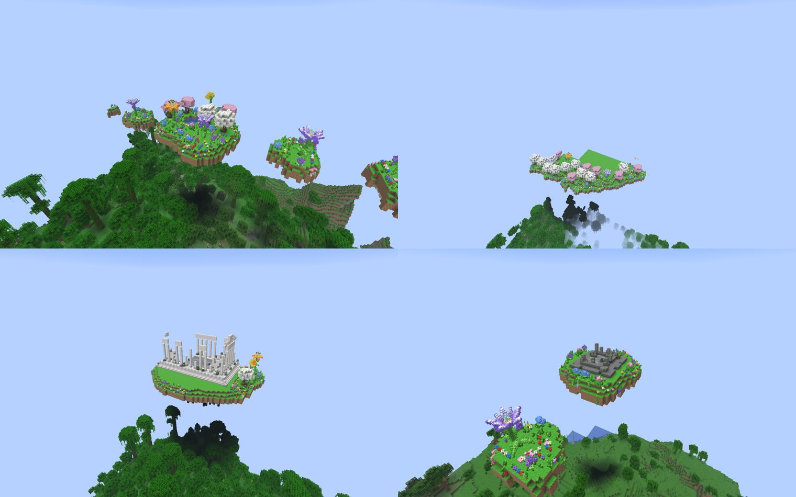
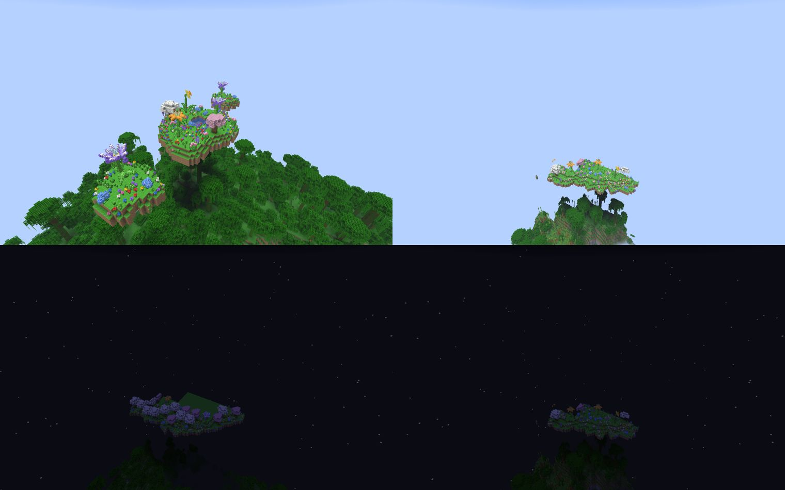
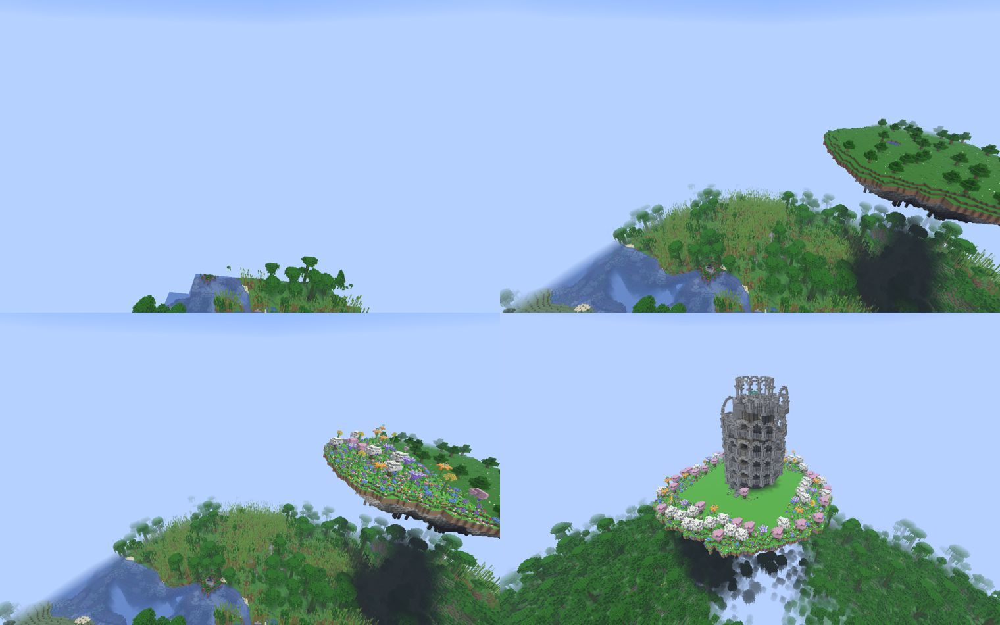

# 천국 하늘섬 P3.8 — 프로덕션 템플릿(초원·forest 38개), D안 연결(비활성), 격리 검증 (2026-11-21)

- 기준: `claude/heaven-sky-island-p3-7-policy-review-20261121` @ `cd1628b`
- 브랜치: `claude/heaven-sky-island-p3-8-production-templates-20261121`
- 승인 정책: H1=D, 범위=초원+forest, H6 풀 ID 유지·`sky_islands/heaven/` 경로, H4=A, H5=forest 807기둥당 6그루·간격 5 (초원은 V5 기본). 권위 문서 §24.5에 반영했다.
- **실제 월드젠은 바꾸지 않았다.** 풀 교체는 비활성 상태로 준비만 했다. 나머지 76개 템플릿은 만들지 않았다.
- 보존: 구조물 ID·세트·확률·바이옴·몹 스폰 규칙(파일 해시로 고정), 원본 NBT 114개, P3 초원 천국판(`heaven_p3/`), P3.6 T1 텍스처, 블록 ID, 게임플레이. F7 드롭·G2 최종 밀도는 보류 그대로.

## 0. 요약

| 항목 | 결과 |
|---|---|
| 프로덕션 템플릿 | 초원 19 + forest 19 = **38개**, `structure/sky_islands/heaven/<테마>/` (5.1 MB) |
| 초원 | P3 천국판과 **바이트 동일** (생성기 재현으로 확인) |
| forest | forest 원본에서 생성: 거대 꽃 175, 나무 342, 식생 93,527블록, 생존 규칙 위반 0. 대표 4개는 승인된 P3.7 비교 시안과 바이트 동일 |
| D안 연결 | 풀 6개(초원·forest × start·satellite·tower_top)를 `src/main/resources/heaven_worldgen_pending/`에 **비활성**으로 준비. 적용·되돌리기 도구 포함, 되돌리기는 원본과 정확히 일치 |
| 월드젠 불변 | 구조물·세트·풀·바이옴 태그 58개 파일이 기준선과 바이트 동일 (JUnit) |
| 격리 조립 검증 | 38개 전부 바닐라 jigsaw 조립기 + 청크별 배치로 검증: 천국 조각만 붙음, 바닐라 지형 0, 남은 직소 0, 탑·폐허·신전 기능 보존 |
| 기존 월드 호환 | 저장된 조각은 옛 템플릿 위치를 유지 → D안은 이음매 없음. 제자리 덮어쓰기(A)를 모의하면 이음매가 생김(§4) |
| 회귀 | GameTest 746/746, JUnit 811/811 |
| 범위 밖 발견 | `SkyIslandHabitat`이 대형 섬의 첫 조회에서 서버 스레드를 7–75초 막는다(**원본 템플릿도 동일**, §6) |

## 1. 프로덕션 템플릿

`tools/heaven-p38/build_production.py` (`build_meadow.py` 생성기 재사용).

- **초원:** P3 규칙 그대로(나무 807기둥당 2, 간격 8). 재생성 결과가 `heaven_p3/meadow/*`와 바이트 동일해야 통과한다.
- **forest:** 원본 forest 템플릿에서 생성한다.
  - 팔레트 A: 잔디 → 천국 잔디, 흙·거친 흙·포드졸 → 천국 흙, 돌 → 크림 석재, 안산암·응회암·이끼 조약돌 → 옅은 크림 석재.
  - 나무: 807기둥당 6그루, 간격 5.
  - 제거: 원본 바닐라 식생(참나무·자작나무 잎·원목, 풀, 고사리, 꽃).
- **보존:** 템플릿 크기, 지형 형상, 건물, 물, 직소의 위치·방향·NBT(`pool` 값 포함). `final_state`는 잔디·흙 5개만 천국 블록으로 바꾼다. 탑의 안산암 3,312개는 건축재로 보존한다.
- **직소 풀 값을 바꾸지 않는 이유:** D안은 풀 ID를 유지하고 풀의 원소만 교체하므로 템플릿의 직소 수정이 필요 없다.

| 템플릿 | 크기 | 거대 꽃 (초원/forest) | 나무 | 식생 블록 | 보행 가능 | NBT |
|---|---|---|---|---|---|---|
| large_a | 97×67×97 | 23 / 24 | 16 / 47 | 10,141 / 12,784 | 97.9% / 96.5% | 307 / 317 KB |
| large_b | 109×69×99 | 28 / 28 | 19 / 56 | 12,014 / 15,278 | 97.9% / 96.4% | 384 / 391 KB |
| large_c | 125×71×113 | 37 / 37 | 25 / 74 | 15,543 / 19,952 | 97.9% / 96.4% | 537 / 542 KB |
| large_d | 145×101×129 | 28 / 28 | 19 / 57 | 11,835 / 15,090 | 98.8% / 98.0% | 386 / 393 KB |
| large_e | 155×101×137 | 35 / 35 | 23 / 71 | 14,731 / 19,056 | 98.7% / 97.7% | 447 / 451 KB |
| plain_medium_a–e | 43–47 × 42–44 × 33–37 | 3,3,3,3,2 (같음) | 2 / 5,5,3,5,5 | 987–1,245 / 1,181–1,513 | 97.7–97.9% / 96.3–97.3% | 21–27 KB |
| plain_small_a–d | 25–27 × 23–24 × 23–27 | 1 (같음) | 1 / 2,1,3,2 | 452–479 / 444–666 | 97.1–97.4% / 95.7–97.1% | 8–9 KB |
| ruins | 36×27×33 | 0 / 0 | 0 / 0 | 229 / 251 | 100% | 14 KB |
| satellite_a·b | 27×22×19, 25×21×21 | 1 / 1 | 0 / 0 | 231–235 / 234–247 | 96.6% | 4–5 KB |
| temple | 81×45×57 | 3 / 3 | 2 / 5 | 1,204 / 1,453 | 99.5% / 99.2% | 98 KB |
| tower | 58×97×49 | 0 / 0 | 0 / 1 | 78 / 147 | 100% / 98.7% | 126 KB |
| **합계** | | 174 / 175 | 118 / 342 | 73,825 / 93,527 | | 2.5 / 2.6 MB |

- 상세는 `data/heaven_production.json` (템플릿별 원본·결과 해시, 미배치 사유, 직소, 위반 수).
- forest 나무 요청 354 중 342를 놓았다. 12그루는 범위·겹침 때문에 놓지 못했다. 특히 `plain_medium_c`는 3그루다.
- 폐허·위성섬·탑은 붙는 조각의 금지 구역 때문에 나무가 0–1그루다(P3.7과 같다).

## 2. D안 연결 변경 (비활성)

| 항목 | 내용 |
|---|---|
| 파일 | `src/main/resources/heaven_worldgen_pending/data/moreminecrafts/worldgen/template_pool/sky_islands/{meadow,forest}/{start,satellite,tower_top}.json` — `data/`가 아니라서 게임이 읽지 않는다 |
| 내용 | 살아 있는 풀 JSON과 **원소 `location`만** 다르다(`sky_islands/<테마>/<n>` → `sky_islands/heaven/<테마>/<n>`). 풀 ID, 가중치, fallback, projection, processors는 동일 |
| 도구 | `tools/heaven-p38/pending_pools.py` — `generate`, `status`, `apply`(월드젠 전환), `revert`. `apply` 후 `revert`가 원본과 바이트 동일함을 확인했다 |
| 적용되는 구조물 | 풀을 쓰는 모든 구조물: `sky_island_meadow`, `sky_island_forest`, 그리고 `meadow/start`를 공유하는 **`sky_island_mountain_meadow`**(바이옴 meadow·cherry_grove) |
| 영향 없음 | 구조물 JSON 8개, 구조물 세트 2개, 바이옴 태그, 몹 스폰 재정의, `SkyIslandHabitat`(경로가 `sky_islands/`로 시작) |
| 고정 | JUnit이 구조물·세트·풀·바이옴 태그 58개 파일의 SHA-256을 `tools/heaven-p38/worldgen_baseline.sha256`과 대조한다 |

## 3. 검증: 정적 / 서버 GameTest / 실제 클라이언트

### 3.1 정적 검증 (JUnit `HeavenP38ResourceTest`, 7개)

| 검사 | 결과 |
|---|---|
| 월드젠 불변 | 58개 파일 해시 동일. 보류 풀은 살아 있는 풀에서 위치만 바꾼 것이고 되돌리면 정확히 같다. 가중치 동일 |
| 원본 불변 | 38개 원본 SHA-256이 생성 보고서와 같음. 초원 프로덕션 = P3 템플릿 |
| 형상·구조물·물·직소 보존 | 38개 모두: 크기, 지형 슬롯 매핑, 건물·물 동일, 직소 위치·방향·NBT 동일 |
| 생존 규칙 | 땅 식물 받침, 잎 `persistent=true`, 덩굴·등나무 지지. forest 원목 수 > 초원의 2배 |
| 풀 그래프 닫힘 | 초원·forest 각각: 시작 풀에서 도달하는 천국판 19개, 옛 섬 템플릿 0, 공용 기능 조각(폐허·신전) 유지, 해결 안 되는 풀 0 |
| 경로·참조 | 템플릿이 `sky_islands/heaven/` 아래에 있고, 살아 있는 데이터는 이를 참조하지 않는다 |
| 권위 기록 | §24.5 문구와 색인 경로 |

### 3.2 서버 GameTest (5 + 1, 실제 바닐라 jigsaw 조립기)

D안 풀의 테스트 쌍(GameTest 네임스페이스, `tools/heaven-p38/pending_pools.py generate`)으로 **38개 템플릿을 조립**하고, 월드젠과 같은 방식으로 **청크마다 `placeInChunk`** 로 배치했다. 실제 풀 ID는 적용하기 전에는 바꿀 수 없어서, 직소의 두 풀 값만 테스트 풀로 바꾼 복사본을 썼다(나머지 풀은 실제 공용 풀).

| 검사 | 결과 |
|---|---|
| 조립 38개 | 모두 통과: 바닐라 지형·바닐라 식생 0, 남은 직소 0, 천국 식생이 템플릿 보유량 이상 (회전 배치 포함) |
| 기능 보존 | 대형 d·e + 탑: vault 8, trial_spawner 16, 안산암 3,312. 폐허: 상자 ≥ 2. 신전: 석영 있음 |
| 연결 | 중형 + 위성: 위성은 천국 조각만 붙음. 폐허 + 공용 폐허 조각, 신전 + 공용 신전 조각 |
| 청크 경계 | 6개(초원·forest × 중형·대형 d·신전): 청크별 배치 = 한 번에 배치 = 저장 후 다시 읽은 시작점 배치 (해시 동일). 청크 24–90개를 가로지름 |
| 저장된 조각 | 시작점 태그에 천국판 템플릿 위치가 저장되고 옛 테마 위치는 없음 |
| Habitat | 초원·forest 템플릿 22쌍(forest 19 전수 1회 + 초원 일부): 원본의 모든 잔디 칸이 천국판에서도 서식지 지지 칸 |

참고(조립 시간): 대형 섬 한 개 조립·배치 360–1,210 ms.

### 3.3 실제 클라이언트 (소프트웨어 렌더, GPU 아님)

- **섬 6개** (forest 중형·대형+탑·신전·폐허, 초원 중형·대형+탑)를 청크별로 조립해 낮에 6장, 자정에 2장 촬영했다.

| forest (정오) | 초원과 밤 |
|---|---|
|  |  |

forest 이미지 배치: 왼쪽 위 중형(+위성), 오른쪽 위 대형, 왼쪽 아래 신전, 오른쪽 아래 폐허. 초원 이미지: 왼쪽 위 중형, 오른쪽 위 대형, 아래는 forest·초원 대형의 자정.

- **저장 후 다시 열기:** 섬 6개를 월드와 함께 저장하고 다시 열어 비교했다. 변한 것은 **천국 잔디 → 천국 흙 전환(0–44블록)뿐**이다. 건물 아래·옆의 덮인 잔디가 F1 규칙대로 죽은 것으로, 바닐라 초원의 잔디 → 흙(3–11블록)과 같은 종류다. 다른 블록은 하나도 바뀌지 않았다.

## 4. 기존 월드 호환 (부분 생성, 청크 경계, 저장·재로드)

**근거(정적):** 구조물 시작점은 조각마다 템플릿 **위치(ID)** 를 저장하고(`SinglePoolElement` 코덱), 블록 내용은 청크가 생성될 때마다 템플릿에서 읽는다. 그래서:
- **D안:** 이미 만들어진 조각은 옛 템플릿 위치를 계속 쓴다 → 이음매 없음. 새로 뽑히는 섬만 천국판이다.
- **A안(같은 경로 덮어쓰기):** 위치는 같고 내용만 바뀐다 → 이미 부분 생성된 섬의 새 청크가 천국 블록으로 생성되어 경계에서 섞인다.

**실측(실제 클라이언트, 바닐라 대형 섬 `large_b`를 서쪽 절반 청크만 생성 → 저장 → 다시 열기 → 나머지 생성, 744,579칸, 4회 측정):**

| 시나리오 | 결과 |
|---|---|
| D: 저장된 시작점으로 나머지 절반 생성 | 끊김 없이 바닐라 섬이 완성되고, 끊김 없이 한 번에 만든 섬과 **3–11칸만 다르다**(전부 바닐라의 잔디 → 흙 후처리 틱) |
| A(모의): 서쪽은 옛 내용, 동쪽은 같은 위치에서 천국 내용 | 순수 바닐라 섬과 **36,669–62,495칸**, 순수 천국 섬과 73,191–99,017칸이 다르다 = **눈에 보이는 이음매** |
| 부분 생성 상태 저장·재로드 | 서쪽 절반이 그대로 저장된다 (틱이 바꾼 잔디 몇 칸을 빼고 동일) |

한계: 진짜 월드젠(바이옴 선택, 구조물 세트 배치, 실제 청크 파이프라인)으로 만든 부분 생성이 아니라, 같은 `StructureStart` 코드를 사용한 모의다. 실제 월드젠 전환(풀 적용) 후 별도 검증이 필요하다(§7).

## 5. §4 정합성 (초원·forest 범위)

§4 평원 "잔디·꽃·드문 나무", 숲 "나무·풀"과 어긋나지 않는다. 초원 수관 7%(드문 나무), forest 수관 약 21%(원본 forest 30%)로 숲 느낌이 나지만 원본보다는 낮다. 건축물은 보존했다. 나머지 4테마(snowy, desert, badlands, rocky)는 §4와의 충돌이 미해결이라 변경하지 않았고 권위 문서에 보류로 기록했다.

## 6. 미해결 위험과 범위 밖 발견

| # | 내용 | 영향 | 처리 |
|---|---|---|---|
| 1 | **`SkyIslandHabitat` 첫 조회 지연 (범위 밖, 원본에도 존재).** 템플릿마다 고체 칸 집합을 처음 만들 때 대형 템플릿에서 서버 스레드가 **7–75초** 멈춘다(`Set.copyOf` 단계). 측정(첫 호출, 원본/천국판): large_a 7.0/10.9 s, large_b 19.6/21.5 s, large_c 75.5/69.5 s, large_d 19.2/20.2 s, large_e 26.2/30.8 s. 중형 이하는 5 ms 이하, 신전 46/42 ms, 탑 722/520 ms | 천국판이 원본보다 특별히 나쁘지는 않다(0.9–1.5배). 그러나 몹 스폰 판정이 서버 틱 감시 한도(기본 60초)를 넘을 수 있다 | 수정하지 않았다. 천국판 대형 섬(특히 large_c)이 월드에 나오기 전에 별도 작업으로 다루길 권한다 |
| 2 | `mountain_meadow`가 `meadow/start` 풀을 공유 | 풀 적용 시 산악 초원 섬도 천국판이 됨 | 승인 항목 |
| 3 | 블록 틱으로 덮인 잔디가 변함 (천국 잔디 → 흙, 바닐라는 잔디 → 흙) | 탑·신전 아래 일부 칸 | F1 규칙대로의 동작 |
| 4 | forest 수관 21%는 원본 30%보다 낮다 | 배치 규칙이 상한 | P3.7 결과 그대로 |
| 5 | GPU 성능 미측정, 실제 월드젠으로 천국 섬이 뽑히는 검증과 몹 스폰 실측은 하지 않음 | | 풀 적용 후 검증 필요 |
| 6 | 클라이언트 측정의 칸 단위 수치는 틱·무작위 회전에 따라 실행마다 조금 다르다 | 판정은 범위로 보고함 | |

## 7. 실제 월드젠 전환에 필요한 승인

| # | 승인 사항 | 권장 |
|---|---|---|
| T1 | 풀 6개 교체(`pending_pools.py apply`)의 시점과 단위 | 초원 먼저(풀 3개), 검증 후 forest |
| T2 | `sky_island_mountain_meadow`(meadow·cherry_grove 바이옴)도 함께 천국판으로 바꿀지 | 함께(분리하려면 별도 풀이 필요) |
| T3 | `SkyIslandHabitat` 첫 조회 지연(§6-1)을 풀 적용 전에 처리할지 | 먼저 처리 |
| T4 | 적용 후 검증 방법: 하늘섬 자연 생성 프로브(`tools/sky-islands-probe`)와 실제 클라이언트로 생성된 섬 확인 | 승인 시 수행 |
| T5 | 옛 템플릿 114개 보관(삭제 금지) | 유지 |
| T6 | 롤백 절차: `pending_pools.py revert` (새 월드에만 영향) | 승인 |
| T7 | 나머지 4테마의 천국화 여부(§4 충돌) | 별도 결정 |
| — | F7 드롭, G2 최종 밀도 | 보류 유지 |

## 8. 회귀

| 실행 | 결과 |
|---|---|
| `./gradlew test build` (GameTest 월드 삭제 후) | **GameTest 746/746**(P3.7의 740 + 신규 6), **JUnit 811/811**(804 + 신규 7), BUILD SUCCESSFUL |
| 실제 클라이언트 `HeavenP38ClientCapture` | BUILD SUCCESSFUL, 스크린샷 13장 |

## 부록 · 파일

| 파일 | 내용 |
|---|---|
| `src/main/resources/data/moreminecrafts/structure/sky_islands/heaven/{meadow,forest}/*.nbt` | 프로덕션 템플릿 38개 |
| `src/main/resources/heaven_worldgen_pending/…` | 비활성 풀 6개 |
| `tools/heaven-p38/build_production.py`, `pending_pools.py`, `worldgen_baseline.sha256` | 생성기, 풀 도구, 월드젠 기준선 |
| `src/gametest/resources/data/moreminecrafts-gametest/{worldgen/template_pool,structure}/heaven_d/` | 격리 테스트 풀·복사본 |
| `src/gametest/…/HeavenP38GameTests.java`, `mob/sky/HeavenHabitatGameTests.java`, `HeavenP38ClientCapture.java`, `src/test/…/HeavenP38ResourceTest.java` | 테스트 |
| `docs/design/SKY_ISLANDS_T2_CONTEXT_2026-10-27.md` §24.5, `docs/CONTENT_AUTHORITY_INDEX.md` | 권위 문서 |
| `data/heaven_production.json` | 생성 결과 |
