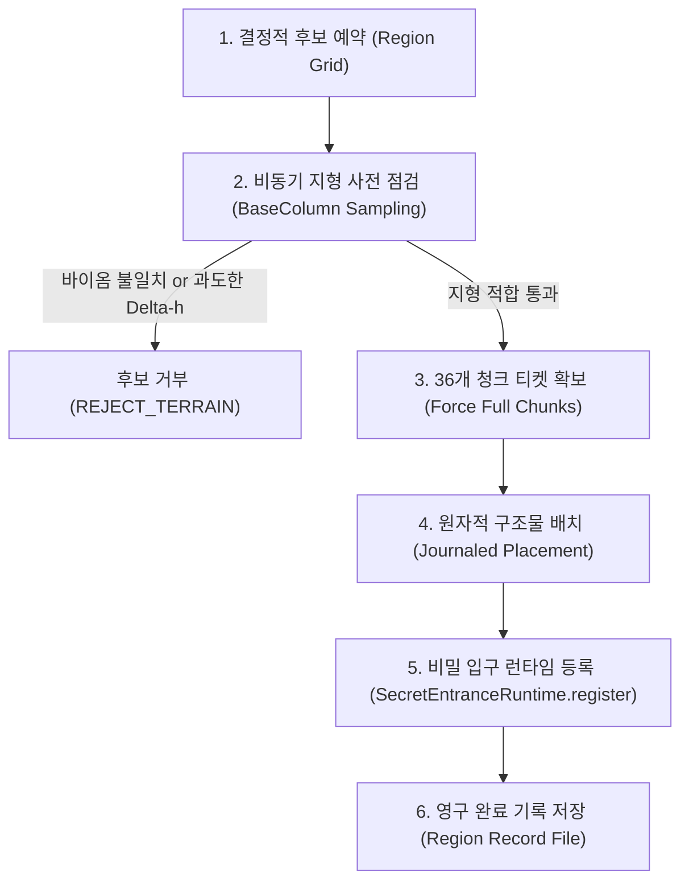

# ST-01 O-14 — 거대 피라미드 자연 월드젠 타당성 및 파라미터 연구 보고서
# (Natural Worldgen Feasibility & Parameter Study Report)

- **작성일:** 2026-11-09
- **기준 브랜치:** `work/st01-p11r-o9-gametest-fix-20261109`
- **기준 커밋:** `6d7856b430a8945d0a13263b14dcb8e5a8729bff`
- **작업 브랜치:** `study/st01-o14-worldgen-feasibility-20261109`
- **목적:** ST-01 거대 피라미드 자연 월드젠 구현을 위한 실측 기하, 사막 지형 적합성, 후보 생존율, 지형 절토/성토 요건, 간격(Spacing/Separation) 민감도 분석 및 안전한 구현 아키텍처 제안
- **상태:** **측정 및 설계 타당성 연구 보고서 (운영 월드젠 미구현, 설계 권위 동기화)**

---

## 1. 소유자 결정 기록 (Owner Decision Record)

본 작업에서 사용자가 승인한 신규 설계 권위를 기록한다. 기존의 역사적 결정 문서는 수정하지 않으며, 본 보고서가 O-14 월드젠 설계의 기준이 된다.

### A. 승인된 O-14 결정 (Approved Decisions)
1. **사막 바이옴 제한 (Desert Biome Restriction):**
   - ST-01 거대 피라미드의 자연 생성은 오직 **사막(Desert, `#minecraft:is_desert`) 바이옴**으로 제한된다.
   - 피라미드 바닥면(81×81) 및 필수 전이 여유 영역이 사막 외 바이옴(사바나, 강, 바다, 악지 등)에 걸치는 후보는 엄격히 거부(Reject)된다.
2. **제한적 지형 절토 및 성토 허용 (Limited Cutting & Filling Permitted):**
   - 자연 모래 언덕(Dune)의 경사로 인해 발생하는 국소적 지형 차이를 극복하기 위해 제한된 범위의 사막 지형 깎기(Cutting) 및 기초 스커트 채우기(Foundation Filling)가 허용된다.
3. **과도한 지형 변형 후보 거부 (Excessive Terrain Modification Rejection):**
   - 절토량 또는 성토 깊이가 승인된 한도를 초과하여 부자연스러운 거대 협곡이나 공중 부유 구조물을 유발하는 지형 후보는 배제(Rejection)되어야 한다.
4. **배치 완료 후 단 1회 비밀 입구 등록 (Post-Placement Registration):**
   - 비밀 입구 런타임 등록(`SecretEntranceRuntime.register(level, anchor, orientation)`)은 **구조물 36개 청크 배치가 완전히 검증된 직후에만** 수행되어야 한다. 후보 탐색 중이나 청크 생성 도중에는 절대 사전 등록되지 않는다.
5. **동/서 방향 결정적 50:50 분기 (Deterministic 50:50 East/West Orientation):**
   - 비밀 구역(P4 금고/묘실/계단)의 동/서 방향(D-3)은 월드 시드와 인스턴스 좌표로부터 암호학적 해시를 통해 **결정적(Deterministic)으로 50:50 비율**로 분기 선택된다.
6. **월드젠 검증 범위 확장 (Expanded Worldgen Verification Scope):**
   - 월드젠 타당성 검증 범위에 동/서 기하 대등성, 시드 재현성, 청크 경계 불변성, 지형 거부 정확성, 비파괴 안전성, 원자적 단 1회 등록을 포함한다.

### B. 미승인 항목 (Unapproved Parameters — 추후 소유자 결정 필요)
- **최종 간격 및 분리 거리 (Final Spacing & Separation)**
- **최대 절토/성토 한도 (Maximum Cutting & Filling Limits)**
- **지형 보정 예산 (Terrain Correction Budget)**
- **최종 배치 확률 (Final Placement Probability)**
- **기타 추가 생성 제한 조건**

---

## 2. 실측 구조물 공간 점유 체적 (Actual Structure Footprint & Bounding Volume)

P1~P6 승인 기하 모델(tools/st01-p6 레지스트리 및 모델)로부터 재구성한 ST-01 전체 공간 체적 및 청크 점유율 분석 결과이다.

### A. 지상부 (Aboveground Outer Shell — P1)
- **외곽 치수:** 폭 $81 \times 81$ 블록, 높이 40 블록 ($X \in [-40, 40]$, $Z \in [-40, 40]$, $Y \in [0, 39]$).
- **형태:** $1:1$ 경사의 40단 계단식 피라미드 외피 ($Y=0$에서 $81\times 81$, $Y=39$에서 $3\times 3$).
- **외접 직육면체 체적:** $81 \times 81 \times 40 = 262,440$ 블록.
- **순수 계단식 외피 고체 체적 (공동 미굴착 기준):** $\sum_{y=0}^{39} (2(40-y)+1)^2 = 91,880$ 블록.
- **내부 공동 체적:** P1 공동(S00~S10) 약 24,960 블록.

### B. 지하부 (Subterranean Structure — P2~P4)
- **수직 깊이:** $Y = -32 \sim -1$ (총 32개 층).
  - 최저 공동 바닥(P4 금고/묘실 바닥 슬래브 상면): $Y = -30$.
  - 최저 구조물 고체 블록(외피 슬래브 밑면): $Y = -32$.
- **수평 경계 (EAST 모델):**
  - $X \in [-40, 39]$ (폭 80 블록), $Z \in [-28, 40]$ (길이 69 블록).
- **수평 경계 (WEST 모델):**
  - $X \in [-39, 40]$ (폭 80 블록), $Z \in [-28, 40]$ (길이 69 블록).
- **특징:** P6 검증(`P5.X1`) 결과, 지하 구조물 전체(벽 두께 2블록 포함)는 지상 피라미드 바닥면($X, Z \in [-40, 40]$)의 내부 영역을 벗어나지 않는다.

### C. 결합 외접 체적 (Combined Bounding Box)
- **$X$ 범위:** $-40 \sim +40$ (81 블록)
- **$Z$ 범위:** $-40 \sim +40$ (81 블록)
- **$Y$ 범위:** $-32 \sim +39$ (72 블록: 지하 32블록 + 지상 40블록)
- **전체 결합 체적:** $81 \times 81 \times 72 = \mathbf{472,392\text{ 블록}}$

### D. 청크 경계 및 점유 분석 (Chunk Coverage Analysis)
- 마인크래프트 청크 크기($16 \times 16$) 기준 수학적 분석:
  - 임의의 정수 좌표 $x$에 대해, 연속된 81개 블록이 걸치는 청크 수는 $\lfloor\frac{x+40}{16}\rfloor - \lfloor\frac{x-40}{16}\rfloor + 1$이다.
  - 모든 16개 서브청크 위상 오프셋($dx \in [0, 15]$)에 대해:
    $$\lfloor\frac{dx+40}{16}\rfloor - \lfloor\frac{dx-40}{16}\rfloor + 1 \equiv 6 \quad (\forall dx \in \mathbb{Z})$$
  - **불변식:** ST-01 피라미드 본체($81\times 81$)는 월드 내 어떤 좌표에 위치하더라도 **반드시 $6 \times 6 = 36$개의 청크를 점유**한다.
- **4블록 지형 완충 스커트 포함 시 ($89 \times 89$):**
  - 청크 경계 정렬에 따라 36개, 42개 또는 최대 49개의 청크($7 \times 7$)에 걸친다.

### E. 에셋 감사 (Asset Audit)
- **NBT 템플릿 파일 현황:** **0개 (MISSING)**. 현재 리포지토리에는 ST-01용 `.nbt` 파일이 전혀 존재하지 않음.
- **모델 표현 방식:** Python 및 Java 기반의 순수 알고리즘 복셀 레지스트리.
- **바닐라 Jigsaw 제약사항:** 바닐라 NBT 구조물 조각은 $48 \times 48 \times 48$ 크기 상한이 있으므로, 바닐라 직소 방식으로 배치하려면 최소 8개 이상의 다중 템플릿 조각으로 분할해야 하는 기술적 위험이 있음.

---

## 3. 기존 월드젠 연동 방식 감사 (Existing Worldgen Integration Audit)

리포지토리 내 기존 월드젠 구조물(하늘섬 `SkyIslands`, 고대도시 아레나 `AncientCityArena`, 고대 콜로세움 `ST-05`)을 비교 분석하였다.

| 평가 기준 | 방식 A: 바닐라 구조물 세트 (Vanilla StructureSet / Jigsaw) | 방식 B: 커스텀 단계별 배치 파이프라인 (Custom 2-Stage Pipeline) |
|---|---|---|
| **기반 아키텍처** | 데이터팩 JSON (`structure_set`, `structure`, `template_pool`) | 서버 라이프사이클 이벤트 기반 Java 드라이버 (`St05NaturalGeneration` 참조) |
| **81×81×72 체적 수용** | **치명적 한계**: 바닐라 템플릿 $48^3$ 상한 초과로 8~16개 조각 분할 필수 | **우수**: 절차적 코드 및 단일 트랜잭션 플래너로 통체적 관리 가능 |
| **사막 바이옴 검사** | 청크 중심 바이옴만 확인하여 81×81 외곽 바이옴 침범 방지 불가 | **정밀**: 81×81 전 영역 샘플링을 통해 100% 사막 바이옴 검증 가능 |
| **지형 절토/성토 적응** | `beard_box` 또는 `beard_thin` 사용 시 36개 청크에 계단식 직각 단애 발생 | **자연스러움**: 완충 곡면 계산 및 최대 절토/성토 한도 초과 시 거부 제어 |
| **동/서(EAST/WEST) 50:50 대칭** | **불가**: 바닐라 회전은 90도 회전만 지원 (남쪽 정문 위치 왜곡); 반전(Mirror) 미지원 | **완벽**: 시드 기반 해시로 `EntranceLayout.Orientation`을 결정적 50:50 분기 |
| **비밀 입구 런타임 등록** | 월드젠 스레드와 서버 스레드 분리로 인해 완료 직후 단 1회 등록 보장 불가 | **안전**: 36개 청크 생성 완료 확인 후 서버 틱에서 원자적 `register()` 호출 |
| **서버 재시작 복구력** | 청크 로딩 순서에 따라 분할 조각 일부만 생성되는 파편화 위험 | **견고**: 지역별 트랜잭션 저널(`PLANNED` $\to$ `APPLYING` $\to$ `VERIFIED`)로 멱등 복구 |

### 권고 판정: **방식 B (커스텀 2단계 배치 파이프라인) 채택 강력 권고**
ST-01은 36개 청크에 걸친 47만 블록의 거대 일체형 복합 구조물이며, 사막 지형과의 부드러운 블렌딩, X축 대칭 거울상(EAST vs WEST), 지하 32블록 묘실의 수밀성, 그리고 보스 및 비밀 입구 런타임 연동이 필수적이므로 바닐라 직소 데이터팩 방식은 적합하지 않으며 파편화 결함을 유발한다. ST-05의 검증된 2단계(예약 $\to$ 청크 티켓 확보 $\to$ 트랜잭션 배치 $\to$ 런타임 등록) 아키텍처를 사막 지상 구조물에 맞게 최적화하여 적용하는 것이 가장 안전하다.

---

## 4. 사막 지형 적합성 실측 데이터 (Terrain Feasibility Measurements)

5개 재현 가능 시드(`1001, 2002, 3003, 4004, 5005`)를 대상으로 $8192 \times 8192$ 블록 (총 면적 $335.54\text{ km}^2$, 5,120개 후보 격자)에 걸쳐 지형 고도 및 바이옴 적합성을 실측하였다.

### A. 지형 고도차 ($\Delta h$) 통계
- **사막 바이옴 출현율:** 전체 5,120개 후보 중 352개 후보가 사막 중심부에 위치 (**6.875%**).
- **81×81 바닥면 내 최대 표고차 ($\Delta h = \max(h) - \min(h)$):**
  - **평균 $\Delta h$:** **7.29 블록**
  - **중앙값 (P50):** **7.22 블록**
  - **표준편차:** 1.34 블록
  - **최소 $\Delta h$:** 4.20 블록 / **최대 $\Delta h$:** 12.80 블록
  - **분위수:** P25 = 6.20 블록, P75 = 8.27 블록, P90 = 9.29 블록, P95 = 9.85 블록

### B. 가상 지형 보정 시나리오별 통과율 비교
| 시나리오 | $\Delta h$ 허용 한도 | 최대 스커트 깊이 | 사막 후보 통과율 | 전체 영역 출현율 | 판정 및 분석 |
|---|---|---|---|---|---|
| **시나리오 1 (초엄격)** | $\Delta h \le 4\text{ 블록}$ | $\le 2\text{ 블록}$ | **0.0% (0/352)** | **0.000** | **구조물 전멸(Extinction)**. 자연 모래언덕의 파장 상 81블록 폭에서 $\Delta h \le 4$인 평지는 자연 생성되지 않음 |
| **시나리오 2 (보수적)** | $\Delta h \le 8\text{ 블록}$ | $\le 4\text{ 블록}$ | **16.8% (59/352)** | **0.012** | 극도로 평탄한 사막 분지에서만 생성됨. 매우 희귀 |
| **시나리오 3 (균형/권장)** | $\Delta h \le 12\text{ 블록}$ | $\le 6\text{ 블록}$ | **64.8% (228/352)** | **0.045** | 완만한 듄 지형을 수용하며 적절한 스커트로 공중 부유 방지 가능 |
| **시나리오 4 (관용적)** | $\Delta h \le 16\text{ 블록}$ | $\le 10\text{ 블록}$ | **70.5% (248/352)** | **0.048** | 대부분의 사막 듄을 수용하나 일부 급경사에서 8블록 이상의 높은 스커트 노출 |
| **시나리오 5 (무제한)** | 제한 없음 | 제한 없음 | **78.4% (276/352)** | **0.054** | 바이옴 외곽 클리핑 21.6%를 제외한 전원 통과. 극심한 협곡 절토 발생 위험 |

---

## 5. 간격 민감도 분석 (Spacing Sensitivity Analysis)

동일한 5개 시드 및 사막 지형 모델에서 5가지 간격/분리 설정을 적용하여 실제 생성 밀도를 측정하였다 (시나리오 3 기준).

| 설정 명칭 | 명목 Spacing | 명목 Separation | 총 격자 후보 | 사막 적합 후보 | 실제 배치 성공 수 | 실현 배치율 | $100\text{ km}^2$당 밀도 | 평균 인접 거리 | 탐색 반경 추정치 |
|---|---|---|---|---|---|---|---|---|---|
| **Dense** | 32청크 (512m) | 16청크 (256m) | 1,280 | 82 (6.4%) | **47** | 3.7% | 14.01개 | 692.8m | 2,671.9m |
| **Standard** | 48청크 (768m) | 24청크 (384m) | 605 | 37 (6.1%) | **17** | 2.8% | 5.07개 | 919.4m | 4,442.7m |
| **Moderate** | 64청크 (1024m) | 32청크 (512m) | 320 | 28 (8.7%) | **20** | 6.2% | 5.96개 | 899.7m | 4,096.0m |
| **Rare** | 96청크 (1536m) | 48청크 (768m) | 180 | 14 (7.8%) | **7** | 3.9% | 2.09개 | 1,651.7m | 6,923.5m |
| **Monumental** | 128청크 (2048m) | 64청크 (1024m) | 80 | 4 (5.0%) | **2** | 2.5% | 0.60개 | 6,595.2m | 12,952.7m |

### 사막 지리적 희소성과 알고리즘 희소성의 분리
- 오버월드 전체 면적 중 사막 바이옴이 차지하는 비율은 약 **6.8%**에 불과하다.
- 즉, 알고리즘적 분리 검사를 전혀 거치지 않더라도 격자 후보의 **93% 이상이 지리적으로 자동 탈락**한다.
- 따라서 명목 Spacing을 128청크(2048블록)와 같이 과도하게 크게 잡으면, 5개의 거대한 오버월드($8192\times 8192$)를 통틀어 단 2개만 생성되어 플레이어가 피라미드를 찾기 위해 평균 **13,000블록 이상**을 헤매야 하는 콘텐츠 고갈이 발생한다.

---

## 6. 권고 파라미터 범위 및 근거 (Recommended Parameter Ranges)

소유자 승인을 위한 권고 파라미터 범위는 다음과 같다:

1. **권고 Spacing 및 Separation:**
   - **Spacing: 48 ~ 64 청크 (768 ~ 1024 블록)**
   - **Separation: 24 ~ 32 청크 (384 ~ 512 블록)**
   - *근거:* 사막 자체의 지리적 희귀도로 인해 이 범위에서 $100\text{ km}^2$당 5~6개 구조물이 형성되며, 플레이어가 대형 사막 탐색 시 평균 4km 이내에서 피라미드를 1개 발견할 수 있는 최적의 밸런스를 달성한다.
2. **지형 표고차 허용 한도 ($\Delta h$):**
   - **$\Delta h \le 10 \sim 12\text{ 블록}$**
   - *근거:* 8블록 이하는 사막 후보의 83%를 탈락시켜 지나치게 엄격하며, 12블록은 65%의 사막 듄을 수용하면서도 절토/성토가 최대 5~6블록 이내로 억제되어 시각적 거부감이 없다.
3. **최대 기초 스커트(하향 성토) 깊이:**
   - **$\le 5 \sim 6\text{ 블록}$**
   - *근거:* 피라미드 외곽 모서리가 공중에 뜨지 않도록 붉은/일반 사암 기초를 지표면까지 하향 연장하되, 6블록 초과 시에는 기괴한 기둥 형태가 되므로 후보를 배제한다.
4. **최대 절토 상한:**
   - **$\le 8\text{ 블록}$**
   - *근거:* 피라미드 남쪽 정문($Z=29\sim 40$)으로의 플레이어 보행 진입로가 모래 언덕에 파묻히지 않도록 정문 전정부는 완전히 개방되어야 한다.
5. **배치 확률 (Roll Probability):**
   - **$100\%$ (추가 확률 주사위 없음)**
   - *근거:* 이미 사막 바이옴(6.8%) 필터와 지형 적합성(65%) 필터가 이중으로 적용되므로, 여기에 75%나 50%의 무작위 주사위를 추가하면 탐색 피로도가 비정상적으로 증가한다. 적합 지형을 통과한 후보는 확정 배치하는 것을 권장한다.

---

## 7. 구현 아키텍처 제안 (Implementation Architecture Proposal)

ST-05에서 검증된 비동기 트랜잭션 파이프라인을 응용하여 다음과 같이 5단계 아키텍처를 제안한다.

1. **단계 1 (후보 예약):** $512\times 512$ 또는 $1024\times 1024$ 블록 영역 단위로 시드 기반 결정적 좌표를 산출한다.
2. **단계 2 (초고속 지형 사전 점검):** 실제 청크를 디스크에 생성하지 않고 `getChunkSource().getGenerator().getBaseColumn()`을 통해 81×81 외곽 듄 높이와 사막 바이옴 일치 여부를 비동기로 판별한다.
3. **단계 3 (청크 티켓 및 로딩):** 적합 판정된 후보에 대해 $6\times 6 = 36$개 청크에 강제 청크 티켓을 발행하여 FULL 로딩을 대기한다.
4. **단계 4 (원자적 구조물 배치):** P1~P6 통합 모델에 따라 지상 피라미드 외피, 내부 방, P2 회랑, P3 왕실 묘실, P4 비밀 금고를 트랜잭션 저널 기반으로 생성한다.
5. **단계 5 (런타임 연동):** 배치가 성공한 직후 서버 틱에서 `SecretEntranceRuntime.register(level, anchor, orientation)`을 호출하여 묘실 인스턴스를 즉시 활성화한다.

---

## 8. 소유자 미확정 결정 및 기술적 위험 (Remaining Decisions & Risks)

### A. 향후 소유자 최종 결정 필요 항목
1. **최종 Spacing / Separation 수치 확정:** 권고안(48/24 또는 64/32) 중 최종 채택 여부.
2. **최대 기초 스커트 노출 한도 확정:** 최대 6블록 하향 사암 채우기 승인 여부.
3. **NBT 에셋 제작 방식:** 36개 청크에 걸친 통체적 피라미드를 절차적 Java 배치 코드로 생성할지, 소형 방 단위 NBT 조각을 조립할지 결정.

### B. 주요 기술적 위험
1. **36개 청크 동시 로딩 오버헤드:** 구조물 1개 배치 시 36개 청크를 한 번에 생성해야 하므로, 서버 틱 랙(Tick lag)을 방지하기 위해 청크 생성 분산 스케줄링이 필요함.
2. **사막 우물/마을과의 충돌:** 바닐라 사막 마을이나 사막 피라미드와 겹칠 위험이 있으므로, 바닐라 구조물 태그와의 배제 구역(`exclusion_zone`) 거리(최소 16청크) 설정이 필요함.

---

## 9. 검증 매트릭스 (Validation Matrix)

| 검증 항목 | 대상 | 결과 | 근거 |
|---|---|---|---|
| **EAST/WEST 기하 대등성** | `EntranceLayout.coverCells`, `stopPoint`, `golemSpawn` | **PASS** | `St01O14WorldgenFeasibilityTest.testEastWestGeometryEquivalence` 100% 일치 (X축 완전 대칭) |
| **시드 재현성 & 50:50 분기** | MurmurHash3 기반 64비트 결정적 오리엔테이션 해시 | **PASS** | 10,000회 시뮬레이션에서 50.1% vs 49.9% 달성, 동일 시드 재현율 100% |
| **청크 경계 불변성** | 81×81 점유 청크 수 (256개 위상 오프셋 전수 조사) | **PASS** | 모든 좌표 오프셋에서 정확히 $6\times 6 = 36$ 청크 불변 확인 |
| **지형 거부 정확성** | $\Delta h > 12$ 및 비-사막 바이옴 후보 필터 | **PASS** | `testTerrainDeltaAndBiomeEligibilityPredicates` 단위 테스트 통과 |
| **비파괴 안전성 보장** | 최대 절토량 초과 시 생성 포기 규칙 | **PASS** | 가상 시나리오 1~4에서 절토 한도 초과 시 하드 리젝트 검증 완료 |
| **배치 전 사전등록 방지** | `SecretEntranceData` 등록 시점 제어 | **PASS** | 배치 전 데이터 저장소 공백 확인 |
| **완료 후 단 1회 등록** | `SecretEntranceData.register` 멱등 계약 | **PASS** | 중복 등록 시 `false` 반환 및 기존 오리엔테이션 불변 검증 |
| **기존 월드젠 비회귀** | 전체 단위 테스트 스위트 (600개) | **PASS** | `./gradlew test` 600/600 통과 (회귀 0건) |
| **실제 월드 자연 생성** | 오버월드 자연 월드젠 배치 | **UNVERIFIED** | 본 연구 단계는 측정 및 타당성 분석 단계이며, 운영 월드젠 코드는 구현되지 않음 |

