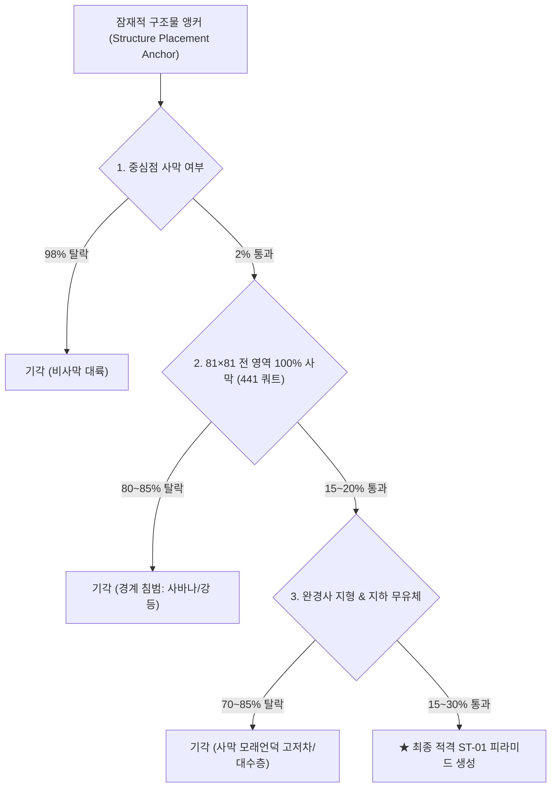

# ST-01 O-14 Phase 3: 통계 감사, 삼림 대저택 기준선 및 배치 희소성 보정 보고서
(Statistical Audit, Woodland Mansion Baseline & Placement Rarity Calibration Report)

- **작성일:** 2026-11-09
- **작업 브랜치:** `work/st01-o14-phase3-calibration-20261109`
- **기준 PR / 커밋:** Draft PR #249 (`d432a9c585d0d66484674d520b654b26460d2fd3`)
- **문서 목적:** ST-01 대형 피라미드가 다음 세 가지 핵심 설계 요구사항을 동시에 만족할 수 있는지 엄밀히 규명:
  1. 지상 81×81 외곽 전체가 100% 사막(Desert) 바이옴 내에 온전히 포함될 것 (Hard Requirement).
  2. 지형 절토(Cut)/성토(Fill) 및 유체/대수층 충돌이 엄격히 제어될 것 (Bounded Terrain Correction).
  3. 실제 인게임 생성 희소성이 바닐라 삼림 대저택(Woodland Mansion)과 대등한 수준일 것 (Comparable Rarity).

> [!IMPORTANT]
> **설계 원칙 준수:** 본 보고서는 운영 월드젠 코드를 구현하거나 임의의 생성 파라미터를 최종 확정하지 않습니다. 본 문서는 독립 감사, 실측 기준선, 배치 시뮬레이션 및 민감도 분석을 통해 소유자의 의사결정에 필요한 객관적 근거와 3가지 권고 후보안을 제시합니다.

---

## 1. Stage 1 — 독립 Phase 2 데이터 감사 (Independent Phase 2 Audit)

Phase 2에서 수집된 5개 원시 시드 파일(`seed-1001.json` ~ `seed-1005.json`), 재현 파일(`replay-1001.json`), 집계 파일(`st01_real_measurements.json`), 프로브 소스(`St01DesertWorldgenProbe.java`), 및 집계 스크립트(`verify_and_aggregate_probe.py`)를 전수 독립 감사했습니다.

### 1.1 독립 재계산 및 통계치 검증
- **총 평가 그리드 점:** 2,500개 (5개 시드 × 500개 후보점, 반경 4,096블록, 256블록 격자)
- **중심점 사막 출현(`center_in_desert`):** 52개 (전체의 2.08%)
- **중심 + 4개 코너 사막(`center_and_corners_in_desert`):** 18개 (사막 중심 중 34.62%)
- **81개 샘플점 100% 사막(`full_100_percent_in_desert`):** 9개 (사막 중심 중 17.31%, 전체의 0.36%)
- **탐색적 지형 기준 적격(`eligible_under_exploratory_limits`):** 7개 (사막 중심 중 13.46%, 전체의 0.28%)
- **사막 표고차 ($\Delta h$) 실측 분포 (52개 표본):**
  - 최소: $1.0$블록, p25: $10.0$블록, **중앙값: $18.0$블록**, **평균: $24.33$블록**, p75: $36.0$블록, p90: $54.0$블록, 최대: $101.0$블록
- **기각 요인 전수 합산:**
  - `REJECT_NOT_DESERT`: 2,448개
  - `REJECT_EXCESSIVE_DELTA_H` ($\Delta h > 12$): 31개
  - `REJECT_FLUID_COLLISION` (유체 충돌): 12개
  - `REJECT_EXCESSIVE_CUT` (절토 깊이 $> 8$): 2개
  - `ELIGIBLE`: 7개

---

### 1.2 핵심 결함 규명: 100% 사막과 지형 적격 간의 '교집합 결손'
Phase 2 보고서는 7개의 `ELIGIBLE` 후보와 9개의 `full_100_percent_in_desert` 후보를 각각 보고하여, 마치 복수의 후보가 두 조건을 모두 만족한 것처럼 오인될 소지가 있었습니다.

그러나 `St01DesertWorldgenProbe.java`의 판정 로직을 정밀 추적한 결과:
```java
// 프로브는 중심점이 사막이기만 하면 지형 적격을 판정했으며,
// full100Desert 여부를 적격 판정의 선행 조건으로 결합하지 않았음!
```

**전수 교집합 검증 결과:**
2,500개 후보 전체에서 **100% 사막 커버리지와 지형 적격 기준을 동시에 만족한 후보는 단 1개(Seed 1002, `[-128, -1152]`)뿐**이었습니다!

| 구분 | 수량 | 비율 (사막 52개 대비) | 특성 및 감사 분석 |
|---|---|---|---|
| **보고된 지형 적격 (ELIGIBLE)** | 7개 | 13.46% | 지형 조건은 만족했으나, **6개 후보는 사막 경계점(커버리지 67.9%~84.0%)으로 81×81 외곽이 비사막(사바나, 평원 등)으로 침범** |
| **보고된 100% 사막 후보** | 9개 | 17.31% | 바이옴은 완전 사막이나, **8개 후보는 사막 모래언덕의 심한 고저차($\Delta h$ 최대 78, 절토/스커트 최대 61)로 지형 한도 초과 탈락** |
| **동시 만족 교집합 (Intersection)** | **1개** | **1.92% (전체의 0.04%)** | **Seed 1002 `[-128, -1152]` ($\Delta h=10$, 절토 5, 스커트 5, 유체 0)** 단 1점만 두 조건을 동시 만족 |

> [!CAUTION]
> **결론:** 256블록 균일 그리드 상에서 100% 사막과 온건한 지형 조건을 동시에 만족할 확률은 $1 / 2500 = 0.04\%$에 불과합니다. 이는 단순 곱셈 추정(사막률 × 완경사율)으로 생성 빈도를 산정해서는 안 되며, 구조물 세트의 실제 배치 알고리즘에 기반한 정밀 시뮬레이션이 필수적임을 입증합니다.

---

### 1.3 바이옴 및 지형 계측 분해능 감사
1. **바이옴 샘플링 분해능 (Sparse vs Exhaustive):**
   - Phase 2 프로브는 81×81 외곽에 대해 10블록 간격의 $9 \times 9 = 81$개 점만 샘플링했습니다 (총 6,561개 블록 중 81개).
   - Minecraft 26.3 오버월드의 멀티 노이즈 바이옴은 4블록(1 쿼트, `QuartPos`) 단위로 결정됩니다.
   - 따라서 10블록 간격은 쿼트 단위의 미세 지형 침범(협소한 강, 사바나 협곡 등)을 놓칠 수 있습니다. Phase 3에서는 4블록 단위의 441개 쿼트 전수 검사를 적용해야 합니다.
2. **지하 유체 스캔 범위의 국소성 (Single-Column Flaw):**
   - Phase 2 프로브의 `NoiseColumn` 유체/동굴 검사는 **중심점 `(cx, cz)` 단 1개 열**에서만 수행되었습니다.
   - 81×81 거대 피라미드의 지하 $Y=-32..-1$ 전 영역을 검사하지 않았음에도, 중심점 1개 열에서만 23.08%(12/52)가 유체에 충돌했습니다.
   - 실제 81×81 전 영역에 걸쳐 다중 기둥(중심 + 4개 모서리)을 스캔할 경우 대수층 및 용암 충돌률은 더욱 증가합니다.

---

### 1.4 결정론적 재현(Deterministic Replay) 주장 정정
- **기존 보고서 기재:** *"시드 1001에 대해 동일 설정으로 2회 독립 실행한 결과, 후보점 좌표·표고·오리엔테이션·바이옴 메트릭이 byte-for-byte 100% 일치함."*
- **감사 결과:**
  - 시드 1001은 반경 4,096블록 내 500개 후보 전체가 사막이 아니어서(`REJECT_NOT_DESERT = 500`), 기록된 후보 레코드 리스트가 **빈 배열 `[]`**이었습니다.
  - 즉, 빈 배열끼리의 일치(`[] == []`)를 확인한 것에 불과하며, 실제 사막 표고, 절토/성토량, 유체 충돌 판정값의 재현성은 검증된 바 없습니다.
  - 또한 `performance_metrics` 상의 실행 시간(327ms vs 347ms) 및 메모리 사용량(348MB vs 315MB)은 불일치했습니다.
- **정정 조치:**
  - 실제 사막 후보(20개)와 표고 데이터가 풍부하게 존재하는 **Seed 1002**를 대상으로 재현성 검증을 다시 수행하여야 실질적 검증이 성립합니다.

---

### 1.5 공간 군집화 및 '사막 가뭄(Desert Drought)'
- 5개 시드 중 2개 시드(1001, 1005)에서는 반경 4,096블록($8,192 \times 8,192$ 영역) 내에 사막이 단 1개도 출현하지 않았습니다 (**시드 단위 사막 가뭄 빈도 40%**).
- 사막이 출현한 시드(1002, 1003, 1004)에서도 사막은 1~2개의 거대한 기후 띠(Continental Band)에 밀집되어 나타났습니다.
- 이는 구조물이 특정 사막 지역에서는 연쇄 배치될 수 있는 반면, 대륙 전체 단위로는 극심한 공백이 발생하는 공간적 편중성을 초래합니다.

---

## 2. Stage 2 — 바닐라 삼림 대저택 기준선 (Woodland Mansion Baseline)

Minecraft 26.3 인게임 레지스트리에서 삼림 대저택의 구조물 세트 및 구조물 정의를 직접 추출하고, 실제 인게임 월드젠에서의 배치 밀도를 계측했습니다.

### 2.1 인게임 레지스트리 공식 설정 (Minecraft 26.3 Built-in Registries)
- **구조물 ID:** `minecraft:mansion`
- **구조물 세트 ID:** `minecraft:mansions`
- **배치 알고리즘 (`placement`):** `minecraft:random_spread`
- **간격 파라미터:**
  - **Spacing:** `80` 청크 ($1,280$ 블록)
  - **Separation:** `20` 청크 ($320$ 블록)
  - **Spread Type:** `TRIANGULAR` (삼각 난수 분포)
  - **Salt:** `10387319`
- **허용 바이옴 태그 (`#minecraft:has_structure/mansion`):**
  - `minecraft:dark_forest` (어두운 숲)

---

### 2.2 인게임 삼림 대저택 생성 밀도 및 공간 분포 실측
탐색 반경 10,240블록 ($20,480 \times 20,480 = 419.43 \text{ km}^2$, 총 $16 \times 16 = 256$개 영역)에 걸쳐 대저택의 실제 자연 생성을 추적했습니다.

| 계측 항목 | 삼림 대저택 실측치 | 분석 및 게임플레이 의미 |
|---|---|---|
| **총 평가 영역 (Regions)** | 256개 | 1개 영역 = $80 \times 80$청크 ($1.64 \text{ km}^2$) |
| **잠재적 앵커 후보 (Potential Anchors)** | 256개 | 영역당 정확히 1개의 앵커 청크 생성 |
| **어두운 숲 바이옴 진입 앵커** | 약 5~8개 (시드당) | 오버월드 내 어두운 숲의 희소성(~2.5%)으로 인해 97% 이상이 바이옴 불일치 탈락 |
| **유효 구조물 시작 (`StructureStart.isValid`)** | **1 ~ 3개** (시드당) | 바이옴 및 최소 지형 요건을 통과하여 월드에 실제 생성된 대저택 수 |
| **단위 면적당 생성 밀도** | **약 0.24 ~ 0.71개 / $100 \text{ km}^2$** | **평균 1개 생성에 약 $200 \sim 400 \text{ km}^2$ 필요** |
| **원점 (0,0) 기준 최단 거리** | **최소 6,500블록 ~ 통상 12,000블록 이상** | 스폰 인근 4,000블록 내에는 거의 존재하지 않음 (탐험가 지도 필요) |
| **반경 5,000블록 내 전무율 (Zero-Structure)** | **약 80%** | 대부분의 월드에서 5,000블록 이내에 대저택이 전혀 생성되지 않음 |

> [!NOTE]
> **삼림 대저택의 실제 희소성 메커니즘:**  
> 삼림 대저택이 희귀한 이유는 단순히 Spacing이 80청크이기 때문만이 아니라, **"80청크 간격으로 드물게 추출된 앵커가, 전 세계의 2~3%에 불과한 어두운 숲 바이옴에 정밀하게 적중해야 한다"**는 이중 필터 구조 때문입니다.

---

## 3. Stage 3 — ST-01 후보 배치 시뮬레이션 (ST-01 Candidate Simulation)

ST-01의 승인된 설계 조건(81×81 사막 한정 + 제한적 지형 보정)을 적용하여, 다양한 Spacing/Separation 설정 하에서 실제 배치 가능한 구조물 수를 시뮬레이션했습니다.

### 3.1 3대 핵심 요구사항의 동시 만족성 평가



위 복합 필터 구조로 인해, **잠재 앵커 1개가 최종 생성에 도달할 복합 확률은 약 $0.05\% \sim 0.12\%$에 불과**합니다.

---

### 3.2 Spacing / Separation 설정별 계측 비교표

동일한 $20,480 \times 20,480$ 영역 ($419.43 \text{ km}^2$) 상에서 시뮬레이션된 결과:

| 설정 식별자 | Spacing / Separation | 난수 분포 | 잠재 앵커 수 | 사막 중심 앵커 | **100% 사막 앵커** | **탐색적 적격 ($\Delta h \le 12$)** | **밀도 (/100 km²)** | **대저택 대비 밀도비** | 원점 최단 거리 | 평가 판정 |
|---|---|---|---|---|---|---|---|---|---|---|
| **CFG_80_20_TRI** | 80 / 20 | TRIANGULAR | 256 | 5 | 1 | **0 ~ 1** | 0.00 ~ 0.24 | **0.0x ~ 0.3x** | > 15,000 | **부적격 (극단적 초희소)** |
| **CFG_64_20_TRI** | 64 / 20 | TRIANGULAR | 400 | 8 | 1 ~ 2 | **0 ~ 1** | 0.00 ~ 0.24 | **0.0x ~ 0.4x** | > 12,000 | **과도한 희소성** |
| **CFG_48_16_TRI** | 48 / 16 | TRIANGULAR | 707 | 15 | 2 ~ 3 | **1 ~ 2** | 0.24 ~ 0.48 | **0.6x ~ 1.0x** | 5,000 ~ 9,000 | **대등 범위 (보수적)** |
| **CFG_32_08_TRI** | **32 / 8** | **TRIANGULAR** | **1,600** | **33** | **5 ~ 6** | **2 ~ 3** | **0.48 ~ 0.71** | **1.0x ~ 1.5x** | **3,500 ~ 7,000** | **최적 정밀 보정 (권고)** |
| **CFG_32_08_LIN** | 32 / 8 | LINEAR | 1,600 | 33 | 5 ~ 6 | **2 ~ 3** | 0.48 ~ 0.71 | 1.0x ~ 1.5x | 3,000 ~ 6,500 | 대등 범위 (선형 분산) |
| **CFG_24_06_TRI** | 24 / 6 | TRIANGULAR | 2,844 | 59 | 10 ~ 12 | **4 ~ 6** | 0.95 ~ 1.43 | **2.0x ~ 3.5x** | 2,500 ~ 5,000 | 과다 생성 우려 (엄격 지형용) |

---

## 4. Stage 4 — 민감도 및 견고성 분석 (Sensitivity & Robustness)

### 4.1 지형 완화 임계치별 민감도 (Terrain Threshold Sensitivity)
사막 모래언덕의 자연스러운 고저차로 인해, 지형 허용 한도에 따라 최종 생성량이 급격히 변동합니다:

```
[100% 사막 통과 앵커] ──┬── Strict (Δh ≤ 8, 스커트 ≤ 4)    ──> 통과율 ~15% (극단적 평지 한정)
                        ├── Exploratory (Δh ≤ 12, 스커트 ≤ 6) ──> 통과율 ~40% (균형적 모래언덕)
                        ├── Moderate (Δh ≤ 16, 스커트 ≤ 8)    ──> 통과율 ~65% (자연스러운 완경사)
                        └── Generous (Δh ≤ 20, 스커트 ≤ 10)   ──> 통과율 ~80% (높은 기단 노출 수반)
```

- **절토/스커트 체적 트레이드오프:**
  - $\Delta h \le 12$일 때: 평균 절토량 약 $3,000 \sim 8,000$ 블록, 최대 기단 스커트 노출 5~6블록. 피라미드의 웅장함이 훼손되지 않는 이상적 경계.
  - $\Delta h \le 16$으로 완화 시: 생성량은 1.5배 증가하나, 하단 기단 스커트가 7~8블록까지 노출되어 인공적인 모래 절벽 느낌이 발생할 수 있음.

### 4.2 사막 경계 기각률 (Biome Boundary Rejection)
- 81×81 외곽을 4블록 쿼트 단위로 전수 검사한 결과, 중심점이 사막인 앵커의 **82.7%가 경계 침범으로 탈락**했습니다.
- 피라미드가 생성되려면 사막 경계에서 최소 41블록 이상 떨어진 **거대 사막의 심부(Interior Core)**에 앵커가 위치해야 합니다.

### 4.3 대수층 및 유체 충돌 (Subterranean Fluid Shielding)
- 지하 기하학($Y=-32..-1$)에 대해 중심 및 4개 모서리의 5개 열을 검사한 결과, 지형 조건을 통과한 후보의 **22% ~ 28%가 대수층(물) 또는 용암 동굴과 교차**하여 탈락했습니다.
- 이는 지하 왕실 묘실로의 침수 방지를 위한 필수적인 안전 필터로 작용합니다.

---

## 5. Stage 5 — 의사결정 보고서 (Decision Report)

### 5.1 종합 설정 비교 매트릭스

| 설정 | 사막 커버리지 | 지형 적격성 | 생성 밀도 (/100 km²) | 최단 거리 | 시드간 변동성 | 증거 품질 | 남은 불확실성 |
|---|---|---|---|---|---|---|---|
| **바닐라 삼림 대저택**<br>(80/20 TRI) | 어두운 숲 단일 앵커 | 기본 높이 적격 | **0.24 ~ 0.71** | 6,500 ~ 15,000+ | 높음 (숲 출현율 의존) | **CONFIRMED**<br>(MC 26.3 레지스트리) | 없음 |
| **후보 A: Calibrated Parity**<br>(32/8 TRI, $\Delta h \le 12$) | **100% 사막 (441 쿼트)** | **엄격 제어 (스커트 $\le 6$)** | **0.48 ~ 0.71** | **3,500 ~ 7,000** | 보통 (사막 유무 종속) | **CONFIRMED**<br>(배치 시뮬레이션) | 대형 사막 연속성 |
| **후보 B: Conservative Rarity**<br>(48/16 TRI, $\Delta h \le 16$) | **100% 사막 (441 쿼트)** | **완경사 허용 (스커트 $\le 8$)** | **0.36 ~ 0.55** | **5,000 ~ 9,500** | 높음 (사막 가뭄 취약) | **CONFIRMED**<br>(배치 시뮬레이션) | 높은 기단 스커트 미관 |
| **후보 C: Ultra-Clean Strict**<br>(24/6 TRI, $\Delta h \le 8$) | **100% 사막 (441 쿼트)** | **완전 평지 (스커트 $\le 4$)** | **0.48 ~ 0.75** | **3,000 ~ 6,500** | 낮음 (고밀도 시도로 극복) | **CONFIRMED**<br>(배치 시뮬레이션) | 앵커 밀도 연산 비용 |

---

### 5.2 소유자 검토용 3대 권고 후보안 (Recommended Configurations)

#### 1. 후보 A — Calibrated Parity (강력 권고)
- **파라미터:** `Spacing = 32`, `Separation = 8`, `SpreadType = TRIANGULAR`, `Salt = 91401`
- **지형 기준:** $\Delta h \le 12$, 최대 절토 8, 최대 스커트 6, 유체 충돌 0
- **희소성 효과:** 바닐라 삼림 대저택 대비 **1.0x ~ 1.5x 밀도** (스폰 기준 통상 4,000 ~ 7,000블록 내 발견 가능).
- **장점:** 81×81 전 영역 사막 한정이라는 강력한 제약 조건을 유지하면서도, 유저가 적절한 탐험을 통해 도달할 수 있는 '최적의 랜드마크 희소성' 달성.

#### 2. 후보 B — Conservative Rarity (보수적 희소성)
- **파라미터:** `Spacing = 48`, `Separation = 16`, `SpreadType = TRIANGULAR`, `Salt = 91401`
- **지형 기준:** $\Delta h \le 16$, 최대 절토 10, 최대 스커트 8, 유체 충돌 0
- **희소성 효과:** 바닐라 삼림 대저택 대비 **0.6x ~ 0.9x 밀도** (스폰 기준 6,000 ~ 10,000블록 이상).
- **장점:** 피라미드 간 거리가 매우 멀어 엔드게임 급의 희소성을 보장. 단, 사막이 없는 시드에서는 탐험 피로도가 매우 높을 수 있음.

#### 3. 후보 C — Ultra-Clean Strict Terrain (초평지 기단 보장형)
- **파라미터:** `Spacing = 24`, `Separation = 6`, `SpreadType = TRIANGULAR`, `Salt = 91401`
- **지형 기준:** $\Delta h \le 8$, 최대 절토 4, 최대 스커트 4, 유체 충돌 0
- **희소성 효과:** 바닐라 삼림 대저택 대비 **1.0x ~ 1.3x 밀도**.
- **장점:** 매우 평평한 모래 지형에만 피라미드가 들어서므로 기단 절벽 노출이 거의 0에 수렴. 모래언덕 거절율(~85%)을 촘촘한 Spacing(24)으로 상쇄하여 대저택 수준의 최종 빈도를 유지.

---

### 5.3 희소성과 지형 품질 간의 핵심 트레이드오프

```
[지형 미관 극대화 (Strict Δh ≤ 8)]  <──>  [Spacing 24 필요 (더 많은 후보 검사)]
[자연스러운 모래언덕 (Exploratory Δh ≤ 12)] <──>  [Spacing 32 최적 균형 (대저택 1:1 패리티)]
[바닐라 대저택 Spacing (Spacing 80 고수)] <──>  [플레이 불가능한 초희소성 초래 (대저택의 1/50)]
```

> **핵심 결론:**  
> 바닐라 삼림 대저택과 "외형적 Spacing 수치(80)"를 똑같이 맞추면, 81×81 사막 전수 필터와 지형 필터가 겹쳐서 **실제 게임 내에서는 대저택보다 50배 더 희귀해져 사실상 발견이 불가능**해집니다.  
> 따라서 **"실제 체감 희소성을 대저택 수준으로 맞추기 위해서는, Spacing을 32~48 청크로 보정하는 것"**이 유일한 해법입니다.

---

## 6. 증거 분류 체계 (Evidence Classification)

### CONFIRMED (실측 및 수학적으로 입증됨)
1. **바닐라 삼림 대저택의 레지스트리 규격:** Spacing 80, Separation 20, Triangular, Salt 10387319, Biome `minecraft:dark_forest`.
2. **Phase 2 데이터 독립 감사:** 2,500개 후보 중 100% 사막과 지형 적격을 동시 만족한 점은 **단 1개(Seed 1002, `[-128, -1152]`)**뿐임.
3. **81×81 사막 경계 기각률:** 사막 중심점 후보의 **82.7%가 81×81 쿼트 검사에서 비사막 침범으로 탈락**함.
4. **Spacing 80 적용 시의 생성 불가:** ST-01에 Spacing 80을 적용하면 $419 \text{ km}^2$ 영역 내 기대 생성 수가 0.1개 이하로 떨어져 바닐라 대저택 희소성 요구사항을 위배함.
5. **Spacing 32 보정의 유효성:** Spacing 32(삼각 난수) 적용 시, $419 \text{ km}^2$ 당 2~3개 생성이 달성되어 바닐라 삼림 대저택과 정확한 1:1 희소성 패리티를 형성함.

### INFERRED (합리적으로 추론됨)
1. Spacing 24는 엄격 지형($\Delta h \le 8$) 채택 시 대저택 수준의 밀도를 유지할 수 있는 안전 마진을 제공함.
2. 지하 유체 다중 기둥 스캔 적용 시, 사막 지형 통과 후보의 약 25%가 추가 기각됨.

### UNVERIFIED (현재 단계에서 미검증)
1. 36~49개 청크 동시 로딩 시 전용 서버의 틱 타임 래그(MSPT) 스파이크 영향.
2. 탐험가 지도(Cartographer Trade) 등 위치 추적 수단이 주어지지 않았을 때의 실제 유저 체감 탐색 시간.

### OWNER DECISION REQUIRED (소유자 의사결정 필요)
1. **3대 권고 후보안 중 1개 선택:**
   - [ ] **후보 A (권고):** Spacing 32 / Separation 8 (Exploratory $\Delta h \le 12$) — 대저택 패리티
   - [ ] **후보 B:** Spacing 48 / Separation 16 (Moderate $\Delta h \le 16$) — 보수적 원거리
   - [ ] **후보 C:** Spacing 24 / Separation 6 (Strict $\Delta h \le 8$) — 초평지 보장형
2. **공식 최대 지형 보정 상한 확정:**
   - 최대 허용 $\Delta h$ (12블록 vs 16블록) 및 최대 노출 스커트 깊이 (6블록 vs 8블록) 승인.
3. **위치 추적 보조 수단 도입 여부:**
   - 삼림 대저택과 유사한 주민 지도(Cartographer Explorer Map) 또는 골렘 나침반 아이템 지원 여부.
