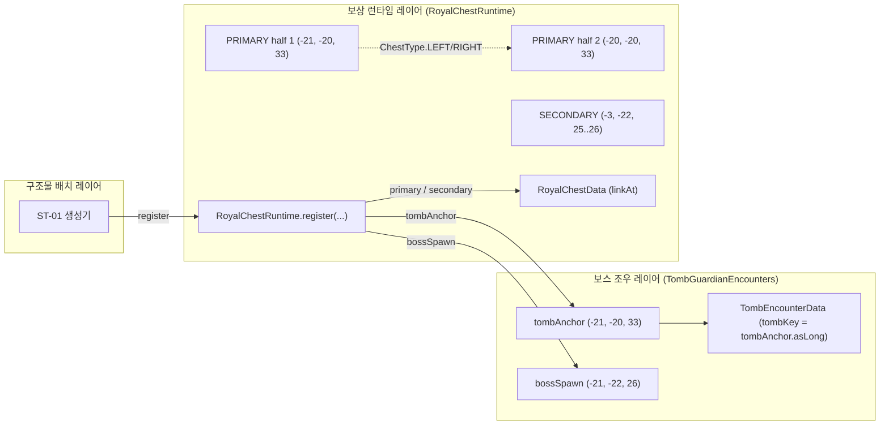

# ST-01 P7-R — PRIMARY B와 Tomb Guardian 3B 연동 및 조합 검증 (2026-11-08)

상태: **연동 검증 완료 / PRIMARY B 승인 및 3B 조건부 채택 반영**  
기준 좌표계: EAST 모델

---

## 1. 확정된 상자-보스 조합 사양

- **PRIMARY 왕실 상자 (승인)**: 후보 B `[(-21, -20, 33), (-20, -20, 33)]` (동쪽 확장, 북쪽 바라봄)
- **Tomb Guardian 등장 위치 (조건부 채택)**: 후보 3B `(-21, -22, 26)` (남쪽 바라봄)
- **주요 연동 지표**:
  - 좌측 상호작용 발판 `(-21, -20, 32)` 기준 수평 거리: **$6.00\text{m}$**
  - 우측 상호작용 발판 `(-20, -20, 32)` 기준 수평 거리: **$6.08\text{m}$**
  - 3차원 유클리드 거리: **$6.32\text{m}$ ~ $6.40\text{m}$**
  - 상호 시야선 (Line of Sight): **100% 완전 직관 (차폐 블록 0개)**
  - 즉시 피격 위험: **0% (단상 위 높이 차이 $+2.0\text{m}$로 인한 충격파 면역)**

---

## 2. tombAnchor와 PRIMARY 상자 좌표의 구조적 관계 (Section 6 심층 조사)

기존 P7 보고서의 단순 ‘좌표 일치 시 100% 호환’ 주장을 재검토하고, 실제 Java 소스 코드(`TombGuardianEncounters`, `TombEncounterData`, `RoyalChestRuntime`, `RoyalChestData`)의 설계 권위를 분석한 결과는 다음과 같다.

### A. `tombAnchor`의 실제 역할
- `tombAnchor`는 `TombGuardianEncounters` 및 `TombEncounterData`에서 보스 인카운터의 진행 상태(DORMANT, ACTIVE, DEFEATED)를 영구 저장하기 위한 **64비트 공간 식별 키(`tombAnchor.asLong()`)**이다.
- 이 키는 보스의 처치 여부(`isDefeated`), 조우 재시도 여부(`decideStart`)를 저장소 차원에서 바인딩하는 용도이므로, **물리적인 상자 블록의 크기나 수와 관계없이 단일 대표 좌표(`BlockPos`)**로 작동한다.
- 따라서 `tombAnchor`는 기존의 안정적인 대표점인 **`(-21, -20, 33)`**을 그대로 유지하면 완전 무결하게 동작한다.

### B. `RoyalChestRuntime`과 2블록 상자의 통합 과제
- `RoyalChestRuntime.register(level, instanceId, tombAnchor, bossSpawn, primary, secondary)`는 `primary` 매개변수로 단일 `BlockPos`를 받는다.
- `UseBlockCallback`은 플레이어가 클릭한 블록의 `hit.getBlockPos()`를 `data.linkAt(pos)`로 조회하여 왕실 상자 여부를 판정한다.
- 후보 B 대형 상자는 `(-21, -20, 33)`과 `(-20, -20, 33)` 2개의 블록으로 구성되므로:
  - 플레이어가 `(-21, -20, 33)`을 클릭하면 기존 단일 좌표 등록으로 즉시 가디언 소환 또는 보상 메뉴가 열린다.
  - 플레이어가 `(-20, -20, 33)`을 클릭할 경우, `linkAt`이 단일 좌표만 알고 있다면 바닐라 상자 처리가 될 위험이 있다.
- **향후 구현 요구사항 (Architecture Requirement)**:
  - 추후 ST-01 월드젠/NBT 구현 단계에서, `RoyalChestRuntime`의 `linkAt` 메서드가 마인크래프트의 `DoubleBlockCombiner`를 통해 연결된 다른 쪽 상자 반쪽(`ChestType.LEFT/RIGHT`)을 자동으로 인식하도록 하거나, 두 좌표 모두를 인스턴스에 링크 등록해야 한다.
  - 이 점을 제외하면, 보스 스폰 좌표(`bossSpawn`)와 조우 키(`tombAnchor`)는 후보 3B 및 대표 좌표와 완벽히 호환된다.

---

## 3. 전투 종료 후 접근성 및 안전 동선

1. **보스 격퇴 후 상자 접근성**:
   - 보스가 쓰러지면 `TombGuardianEncounters.DEFEATED` 이벤트가 발생하고 `TombEncounterData`에 영구 기록된다.
   - PRIMARY 상자 후보 B `[(-21, -20, 33), (-20, -20, 33)]` 앞의 전면 발판 `Z=32`는 $11\times6$ 크기의 넓은 단상 플랫폼으로, 보스 사체나 주변 장애물에 가로막히지 않고 즉시 접근 가능하다.
2. **동쪽 진행 흐름 (The Eastern Flow)**:
   - 후보 B 상자는 동쪽(+X)으로 뻗어 있어, 상자를 연 후 플레이어가 자연스럽게 고개를 돌렸을 때 동측 벽의 보조 상자 벽감($X=-3$)과 동남측 바닥의 비밀 출구($X=-9..-5, Z=33..37$)가 시야선에 들어온다.
   - 이는 D-I = EAST 결정과 조화롭게 연계되는 최적의 공간 스토리텔링을 완성한다.
