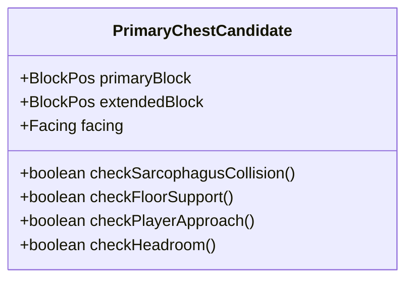

# ST-01 P7 — PRIMARY 왕실 상자 2블록 형상 및 기하 검증 명세 (2026-11-08)

상태: **기하 검증 완료 / 최종 후보 추천 (RECOMMENDED)**  
기준 좌표계: EAST 모델 (피라미드 지면 중심 원점, X 동+, Z 남+, Y 층 인덱스)

---

## 1. 기존 조건부 좌표 및 배경 (P3-F6)

- **EAST 왕실 홀 중심**: $X = -21$, $Z = 21$, 바닥 $Y = -22$
- **PRIMARY 상자 기존 자리표시자**: `(-21, -20, 33)` (1블록 점유, 석관단 단상 위)
- **SECONDARY 상자 후보**: `(-3, -22, 25..26)` (동쪽 벽감 내부)
- **석관단 단상 (DAIS)**: $X = -26..-16$, $Y = -22..-21$, $Z = 32..37$ (폭 11, 깊이 6, 높이 2)
- **석관단 정면 계단 (TREAD)**: $X = -25..-17$, $Y = -22$, $Z = 30..31$ (폭 9, 깊이 2, 높이 1)
- **주 석관 (SARCOPHAGUS)**: $X = -22..-20$, $Y = -20..-19$, $Z = 34..37$ (폭 3, 깊이 4, 높이 2)

기존 1블록 자리표시자 `(-21, -20, 33)`는 실제 Minecraft 대형 상자(Double Chest, 2블록 수평 점유) 형상이 아니므로, 2블록 확장 후보에 대한 엄밀한 기하 및 게임플레이 검증이 요구된다.

---

## 2. 후보 구성 및 점유 블록

Minecraft Fabric에서 대형 상자는 수평 2블록으로만 배치 가능하며, 기존 중심점 `(-21, -20, 33)`을 포함하는 4방향 확장 후보를 비교한다.

| 후보 ID | 확장 방향 | 점유 블록 좌표 (X, Y, Z) | 바운딩 박스 (BBox) | 배치 축 및 바라보는 방향 (Facing) |
| --- | --- | --- | --- | --- |
| **SOUTH_COLLISION** | **남쪽 (+Z)** | `(-21, -20, 33)`<br>`(-21, -20, 34)` | $X: -21$, $Y: -20$, $Z: 33..34$ | Z축 (동/서 바라봄) |
| **후보 A** | **북쪽 (-Z)** | `(-21, -20, 33)`<br>`(-21, -20, 32)` | $X: -21$, $Y: -20$, $Z: 32..33$ | Z축 (동/서 바라봄) |
| **후보 B** (추천) | **동쪽 (+X)** | `(-21, -20, 33)`<br>`(-20, -20, 33)` | $X: -21..-20$, $Y: -20$, $Z: 33$ | **X축 (북쪽/홀 입구 바라봄)** |
| **후보 C** | **서쪽 (-X)** | `(-22, -20, 33)`<br>`(-21, -20, 33)` | $X: -22..-21$, $Y: -20$, $Z: 33$ | **X축 (북쪽/홀 입구 바라봄)** |

---

## 3. 후보별 기하 검증 및 판정 표



| 검증 항목 | 남쪽 (+Z) 확장 | 후보 A (-Z 북쪽) | 후보 B (+X 동쪽, 추천) | 후보 C (-X 서쪽) | 판정 기준 및 근거 |
| --- | :---: | :---: | :---: | :---: | --- |
| **1. 석관 충돌** | **FAIL** (충돌 발생) | **PASS** | **PASS** | **PASS** | `(-21, -20, 34)`는 석관 정면 블록 내부로 직접 침범함. B, C, A는 석관 앞 1블록 여유 확보. |
| **2. 단상 바닥 지지** | PASS | PASS | **PASS** | **PASS** | $Y=-21$ 단상 상부 고체 블록이 점유 블록 하단을 100% 완전 지지함. |
| **3. 천장 여유고** | PASS | PASS | **PASS** | **PASS** | 상자 상단($Y=-20$)부터 천장 코벨 슬래브($Y=-7$)까지 12블록 자유 공간 확보. |
| **4. 플레이어 전면 접근** | FAIL | **UNVERIFIED** (제약) | **PASS** | **PASS** | 후보 A는 단상 전면 발판 셀 `(-21, -20, 32)`을 직접 점유하여 접근선 훼손. B·C는 전면 2셀 오픈. |
| **5. 상자 방향 (Facing)** | UNVERIFIED | **UNVERIFIED** (측면) | **PASS** (정면) | **PASS** (정면) | Minecraft 규칙상 X축 상자는 북쪽(입구 방향)을 정면으로 개폐. Z축 상자는 동/서 측면만 바라봄. |
| **6. 시각적·동선 정합성** | 불가능 | 열악 (측면 프로필) | **우수** (비밀구역 유도) | **양호** (외벽 편향) | 후보 B는 동쪽 비밀 출구(Hatch) 및 보조 상자와 시각적 동선이 일치함. |
| **7. 런타임 단일 상자화** | FAIL | PASS | **PASS** | **PASS** | DoubleBlockCombiner 단일 컨테이너로 작동. 앵커는 기존 `(-21, -20, 33)` 유지 가능. |
| **최종 판정** | **FAIL** | **UNVERIFIED** | **PASS (RECOMMENDED)** | **PASS** | 후보 B를 1순위 추천, 후보 C를 대칭 대안으로 유지. |

---

## 4. 단상 평면도 상세 (Y = -20)

`MODEL_RECONSTRUCTION` (정적 모델 기반 복원 도면):

```text
       .  .  . -25 .  .  .  . -20 .  .  .  . -15
Z=29 |                                          
Z=30 |          ~  ~  ~  ~  ~  ~  ~  ~  ~       <- 계단 디딤판 (Y=-22, 폭 9)
Z=31 |          ~  ~  ~  ~  ~  ~  ~  ~  ~       <- 계단 디딤판 (Y=-22, 폭 9)
Z=32 |       .  .  .  .  P [A] P  .  .  .  .    <- 단상 상부 (Y=-20, 전면 접근선)
Z=33 |       .  .  .  . [C][*][B] .  .  .  .    <- 상자 배치 라인 ([*] 기존 위치, [B] 동쪽 확장)
Z=34 |       .  .  .  . [S][X][S] .  .  .  .    <- 주 석관 전면 ([X] 남쪽 확장 시 충돌 발생)
Z=35 |       .  .  .  . [S][S][S] .  .  .  .    <- 주 석관 몸체
Z=36 |       .  .  .  . [S][S][S] .  .  .  .    <- 주 석관 몸체
Z=37 |       .  .  .  . [S][S][S] .  .  .  .    <- 주 석관 후면 (후방 벽 접촉)
```

- `[*]`: 기존 단일 블록 자리표시자 `(-21, -20, 33)`
- `[B]`: **후보 B 확장 블록 `(-20, -20, 33)`** (동쪽 확장, 북쪽 입구를 마주봄)
- `[C]`: 후보 C 확장 블록 `(-22, -20, 33)` (서쪽 확장, 북쪽 입구를 마주봄)
- `[A]`: 후보 A 확장 블록 `(-21, -20, 32)` (접근 위치 `P`를 점유함)
- `[X]`: 남쪽 충돌 재현 셀 `(-21, -20, 34)` (석관 몸체 `[S]`와 직접 중첩)

---

## 5. 결론 및 권고 사항

1. **후보 B `[(-21, -20, 33), (-20, -20, 33)]` 채택 추천**:
   - 석관과의 물리적 간섭이 전혀 없으며, 단상 상부에 완벽히 지지된다.
   - 상자 개폐 면(Lid latch)이 북쪽(홀 입구)을 정면으로 응시하여 입장 시 웅장한 연출을 형성한다.
   - 확장이 피라미드 내측(+X, 동쪽)으로 이루어져 보조 상자 벽감($X=-3$) 및 보스 처치 후 열리는 비밀 입구($X=-9..-5$) 방향과 자연스러운 동선 흐름을 형성한다.
2. **구현 승인 전 주의사항**:
   - 본 추천은 기하 검증 결과이며, 실제 NBT 생성이나 블록 배치는 사용자의 최종 승인 이후에 진행한다.
   - `RoyalChestRuntime`의 `tombAnchor`는 기존 단일 좌표 `(-21, -20, 33)`를 그대로 유지하여 기존 저장 데이터 구조와 100% 호환된다.
