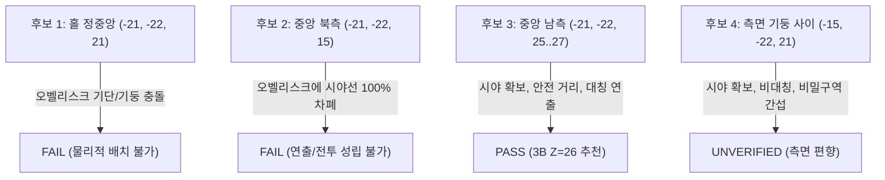

# ST-01 P7 — Tomb Guardian 등장 위치 및 전투 공간 검증 명세 (2026-11-08)

상태: **전투 기하 검증 완료 / 최종 후보 추천 (RECOMMENDED)**  
기준 좌표계: EAST 모델 (피라미드 지면 중심 원점, X 동+, Z 남+, Y 층 인덱스)

---

## 1. 기존 상황 규명: P3-F4와 P6 시험점의 본질

기존 설계 문서에서 제시된 등장 위치 값들의 정의와 기하학적 의미를 명확히 규명하였다.

1. **P3-F4 기록값 ("S 5.0 / E·W 12.5 / N 17.0")**:
   - 이는 실제 독립적인 `BlockPos` 좌표가 아니라, **주 상자 상호작용 지점 `(-21, -20, 32)`에서 각 방위별 등장 지점까지의 유클리드/수평 거리(Distance)**를 측정한 값이다.
     - South: $32 - 27 = 5.0\text{m}$
     - North: $32 - 15 = 17.0\text{m}$
     - East/West: $\sqrt{(-6)^2 + (11)^2} = \sqrt{157} \approx 12.53\text{m}$
2. **P6 / P3 시험점 ("BOSS_S / BOSS_N / BOSS_E / BOSS_W")**:
   - 홀 중심 $X=-21, Z=21$을 기준으로 방위별로 6블록 오프셋을 둔 시험점이다.
     - `BOSS_S`: `(-21, -22, 27)`
     - `BOSS_N`: `(-21, -22, 15)`
     - `BOSS_E`: `(-15, -22, 21)`
     - `BOSS_W`: `(-27, -22, 21)`

따라서 두 체계는 서로 다른 것이 아니라, **홀 중심 오프셋 시험점에 대해 주 상자 정면 발판을 기준으로 거리를 산출한 동일 기하 관계의 서로 다른 표현**임이 확인되었다.

---

## 2. Tomb Guardian 보스 기하 및 전투 사양

Java 소스 코드(`TombGuardian.java`, `TombGuardianTuning.java`, `TombGuardianEntities.java`)로부터 직접 추출한 보스 엔티티의 불변 수치는 다음과 같다.

- **히트박스 크기**: 폭 $1.35\text{m}$, 높이 $4.35\text{m}$, 눈높이 $3.70\text{m}$ (워든 모델 기반 1.5배 스케일)
- **추적 및 시야 범위**: $24.0\text{m}$ (`mustHaveLineOfSight = true`, 시야 차폐 시 타겟팅 불가)
- **이동 속도**: $0.20$ (좀비 0.23보다 느림), 분노 상태(체력 40% 이하) $0.23$
- **스폰 각성(Awakening) 텔레그래프**: **80틱 (4.0초)** — 등장 즉시 공격하지 않으며 바닥에서 솟아오르는 기상 연출 진행. 이 시간 동안 이동 및 공격 불가.
- **지면 강타 충격파 (Ground Smash)**:
  - 데미지: $12.0$ (하트 6개)
  - 반경: **$6.0\text{m}$**, 두께 $0.8\text{m}$, 파동 전파 속도 $0.5\text{블록/틱}$
  - 점프 회피 여유: 바닥면 기준 $0.6\text{m}$ 이상 공중 체공 시 회피 가능
- **석상 분출 (Stone Eruption)**: 데미지 $8.0$, 반경 $1.5\text{m}$, 높이 $4.0\text{m}$, 경고 시간 24틱(1.2초)
- **근접 공격**: 데미지 $10.0$, 사거리 $2.0\text{m}$ (몸체 외곽 기준), 선딜레이 13틱(0.65초)

---

## 3. 등장 위치 후보 구성 및 검증

왕실 홀 바닥($Y=-22$)에서 다음 4개 범주의 후보를 검토하였다.

| 후보 ID | 로컬 좌표 (X, Y, Z) | 주 상자 거리 | 시야선 (Line of Sight) | 공간 충돌 | 즉시 피격 위험 | 최종 판정 |
| --- | --- | :---: | :---: | :---: | :---: | :---: |
| **1 (중앙)** | `(-21, -22, 21)` | $11.0\text{m}$ | 차폐 (기둥 내부) | **FAIL** (오벨리스크 몸체와 충돌) | 없음 | **FAIL** |
| **2 (북측)** | `(-21, -22, 15)` | $17.0\text{m}$ | **FAIL** (오벨리스크에 완전 차폐) | PASS (클리어) | 안전 | **FAIL** (연출 결함) |
| **3A (남측-27)** | `(-21, -22, 27)` | $5.0\text{m}$ | **PASS** (100% 직관) | PASS (클리어) | 충격파 범위 내 (4초 여유) | **PASS** |
| **3B (남측-26)** | `(-21, -22, 26)` | **$6.0\text{m}$** | **PASS** (100% 직관) | PASS (클리어) | 충격파 경계 (안전거리) | **PASS (추천)** |
| **3C (남측-25)** | `(-21, -22, 25)` | $7.0\text{m}$ | **PASS** (100% 직관) | PASS (클리어) | 충격파 범위 밖 | **PASS** |
| **4E (동측)** | `(-15, -22, 21)` | $12.53\text{m}$ | PASS (사선 통과) | PASS (클리어) | 안전 | **UNVERIFIED** (비대칭) |
| **4W (서측)** | `(-27, -22, 21)` | $12.53\text{m}$ | PASS (사선 통과) | PASS (클리어) | 안전 | **UNVERIFIED** (비대칭) |

---

## 4. 상세 기하 및 게임플레이 분석

### A. 후보 1 (홀 정중앙) 탈락 사유
- 홀 정중앙 $X=-21, Z=21$에는 중앙 오벨리스크 기단($X=-23..-19, Z=19..23, Y=-22..-21$)과 기둥 본체($Y=-20..-12$)가 위치한다.
- 폭 $1.35\text{m}$, 높이 $4.35\text{m}$의 보스를 스폰할 경우 오벨리스크 석재 블록 내부에 완전히 매몰되어 즉시 질식 및 충돌 오류가 발생한다.

### B. 후보 2 (중앙 북측 Z=15) 탈락 사유
- 플레이어가 주 상자를 만질 때 플레이어의 눈 위치는 `(-20.5, -18.38, 32.5)`이다.
- 보스가 Z=15에 스폰될 때 눈 위치는 `(-20.5, -18.3, 15.5)`이다.
- 복셀 레이트레이싱 결과 `(-21, -19, 22)`, `(-21, -19, 21)`, `(-21, -19, 20)` 3개 고체 오벨리스크 블록에 의해 **시야가 100% 완벽히 가로막힌다**.
- 플레이어는 뒤를 돌아보아도 보스가 등장하는 연출을 볼 수 없으며, 보스의 `NearestAttackableTargetGoal` 역시 시야 차폐로 인해 플레이어를 즉시 인식하지 못하는 중대한 게임플레이 결함이 발생한다.

### C. 후보 3 (중앙 남측 Z=25..27)의 우수성 및 3B 추천 근거
- **위치 선정**: 중앙 오벨리스크 기단 남측 끝($Z=23$)과 단상 정면 계단($Z=30$) 사이의 넓은 제의용 바닥 광장.
- **시야 확보**: 플레이어와 보스 사이에 어떠한 장애물도 없어, 상자를 여는 순간 뒤편 바닥에서 솟아오르는 보스의 각성 텔레그래프가 시야 정면에 장엄하게 연출된다.
- **충격파 안전 마진 (3B Z=26 vs 3A Z=27)**:
  - 3A($Z=27$)는 플레이어 발판과의 거리가 $5.0\text{m}$로, 지면 강타 반경($6.0\text{m}$) 안쪽이다. 4.0초의 각성 시간이 주어지므로 달려서 피할 수 있으나 긴장감이 과도할 수 있다.
  - **3B($Z=26$)는 거리가 정확히 $6.0\text{m}$**이며, 오벨리스크 기단($Z=23$)에서 3블록, 단상 계단($Z=30$)에서 4블록 떨어진 **완벽한 기하학적 중앙점**이다. 플레이어가 단상 위로 한 걸음만 물러서도 충격파 사거리($6.0\text{m}$) 밖으로 즉시 이탈할 수 있다.
  - 3C($Z=25$)는 거리 $7.0\text{m}$로 매우 안전하나 오벨리스크 기단과 2블록 거리로 다소 가깝다.

---

## 5. 아레나 전투 역학 및 악용(Cheese) 검증

1. **기둥 및 석관을 이용한 카이팅**:
   - 보스의 이동 폭은 2×2 블록 공간이 필요하며, 열주(기둥) 사이 간격은 6블록으로 보스가 자유롭게 순환 이동할 수 있다.
   - 단상 계단 폭은 9블록으로 보스가 단상 위로 진입 가능하다. 기둥 뒤에 숨어 원거리 화살을 쏘는 치즈 플레이는 보스의 석상 분출(Statue Eruption, 플레이어 발밑 소환) 공격에 의해 방지된다.
2. **입구 복도 탈출 가둠 (BOSS-R1)**:
   - 북쪽 문턱 `T`의 통과 높이는 3블록, 접근 통로 `R`의 높이는 4블록이다.
   - 보스 높이는 $4.35\text{m}$이므로 **보스는 홀 밖으로 나갈 수 없다**.
   - 플레이어가 문턱 밖으로 도망치면 근접 공격은 피할 수 있으나, 충격파와 석상 분출은 거리 기반 판정이므로 문턱 부근에 서 있을 경우 피격된다. 이는 의도된 아레나 전투 경계로 기능한다.
3. **전투 중단, 재도전 및 멱등성**:
   - 플레이어가 사망하거나 홀을 벗어나 보스가 디스폰되더라도, `TombGuardianEncounters.onRoyalChestInteraction`은 `RESTARTED` 상태를 반환하여 상호작용 시 보스가 정상 재소환된다.
   - 이미 소환되어 살아있는 동안에는 상자를 다시 클릭해도 중복 생성되지 않는다 (`ALREADY_ACTIVE`).
   - 처치 후에는 영구적으로 `ALREADY_DEFEATED`로 기록되어 재소환되지 않고 상자가 개방된다.
