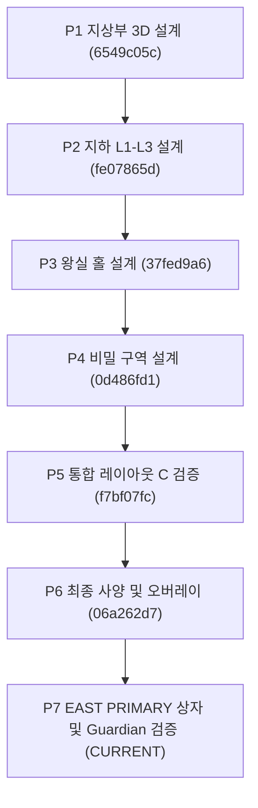

# ST-01 P7 — 사용자 승인 기록 및 결정 경계 문서 (2026-11-08)

상태: **설계 및 기하 검증 기록 문서 (DESIGN & GEOMETRY VERIFICATION RECORD)**  
기준 커밋: `06a262d70d9b5154d1ffccb1bbdfc4601b2b984f` (origin/work/st01-p6-final-spec-20261107)  
작업 브랜치: `work/st01-p7-east-primary-guardian-20261108`

---

## 1. 사용자 승인 사항 기록 (APPROVED WHAT)

다음 결정은 선행 검토를 거쳐 최종 승인되었으며, 이번 P7 세션의 불변 기준선으로 적용된다.

| 항목 | 승인된 결정 내용 | 적용 범위 및 제약 | 상태 |
| --- | --- | --- | --- |
| **D-I** | **기준 방향 = EAST** | • ST-01 왕실 홀, 지하 통로, 비밀 구역의 기본 방향을 EAST로 확정. • WEST는 정합성 검증 및 비교를 위한 거울(mirror) 모델로만 보존. • 향후 동·서 방향을 다시 선택하거나 번복하지 않음. • 기존 P4-B 조건부 공간 설계 및 레이아웃-C 오버레이를 유지. | **APPROVED** |

> [!IMPORTANT]
> **D-I = EAST 승인의 의미와 한계**  
> EAST 방향이 확정됨으로써 지하 3층 왕실 홀의 중심 축 좌표계($X = -21$, $Z = 21$, $Y = -22$)가 기준선으로 정립되었다.  
> 그러나 이는 방향에 대한 승인일 뿐이며, 왕실 홀 내부의 미결정 항목(PRIMARY 상자의 2블록 점유 형상 P3-F6, Tomb Guardian 실제 등장 좌표 D-E)까지 자동으로 확정된 것은 아니다. 미결정 항목은 본 P7 세션의 독립 기하·동선 검증을 통해 별도 후보를 도출한다.

---

## 2. 설계 권위 및 구현 상태 경계 (IMPLEMENTATION BOUNDARY)

본 P7 작업은 순수한 **설계·기하·게임플레이 검증 단계**이며, 다음 구현 항목은 일체 변경하거나 생성하지 않는다.

1. **Minecraft 구조물 NBT**: 미구현 (NO NBT GENERATED)
2. **ST-01 월드젠(Worldgen) 배치 훅**: 미구현 (NO WORLDGEN HOOKS)
3. **구조물 인스턴스 안정적 ID 경로**: 미구현 (NO INSTANCE ID PERSISTENCE)
4. **PRIMARY 2블록 상자 형상**: 미승인 (RECOMMENDED 상태로 제시, 사용자 최종 승인 대기)
5. **Tomb Guardian 실제 스폰 좌표**: 미승인 (RECOMMENDED 상태로 제시, 사용자 최종 승인 대기)
6. **실제 게임 내 시야·전투**: `LIVE_SERVER_UNVERIFIED` (정적 기하 및 복셀 레이트레이싱으로 검증, 실제 Fabric 런타임 서버 검증 대기)
7. **보상 런타임 연결 금지**: I06-P3에 구현된 `RoyalChestRuntime.register(...)` 함수는 본 P7에서 호출하거나 구조물에 임의 배선하지 않는다.
8. **보상 규칙 보존**: 기존 보상 확률, 수량, 유물 촉매 배분 규칙, 보스 전투 로직은 100% 보존된다.

---

## 3. 선행 산출물 포함 관계 확인

본 브랜치는 P6 기준 커밋 `06a262d7`에서 분기하였으며, 다음 선행 산출물을 완전히 포함하고 있음을 확인하였다.

- `06a262d7` (P6): 후보 C 오버레이, 닫힘/열림 검증, 구성요소 좌표 명세서
- `f7bf07fc` (P5): P4-B 조건부 채택 및 P1-P4 통합 검증
- `0d486fd1` (P4): 비밀 구역 3D 모델
- `37fed9a6` (P3): 왕실 홀 3D 모델 및 P3-F4 보스 후보 기록
- `48038bc9` (I06-P3): 왕실 상자 보상 런타임 엔진 머지
- `PR #245` (I06-P4): ST-01 통합 준비 브랜치 (설계 미확정 항목으로 블로커 등록 상태)
