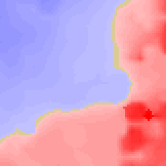
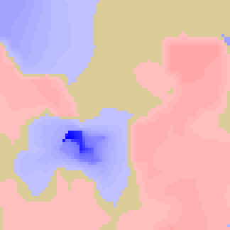
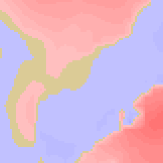
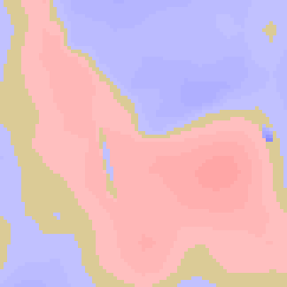

# 08 — Visual and geometric evidence

Status: **geometric evidence generated from real generator heights. Client-rendered captures under Policy B: NOT RUN.** They would need a client capture of a world generated with the experimental constants; the infrastructure exists (`st01-p8c2c-policy-d.yml` `client-capture`) but was not run for B in this task. Perceived quality (cliffs, exposed body, entrance drops) stays **LIVE VALIDATION PENDING**.

Generator: [probe/figures.py](probe/figures.py), which reads the archived height grids in [results/coverage](results/coverage) and needs no game. Reproduce with:

```
python3 -I probe/figures.py results/coverage figures 1034165336:263,-241:max-cut 287862831:-499,-375:max-skirt \
  527213223:622,-460:D-reference 914490140:460,240:village-overlap
```

## Cut/fill maps (81 × 81 footprint, 4 px per block, east → right, south → down)

Red marks natural terrain above Y0, which is excavated (darker means deeper; full red = 24). Blue marks natural ground below Y0, where the assembly body stands above ground (darker means deeper; full blue = 32). Sand colour marks ground exactly at the plane.

| Case | Map | Sections (1 block = 6 px on both axes, through the most extreme column) | Numbers |
|---|---|---|---|
| **Maximum cut** (B-only) |  | [SVG](figures/cutfill-1034165336-263_-241.svg) | seed 1034165336, chunk 263,−241, yf 74, cut **24**, skirt 9, diff 33; Policy D rejects it (diff) |
| **Maximum skirt** (B-only) |  | [SVG](figures/cutfill-287862831--499_-375.svg) | seed 287862831, chunk −499,−375, yf 70, cut 4, skirt **32**, diff 36; the 32 is an **interior pit** that the body fills, not an edge |
| **Policy D reference** |  | [SVG](figures/cutfill-527213223-622_-460.svg) | seed 527213223, chunk 622,−460, yf 65, cut 10, skirt 4, diff 14; Policy D-eligible today |
| **Village overlap** (B-only) |  | [SVG](figures/cutfill-914490140-460_240.svg) | seed 914490140, chunk 460,240, yf 68, cut 4, skirt 10; Policy D rejects it (skirt) |

## What the geometry shows

1. **A large cut stays inside the footprint and leaves a wall at the edge.** In the max-cut case the excavation is an L-shaped region across the east and south halves, up to 24 deep at the south-east. The north-west half stands above the natural ground (blue). The rising natural slope therefore continues outside the east and south edges as a cliff, up to 23 high across all B sites (boundary-cliff max, [03](03-terrain-correction-architecture.md)), while the body is exposed on the north-west edges.
2. **A large skirt usually comes from a local depression.** The 32-deep column of the max-skirt case is a narrow pit in the interior. It is invisible after generation because the body fills it. Exposure occurs only where low ground reaches the footprint edge, which is what the exposed-body-face metric measures (median 7, p90 16 under B).
3. **Policy D sites look like flattened shelves.** Policy B sites look like shelves cut into a slope, with the downslope side becoming a sandstone wall up to the body height.

## Solid-face evidence (exposure safety)

[results/assembly-outer-faces.json](results/assembly-outer-faces.json), from [probe/outer_faces.py](probe/outer_faces.py), lists every outer-face cell from Y−32 to Y0 of both route templates:

* Two faces are 100 % sandstone (2,673 cells each).
* Each of the other two faces leaves a 780-cell (39 × 20, Y−24..Y−5) slot that the D1 royal hall fills; the hall's own outer walls on those faces are sandstone and smooth sandstone, 780/780 cells solid.
* The only opening at or below Y0 is the route entrance: a 25-wide air gap at Y0 (x −12..12) on one edge, with a smooth-sandstone floor at Y−1.

Exposing the underground body therefore reveals solid walls, never rooms. The entrance threshold is the one place where a drop matters for players ([03](03-terrain-correction-architecture.md) §3).
