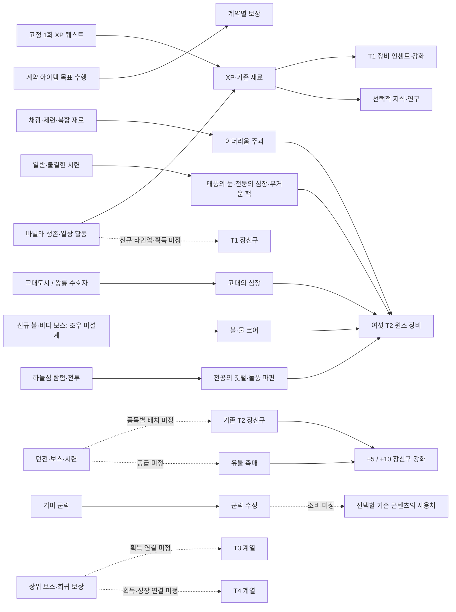

# MoreMinecrafts — 콘텐츠 설계 현황 복원 및 후속 설계 로드맵

기준일: **2026-10-30 (한국시간)**  
대상: **ItzGamesGD/MoreMinecrafts-Beta**  
성격: **콘텐츠 기획 인벤토리·후속 설계 제안. 새로운 게임 디자인 승인이나 구현 지시문이 아니다.**

## I. 전체 요약

### 핵심 결론

1. **‘10종 구조물’은 역사적 ST-01~ST-10 목록이다. 태양 신전(ST-02)은 취소되어 활성 항목은 9개다.** 고대도시 경기장·전체 변형, 하늘섬의 세 구조물은 별도 작업이다. 왕릉은 거대 피라미드(ST-01) 내부 조우 공간이다. 이를 합치거나 대체하여 새로운 10개 목록을 만들면 기존 결정을 왜곡한다. [구조물 목록][S02]·[구조물 색인][S01]
2. **피라미드·약탈자 본거지·거미 군락·고대 투기장·하늘섬의 핵심 경험과 규칙은 상당 부분 확정됐다.** 남은 주요 공백은 보상 품목의 배치, 일부 기능의 게임플레이 적용 범위, 신규 보스와 상위 성장의 연결이다. 건축 도면·리소스·월드젠 수치·라이브 검증 부재를 콘텐츠 전체의 미설계로 집계하지 않았다.
3. **T1 장신구는 단순히 기록이 흩어진 경우가 아니다.** 기존 12종의 역할·5카테고리·강화표는 분산되어 존재하며, 10월 27일 결정은 이를 **T2 수준으로 상향**하고 **T1 유물·장신구를 나중에 별도 추가**하도록 한다. 신규 T1 라인업은 명시된 미완 설계다. [Sky/T2 §9·§11][SKY]·[12종][A01]·[강화][A02]
4. **아이템 부족과 보상 배치 부족이 섞여 있다.** 약탈자 본거지는 65%/35%/10% 추첨 정책이 있지만 지급할 실제 아이템 목록이 보류됐다. 왕릉은 고대의 심장 50%×1이 확정됐으나 추가 재료 풀이 남아 있다. 유물 촉매는 소비 지점은 있지만 공급처가 미설계다. 군락의 수정은 획득이 확정됐지만 사용처가 없다.
5. **가장 직접적인 진행 공백은 신규 불·바다 보스다.** 불타는 심장·해류의 심장의 각 50%×1 드롭과 T2 사용처는 확정됐지만, 보스의 구체 정체·발견·조우·재도전 설계 기록은 찾지 못했다. 옛 보루/엘더 가디언 경로는 명시적으로 대체됐으므로 임의 복구 대상이 아니다. [Sky/T2 §18.4][SKY]
6. **엔드 5종(ST-06~10)은 고수준 콘셉트 이후 상세 설계 기록이 부족하다.** 각자의 플레이 이유·탐험 흐름·적·보상 역할부터 정해야 한다. 기존 T3 7종·T4 3종의 명칭을 다시 만드는 작업보다 보스 보상→재료→획득 연결을 설계하는 편이 우선이다.
7. **P0는 불·바다 코어를 공급할 최소 조우·재도전 결정(D00)에만 한정했다.** 이 선택 없이 두 보스의 보상·제작 진행을 완결할 수 없기 때문이다. 전체 보스 수치나 다른 구조물을 P0로 올리지 않았다. T1, 기존 보상 인벤토리, 군락 수정, 퀘스트 대체 목표는 이 결정과 병렬 진행할 수 있다.

### 조사 기준과 근거의 우선순위

최신 누적 기준은 **checkpoint/wave15-unified-20261029**다. 여기에 **열린 PR #214의 ST-05 Q111~Q116 승인 기록**을 해당 범위에만 덧붙였다. #214는 미병합 문서 PR이며, 이를 체크포인트에 반영된 구현으로 취급하지 않았다. Q1~Q110의 정리 PR [#212](https://github.com/ItzGamesGD/MoreMinecrafts-Beta/pull/212)는 병합되어 있다.

[원격 main의 권위 색인](https://github.com/ItzGamesGD/MoreMinecrafts-Beta/blob/main/docs/CONTENT_AUTHORITY_INDEX.md)도 직접 확인했다. main에 없는 최신 설계를 누락시키지 않도록 누적 체크포인트와 독립 설계 브랜치를 함께 사용했다.

[CONTENT_AUTHORITY_INDEX.md][AUTH]의 현재 라우팅과 명시적 소유자 승인·대체 규칙을 먼저 따랐다. 과거 체크리스트의 OPEN, 오래된 PR 본문, 코드의 존재만으로 최신 설계를 덮어쓰지 않았다. 설계 문서·분산 브랜치와 관련 열린/병합/종료 PR의 본문 및 필요한 논의를 확인했다. 중요한 복원 경로는 다음과 같다.

| 확인 경로 | 읽은 상태 / 조사에 주는 의미 |
|---|---|
| [#71](https://github.com/ItzGamesGD/MoreMinecrafts-Beta/pull/71), [#74](https://github.com/ItzGamesGD/MoreMinecrafts-Beta/pull/74), [#83](https://github.com/ItzGamesGD/MoreMinecrafts-Beta/pull/83) | #71 병합, #74·#83 미병합 종료. Oct 7 후속 방향과 고대도시 기록을 복원했다. #83은 경기장 프로토타입이며 전체 도시 변형 완료 근거가 아니다. |
| [#101](https://github.com/ItzGamesGD/MoreMinecrafts-Beta/pull/101), [#113](https://github.com/ItzGamesGD/MoreMinecrafts-Beta/pull/113), [#183](https://github.com/ItzGamesGD/MoreMinecrafts-Beta/pull/183) | #101·#113 미병합 종료지만 12종·강화 문서는 최신 체크포인트에 보존. #183은 생명의 고리 후속 결정 병합. 종료를 설계 폐기로 해석하지 않았다. |
| [#140](https://github.com/ItzGamesGD/MoreMinecrafts-Beta/pull/140), [#147](https://github.com/ItzGamesGD/MoreMinecrafts-Beta/pull/147), [#148](https://github.com/ItzGamesGD/MoreMinecrafts-Beta/pull/148) | 미병합 종료. 퀘스트 소유자 결정, 본거지 상세 설계, 계약 아이템 체계의 후속 보존본을 사용했다. #147의 짧은 옛 피라미드 초안을 최신 설계로 쓰지 않았다. |
| design/pyramid-mob-roster-20261026, design/spider-colony-biome-20261026 | 독립 설계 브랜치의 일반몹·거미 Q1~Q104 결정 확인. 전용 PR 미발견과 설계 기록 부재는 다르다. |
| [#189](https://github.com/ItzGamesGD/MoreMinecrafts-Beta/pull/189), [#193](https://github.com/ItzGamesGD/MoreMinecrafts-Beta/pull/193) 및 Wave 15 | 보존·통합 경로. F-2/F-6, 태양 신전 취소, 영토 보류 등은 후속 체크포인트 문서와 함께 읽었다. |
| [#198](https://github.com/ItzGamesGD/MoreMinecrafts-Beta/pull/198), [#202](https://github.com/ItzGamesGD/MoreMinecrafts-Beta/pull/202), [#204](https://github.com/ItzGamesGD/MoreMinecrafts-Beta/pull/204) | 병합된 T2 재료·획득·내구도·레시피 통합 이력. **설계가 이미 확정된 범위**를 식별하는 데 사용했다. |
| [#209](https://github.com/ItzGamesGD/MoreMinecrafts-Beta/pull/209), [#210](https://github.com/ItzGamesGD/MoreMinecrafts-Beta/pull/210), [#211](https://github.com/ItzGamesGD/MoreMinecrafts-Beta/pull/211), [#213](https://github.com/ItzGamesGD/MoreMinecrafts-Beta/pull/213), [#214](https://github.com/ItzGamesGD/MoreMinecrafts-Beta/pull/214) | 조사 시점 열린 PR. 하늘섬·왕릉 보스·서식지·투기장 컨트롤러의 구현 작업 존재와 설계 한계를 구분했다. PR의 과거 테스트 결과를 이번 조사에서 재검증하지 않았다. |
| [#85](https://github.com/ItzGamesGD/MoreMinecrafts-Beta/pull/85), [#117](https://github.com/ItzGamesGD/MoreMinecrafts-Beta/pull/117) | 각각 잘못된 저장소 대상의 전체 고대도시 실험, 지하왕국 생성 실험. 정식 콘텐츠 완료나 새로운 구조물 선정으로 승격하지 않았다. |

이 보고서의 상태는 **설계 상태**다. COMPLETE=주요 결정 확정, PARTIAL=핵심은 있으나 추가 결정 필요, MISSING=필요한 설계 기록 미발견, CONFLICT=명시적 대체로 풀리지 않는 현행 결정 충돌, UNKNOWN=자료 부족으로 판단 불가다. DEFERRED/CANCELLED/SHELVED는 별도의 범위 표시다. 상세 수치가 후속 튜닝으로 위임됐다는 사실만으로 핵심 설계를 미완으로 되돌리지 않았다.

**현재 근거에서 확정한 미해결 CONFLICT는 없다.** 고대의 심장/옛 수호자의 핵, 하늘섬 금고 깃털 10%/15%, 이더리움 교체, 거미 수정의 어미 독점 등은 후속 승인으로 해소됐다. 다만 전체 저장소에 충돌이 전혀 없음을 보증하는 구현 감사는 아니다.

## II. 10종 구조물 설계 현황표

### 정확한 역사 목록과 현재 상태

아래 상태는 콘텐츠 패키지 관점이다. ‘핵심 COMPLETE / 전체 PARTIAL’은 확정된 경험을 재설계하라는 뜻이 아니라, 보상 등 남은 축만 닫으라는 뜻이다. 취소된 ST-02는 활성 콘텐츠 완료율에서 제외한다.

| ID | 정확한 구조물 / 역할 | 지형·바이옴·차원·희귀도 | 설계 상태 | 남은 기획 결정 / 다음 단계 | 우선순위 |
|---|---|---|---|---|---|
| ST-01 | **거대 피라미드 / Colossal Pyramid**. 대규모 탐험·묘실·왕릉 조우 | 오버월드 사막. 별도 대형 피라미드. 생성 희귀도 최종값 미정 | **PARTIAL**. 탐험 콘셉트·주동선·일반몹 8종·왕릉 보스 핵심 COMPLETE | 일반몹의 일회성/반복 출현·퇴각 후 유지 정책, 분기별 위험/보상과 추가 보스 보상 풀. 정확한 도면·블록 제작 제외 | P1 조우/보상, P2 수치 |
| ST-02 | **태양 신전 / Sun Temple** | 역사상 오버월드 사막 후보 | **COMPLETE — 취소 결정만 확정 / CANCELLED** | 상세 콘텐츠 평가·재설계 대상 아님. ID 보존. 천공 신전으로 대체하지 않음 | 작업 없음 |
| ST-03 | **약탈자 본거지 / Pillager Headquarters**. 유한 주둔군이 있는 군사 마을 약탈 | 오버월드 평탄한 평원·숲. 희귀 지역 랜드마크 확정, 수치 빈도는 후속 튜닝 | **PARTIAL**. 공간 관계·유한 전투·추첨 정책 COMPLETE | 일반 보급품과 프리미엄 지급 품목·가중치·강화 등급·상단 룬과의 중복. 장비 다양화까지 명시 보류된 풀을 조건 충족 후 설계 | P2 |
| ST-04 | **거미 군락 동굴 / Spider Colony Cave**. 자연 동굴 생태·선택 탐험 | 오버월드 기존 자연 동굴, Y -48~48·Y≈0 중심. 매우 희귀. 실제 동굴방·연결 통로를 따르는 바이옴 방향 | **PARTIAL**. Q1~Q104의 생태·어미 조우·주요 드롭 COMPLETE | 군락 수정 사용처와 전체 수급 목표, 고치 위험/보상 비율·전리품. 기술 가능성 UNKNOWN은 별도이며 현재 WHAT를 다시 묻는 사유 아님 | P1 수정, P2 고치 |
| ST-05 | **고대 투기장 / Ancient Colosseum**. 독립 지하 7라운드 시련 | 오버월드 거대한 자연 동굴 내부만. 드문 대형 폐허. 표면 생성 아님 | **PARTIAL**. Q1~Q116의 조우 핵심 COMPLETE | 추가 직접/개인 보상 필요 여부·품목, 시간초과 뒤 보스의 드롭·장애물 파괴/복원 경계 | P1 국소 결정 |
| ST-06 | **엔드 도시·함선 개편 / End City and Ship Remake** | 엔드의 기존 바닐라 도시·함선. 테마 건축 개선 | **PARTIAL — 고수준 의도만 확인** | 상세 동선·전투 변화·보상 유지/추가 범위는 **설계 기록 미발견**. 원본 도시/배와 무엇이 달라지는지 경험 명세부터 | P2 |
| ST-07 | **공허의 성채 / Void Citadel** | 엔드의 별도 대형 요새 | **PARTIAL — 콘셉트만 확인** | 생성 지형/희귀도·내부·적/보스·전리품·진행 역할 모두 상세 기록 미발견 | P2 |
| ST-08 | **엔드 천문대 / End Observatory** | 엔드, 천문대 테마 | **PARTIAL — 콘셉트만 확인** | 탐험 목표·공간·기믹·적·보상·다른 콘텐츠 연결의 상세 기록 미발견 | P2 |
| ST-09 | **공허의 수도원 / Void Monastery** | 엔드, 수도원 테마 | **PARTIAL — 콘셉트만 확인** | 플레이 역할·공간·적·보상 상세 기록 미발견. 과거 구현 난도 언급은 있음, 실현 가능성 UNKNOWN | P2 |
| ST-10 | **엔드 함선 조선소 / End Shipyard** | 엔드의 독립 조선 부지. ST-06 함선 개편과 별개 | **PARTIAL — 콘셉트만 확인** | 규모·동선·적·보상·함선과의 플레이 관계 상세 기록 미발견. 함선 수·보스 등을 추정하지 않음 | P2 |

근거: [후보대장][S02], [구조물 라우팅][S01], [피라미드][S03], [일반몹][S04], [본거지][S05], [거미 군락][S06], [투기장 최신 권위][S07].

### 확정된 공간·전투·보상 경계

**ST-01 / 피라미드 내부 왕릉.** 지상은 장엄하고 시야가 열린 중앙 주랑홀, 발코니와 작은 제단실, 지하 대계단으로 구성하는 방향이다. 지하는 명확한 중앙 주동선과 선택 묘실 분기로 나뉘며, 모든 곁가지를 깨야 왕릉에 도달하는 구조가 아니다. 지상 3+지하 2는 개념적 구역이고 ‘필수 다섯 방/층’이 아니다. 81×81 외곽·지상 높이 40·지하 최대 깊이 20은 승인 범위다. 22~30개 공간 같은 초기 예시는 승인 할당량이 아니다.

일반몹은 매장된 미라·묘실 궁수·장례 시종·금장 미라와 바닐라 Husk·Skeleton·Bogged·Spider의 8종이다. 바닐라 행동을 재사용하며 방별 위험 역할은 있지만 정확한 수·강도는 미정이다. 일반 수호몹의 1회 초기 배치/반복 출현과 미처치 퇴각 후 유지 정책도 아직 열려 있다. 이는 재방문 위험·농장·보상량에 영향을 주므로 저장 구현법과 구분해 결정해야 한다. 왕릉 보스방은 **수호자 단독 조우**다. 주 왕실 상자 첫 상호작용이 경고·각성을 일으키고 처치 후 그 상자가 열린다. 일반 탐험 상자는 별도다. 누적 소음계는 폐기됐다.

왕릉 수호자는 시각 기반 중장갑 골렘형 보스로, 근접·바닥 충격파·예고 뒤 솟는 석상 공격과 저체력 템포 변화를 갖는다. 바닐라 워든의 소닉붐/진동 AI를 이식하는 설계가 아니다. **정상 처치한 왕릉은 영구 종료**, 미처치 중단만 재도전한다. 고대의 심장 50%×1과 기존 고대도시 3% 경로는 확정. 대지 철퇴의 마지막 재료는 최신 §18에 따라 **이더리움 주괴**다. 옛 네더라이트 배치를 현재 결정으로 되살리지 않는다. [피라미드 후속 승인][S03]·[F-2/Q4][F02]·[Sky/T2 §18][SKY]

**ST-03 / 본거지.** 112×112 외곽, 연속 정사각 성벽·모서리 탑 4개·외부 정문 1개, 내부 시설 19~22개 방향이 확정됐다. 정문→큰길→광장→2층 우민 저택이 방향 감각을 제공하고 옆골목은 자유 탐색을 허용한다. 감옥·파괴수 마구간, 직접 맞닿은 무기고·훈련장은 확정이다. 제안된 ‘정확히 20개 시설’의 세부 개수나 좌표를 확정안으로 취급하지 않는다.

초기 주둔군 35~45명, 바닐라 AI, 강화 변명자 지휘관 1명(40 HP)이 기본이다. 주둔군·지휘관은 처치 뒤 자연 재생성되지 않는다. 전역 경보·지원군·지휘관 버프·보스 페이즈는 없다. 상자를 열기 위해 지휘관을 반드시 죽이는 관문도 없다. 미완은 이 콘셉트 자체보다 **실제로 지급할 보상 목록**이다. [본거지 현행 결정 색인][S05]

**ST-04 / 거미 군락.** 고정 던전이 아니라 기존 넓은 자연방과 통로를 따라가는 희귀 생태계다. 군락 가로 목표 약 128~256블록, 큰 둥지 1~3개, 각 둥지 지름 약 20~36블록 방향이 있다. 최신 Q97은 적합한 자연방이 없으면 후보를 버리도록 하므로, 옛 허용을 근거로 새 거대 동굴을 파거나 둥지를 축소하면 안 된다. 필요한 최소 자연형 연결 보충은 제한적으로 남는다.

일반 자연 적은 거미:동굴거미 80:20, 기존 동굴 약 1.5배 밀도 목표이며 바닐라 몹 상한을 넘기지 않는다. 둥지에는 일반 거미 생성기 1~2개가 있다. 어미거미는 둥지당 한 번 나오는 60 HP 정예 조우로, 전투 중 15초마다 최대 2마리·동시 최대 4마리의 작은 거미를 소환한다. 피해·개체는 중단/재시작에도 이어진다. **어미를 처치한 둥지에서는 어미만 다시 나오지 않으며**, 일반 거미/동굴거미 자연 스폰과 일반 거미 생성기는 유지된다.

바닥 알주머니와 매달린 고치는 별개다. 자연 알주머니 35%는 파괴 시 작은 거미 1~2마리, 고치는 일반 거미 위험형 또는 소량 보상형이다. 전용 보물상자를 두지 않는 결정은 **보상 설계 실수나 누락이 아니다**. 어미 드롭과 광맥으로 얻는 군락 수정의 사용처가 실제 공백이다. [거미 Q48~Q104][S06]

**ST-05 / 고대 투기장.** 중앙 평탄 전투장·동서남북 플레이어 입구·장식 관람석이 있으며, 중앙 수정 접근으로 R1이 시작된다. 일반~정예 R1~R6과 불멸의 검투사 R7, 일반 금고 6개+중앙 불길한 금고 1개가 확정됐다. 현재 활성 로스터 15종과 조건부 비활성 후보 8종은 이미 구별돼 있다. 후보 8종을 새 몹 설계 할당량으로 만들지 않는다.

라운드 생존 상한 12마리, 6마리 이하 시 보충, R3/R5 보급, 파티 수에 따른 예산, 성공/실패 뒤 **65분 재도전 쿨다운**까지 확정됐다. 최신 #214는 별도의 **전체 시험 제한 65분**, 서버 오프라인 시간 제외, 재시작 보존, 라운드별 개인 자격·실제 지급 시 수령 기록을 명시한다. 시험 제한과 재도전 쿨다운은 같은 길이의 **다른 시계**다.

기본 보상은 웨이브당 공유 일반 열쇠 1개와 보스 공유 불길한 열쇠 1개다. 개인 기록이 있다고 개인 지급 품목까지 승인된 것은 아니다. 보스 검·방패는 수집 장비가 아니다. 시간초과 뒤 남은 보스의 통상 드롭과 특수 장애물 파괴·복원은 #214의 O-8/O-9로 남아 있다. 이는 핵심 시련 전체를 처음부터 다시 설계할 이유가 아니다. [최신 권위][S07]·[C0 계약 §14][S08]

### 10종 밖에서 함께 관리해야 할 설계

| 콘텐츠 | 현재 핵심 설계와 연결 | 상태 / 다음 설계 |
|---|---|---|
| **고대도시 내부 경기장** | 고대도시에 무작위로 추가되는 랜드마크. 새 보스·퍼즐·퀘스트·진행 잠금을 의무화하지 않음. ST-05와 별개 | **핵심 COMPLETE**. 별도 고유 전리품이 없다는 이유로 공백 판정하지 않음. #83 프로토타입과 전체 도시 개편을 구분 |
| **고대도시 전체 변형** | 죽음/잔해, 네더 침식, 전성기라는 세 콘셉트 채택. 경기장과 별도 계층 | **PARTIAL**. 변형별 플레이 경험·주민/수호자 행동·출현 관계·보상 영향 상세 미정. 별도 Structure-Generator 저장소 작업의 완료 여부는 이번 조사에서 UNKNOWN |
| **부유 유적** | 하늘섬 위 소형 폐허·시각 변형·일반 상자·바닐라 시련 생성기/금고 | **핵심 COMPLETE / 상세 보상 PARTIAL**. 신규 보스 설계 불필요 |
| **천공 신전 / Sky Temple** | 하늘섬 위 대형 개방 단층 파르테논형 중앙 전투장. 폭풍의 사냥꾼만 정예 추가 허용, 비룡 제외 | **핵심 COMPLETE / 상세 보상 PARTIAL**. 취소된 사막 태양 신전(ST-02)과 다른 콘텐츠 |
| **공중 시련탑** | 일반 하늘섬 위 5~7층 폐허탑. 층당 생성기 1~2개, 최상층 보상 집중. 별도 보스·강제 층 잠금 없음 | **핵심 COMPLETE / 희귀품 배치 PARTIAL**. 최상층은 깃털 외 희귀 가중치·용기 수로 차별화 |
| **지하왕국 실험** | #117의 최소 방·복도·시련방 생성 가능성 조사 | 정식 콘텐츠 선정·보상 설계 **UNKNOWN**. 실험의 ‘특수아이템(미정)’을 활성 구조물의 신규 보상 의무로 승격하지 않음 |

근거: [고대도시 확장 기록][CITY]·[F-6][F02]·[Sky §4·§8·§16·§18][SKY]. 하늘섬의 산악 우대·다른 바이옴 저확률·주변 지형 대비 상대 고도·대부분 독립/일부 군집·자동 다리 없음은 이미 승인됐다. 빈도·간격·크기의 정량 튜닝을 새 세계관 결정으로 확대하지 않는다.

## III. 전리품 및 보상 설계 공백

### 구조물별 일반·희귀·고유 보상

‘미정’은 확률이 전혀 없다는 뜻과 실제 품목이 미정이라는 뜻을 구분해서 읽어야 한다.

| 보상원 | 일반 탐험 보상 | 희귀·고유 / 수량·확률 확정 범위 | 남은 설계 |
|---|---|---|---|
| 피라미드 일반/선택 묘실 | 일반 묘실·고가 부장품실·비밀공간의 역할 차이 있음 | 주 왕실 상자만 보스 처치 해금 | 일반/고급/왕실 상자별 기존 품목·수량·희귀 추첨 배분 **PARTIAL** |
| 왕릉 수호자 | 기존 희귀광물·상위 제작재료 추가 방향 승인 | **고대의 심장 50%×1**. 새로운 ‘수호자의 핵’ 추가 금지 | 심장 외 추가 재료의 구체 목록·수량·확률. 신규 전용 장비를 의무화할 필요 없음 |
| 본거지 각 시설 | 보급품·장비·약탈품 방향 | 저택 프리미엄 **65%**, 무기고 **35%**, 각각 구조물당 1회·독립 | 일반 품목량, 프리미엄 실제 허용목록·가중치·강화등급. 장비 다양화까지 **명시 보류** |
| 본거지 지휘관 | 일반 희귀 드롭 | 별도 특수 추첨 **10%**, 상자와 독립 | 실제 특수 품목. 10%를 ‘반드시 새 전용 아이템’으로 해석하지 않음 |
| 거미 군락 / 어미 | 어미: 거미줄 4~8, 실 4~8, 거미눈 1~3, 발효거미눈 1~2, 적격 처치 40 XP | **군락 수정 100%×1**, 수정은 약탈 영향 없음. 수정 광맥도 별도 승인 | 수정 사용처·광맥 전체 수급, 매달린 고치의 소량 보상 풀/위험 비율. **전용 상자 없음은 확정** |
| 투기장 R3/R5 보급 | 참여자 수만큼 공개 상자. 각 익힌 소고기 8·화살 16·일반 황금사과 1 | 전투 도중 지원이며 개인 소유 보상 상자가 아님 | 핵심 내용 COMPLETE. 물품 추가 설계 불필요 |
| 투기장 라운드 / 보스 | 바닐라 몹 드롭·XP, 일반/불길한 금고 | 완료 웨이브당 공유 일반 열쇠 1, 보스 공유 불길한 열쇠 1 | 추가 직접 보상·개인 지급 품목은 미정. 개인 자격 기록과 실제 지급을 혼동하지 않음 |
| 하늘섬 세 구조물 일반 상자 | 바닐라 희귀품+기존 MM 재료 편입 방향 | 상자당 깃털 **5%×1**, 1회 추첨 | 기존 재료 종류·수량·가중치. 탑 최상층과 다른 구역의 가치 배분 |
| 하늘섬 금고 | 기존 시련 보상·MM 재료 방향 | 깃털 **15%×1**, 돌풍 파편 **5%×1**, 별도 독립 보상 | 기본/희귀 풀 상세·금고 수와 경제. **깃털 10%는 폐기된 과거값** |
| 고대도시 | 기존 고대도시 탐험 상자 | 고대의 심장 **3%×1 유지** | 경기장에 별도 보상 의무 없음. 전체 변형의 보상 변경은 상세 미설계 |
| ST-06 | 바닐라 도시/함선 개편 방향만 확인 | MM 전용 보상 변경 기록 미발견 | 바닐라 보상 유지/추가할 이유를 먼저 결정 |
| ST-07~10 | 상세 기록 미발견 | 상세 기록 미발견 | 각 플레이 역할 이후 보상 풀 설계. 고유품을 먼저 발명하지 않음 |

근거: [피라미드][S03]·[본거지][S05]·[거미][S06]·[투기장][S07]·[Sky §18.1·18.4][SKY].

### 기존 아이템 활용과 실제 부족의 구분

| 구분 | 해당 항목 | 판단 / 먼저 할 일 |
|---|---|---|
| **기존 아이템은 있으나 보상 풀에 배치되지 않음** | 기존 장신구 12종, 실제 인챈트 룬, 일반/상위 광물·제작재료, 보급품 | 품목별 획득표를 만들어 구조물별 역할을 배정한다. 신규 아이템 대량 추가가 선행 조건은 아님 |
| **소비는 확정, 공급 연결 미설계** | 유물 촉매 | +5/+10 용도는 있음. 어떤 탐험/시련/보스가 얼마씩 공급할지, 재획득·대체 경로를 설계 |
| **획득은 확정, 소비 미설계** | 군락 수정 | 어미+광맥 수급 존재. 실제 쓸 곳 1개부터 선택. 미래용 예외 승인품이므로 임의 삭제·새 통화 전환 금지 |
| **아이템·드롭률·사용처는 확정, 공급 조우가 미설계** | 불타는 심장·해류의 심장 | 신규 불·바다 보스의 정체·조우·재도전 계약을 작성. 코어 자체를 새로 만들거나 옛 수급을 복구할 문제와 다름 |
| **새 아이템군이 실제로 필요하다고 명시됨** | 신규 T1 유물·장신구 | 역할·라인업이 의도된 후속 작업. 기존 T2를 하향 재분류하여 메우지 않음 |
| **새 아이템은 채택됐지만 상세가 남음** | 깃털 부적·비행 촉매 | 역할/연결은 있음. 최종 조합 수량·강화·지속/속도 등 남은 규칙만 설계 |
| **현재 근거로 신규 보상 필요성을 판단할 수 없음** | 엔드 5종의 전용 아이템, 고대도시 변형 보상 | 플레이 목적과 기존 콘텐츠와의 차이를 먼저 정한다. 설계 기록 미발견을 임의 아이템으로 채우지 않음 |

이미 닫힌 재료 연결도 있다. 최신 이더리움 주괴는 티타늄 완성재료·미스릴 완성재료·다이아몬드·금·네더라이트·이더리움 파편을 각 1개 사용하고, 여섯 T2 원소 장비의 공통 재료다. 아다만티움은 불꽃검과 자체 장비 계열에 사용된다. 따라서 오래된 ‘다섯 광물 모두 사용처 없음’을 그대로 반복하면 안 된다. 텅스텐 등 남은 재료의 **대표 소비처와 전체 수요량**은 후속 과제다. [Sky §18][SKY]·[아다만티움][ADAM]·[재료 경제 보류][AUTH]

### 가치·중복·반복 탐험에서 실제 남은 문제

- **본거지:** 저택/무기고 프리미엄이 둘 다 실패할 확률은 22.75%다. 이는 일반 전리품까지 전무하다는 뜻이 아니다. ‘맨션보다 좋은 전체 보상’ 목표는 일반 보급품과 희귀 목록을 채운 뒤 비교해야 하며 현재 달성됐다고 판단할 수 없다. 지휘관과 상자의 역할도 분리한다.
- **피라미드:** 정상 처치 뒤 50%로 심장을 못 얻어도 같은 왕릉 재추첨은 없다. 다른 피라미드/고대도시가 대체 경로다. 이 실패 시에도 충분한 탐험 가치를 주는 **추가 기존 재료 묶음**이 미정이다. 현재 확률을 바꾸자는 결정은 아니다.
- **하늘섬:** 미스릴·아다만티움 등 기존 희귀 재료를 다수 상자/금고에 넣으면 채굴 가치가 낮아질 수 있다. 구조물 수·금고 수·소량 배분을 같은 보상표에서 다룬다. 지금 대규모 확률 시뮬레이션을 할 필요는 없다.
- **촉매:** 장신구 12종 강화가 모두 같은 촉매를 요구하므로 단일 1회성 보스에만 몰아 넣으면 수집/강화 병목을 만들 수 있다. 복수 수급원을 검토하되, 왕릉 심장→촉매 변환은 아직 확정이 아니다.
- **반복 플레이:** 본거지·왕릉·어미거미는 장소별 1회 수익과 **새 장소 탐험**이 핵심이다. 동일 장소의 보상 리필 부재를 자동 결함으로 보지 않는다. 반대로 투기장은 반복 전투가 가능해도 바닐라 금고의 개인별 수령 제한이 남으므로, 충분한 재도전 가치가 있는지는 추가 보상 정체성과 함께 설계할 문제다.
- **중복 수집:** 장신구의 여러 획득처·반복 획득 후 쓰임, 상단의 룬 판매와 던전 룬 보상 중복은 미정이다. 분해/환전 시스템이 필요하다고 먼저 가정하지 말고 ‘동일 아이템을 다시 얻는 경험이 어떤 가치인가’부터 결정한다.

## IV. 콘텐츠 연결 관계

### 현재 확인되는 성장 흐름

실선은 **설계상 연결 확정**을 뜻하며 구현 완료를 뜻하지 않는다. 점선은 아직 공급·품목·연결 규칙을 설계해야 하는 부분이다. T3/T4는 서로 독립된 상위 계열로 두었다.

지식은 무료 활동 해금, 연구는 재료+raw XP 구매라는 구분이 있다. 위 그림은 모든 연구를 XP만으로 산다는 뜻이 아니다. 퀘스트 역시 모든 설계 슬롯이 현재 등록/구현돼 있다는 뜻이 아니다. [연구][RES]·[7루트][ROOTS]·[퀘스트][QUEST]

### 연결의 네 유형

| 유형 | 확인된 사례 | 후속 대응 |
|---|---|---|
| **1. 의도적으로 독립** | 건축 자체가 콘텐츠인 고대도시 경기장, 자유 약탈 본거지, 선택 생태계 거미 군락, 자연 생물 역할의 부유 해파리 | 강제 퀘스트·보스·유일 재료·상위 관문을 붙이지 않는다. 고유한 장소 경험만으로도 성립 |
| **2. 연결 설계가 아직 없음** | 신규 T1 장신구, 촉매 공급, 기존 장신구의 실제 배치, 군락 수정 소비, 깃털의 연구/납품/경제 세부 연결, 신규 불·바다 보스의 조우/재도전, 엔드 후보의 진행 역할 | 각 링크의 출발·목표·선택/필수·1회/반복을 명시하는 기획 과제 |
| **3. 연결 설계는 있고 구현/통합이 남음** | 승인된 T2 제작/코어 소스, 본거지 유한군·보상 추첨, 거미 생태 규칙, 하늘섬 변종·신규 비행몹, ST-05 후속 저장/자격 정책 | 확정 WHAT를 다시 설계하지 않는다. 예: 불·물 코어의 ‘보스50%→검’ 링크는 확정이지만 **보스 encounter 자체**는 2번 공백을 함께 가짐 |
| **4. 연결 설계끼리 충돌** | 이 조사에서 확정한 미해결 사례 없음 | 옛 코어 경로, 촉매와 혼동된 수호자의 핵, 10% 깃털, 영토 의뢰 게시판은 명시적 대체/보류로 해소. 충돌 수를 늘리기 위해 다시 등록하지 않음 |

### 플레이 성장 흐름의 구조적 문제

**초반의 빈칸은 장비 강화가 아니라 장신구 진입 경험이다.** T1 장비·인챈트·강화는 구조가 있지만 장신구 신규 T1의 역할·획득이 비어 있다. 반대로 기존 12종을 모두 초반에 배치하면 T2 방향과 충돌한다.

**중반의 공급과 소비가 다른 문서에 흩어져 있다.** 코어/깃털/장신구/촉매의 아이템 역할은 있지만 구조물별 보상표가 연결하지 못한 경우가 있다. 공통 아이템 목록을 만든 다음 구조물별로 다른 역할을 배정하면 기존 설계를 크게 활용할 수 있다.

**후반은 ‘무엇을 더 강하게 만들 것인가’보다 ‘왜 어떤 도전을 할 것인가’가 먼저다.** 엔드 구조물 5종, 통합 엔드 보스, T3/T4 획득/성장은 서로 의존하지만 필수 단일 사다리로 승인된 것은 아니다. 보스 정체→보상→재료→제작 순서로 닫고, 여러 선택 경로를 남긴다.

**장비 티어와 재료 업그레이드를 같은 사다리로 보면 안 된다.** Diamond→Netherite→Adamantium 및 Diamond→Mithril은 재료 장비 계열이다. T2 신규 제작은 입력 무기의 강화·인챈트를 계승하지 않는 별도 계약이며, T3→T4 강제 진화는 아니다. [장비][EQUIP]·[Sky §18.5][SKY]

## V. T1 장신구 및 성장 체계

### 존재하는 설계와 실제 빠진 설계

| 질문 | 상태 | 근거와 결론 |
|---|---|---|
| 기존 장신구 설계가 있는가? | **COMPLETE — 명칭·역할·카테고리** | 10/16 12종, 10/17 발동/강화표, 10/25 쿨다운 후속 결정에 분산 존재 |
| 기존 12종은 T1인가? | **T2 상향 방향 COMPLETE / 개별 획득 상세 PARTIAL** | 10/27 §9가 기존 유물·장신구를 T2 수준으로 상향. 옛 문서의 무티어 표기를 T1 근거로 삼지 않음 |
| 신규 T1 장신구 종류·역할은 있는가? | **MISSING — 명시된 후속 과제** | ‘T1은 나중에 별도 추가’, §11 ‘T1 신규 라인업/기존 T2와 관계’가 남은 과제라고 명시 |
| T1→T2 장신구 업그레이드가 확정됐는가? | **MISSING — 관계 미설계** | 진화 레시피·필수 하위품 소비·강화 승계 규칙은 미발견. 반드시 진화형일 필요도 없음 |
| 기존 12종의 강화는 있는가? | **COMPLETE — 승인된 현재 표** | +0~+10 독립 표, 100% 성공·실패/파괴 없음. 새 T1에 자동 적용하기로 한 것은 아님 |
| 획득/촉매 공급은 닫혔는가? | **PARTIAL / 촉매 공급 MISSING·DEFERRED** | 탐험·던전·보스 중심 방향만 있고 품목별 배치는 미정. 촉매 수급은 던전 설계까지 명시 보류 |
| 깃털 부적은 T1 공백을 메우는가? | **아니며 PARTIAL** | 별도로 채택된 T2 확장. 낙하 경감+이단 점프·5슬롯 편입 확정, 강화/CD/최종 레시피 미완 |

근거: [12종][A01]·[강화][A02]·[쿨다운][A03]·[Sky §9·11·13][SKY].

### 기존 12종의 역할 인벤토리

공통 규칙은 **전투 / 방어·생존 / 지원·회복 / 탐험·이동 / 생활·채집 각 1슬롯**이다. 수동 발동은 전투 장신구만 가능하다. 개별 획득처가 아래 효과 표와 별도로 필요하다.

| 장신구 | 카테고리 / 발동 | 확정 역할 | 남은 의미 있는 설계 |
|---|---|---|---|
| 설원의 부적 | 탐험·이동 / 패시브 | 가루눈 침강·얼음 미끄러짐 감소 | 미끄러짐의 기초 절대 효과 정리. T1로 재분류하지 않음 |
| 심해의 진주 | 탐험·이동 / 조건 자동 | 수중 웅크림+수평 이동 입력 없음 2초 후 물호흡 | 핵심 트리거/CD 확정. 유속으로 이동했다고 실패시키는 재설계 불필요 |
| 잿불 반지 | 방어·생존 / 피격 후 자동 | 화염 피격 뒤 후속 화염 피해 감소 | 첫 피격 제외까지 확정. 개별 획득 배치 |
| 생명의 고리 | 방어·생존 / 저체력 자동 | HP≤25% 재생, 회복 시 재무장 | 10/25 재무장·CD 종료 예외 확정. 저체력 연속 발동을 다시 허용하지 않음 |
| 바다의 속삭임 | 생활·채집 / 패시브 | 낚시 성공구간·입력 여유 증가 | 희귀도/크기/무게 증가로 바꾸지 않음 |
| 별의 계약 | 전투 / 조건 패시브 | 저체력 근접 공격 보너스 | 수동 액티브로 재분류하지 않음 |
| 환영의 거울 | 전투 / 수동 | 실제 피해 가능한 검 근접 분신 | 후보 CD 등 남은 값, 보스/아군/다중 효과 경계. 인벤토리·채굴·원소스킬 복제 금지 |
| 시간의 고리 | 전투 / 수동 | 착용자 정상, 몹/AI/투사체 시간 진행 20% | MP·보스 적용 범위와 재적용. 엔진 구현법은 조사 제외 |
| 피의 계약 | 전투 / 수동 | 현재 HP30% 비용, 자연재생 중지, 일정시간 공격력 상승 | 핵심 위험/보상·CD90초 확정. 획득 배치 |
| 생명의 씨앗 | 지원·회복 / 자기 HP≤40% 자동 | 아군 범위 회복 | 동맹/길들인 동물·중첩·재무장·흡수 제안·후보 CD의 최종 적용 범위 |
| 중력의 심장 | 전투 / 수동 | **조준 지점** 중심 다수 적 끌어당김 | 보스/아군 범위·후보 CD. 착용자 중심으로 바꾸지 않음 |
| 영혼의 사슬 | 전투 / 수동 | 원 직접 타격의 고정 비율을 다른 연결 대상 **각각**에 전파 | 보스/MP 경계·기본 지속/후보 CD. 재귀/AoE 이중집계 금지, 연구 cap 확장 제안은 강화표로 대체 |

기존 강화표는 이미 있으므로 전부 다시 수치 설계할 필요가 없다. 일부 후보 CD·대상 경계만 별도 확정하면 된다. 시각·리소스·입력 UI는 이번 로드맵에 넣지 않았다.

### 강화·T1 장비·하위 장비와의 관계

- **T1/T2 일반 장비:** +20, +5/+10/+15/+20 마일스톤. 현재 승인된 잠정 밸런스는 raw XP 40/70/110/160을 각 5회 사용해 총 1,900 XP다. 구조 확정과 수치의 향후 밸런스 조정 가능성을 구분하며, 역사적 +30/+40을 복원하지 않는다.
- **장신구 12종:** +10, 총 550 raw XP·강화석 12개, +5/+10만 유물 촉매. 마일스톤당 촉매 1개는 잠정 수량이므로 공급 설계 때 확정해야 한다. 장비 +20에 촉매를 추가하는 규칙이 아니다.
- **T1 인챈트·Book Option:** 기본 XP 트리와 선택적 최적화 축은 이미 설계됐다. 신규 T1 장신구를 만들어야 기존 T1 장비가 작동하는 구조가 아니다.
- **Utility 6종:** 채광 랜턴·포션 주입기·침낭·휴대 화로·채광 드릴·배낭은 별도 장비 체계다. 장신구 다섯 칸에 강제로 넣지 않는다.
- **이미 확정된 하위 제작:** 배낭 3단계와 휴대 화로의 재료·배치는 최신 퀘스트 소유자 결정 §O/P에 있다. 이를 오래된 Utility 문서만 보고 다시 미정으로 분류하지 않았다.
- **남은 하위 장비 설계:** Gauntlet의 정확한 조합과 전용 인챈트 정체성, 랜턴·주입기·드릴 등 남은 조달 시점/재료 배분은 별도 소규모 작업이다.
- **이동 효과 중복:** 깃털 부적과 Feather Boots·Jet Boots·Elytra 관련 효과의 추가 점프·낙하 경감 조합은 미완이다. 후속 부적 채택은 기존 인챈트 삭제 승인이 아니며, 이름/효과가 겹친다는 사실만으로 CONFLICT로 보지 않는다.

근거: [장비·강화][GROW]·[T1 인챈트][T1EN]·[Book/교역][BOOK]·[Utility][UTIL]·[퀘스트 §O/P][QOWNER]·[인챈트 원형][ENCHANT].

**후속 방향 제안:** 신규 T1은 바닐라 생존에서 얻는 작고 명확한 편의·방어·기초 전투 선택으로 시작하고, 기존 T2의 강한 액티브·조건 효과와 역할을 구분하는 편이 재활용성이 높다. 모든 카테고리에 같은 수의 아이템, T2 효과의 단순 축소판, 필수 승급 재료를 먼저 강제하지 않는다. 구체 품목·개수·강화 유무는 다음 설계 세션에서 승인받을 내용이다.

## VI. 추가 발견된 설계 과제

### 사용자 제시 범위 밖의 기획 공백

| 영역 | 설계 상태 / 발견한 공백 | 이미 확정됐거나 제외할 것 | 권장 |
|---|---|---|---|
| 신규 불·바다 보스 | **MISSING — encounter 상세 기록 미발견**. 속성·코어50%×1 외 정체·발견·시작·재도전·성장 위치 미정 | 코어 품목/확률과 연결 T2 검은 재설계하지 않음 | P0 최소조우 결정, P1 상세 |
| 통합 엔드 보스 | **PARTIAL / DEFERRED**. Thousand Eyes+Gateway 통합 개념과 도입/시험 설계 존재. 약점·단계·보상·재도전 상세 미완 | 무작위로 엔더 드래곤을 바꾸는 설계로 복원하지 않음 | P2 이후 |
| Mire Shaman·Shard Golem | **PARTIAL / 후보·보류**. 역할 방향은 있으나 정식 조우·보상 상세 후속 | 지금 필수 보스 로스터/새 재료를 확정하지 않음 | P3 선택 시 |
| 연구·지식 | **핵심 COMPLETE / 일부 상세 PARTIAL**. 7분야·무료 지식70개·재료+XP 연구·독립 루트와 후속 결정을 이미 보유. 낙하 도끼 L2 구매 비용, 포획 도구 제작식, 피글린 거래의 구체 상품/재고 내용은 남음 | 연구 구현표 DATA_ONLY/PARTIAL/BLOCKED를 설계 미완 개수로 복사하지 않음. 연구 tier는 필수 연속 구매 관문 아님. 보스 제외 포획·내구30 등 기능은 확정 | 남은 내용만 P2 |
| Tactical Shooting | **PARTIAL — 방향 승인·상세 사양 후속**. 연막·분열·조명 3종과 활/쇠뇌 지원은 확정, 조합·범위·피해·지속 등 상세 후속 | 10/17 최종 승인이 무기한 보류를 해제. 분열 추가 최대3대상 등 기존 방향 유지. 다른 탄종으로 임의 대체하지 않음 | P2 |
| XP Quest 목표 교체·미완 검토 | **PARTIAL**. 9슬롯 새 목표 미정. 농장 수확 약800회의 차별 조건, 실제 Mending 경험의 귀속/횟수 등도 남음. 제작 검토 진행 중, 건축/양조/장비/성장 탭 전체 검토 완료 기록은 미발견 | 200슬롯/임시 총XP와 실제 등록 수를 구분. 오래된 DELETE 결정만 적용하지 않음. 자연 구조물 판정·지도 대상 증명처럼 이미 정한 목표의 구현 과제는 제외 | P1 목표, P2 잔여 탭 |
| XP 공급·성장 속도 | **PARTIAL**. 퀘스트 공급, 연구 구매, 장비/장신구 강화 비용을 같은 플레이 시간 관점에서 연결할 필요 | 기존 승인 보상을 추가 콘텐츠 때문에 일괄 삭감하는 설계 금지. 전체 시뮬레이션/재테스트는 아님 | P2 |
| 현상금·계약 목표 풀 | **PARTIAL**. 탐험 tier별 실제 허용 구조물표(현재 오버월드 부분집합은 잠정), 고유 특별 목표, 구조물/이벤트의 특별 계약 직접드롭 확률은 후속/보류. 직업별 가중치도 보류 | 계약 아이템·양도 진행·수동 납품·등급·보상량·가격 범위는 이미 상당수 확정. 특수 계약 직접판매 금지와 직접드롭 미정은 다른 규칙. 10/19 게시판은 역사 자료 | P2 |
| 희귀 상단·실제 인챈트 룬 | **PARTIAL**. 최신 동률 3등급의 일반 상품 구성·계약 판매 가격/비중, 던전 룬과의 차별화. **상한 초과 룬24종 승인 가격표 원문은 미발견(UNKNOWN / SOURCE MISSING)** | 최상급만 룬4개, 일반 초급/중급/고급 계약 판매 가능, 특수 직접판매 금지. 옛 4등급 확률/임의 가격식 복구 금지. 고급→특수5%와 상단 판매의 구체 적용 범위는 확인 필요 | P2 |
| 재료 경제 | **PARTIAL**. 남은 대표 소비처, 전체 수요와 반복 보상 관계 | 이더리움 공통재료·티타늄/미스릴 간접 소비·아다만티움 계열은 이미 존재. 광석 생성 코드/희귀도 재감사 제외 | P2 |
| 비행 포션·촉매 | **PARTIAL**. 촉매 정확한 수량·강화형 속도 등 | 자유비행 60초/연장120초/강화30초 및 종료 완충 방향은 채택. 새 차원/별도 이동 장비 추가는 아님 | P2 |
| 하늘섬 일반 생물·드롭 | **핵심 COMPLETE / 일반 드롭 PARTIAL**. 비룡 일반 전리품·해파리 일반 드롭·변종 소량 보상 등 | 신규4+변종5는 이미 선택. 몹 숫자를 더 채우거나 해파리에 깃털/고유 보스 보상을 붙이지 않음 | P2 낮음 |
| 낚시 환경·조달·퀘스트 | **일부 PARTIAL·명시 DEFERRED**. Fish Trap 정확한 제작 재료/배치·어부 최종 가격/수급 경제, 환경 메타데이터 후속. 낚시16퀘스트 콘텐츠 리뷰는 별도 선행 조건으로 보류 | 어부 판매·현재 가치 모델과 Multi Catch가 없는 것으로 보고하지 않음. 통발의 기본 행동은 이미 확정. 미니게임 버그/조작/라이브 테스트는 로드맵 제외 | 조달 P2, 생태/Quest 보류 |
| 양조/Alchemy | **선택된 연구 합성은 COMPLETE**, 광범위 새 효과·촉매·발견 콘텐츠는 보류 | Stage22 포션 혼합/농축과 공정 제어 승인 범위를 존중. 옛 비권위 아이디어 브랜치를 전체 시스템 부활 승인으로 쓰지 않음 | 선택된 비행 포션 P2, 광범위 확장 P3 |
| T3/T4 획득·성장 | **PARTIAL·명시 DEFERRED**. 보스 보상→재료→레시피, T3 별도 성장축 필요성, T4 Mastery 공급 | T3 7종·T4 기본3종·핵심 정체성은 존재. 일반 +강화 없음, T3→T4 강제 진화 아님 | P2 이후 |
| 월드 이벤트 | **순찰 핵심 COMPLETE / 재료 풀 PARTIAL**. 5종 중 중무장/보급 변형의 기존 MM 저티어 재료 지급 목록은 남음. 유성·독립 정예 등은 조건부 후보 | 5종 순찰·기존 빈도·전용 대장 방향을 다시 새로 설계하지 않음. 새 이벤트 타이머·희귀 아이템을 임의 추가하지 않음 | 지급 풀 P2, 새 이벤트 P3 |
| 일반몹·차원별 생태 | **40종 핵심 로스터 COMPLETE**. 바닐라 계열 AI/서식/드롭 재사용이 의도. 네더·엔드 일부 일반몹도 존재 | 모든 몹에 액티브·고유 드롭을 붙이거나 차원마다 같은 수의 몹/새 차원을 요구하지 않음. 차원별 상위 방문 동기는 별도 보스/구조물 설계에서 다룸 | 추가 확대 P3 |
| Skeleton King | **생존 역할/보상 라우팅 UNKNOWN**. 기존 구현·전투 원형은 있으나 현행 생존 진입·핵심 보상·반복 역할의 별도 확정 기록은 회수하지 못함 | 미구현 보스로 새로 세지 않음. 현재 중후반 필수 관문으로 자동 승격하지 않음 | 기록 회수 P2 |
| 반복 플레이·엔드게임 | **PARTIAL**. 1회 수집·새 지역 탐험·재도전의 서로 다른 가치가 미정인 보상표와 연결됨 | 모든 구조물을 리필 던전/일일퀘스트로 바꾸지 않음 | 보상 세션 후 P2 |

근거: [Oct7 후속][OCT7]·[연구 권위][RES]·[7루트 완결][ROOTS]·[잔여 연구 승인][RREMAIN]·[퀘스트 소유자 결정][QOWNER]·[계약][BOUNTY]·[상단/룬][CARAVAN]·[가격 원문 미발견 F21][RECORDS]·[순찰][PATROL]·[일반몹 로스터][MOBS]·[보스 복원 기록 §13][RECOVERY]·[낚시][FISH]·[Sky][SKY]·[현행 인덱스][AUTH].

T3의 기존 7종은 타나토스의 철퇴·포세이돈의 창·화염 도끼·뇌신의 도끼·성검 솔라리스·월야잔광·빙결검이며, T4 기본 3종은 무극검·천궁·천서다. 이 로스터와 정체성을 보존하되, 각 아이템의 Fabric 상세 능력·획득·후반 성장 연결까지 모두 끝났다고 주장하지 않는다. [장비 확정][EQUIP]

퀘스트 대체 9슬롯은 단검100처치·대검100처치·MM 무기군·네더라이트 칼날군·셜커 상자·워든3처치·곡괭이5000사용 및 모든 단검/대검 제작에 해당하는 기존 목표다. 삭제 대상 목표를 계속 활성 사양으로 쓰지 말고 같은 슬롯에 다른 경험을 설계해야 한다. 전체 XP는 **활성180개 180,000 + 미래20개 29,100 = 209,100 raw XP의 임시 예산**으로 구분한다. [소유자 결정 §N][QOWNER]

현재 반복 플레이 축은 계약·낚시 가치/등급·Book Option 재설정·상단의 상한 초과 룬·탐험과 재료 수집에도 있다. XP Quest는 1회성이므로 반복 일일 과제로 바꾸는 것이 기본 해결책은 아니다. 계약을 여러 장 함께 진행할 수 있는 현행 규칙과 상단의 반복 거래가 고급 룬 접근 속도를 어떻게 만드는지는 **미검증 경제 가설**로만 남기고 가격표/품목 설계에 반영한다. 과거 경제 모델의 위험을 현재 확정 결함처럼 옮기지 않는다.

### 현재 범위에서 재개하지 않을 항목

**영토 시스템과 시설은 SHELVED**다. 영토 문서가 자세하다는 이유로 시설·영토 경제·영토 의뢰를 미완 필수 콘텐츠로 다시 올리지 않는다. 독립 콘텐츠로 남은 순찰·상단·룬·아다만티움만 현재 상태에 따라 다룬다. 용병은 영토와 독립된 후보지만 **CANDIDATE/DEFERRED**로 남는다. [영토 보류][SHELVED]·[보존 후속][F02]

**Coating은 일시 보류**, 글라이더·산소통·갈고리·로프 화살 등은 개별 보류 상태다. 장신구 보상이나 T3/T4 재료 수요를 채우려는 목적으로 재활성화하지 않는다. 장비형 Jet Boots/Return Crystal의 퇴역과 별도 인챈트 Jet Boots의 존속도 구분한다. [현행 인덱스][AUTH]

## VII. 후속 설계 로드맵

### 우선순위와 진행 방식

**P0는 실제 후속 설계를 막는 핵심 선행 선택**, P1은 현재 선택된 콘텐츠의 큰 빈칸·보상/진행 연결, P2는 그 결과를 이용한 확장·배분·상위 설계, P3는 명시 보류·선택 후보다. 이번 P0는 D00 한 건으로 제한했다. 이미 선택된 불/물 T2 경로를 완결할 공급 조우의 정체·접근·재도전이 없기 때문이다. 다른 설계까지 멈추는 전역 차단은 아니다. ST-05 O-8/O-9는 R7의 해당 후속 작업만, O-7은 추가 개인 지급(C6)만 막으므로 각각의 국소 선행 조건으로 관리한다.

아래는 구현 작업 목록이 아니라 **설계 세션 단위**다. 산출물은 짧은 결정표·품목표·플레이 흐름 명세이며, 이 보고서에서 제안을 승인 권위로 승격하지 않았다. 이후 사용자 승인 시 해당 기존 권위 문서에 동기화하는 것이 완료 조건이다.

| ID | 설계 과제 | 우선순위 | 선행 조건 | 병렬 가능 여부 | 예상 산출물 |
|---|---|---|---|---|---|
| D00 | **불·바다 코어 공급 조우의 최소 WHAT 선택** | P0 | 각 신규 보스50%×1·기존 코어 사용처 유지 | T1/보상 인벤토리/수정/Quest와 병렬 | 두 보스의 기본 정체·최초 발견/접근·실패 복귀·재도전 가능 여부. 세부 공격/수치 제외 |
| D01 | **신규 T1 장신구의 진입 역할·범위** | P1 | 없음. 기존 T2 방향 유지 | 가능: D03~D07·D14 | 목표 플레이·T1/T2 차별성·초기 카테고리 역할·획득 난이도·강화 필요성 결정표 |
| D02 | T1 품목과 기존 T2의 관계 구체화 | P1 | D01 | 품목군별 병렬 가능 | 소규모 승인 로스터, 효과/발동/획득표, 병존·교체·승계 여부. 기존 T2 표 자동 복사 금지 |
| D03 | 신규 **불 보스**의 조우 상세 | P1 | D00, 코어50%×1·불꽃검 연결은 고정 | D04와 독립 병렬 | 전투 정체·핵심 대응·입장 수준·실패/재도전·기존 추가 보상 계약 |
| D04 | 신규 **바다 보스**의 조우 상세 | P1 | D00, 코어50%×1·물의 검 연결은 고정 | D03과 독립 병렬 | 수중/육상 조우 경험·핵심 대응·입장 수준·재도전·기존 추가 보상 계약 |
| D05 | **기존 보상 후보 인벤토리** 작성 | P1 | 현행 아이템/장신구/룬의 설계 목록 | 가능. 새 T1은 D02 후 추가 | 일반/희귀/목표보상별 재사용 후보와 현재 사용처·원래 획득원·배치 금지/보류표 |
| D06 | **ST-05 시간초과 후 R7 경계** 확정 | P1 | Q116 유지, #214 O-8/O-9 | 다른 설계와 독립 | 시간초과 후 보스 드롭 허용범위·장애물 파괴 지속 여부·복원 시점 결정 |
| D07 | **군락 수정의 첫 사용처**와 공급 목표 | P1 | 어미100%×1+광맥·선택 콘텐츠 유지 | 가능: 다른 구조물과 독립 | 용도 채택 또는 미래용 유지 결정. 채택 시 제작/교환·필요량 범위·광맥/어미 역할 구분 |
| D08 | 기존 **T2 장신구의 미확정 발동·대상·중첩** | P1 | 기존 효과/강화표 유지 | 시간/중력군과 씨앗/사슬군 분담 가능 | 아군·PvP·보스·다중 착용자·재적용/재무장 표, 후보 CD 중 필요한 값만 확정 |
| D09 | **피라미드 일반몹·보상** 배분 | P1 | D05. 보스/왕실 상자 게이트 고정 | D10·D11과 병렬 | 일반몹 일회/반복 출현·퇴각 후 유지, 일반/위험 곁가지/왕실·보스의 기존 품목표, 심장 실패 시 보상 가치 |
| D10 | **하늘섬 세 구조물 보상** 상세 배분 | P2 | D05. 깃털5%/15%·파편5% 고정 | D09·D11과 병렬 | 유적/신전/탑 층·최상층의 일반/희귀 재료표, 채굴 보상과의 역할 비교 |
| D11 | **본거지 프리미엄 풀** 허용목록 | P2 | D05, 장비 다양화 조건 충족 여부 결정 | 조건 충족 후 D09·D10과 병렬 | 저택65/무기고35/지휘관10의 품목·조건부 가중치·룬/상단 중복 규칙. 보류 유지도 명시 가능 |
| D12 | **ST-05 추가 보상 필요성·형태** | P1 | D05. 열쇠/금고 기본 규칙 유지 | D06과 별도로 가능 | 직접 공유 희귀보상/추가 개인지급/보류 중 선택, 선택한 경우 품목·시점·반복가치. 개인 지급 미선택 시 C6 보류 |
| D13 | **장신구별 획득표·유물 촉매 공급** | P1 | D05 및 선택 구조물/보스 보상 역할. 신규T1 부분만 D02 | 기존12/촉매는 T1 완료를 기다리지 않음. 수급처별 초안 병렬 | 기존12·깃털부적 획득표에 신규T1 후속 합류, 촉매 수급처·갱신 여부·수량, 중복 수집 가치 |
| D14 | **XP Quest 대체 목표** 확정 | P1 | 최신 소유자 결정 §N의 슬롯 보존 | 다른 콘텐츠 세션과 병렬 | 삭제 대상7+제작 대체2의 총9슬롯 목표·진행 조건. **각 슬롯 임시 XP·tier 유지**, 변경은 별도 승인 |
| D15 | 깃털 부적의 효과 조합·강화 | P2 | 기존 T2 부적 채택·다섯 슬롯 유지 | D16과 병렬 가능 | +0~+10 표·CD·최종 조합, Feather/Jet Boots·Elytra와 점프/낙하 조합 규칙 |
| D16 | 비행 촉매·포션의 남은 수치 | P2 | 60/120/30초·양조 방식 유지 | D15와 병렬 | 촉매 재료 수량·제작식·강화형 속도·종료 안전 규칙의 콘텐츠 결정 |
| D17 | 거미 고치·일반 드롭 보상 정리 | P2 | 고치/알주머니 구분, D07의 경제 방향 | 독립 가능 | 위험/보상형 비율, 기존 소량 아이템 풀. 새 상자/신규 통화 불필요 |
| D18 | 계약 목표 풀·희귀 상단 판매 연결 | P2 | D05, 선택 구조물/몬스터의 역할 | 목표군/상단표 병렬 가능 | 등급별 탐험 구조물표·목표 ID/품목·일반 계약 판매표. 고유 특수 목표/직접드롭은 채택 범위만 설계, 직접판매 금지 유지 |
| D19 | 하위 장비 잔여 조달·Gauntlet 정체성 | P2 | 배낭3/화로 승인 레시피 유지 | Utility와 Gauntlet 분담 가능 | 랜턴/주입기/드릴·Fish Trap 등 남은 제작·시점, Gauntlet 재료/배치·유효 인챈트 역할 |
| D20 | Tactical Shooting 콘텐츠 확정 | P2 | 10/17 승인된 연막/분열/조명 3종 유지 | 다른 설계와 독립 | 3종 효과 상세·기존 화살과 구분·제작/보상 연결. 새 재활성화 승인/리소스 제작은 불필요 |
| D21 | 연구 잔여 가격·제작 연결 | P2 | 기존 효과·7분야 구조 유지 | 낙하도끼/포획도구는 독립, 피글린 상품은 D18과 협업 | 낙하도끼L2 연구 비용, 포획도구 제작식, 피글린 실제 상품·재고표 |
| D22 | 순찰 중무장·보급 재료 풀 | P2 | D05, 순찰 5종·기존 빈도 유지 | 다른 보상 세션과 병렬 | 실제 기존 저티어 MM 재료·수량 묶음, 다른 탐험 보상과 중복 범위 |
| D23 | Quest 잔여 내용 검토 | P2 | 최신 §N 유지. 낚시16개는 별도 보류 | 탭별 병렬 가능 | 농장/수선·해양 feature 방문/실제 활공 인정의 미정 조건, 제작·건축·양조·장비/성장 미검토 범위의 목표·보상 제안 |
| D24 | 룬 가격 원문 회수·상단 3등급 상품표 | P2 | F21 SOURCE MISSING 확인, D05·D18과 공유 | 원문 회수는 독립. 가격/상품 정리는 후행 | 승인된24종 가격표 회수 또는 미발견 명시 후 재승인안, 3등급 구성·계약 전환 범위 |
| D25 | Skeleton King의 생존 역할 기록 복원 | P2 | 기존 전투 원형 보존 | 다른 보스와 독립 | 승인된 진입/보상/재도전 기록 회수, 끝내 없으면 해당 범위만 신규 설계 목록화 |
| E00 | **엔드 5종의 역할 분담** | P2 | 기존 ST-06~10 명칭/구분 유지 | D01~D20과 병렬 | 각 장소의 방문 이유·난도/위험 성격·기존 도시 대비 차이. 필수 선형 순서 여부를 명시 |
| E06 | 엔드 도시·함선 개편 경험 명세 | P2 | E00 | E07~E10과 병렬 | 유지할 바닐라 탐험·바꿀 동선/전투·보상 변경 범위 |
| E07 | 공허의 성채 상세 콘셉트 | P2 | E00 | E06·E08~E10과 병렬 | 생성 환경·공간/전투 흐름·적 역할·기존/새 보상 필요성 |
| E08 | 엔드 천문대 상세 콘셉트 | P2 | E00 | E06~E07·E09~E10과 병렬 | 탐험 목표·기믹 채택 여부·적·보상·외부 연결 |
| E09 | 공허의 수도원 상세 콘셉트 | P2 | E00 | 다른 End 항목과 병렬 | 장소 역할·동선·조우·보상. 구현 난도는 구체 WHAT가 정해진 뒤 별도 검토 |
| E10 | 엔드 함선 조선소 상세 콘셉트 | P2 | E00 | 다른 End 항목과 병렬 | 함선 개편과 구분되는 방문 경험·공간·적·보상 |
| H01 | 통합 엔드 보스의 정식 조우·보상 | P2 | 시험 설계 유지, 상위 도전 재개 선택 | E군과 초기 역할 검토 병렬 | 약점/단계·승패/재도전·보상 역할. 새 엔드 구조물에 자동 귀속하지 않음 |
| H02 | T3 획득 연결·별도 성장 필요성 | P2 | 선택 보스·보상의 정체성 | H03과 병렬 | 확정7종의 획득/재료 연결, 추가 성장축 채택/불채택 |
| H03 | T4 획득·성장 공급 | P2 | 선택 보상·기존3종 정체성 | H02와 병렬 | 장비별 획득·Mastery 필요성/공급, 약몹 농사 우위 방지 방향 |
| C01 | 공급·소비·반복 플레이 최종 연결표 | P2 | 먼저 완료한 보상/장비/Quest 세션 결과 | 초안은 D05 직후, 최종 배분은 후행 | 광물·코어·깃털·촉매·수정·XP의 수급/소비/1회·반복 표와 남은 미연결 항목 |
| P31 | 고대도시 전체 변형·후보 보스·새 이벤트 | P3 | 각 후보의 명시 재개 선택 | 후보별 독립 | 채택 범위·상세 설계 필요 목록. 미선택 후보는 보류로 유지 |

**추천 첫 묶음:** D00(불·바다 공급 조우 선택), D01(T1 역할), D05(기존 보상 인벤토리), D06(ST-05 국소 경계), D07(수정 사용처), D14(퀘스트 대체 목표). 서로의 세부 수치 확정을 기다릴 필요가 없다. D00 뒤 D03/D04는 병렬로 진행하고, D09/D12/D13으로 탐험→보상→장신구 성장 연결을 닫는 순서가 적합하다.

건축 좌표·블록 팔레트·모델·텍스처·음향·애니메이션·UI·월드젠 코드/기술 실험·테스트·보안 감사·PR 통합/병합·체크포인트 변경은 위 로드맵에서 제외했다. 거미 바이옴이나 시간 감속이 기술적으로 어렵다는 기록은 추적하되, 이번에 가능성 검증을 실행하거나 사전 승인 질문을 늘리지 않았다.

## VIII. 사용자 결정 필요 사항

다음은 이번 조사에서 대신 확정하지 않은 **큰 게임 디자인 선택**이다. 사소한 확률·좌표·UI 질문은 제외했다. 권장안은 보고서 작성자의 제안이며 승인된 기존 설계가 아니다.

| 결정 | 선택지와 장단점 | 권장안 / 적용 시점 |
|---|---|---|
| **T1 장신구의 역할** | A. 바닐라 활동에서 얻는 소규모 패시브·편의 중심: 접근이 쉽고 기존 T2와 차별화. B. 기존 T2를 축소한 완전한 초기 라인: 선택 폭은 넓지만 효과 중복·보상표·밸런스 작업 증가 | **A 권장**, D01. 기존 12종을 T1으로 낮추지 않고 새로운 진입 경험을 제공. T1을 필수 T2 제작재료로 할지는 별도 관계 결정 |
| **불·바다 보스의 발견/재도전 형태** | A. 탐험으로 찾는 장소별 조우: 탐험 보상에 자연스럽지만 장소 수급에 의존. B. 재료 소환형: 재도전이 명확하지만 소환재료 경제가 추가됨. C. 최초 탐험 발견+반복 도전: 두 경험을 연결하지만 규칙이 늘어남 | **공통 형식을 강제하지 말고 보스별 선택**, D00→D03/D04. 먼저 두 코어의 반복 공급 가능 여부와 실패 후 접근성을 정하면 50% 드롭 규칙을 실제 플레이 흐름에 연결할 수 있음 |
| **ST-05 추가 개인 지급 보상을 지금 도입할지** | A. 확정 열쇠/금고·공유 보상 체계로 먼저 완결하고 개인 지급은 보류: 기존 결정 활용, 역할 중복 적음. B. 개인 보상 품목을 추가: 파티별 보상 동기는 강화되지만 품목·반복·경제 설계가 필요 | **A를 기본 범위로 권장**, D12. 개인 자격/기록 설계를 삭제하는 뜻은 아님. 추가할 명확한 성장 목적이 있을 때 B의 품목·지급 시점 설계. O-7은 C6만의 국소 선행 조건 |
| **ST-05 시간초과 후 보스의 행동·드롭** | A. 시련 보상 없이 남기고 특수 지형 파괴를 종료, 만료 시점까지 파괴한 블록 복원. B. 남은 보스의 지형 파괴를 계속 허용하고 처치/소멸 때 복원. 통상 드롭 없음/별도 기존품은 함께 선택 필요 | **A 및 시련 전용 직접 드롭 없음 방향 권장**, D06. Q116의 보상 금지·잔존을 지키며 종료 뒤 환경 변경을 제한. XP는 승인된 통상 처리 범위 유지. O-8/O-9의 실제 확정은 필요 |
| **군락 수정의 첫 소비 목적** | A. 기존 장비/장신구/유틸리티 중 한 곳의 제작·개선 재료: 명확한 탐험 동기. B. 교환 재화: 넓게 소비 가능하지만 새 경제 축/가격표 부담. C. 미래용 수집품 유지: 현재 생태 설계는 진행 가능하지만 보상 의미 약함 | **A를 먼저 검토**, D07. 이미 있는 콘텐츠에서 필요를 찾고 광맥 수급을 맞춤. 적절한 사용처가 없으면 C를 명시적으로 유지할 수 있으며 새 시스템을 억지로 만들 필요 없음 |
| **엔드 5종의 역할 관계** | A. 서로 다른 선택 탐험·전투 장소: 방문 이유를 나눌 수 있고 비선형성을 유지. B. 정해진 순서의 상위 진행 사슬: 목표가 명확하지만 각 구조물/보상/보스의 의존 증가 | **A 권장**, E00. 필수 사슬 승인 근거가 없고 모든 장소를 하나의 보스/T3/T4 관문으로 묶을 필요가 없음. 각 역할을 먼저 선택한 뒤 개별 상세 설계 |

T3 별도 성장·T4 Mastery·광범위 Alchemy·후보 보스/용병의 재개는 **지금 이 첫 묶음의 선행 결정이 아니다**. 해당 세션을 실제로 선택할 때만 질문한다.

### 근거 문서 색인

아래 링크는 조사 당시 읽은 원격 문서다. 최신 누적 문서는 Wave 15, ST-05 추가분만 열린 #214 브랜치로 구분했다. 기존 설계 문서는 수정하지 않았다.

- 콘텐츠/구조물 라우팅: [CONTENT_AUTHORITY_INDEX.md][AUTH], [STRUCTURE_AUTHORITY_INDEX.md][S01], [STRUCTURE_CANDIDATE_AUTHORITY_2026-10-25.md][S02].
- 구조물 상세: [PYRAMID_DESIGN_PREP_2026-10-25.md][S03], [PYRAMID_MOB_ROSTER_DESIGN_2026-10-26.md][S04], [PILLAGER_HEADQUARTERS_DESIGN_2026-10-22.md][S05], [SPIDER_COLONY_CAVE_BIOME_DESIGN_2026-10-26.md][S06].
- 고대도시/보존: [ANCIENT_CITY_STRUCTURE_EXPANSION_2026-10-13.md][CITY], [PHASE2_AUTHORITY_RECONCILIATION_2026-10-26.md][F02], [영토 보류][SHELVED].
- ST-05 최신: [ST05_ANCIENT_COLOSSEUM_CURRENT_AUTHORITY_2026-10-29.md @ #214][S07], [ST05_C0_TRIAL_STATE_SAVE_REWARD_CONTRACT_2026-10-30.md @ #214][S08]. C0 계약은 자체 권위가 아니라 승인 규칙을 설명하는 후속 계약 문서다.
- 하늘섬/T2: [SKY_ISLANDS_T2_CONTEXT_2026-10-27.md][SKY]. 특히 §8~§9·§12·§18의 후속 결정을 사용.
- 장신구: [ACCESSORY_RELIC_SYSTEM_DECISIONS_2026-10-16.md][A01], [ACCESSORY_ENHANCEMENT_DECISIONS_2026-10-17.md][A02], [ACCESSORY_COOLDOWN_DECISION_2026-10-25.md][A03].
- 장비/성장: [EQUIPMENT_PROGRESSION_FINALIZATION.md][EQUIP], [STAGE_2_GAMEPLAY_RECONCILIATION.md][GROW], [T1_ENCHANTMENT_SKILL_TREE_FINALIZATION.md][T1EN], [인챈트 원형][ENCHANT], [Utility][UTIL], [교역/Book Option][BOOK], [아다만티움][ADAM].
- 연구/Quest: [RESEARCH_KNOWLEDGE_TIER_DESIGN_2026-10-08.md][RES], [RESEARCH_STAGE22_SEVEN_ROOT_COMPLETION_AUTHORITY_2026-10-15.md][ROOTS], [잔여 연구 승인][RREMAIN], [XP Quest 카탈로그][QUEST], [최신 소유자 결정][QOWNER].
- 경제/독립 콘텐츠: [BOUNTY_CONTRACT_APPROVED_2026-10-22.md][BOUNTY], [희귀 상단/룬][CARAVAN], [약탈자 순찰][PATROL], [Oct7 후속][OCT7], [Alchemy 비권위 아이디어][ALCHEMY].
- 추가 공백 근거: [DESIGN_CONFLICT_REGISTER.md — F21 가격표 원문][RECORDS], [VANILLA_MODEL_CUSTOM_MOB_ROSTER.md][MOBS], [FULL_CONTENT_RECOVERY_RECONCILIATION.md][RECOVERY], [STAGE_3_FISHING_RESOURCE_RECONCILIATION.md][FISH].

**조사 범위 검토:** 문서·관련 PR/브랜치·기존 결정의 대체 관계를 확인했다. 구현 상태는 PR 기록과 필요한 최소 정적 존재 확인에 한정했다. 빌드·GameTest·보안 감사·전체 코드 재검증·새 CI 실행은 수행하지 않았다. 보상 가치/난도에 대한 우려는 설계 검토 과제이며 실제 플레이 결함으로 확정하지 않았다.

[AUTH]: https://github.com/ItzGamesGD/MoreMinecrafts-Beta/blob/checkpoint/wave15-unified-20261029/docs/CONTENT_AUTHORITY_INDEX.md
[S01]: https://github.com/ItzGamesGD/MoreMinecrafts-Beta/blob/checkpoint/wave15-unified-20261029/docs/STRUCTURE_AUTHORITY_INDEX.md
[S02]: https://github.com/ItzGamesGD/MoreMinecrafts-Beta/blob/checkpoint/wave15-unified-20261029/docs/STRUCTURE_CANDIDATE_AUTHORITY_2026-10-25.md
[S03]: https://github.com/ItzGamesGD/MoreMinecrafts-Beta/blob/checkpoint/wave15-unified-20261029/docs/PYRAMID_DESIGN_PREP_2026-10-25.md
[S04]: https://github.com/ItzGamesGD/MoreMinecrafts-Beta/blob/checkpoint/wave15-unified-20261029/docs/PYRAMID_MOB_ROSTER_DESIGN_2026-10-26.md
[S05]: https://github.com/ItzGamesGD/MoreMinecrafts-Beta/blob/checkpoint/wave15-unified-20261029/docs/PILLAGER_HEADQUARTERS_DESIGN_2026-10-22.md
[S06]: https://github.com/ItzGamesGD/MoreMinecrafts-Beta/blob/checkpoint/wave15-unified-20261029/docs/SPIDER_COLONY_CAVE_BIOME_DESIGN_2026-10-26.md
[S07]: https://github.com/ItzGamesGD/MoreMinecrafts-Beta/blob/design/st05-c0-state-save-reward-contract-20261030/docs/ST05_ANCIENT_COLOSSEUM_CURRENT_AUTHORITY_2026-10-29.md
[S08]: https://github.com/ItzGamesGD/MoreMinecrafts-Beta/blob/design/st05-c0-state-save-reward-contract-20261030/docs/design/ST05_C0_TRIAL_STATE_SAVE_REWARD_CONTRACT_2026-10-30.md
[SKY]: https://github.com/ItzGamesGD/MoreMinecrafts-Beta/blob/checkpoint/wave15-unified-20261029/docs/design/SKY_ISLANDS_T2_CONTEXT_2026-10-27.md
[CITY]: https://github.com/ItzGamesGD/MoreMinecrafts-Beta/blob/checkpoint/wave15-unified-20261029/docs/preservation/recovered/content-first-axis-review/ANCIENT_CITY_STRUCTURE_EXPANSION_2026-10-13.md
[F02]: https://github.com/ItzGamesGD/MoreMinecrafts-Beta/blob/checkpoint/wave15-unified-20261029/docs/preservation/PHASE2_AUTHORITY_RECONCILIATION_2026-10-26.md
[A01]: https://github.com/ItzGamesGD/MoreMinecrafts-Beta/blob/checkpoint/wave15-unified-20261029/docs/ACCESSORY_RELIC_SYSTEM_DECISIONS_2026-10-16.md
[A02]: https://github.com/ItzGamesGD/MoreMinecrafts-Beta/blob/checkpoint/wave15-unified-20261029/docs/ACCESSORY_ENHANCEMENT_DECISIONS_2026-10-17.md
[A03]: https://github.com/ItzGamesGD/MoreMinecrafts-Beta/blob/checkpoint/wave15-unified-20261029/docs/ACCESSORY_COOLDOWN_DECISION_2026-10-25.md
[EQUIP]: https://github.com/ItzGamesGD/MoreMinecrafts-Beta/blob/checkpoint/wave15-unified-20261029/docs/EQUIPMENT_PROGRESSION_FINALIZATION.md
[GROW]: https://github.com/ItzGamesGD/MoreMinecrafts-Beta/blob/checkpoint/wave15-unified-20261029/docs/STAGE_2_GAMEPLAY_RECONCILIATION.md
[T1EN]: https://github.com/ItzGamesGD/MoreMinecrafts-Beta/blob/checkpoint/wave15-unified-20261029/docs/T1_ENCHANTMENT_SKILL_TREE_FINALIZATION.md
[ENCHANT]: https://github.com/ItzGamesGD/MoreMinecrafts-Beta/blob/checkpoint/wave15-unified-20261029/docs/ENCHANTMENT_BRANCH_SKELETON.md
[BOOK]: https://github.com/ItzGamesGD/MoreMinecrafts-Beta/blob/checkpoint/wave15-unified-20261029/docs/VILLAGER_TRADE_AND_ENCHANTED_BOOK_INTEGRATION_CHECKPOINT.md
[UTIL]: https://github.com/ItzGamesGD/MoreMinecrafts-Beta/blob/checkpoint/wave15-unified-20261029/docs/UTILITY_EQUIPMENT_FINALIZATION.md
[ADAM]: https://github.com/ItzGamesGD/MoreMinecrafts-Beta/blob/checkpoint/wave15-unified-20261029/docs/preservation/recovered/territory-chain/ADAMANTIUM_EQUIPMENT_DESIGN_2026-10-18.md
[RES]: https://github.com/ItzGamesGD/MoreMinecrafts-Beta/blob/checkpoint/wave15-unified-20261029/docs/RESEARCH_KNOWLEDGE_TIER_DESIGN_2026-10-08.md
[ROOTS]: https://github.com/ItzGamesGD/MoreMinecrafts-Beta/blob/checkpoint/wave15-unified-20261029/docs/RESEARCH_STAGE22_SEVEN_ROOT_COMPLETION_AUTHORITY_2026-10-15.md
[RREMAIN]: https://github.com/ItzGamesGD/MoreMinecrafts-Beta/blob/checkpoint/wave15-unified-20261029/docs/preservation/recovered/stage23a-remaining-approval/RESEARCH_STAGE23A_REMAINING_USER_DECISIONS_2026-10-17.md
[QUEST]: https://github.com/ItzGamesGD/MoreMinecrafts-Beta/blob/checkpoint/wave15-unified-20261029/docs/design/xp-quest/A_XP_QUEST_CATALOG.md
[QOWNER]: https://github.com/ItzGamesGD/MoreMinecrafts-Beta/blob/checkpoint/wave15-unified-20261029/docs/design/xp-quest/audit-200/OWNER_DECISIONS_2026-10-21.md
[BOUNTY]: https://github.com/ItzGamesGD/MoreMinecrafts-Beta/blob/checkpoint/wave15-unified-20261029/docs/BOUNTY_CONTRACT_APPROVED_2026-10-22.md
[CARAVAN]: https://github.com/ItzGamesGD/MoreMinecrafts-Beta/blob/checkpoint/wave15-unified-20261029/docs/preservation/recovered/territory-chain/RARE_CARAVAN_ENCHANTMENT_RUNE_DECISIONS_2026-10-18.md
[PATROL]: https://github.com/ItzGamesGD/MoreMinecrafts-Beta/blob/checkpoint/wave15-unified-20261029/docs/preservation/recovered/territory-chain/WORLD_EVENT_PILLAGER_PATROL_DESIGN_2026-10-18.md
[OCT7]: https://github.com/ItzGamesGD/MoreMinecrafts-Beta/blob/checkpoint/wave15-unified-20261029/docs/CONTENT_FINALIZATION_CONTINUATION_2026-10-07.md
[SHELVED]: https://github.com/ItzGamesGD/MoreMinecrafts-Beta/blob/checkpoint/wave15-unified-20261029/docs/preservation/recovered/territory-chain/TERRITORY_SHELVED_INDEPENDENT_CONTENT_2026-10-21.md
[ALCHEMY]: https://github.com/ItzGamesGD/MoreMinecrafts-Beta/blob/docs/alchemy-plot-notes/docs/ideas/alchemy/README.md
[RECORDS]: https://github.com/ItzGamesGD/MoreMinecrafts-Beta/blob/checkpoint/wave15-unified-20261029/docs/preservation/recovered/territory-chain/DESIGN_CONFLICT_REGISTER.md
[MOBS]: https://github.com/ItzGamesGD/MoreMinecrafts-Beta/blob/checkpoint/wave15-unified-20261029/docs/VANILLA_MODEL_CUSTOM_MOB_ROSTER.md
[RECOVERY]: https://github.com/ItzGamesGD/MoreMinecrafts-Beta/blob/checkpoint/wave15-unified-20261029/docs/FULL_CONTENT_RECOVERY_RECONCILIATION.md
[FISH]: https://github.com/ItzGamesGD/MoreMinecrafts-Beta/blob/checkpoint/wave15-unified-20261029/docs/STAGE_3_FISHING_RESOURCE_RECONCILIATION.md

